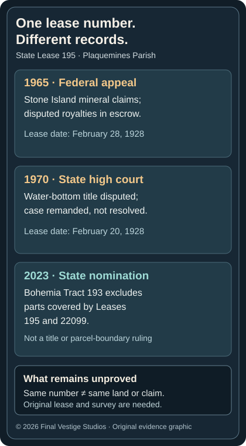
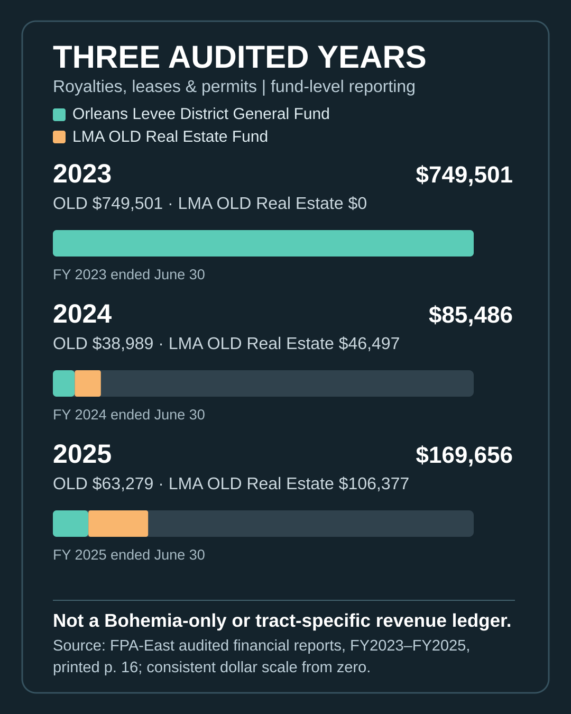
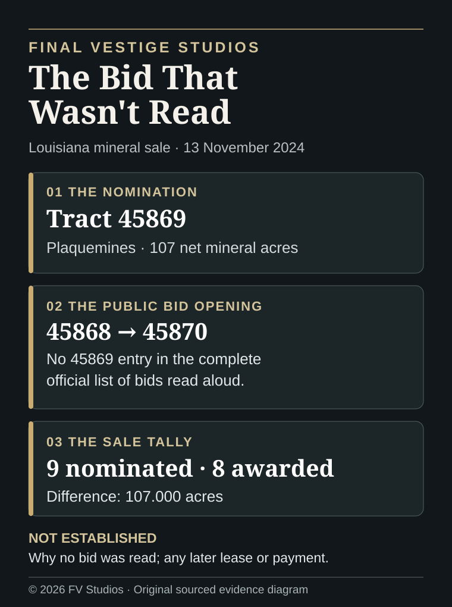

# The Spillway That Kept Its Names
*Final Vestige Investigations · focused reader candidate v50v · updated 18 November 2026 · INTERNAL EDITORIAL/LEGAL REVIEW — NOT APPROVED FOR PUBLICATION*

**Deck:** Louisiana returned land taken for a flood-control project. The owners then had to fight for the mineral income it had produced. Decades of deeds, judgments, settlements and official account transfers reveal why a legal entitlement is not the same thing as a cleared payment.

**Editorial scope:** This is a new, shorter treatment of the existing Bohemia investigation, **not** a new investigation or replacement for the canonical [v49 research manuscript](./bohemia-spillway-reader-cut-v49-2026-11-16.md). It draws on the verified source trail below. Avoid importing additional figures without checking their underlying document. Do not publish or overwrite WordPress draft #2488 without the release gates at the end.

## The deed and the money

On August 9, 2005, the Orleans Levee District conveyed a parcel of the Bohemia Spillway, known in the records as Tract 78, to successors of the Eusan family. The conveyance was recorded sixteen days later. It returned land that the family had transferred to the district in 1925. Eight decades separated the two instruments. [1]

That should have been the end of a long dispute. Instead, it exposed a second one. Who was entitled to the income earned from the tract while the government held it?

On September 26, 2012, Louisiana's Fourth Circuit Court of Appeal affirmed an award of **$996,596.40 in past revenues** and **$366,957.12 in statutory interest** to the Eusan claimants. It reversed a further **$365,777.34** award framed as interest on civil fruits. Those are judicially examined figures, not estimates extracted from an annual report. But even an appellate opinion cannot tell us whether a particular bank transfer subsequently cleared. The ruling records an entitlement and adjudicated amounts. The final distribution trail is a separate kind of evidence. [1]

The surrounding landscape offers a tempting visual metaphor. In February 2012, the Mississippi River opened a channel on its eastern bank in the Bohemia Spillway. NASA's account describes an initial breach about **32 feet wide and five feet deep**. A September 2007 aerial image records the canal before the breakthrough; Landsat imagery from February 2023 shows the watercourse later known as Mardi Gras Pass. The river changed course while a family pursued the value of land returned years before. But the images cannot establish the boundaries of Tract 78, the mineral title beneath it or the destination of royalty payments. [2]

*September 20, 2007. USDA Farm Service Agency National Agriculture Imagery Program aerial imagery, presented by NASA Earth Observatory; image treatment credited by NASA to Joshua Stevens. Documentary aerial image, not a reconstruction. Source and reuse terms: [NASA Earth Observatory](https://science.nasa.gov/earth/earth-observatory/mardi-gras-pass-150986/), [NASA media guidelines](https://www.nasa.gov/nasa-brand-center/images-and-media/) and [USDA NAIP catalogue](https://naip-usdaonline.hub.arcgis.com/). Public delivery of the existing WordPress asset remains a release check.*

*February 13, 2023. NASA Earth Observatory image by Joshua Stevens using USGS Landsat 8 data. Documentary satellite image, not a reconstruction. [Original NASA source](https://science.nasa.gov/earth/earth-observatory/mardi-gras-pass-150986/); [NASA reuse terms](https://www.nasa.gov/nasa-brand-center/images-and-media/). Do not describe this as a survey of a claimant's tract.*

## A flood-control project acquired in three ways

The Bohemia Spillway began as an answer to the Mississippi's high water. Louisiana's Supreme Court traced its creation to the 1920s, when the Orleans Levee District acquired land south of New Orleans and removed levees so floodwater could escape toward the Gulf. The court described a roughly **33,000-acre** project. It assigned approximately **3 percent** of that area to formal expropriation, **48 percent** to purchases in lieu of expropriation and **49 percent** to public transfers. Those rounded categories matter: a public land transfer was not a privately owned tract taken from a family. [3]

The same 1986 ruling supplied numbers that explain why the argument continued. It reported **$389,500** in total compensation for the private acquisitions. Against that, the court recorded **$1,734,480** in mineral receipts from 1929 through 1948 and **$42,921,729** from 1950 through 1981. These were gross historical receipts as the court described them, not net earnings, a present-day valuation or a sum payable to every descendant. They demonstrate the change in the property's financial significance. They do not allocate revenue to individual tracts. [3]

In 1984, Louisiana declared that the original public purpose no longer justified the government's continued ownership of eligible privately acquired lands and ordered their return to former owners or successors. The Louisiana Supreme Court upheld that mechanism in October 1986. But determining that a category of land should be returned was only the first step. Each claimant still needed to establish eligibility and title; mineral proceeds called for their own accounting. [3][4]

The distinction was litigated. In a 1999 appellate decision, judges explained that the Department of Natural Resources' power to certify land-return claimants did not give it authority to order the separate turnover and escrow of earlier royalty revenue. Act 1364 of 1997 had subsequently supplied procedures for such payments and escrow. Establishing a legal process, however, never meant every required account had been funded or every individual had been paid. [4]

## When a settlement became a payment schedule

The largest claimant case, *Haspel & Davis*, shows how far apart those steps can be. A Fifth Circuit opinion from July 23, 2007, recounts a state-court settlement under which landowners would receive an immediate **$2,318,263.72** and another **$18,767,145.26** only “as and if funds are appropriated thereof.” The agreement contemplated at least **$2.6 million per year**, and the court recorded that several payments had been made but were smaller than that annual amount. [5]

The words about appropriation were consequential. The federal appeals court concluded that the participants' earlier takings claims had been compromised into rights enforceable under the settlement agreement and consent judgment. It reversed a federal takings judgment in their favor. That ruling was not a determination that the entire settlement had been paid. It identified the legal route available for enforcement. [5]

Agency records provide a partial payment trail. A February 18, 2010 flood-authority resolution lists five transfers associated with the class settlement between December 2000 and January 2005, totaling **$5,545,818.89**, and authorizes a further **$100,000** appropriation. The latter is an authorization, not proof of a completed sixth disbursement. Nor does a board's accounting recital reveal every deduction, intermediary account, distribution to counsel or final claimant receipt. Those documents must be examined rather than presumed. [6]

Here lies a recurring trap in the Bohemia record. “Awarded,” “appropriated,” “escrowed,” “paid into court” and “received by an heir” sound like stages of one transaction. They are not interchangeable facts. An amount in a court opinion is not a cleared bank credit. An authorized appropriation may remain unspent. A payment into a court registry can still await distribution. Without the final step, a precise public figure can create an imprecise public impression.

## The escrow the board voted to close

The flood authority returned to the subject on **March 19, 2015**. Its board adopted **Resolution 03-19-15-12**, directing closure of an escrow account maintained for Bohemia litigation claims and authorizing the remaining balance's transfer into an Orleans Levee District general-fund investment or operating account. Eight commissioners voted in favor; none voted against. [7]

The resolution recited the authority's understanding that the claims associated with the account had been settled. It referred back to **Act 1364 of 1997** and an **Orleans Levee District resolution dated July 15, 1998**, under which escrow and a corresponding fund-balance reserve were to be established. The record matters because it establishes an actual board action, not merely a director's later memory of one. [7]

What it does **not** supply is the closing balance, a cancelled check, the transfer's bank posting, a claimant-level distribution schedule or a list of whose claims the board considered satisfied. Its recital is the board's assertion about the matter's disposition. It cannot stand in for independent reconciliation of every court judgment or every person entitled to proceeds.

The same meeting adopted a separate resolution authorizing nominations for mineral leases on land in which the district said it **may hold** mineral interests. The mineral-lease resolution passed **7–1**. It is possible to read these two actions together as evidence that officials were closing one administrative chapter while preparing future mineral leasing. It is not permissible to leap from that proximity to an accusation that a specific claimant's property or payment was diverted. [7]

## Three measures, not one royalty

In July 2023, while the flood authority and Lakefront Management Authority were negotiating the future route of Bohemia income, a separate state mineral advertisement offered a lesson in how much can hide inside the word *land*. **State Agency Tract 45659** concerned **Bohemia Spillway Tract 193**, not the Eusan family's Tract 78. The application described a parcel of approximately **73.148 acres** along the Mississippi in Plaquemines Parish, citing a 1924 survey and a **July 6, 1992** recorded conveyance. But the new lease nomination expressly excluded the southern **5,405 feet** of the tract, as well as portions covered by **State Leases 195 and 22099**. After those exclusions, the notice gave the remaining area as just **7.91 acres**. Those are the nominator's descriptions, not a new determination of legal title. [22]

In the same document, another number appeared: the **Orleans Levee District retained 18.098 percent of the mineral rights only**. Border Exploration, L.L.C. was named as applicant for the agency nomination. The 73.148 acres described the larger parcel; 7.91 acres described the remaining area offered for lease; 18.098 percent described an asserted *interest*, not an acreage measurement or a royalty rate. Multiplying these figures together cannot tell a reader how much cash an agency or heir was owed. An actual account would need the operative leases, ownership and division orders, production dates, and receipts. The official notice warns that the property description came from the nominating party and that competing claims or prior leases could affect it. [22]

### The lease number that predates the present dispute

One of the exclusions in the 2023 nomination has a documented life far outside this application. **State Lease 195** appears in a **1965 federal appellate opinion** about disputed mineral royalties around **Stone Island and the West Black Bay Field**, also in Plaquemines Parish. The Fifth Circuit described a state-issued lease from 1928 overlapping the property claimed by private lessors. Oil revenues had been placed in escrow during a title dispute; the court affirmed refusal to distribute that money before the claimants established entitlement under the escrow order. That is a documented example of how royalties can exist, be held and still be legally contested. It is **not** evidence that money owed on Bohemia Tract 193, or to Eusan successors on Tract 78, was deposited into that escrow. [24]

In **March 1970**, Louisiana's Supreme Court considered another title suit involving State Lease 195 and the succession of Noah Cutrer. The court rejected a summary judgment against the private claimants and sent the matter back for further proceedings because factual disputes, including land-versus-water-bottom status and the chain of title, remained. A **different Gulf Oil title case** decided on rehearing in **July 1975** concerned Plaquemines Parish water bottoms and royalties: the Louisiana Supreme Court affirmed the state's title on the record presented. Neither decision settles title to the acreage newly offered in the **2023 Bohemia Tract 193** nomination. The cases show why the boundary and chain of title of an older lease matter, rather than providing a short answer to a new landowner's claim. [25][26]

Even the old lease's precise date demands care. The Fifth Circuit's 1965 opinion called it **February 28, 1928**; Louisiana's 1970 opinion called it **February 20, 1928**. We have not obtained the **original State Lease 195 instrument or amendments** to adjudicate that eight-day discrepancy. The 2023 mineral notice proves only that its nominator **excluded acreage it described as already covered by Leases 195 and 22099**. It does not connect the particular Stone Island litigation parcels to Tract 193, identify how much of the 7.91 acres abuts either lease, or establish the beneficiaries of later royalties. To test the geographic connection, the necessary records are the actual lease plats, amendments, production-unit boundaries, assignment history and title exhibits, not a repeated lease number. [22][24][25]

**There is another distinction buried in the numbering.** Louisiana's own mineral-leasing manual says that a state-agency *tract* advertised for bids does not receive a sequential state *lease* number merely by appearing in the sale notice. A state-agency lease number and file follow an award. That means **45659** and **45869** are the identifiers of the advertised tracts in the records examined here, not proof that an executed State Lease 45659 or State Lease 45869 ever existed. Nor does the presence of pre-existing **State Leases 195 and 22099** in the Tract 193 exceptions establish their current ownership, geographic extent or revenue flows. Those propositions require the original instruments and subsequent releases or amendments. [19][22][27]

The file search must also reach more than one custodian. Louisiana's published procedures distinguish **official state mineral-lease files**, maintained by the mineral office, from **official state-agency mineral-lease files**, retained by the relevant public agency. For agency leases awarded through the board, the mineral office describes its own file as generally holding a copy of the lease and its transmittal letter; the board's minute book is yet another record. Those rules supply a concrete retrieval plan: compare the state-side lease and bid records with the Orleans Levee District or successor custodian's original lease file, plats, amendments, unitization records and disbursement accounts, then test each instrument against the tract boundaries. The official guidance does **not** identify the present custodian or complete history of either 1928 Lease 195 or Lease 22099. [27]

*“One Lease Number. Different Records.” Mobile-first original documentary-context diagram, © 2026 Final Vestige Studios, November 18, 2026. Based on the [1965 Fifth Circuit ruling](https://law.justia.com/cases/federal/appellate-courts/F2/346/43/445482/) [24], the [1970 Louisiana Supreme Court ruling](https://law.justia.com/cases/louisiana/supreme-court/1970/255-la-857-0.html) [25], and the [July 2023 state mineral notice](https://www.denr.louisiana.gov/assets/OMR/NOP_tracts/2023/45656-45659.pdf) [22]. Not a cadastral survey, archival photo, lease document, title adjudication or reconstruction. Illustrated dates are from published opinions and conflict by eight days; original lease unverified. New portrait graphic independently raster-inspected at 390px; authenticated WordPress-theme QA remains required. [Mobile original](./assets/bohemia-state-lease-195-mobile-v50j.svg) · [Landscape original](./assets/bohemia-state-lease-195-across-records-v50i.svg).*

The sale's outcome is no longer confined to the nomination's blank bidder table. The **Louisiana State Mineral and Energy Board's signed July 12, 2023 regular-meeting minutes** report that **six tracts were offered** and **single bids arrived for five**. At the meeting the board unanimously accepted staff's recommendation and recorded awards for **Tracts 45654, 45655, 45656, 45657 and 45658**. It did **not** list a winning bidder or an award for the remaining tract, **45659**, the Bohemia Tract 193 nomination. The actual award entries appear on printed pages 10–11; the preceding page records the six-to-five result. The record makes a narrow, consequential point: **no award for Tract 45659 was recorded at the July 12, 2023 sale**. [23]

A missing award is not necessarily a failed project. The same minutes say that the five awards depended on verification of tract descriptions, earlier overlapping leases and actual bid acreage. They do not supply a separate sealed-bid opening transcript for Tract 45659, an explanation for the absence of an award, or subsequent lease files. The state might later have advertised the acreage again; we have not established whether it did. Nor do the five other awards give a reader grounds to calculate a loss on Bohemia Tract 193 or an amount owed to any Eusan claimant. To go further requires the tract-specific bid register and any later executed lease and royalty accounting. [22][23]

This **July 12, 2023** offering is also separate from **Tract 45869**, the roughly 107-net-mineral-acre Schroeder nomination advertised for November **2024**. The 2023 board's award omission and the 2024 board's missing bid opening are **two distinct proceedings**, neither a ledger of private claims. The distinction makes the investigative problem more precise: the public shorthand *Bohemia royalties* can encompass different tracts, fractional interests, prior leases and different recipients. None can be substituted for the Eusan judgment without identifying the actual mineral property and money trail. [19][21][22][23]

## A different bargain, eight years later

On **November 16, 2023**, the Southeast Louisiana Flood Protection Authority–East approved a revised interagency memorandum. Its public minutes describe a negotiation with the Lakefront Management Authority: LMA would not seek Bohemia revenues the flood authority had received before 2024, and the flood authority would forgive an interagency balance owed by LMA. A January 1, 2024 date governed the planned change in revenue routing. [8]

It was an exchange between public agencies, not a private landowner's settlement. That is not a semantic distinction. The rights LMA negotiated as manager of non-flood-protection assets cannot be treated as a release of the Eusan judgment or a waiver by every former owner.

The counterpart Lakefront Management Authority board also approved the agreement that November 16. Its official resolution records **13 votes in favor and none opposed**, authorizing its chair or director to sign. Both authorities' votes are now verified. What has not been obtained is a copy of the agreement bearing the executed signatures and its final accounting schedules. [9]

A question from one commissioner made the November bargain unusually explicit. Why, Herbert Miller asked, was the interfund balance LMA owed the flood authority being forgiven? Vice President Roy Arrigo said Bohemia revenue should have been classified with non-flood assets years earlier, although the flood authority had retained it. Rather than seek the earlier receipts, LMA would begin receiving that revenue effective **January 1, 2024**; the flood authority would forgive the interagency balance. The minutes record that **regional director Kelli Chandler put Bohemia's annual revenue between $150,000 and $700,000 over the preceding five years**, and **Louis Capo said the flood authority had received $9 million since 2007**. Those are figures attributed to officials at the November 16 meeting, **not independently reconciled audited accounts**. Neither is a balance of cash still on hand, an amount proved payable to former owners or a calculation of LMA's net loss. [8]

The same exchange contains a vital complication. Executive counsel **Kirk Ordoyne** told commissioners that from **2007 through 2015** the flood authority had paid outstanding litigation related to Bohemia, and that the settlement escrow had closed in **2015**. His recollection accords with the separate **March 19, 2015 board resolution** directing that the account be closed, but the two agency records still do not disclose the account's actual closing balance or each claimant's cleared receipt. Nor do the records identify which portion of Capo's reported $9 million, if any, remained after litigation expenses and other uses. The historical revenue figure, the interagency debt adjustment and the heirs' adjudicated payments are three distinct quantities. [7][8]

Even the numbers resist an easy summary. In June 2023, LMA director Louis Capo discussed approximately **$800,000** in outstanding interagency obligations. At the November LMA meeting, he described **$700,000** to be forgiven. The **$100,000 difference** is unresolved. A repayment, an adjustment, a revised negotiation or an accounting classification could explain it. The minutes do not establish which. [9][10]

A month after both boards voted, Capo offered a year-end account of what LMA believed it had secured. At the **December 14, 2023** board meeting, he described a renegotiated memorandum that released a balance he traced to **2006–2007**, anticipated that LMA would receive Bohemia oil-and-gas lease revenue **for the first time**, and reported that Lakeshore Drive grass-cutting responsibility had shifted to the flood authority. His remarks put the mineral-revenue routing inside a wider administrative rearrangement. They are an official's contemporary description, **not** the signed agreement, a debt-origin audit or a verified account of cash received. [18]

That wider bargain complicates any easy valuation. Forgiving an old interagency obligation, redirecting future mineral receipts and reassigning maintenance work affect different ledgers and potentially different fiscal years. The December minutes do not establish whether the grass-cutting change was a clause of the signed memorandum or an associated operational decision. Nor can an estimated maintenance saving be counted as a mineral royalty, or used to diminish a private claimant's court award. The executed instrument and both agencies' general-ledger entries are needed to make those distinctions definitive. [18]

### Three audited years, one incomplete account

The Flood Protection Authority–East's audits offer a test of the public agencies' 2023 revenue bargain, but they do not supply a royalty register. In the governmental-fund statements for the year ended **June 30, 2023**, the line **“Royalties, leases, and permits”** contains **$749,501**, all attributed to the Orleans Levee District (OLD) General Fund. In fiscal **2024**, it falls to **$85,486**: **$38,989** in the OLD General Fund and **$46,497** in the Lakefront Management Authority's OLD Real Estate Fund. That fiscal year spans the agencies' discussed **January 1, 2024** change in where Bohemia income would be received. [28][29]

An archived copy of the authority's **approved fiscal 2025 budget**, posted on **April 1, 2024** with a **March 21** board-meeting filename, goes further than the February committee minutes. Its Orleans Levee District account detail identifies the **fiscal 2023 actual** as **$743,717 in “Bohemia Royalties” (account 3300)** plus **$5,784 in “Bohemia Other Income” (account 3305)**. The sum is **$749,501**, exactly the figure reported under the broader royalties, leases and permits heading in the fiscal 2023 audited governmental-fund statement. That is a meaningful account-level bridge: the budget classifies the older total by named Bohemia accounts. It is not a transaction ledger, royalty-division order, bank statement or proof of payment to any private claimant. [32][28]

The same approved budget lists **$950,000** for Bohemia royalties and **$13,900** for other Bohemia income in its **fiscal 2024 *budget***, then **zero budgeted** for each in **fiscal 2025**. The combined $963,900 change, displayed in the budget summary as a **100-percent reduction**, is a change between **two plans**. It is **not** a measured $963,900 drop in money received. The later FY2024 and FY2025 audits report actual fund-category totals of **$85,486** and **$169,656**, respectively, using broader reporting headings. Comparing plans, actuals and different agency funds as though they were one uninterrupted cash account would create a false reconciliation. [32][29][30]

In the Orleans Levee District departmental schedule, those named accounts appear with more useful identifiers: **1001003300** and **1001003305**. They give the next records request something more exact than “all Bohemia money”: request transaction-level postings, payer/source descriptions, dates, reversals and related bank deposits for both codes, then reconcile them to the audited fund totals and the separate LMA receipts. The published March budget does not independently establish the contents of the **91-page draft** circulated at the **February 22** committee meeting, although its numbers confirm the later adopted zero-budget treatment. [32][31]

The next two published budgets supply the missing **actual** side of that comparison. In the authority's **fiscal 2026 budget**, the *fiscal 2024 actual* column records **$37,093** under Bohemia Royalties and **$1,896** under Bohemia Other Income. Together, **$38,989** exactly matches the OLD General Fund's portion of the **2024 audited** category. There is a small but real documentary wrinkle: the budget's separate broad summary prints **$38,988** for the FY2024 actual “Mineral Revenue” heading, one dollar less than both its detailed account lines and the audit. The reason for that $1 discrepancy is not established by the published schedules. The detailed figures, not the summary, are the ones that reconcile to the audit. They do not explain the separate **$46,497** reported in LMA OLD Real Estate for FY2024. [33][29]

A later budget provides the same bridge for **fiscal 2025 actual** revenue. In the authority's **March 2026 fiscal 2027 budget**, OLD's named **Bohemia Royalties** account reports **$63,279** in FY2025 *actual revenue*; Bohemia Other Income shows no amount. The sum again matches the audited OLD General Fund's **$63,279**. The contrast is more revealing than the original zero forecast: in **March 2024**, officials had budgeted **zero** Bohemia royalties for FY2025, yet the later budget reports **$63,279 of actual revenue recorded** under a Bohemia-named OLD account in that year. This does **not** establish misrouting, concealment or a broken agreement. Production-to-payment lags, ownership and lease assignments, accounting entries and the signed interagency memorandum could each matter; none has been reconciled to the individual receipts. Nor can the separate **$106,377** audited LMA fund-category total yet be called entirely Bohemia income without its own account detail. [34][32][30]

Across the three years, the named OLD account amounts and the corresponding audited OLD category totals agree: **$749,501 in FY2023**, **$38,989 in FY2024**, and **$63,279 in FY2025**. This is a defensible *account-category crosswalk*, not a complete cash trail. The remaining unanswered question is no longer whether the budgets even name Bohemia, but which leases, production dates and payers produced those posted amounts and how they were eventually allocated. [28][29][30][32][33][34]

The routing decision also left a more direct trace than the later aggregates. On **February 22, 2024**, the flood authority's Finance Committee reviewed its *draft* fiscal 2025 operating budget. Its minutes record that **no Bohemia royalties were budgeted by the flood authority because the royalties were then being sent to the Lakefront Management Authority**. That is a contemporaneous explanation of how staff prepared a forecast after the announced January handover. It supports the existence of an administrative routing change; it does **not** establish the amount actually remitted, the date any individual payment cleared, or the full terms of the still-unrecovered signed agreement. [31]

The February draft-budget discussion is consistent with the later approved zero-budget treatment, but a zero in FPA-East's forecast does not mean zero receipts in the region. LMA's **fiscal 2025–2026** budget separately forecast **$100,000** in Bohemia receipts under line 444010, while the flood authority's consolidated **fiscal 2025** audited fund-category total was **$169,656**. The two figures concern different accounting periods and measurement bases. Their difference is not a shortfall, diversion or claimant balance. [14][30][31][32]

A third audited year complicates the simplest account of what happened next. For the year ended **June 30, 2025**, the same consolidated reporting line totals **$169,656**, comprising **$63,279** for the OLD General Fund and **$106,377** for LMA OLD Real Estate. That is **$84,170 above** fiscal 2024, though still **$579,845 below** fiscal 2023. The 2025 report's separate budget-to-actual schedule uses the shorter heading **“Mineral revenue”** for the same **$169,656**. Those two labels appear in the same annual report; neither reveals which mineral leases, permits, parcels or production periods generated the transactions. [30]

A second audit is now available to test the **LMA** part of that total. In its own report for the year ended **June 30, 2025**, the Lakefront Management Authority lists **$106,377** under “Royalties, leases, and permits” in its OLD Real Estate Fund. This is the **same $106,377**, in the **same fund and fiscal year**, that appears in the Flood Protection Authority–East's combined 2025 statement. LMA identifies itself as a component unit of the flood authority. The separately published reports therefore give two documentary views of a reported account, **not two independent payments to be added together**. Counting both would inflate the reported revenue, while the correct consolidated total remains **$169,656**: **$63,279 OLD General Fund plus $106,377 LMA OLD Real Estate**. The matching public reports strengthen the *fund-level classification* but cannot determine how much of the LMA line came from Bohemia, which leases produced it or whether it cleared a bank. [35][30]

### The audit the receiving agency said it wanted

A year after the public agencies changed the route of Bohemia receipts, the Lakefront Management Authority itself raised a question about whether the amounts matched expectations. In its **March 26, 2025 Finance Committee minutes**, while considering the **2025–2026 operating budget**, executive director **Louis Capo** was recorded as saying that Bohemia payments had **“not panned out as expected.”** The minutes say he wanted to audit the accounts to determine whether payments were being made properly; they also attribute to him the statement that the relevant leases **had not been audited since 2007**. That last date is *the director's reported characterization*, not an independently checked audit history. No operator underpayment, withheld public money, unperformed contractual duty or completed investigation can be inferred from the remarks alone. [36]

The following evening, **March 27, 2025**, LMA's full board approved the 2025–2026 operating and capital budgets. In his director's report, Capo said he would work with **“SELFPA”** to **verify Bohemia payments**, as the minutes print the other agency's abbreviation. The board record does not include an audit report, bank reconciliation, a finding against any operator, or a vote to recover a stated amount. The significance is narrower but real: the receiving authority was publicly describing its own need to check the royalty-payment trail, not merely presenting aggregate fund totals. The necessary follow-up is an actual lease-audit scope, royalty check detail, division-of-interest schedules, any correspondence between LMA and Flood Protection Authority–East, adjustment notices and a documented outcome. [37]

The next public reference to an audit requires a closer distinction. At the **August 21, 2025** Flood Protection Authority–East board meeting, Capo gave an LMA financial and management update. When a commissioner asked for a quarterly financial report, the minutes record him saying the agency was **under an audit**; the finance chairman also noted an audit in progress. But the minutes **do not identify a Bohemia mineral-lease audit**, a royalty-account engagement, any operator finding or the results of the verification Capo had proposed in March. In this record, the audit discussion arises alongside ordinary financial reporting and investments. Treating it as proof that the promised lease review was completed would erase a necessary distinction. [38]

### An October update whose scope remains unnamed

At LMA's **October 23, 2025** full-board meeting, Capo reported that an audit should be in its final stages and ready to report in **November or December**. The original minutes do not say that this was an audit of Bohemia mineral leases. They supply no lease list, operator statements, remittance tests, audit contractor or finding. The forecast of a report was not itself a report. The later remark confirms that *an audit* remained part of management's public discussion, but it does not close the question raised in March. [39]

There is a useful date check. LMA's published independent financial-statement audit for the year ended June 30, 2025 bears an **October 16, 2025** report date, seven days before that board meeting. Its expressed opinion addresses the authority's financial statements, not the completeness of individual Bohemia royalty payments. The board's later forecast and the dated financial report cannot safely be identified as the same engagement or as different engagements from these documents alone. In particular, neither proves that the proposed *mineral-lease payment verification* was commissioned, completed or found nothing wrong. Only a defined engagement, royalty-detail workpapers or final lease-review report could answer that. [35][39]

### The lease records were being reorganized in 2026

The later public minutes reveal something practical about the search for the missing payment trail, though not about the merits of any royalty claim. At its **March 19, 2026 Finance Committee meeting**, LMA staff described a proposed accounts-receivable system, **ReLease**, that could hold leasehold documents and track appraisal adjustments and expiring paperwork. Capo said he intended to move forward with the system before annual audit season. That was a discussion of administrative tools, **not** a Bohemia royalty examination, an audited deposit schedule or proof that historic records had already been migrated. [40]

At the **June 25, 2026 Finance Committee meeting**, Capo reported a setback to the Re-Lease rollout after the departure of the employee handling lease-related accounts receivable. He also said the auditors had not yet contacted the agency to schedule its fiscal-year audit. The record concerns agency accounting operations and preparation for a routine audit, **not** evidence that Bohemia payments were deficient or that the distinct March 2025 lease verification had been completed. For anyone trying to reconcile a named royalty account to a particular lease, the implication is procedural: request original statements, deposit and general-ledger extracts **regardless of software platform**, along with any later migration or audit-engagement records. [41]

The August minutes also record Capo's explanation that assets administered by LMA and the flood authority were owned by the **Orleans Levee District**. That distinction between owner and manager helps explain why an LMA-managed revenue category might be reported under an **OLD Real Estate** fund. It does not adjudicate the mineral title of any Bohemia tract or identify whose account received a particular payment. [38]

These two minutes put the later financial tables in their proper place. **$106,377** in an audited governmental-fund revenue line is evidence of what the agency reported for fiscal 2025; a director's concern about Bohemia lease payments is evidence that further verification was contemplated. Neither supplies the missing lease-by-lease reconciliation or proof that any claimant was unpaid. They must not be combined into an accusation, and an announced intention to audit must not be reported as an audit completed. [35][36][37]

The LMA report exposes another gap between planning and accounting: its **fiscal 2025 budget-to-actual schedule**, printed page 53, shows **zero budgeted** for the broad “Royalties, leases, and permits” heading and **$106,377 recorded as actual**. That is a budget variance, not evidence of a missing or illicit receipt. The auditors expressly distinguish the audited basic financial statements from this *required supplementary* budget schedule: they applied limited procedures to the latter and **did not express an opinion or assurance on it**. A precise account of the 2024 handover must keep that distinction visible rather than using the word “audited” to imply transaction-level verification of every figure on every supplementary page. [35]

The crosswalk establishes that each year's **OLD General Fund** total can be matched to named Bohemia accounts in a later budget's actual column. What this means for the separate **LMA** fund receipts, and for any particular mineral lease or private claimant, remains unproved. The **2023 account-code crosswalk** ties that year's OLD total to two Bohemia-labeled accounts, but it does not identify the individual leases or cash postings. The **2024–2025 audited categories** still combine revenue types and funds; none is a claimant-specific record for Eusan Tract 78. [32] The fall between 2023 and 2024 cannot be attributed confidently to the interagency memorandum, and the partial rebound in 2025 does not prove the transfer of any specified lease revenue. Nor can these annual totals verify the separate **$9 million since-2007** figure stated during the 2023 negotiation, or show that a claimant received payment. To close that evidentiary gap would require an executed memorandum and a transaction-level crosswalk from lease, tract, payer and production period through posting and cash receipt, then separately to any settlement disbursement. [8][28][29][30]

*Three audited years, one broad account category. Final Vestige Studios original data visualization, November 18, 2026, © 2026 Final Vestige Studios. Same zero-baseline scale, split by OLD General Fund and LMA OLD Real Estate Fund using independently audited governmental-fund statements for [FY2023, printed p. 16](https://app.lla.state.la.us/PublicReports.nsf/0/7C1A721A298CB70786258A6D00711AD7/$FILE/00003310.pdf), [FY2024, printed p. 16](https://app.lla.state.la.us/PublicReports.nsf/0/AB3139C8E769CB7086258BB700789609/$FILE/0000619F.pdf), and [FY2025, printed p. 16](https://app.lla.state.la.us/PublicReports.nsf/0/7A7589E9550859E586258D380070A30B/$FILE/0000906da.pdf). 2025 budgetary-basis presentation on printed p. 59 uses “Mineral revenue.” This figure is not a mineral-only tract ledger, evidence of the revenue-change mechanism or a record of private claimant payments. SVG source metadata identifies creator, date, underlying reports, rights and accessibility description. Exact-Git-blob SVG rasterized at 390px and 900px and visually inspected for label clipping and contrast; authenticated WordPress-theme visual QA remains outstanding.*

The November record contains another qualification: Capo discussed **up to $150,000** related to production from July through December 2023, while the flood authority's account spoke of revenues it had **already received** before January 2024. LMA counsel described a **six-to-eight-month delay** between production and royalty receipt. The two descriptions may address different dates in the same revenue cycle. Neither proves that $150,000 was deposited, nor defines a final contractual cutoff without the executed document. [8][9]

*The November 2023 public-agency bargain, diagrammed by Final Vestige Studios on November 17, 2026, from official flood-authority and LMA board minutes [8][9]. © Final Vestige Studios; original explanatory vector, not a contemporaneous document or AI reconstruction. The simplified revenue cutoff does not supersede the board's production-date qualification. Requires an accessible source/credit caption and actual WordPress responsive-theme inspection before release.*

## The vote that did not issue a lease

The next step was not a mineral lease. It was a vote about who would handle one.

On **July 25, 2024**, the Lakefront Management Authority adopted a resolution directing the Louisiana State Mineral and Energy Board to lease Orleans Levee District land in the Bohemia Spillway. Nine commissioners voted for it, none against. The resolution cited the previous November's agreement as the basis for LMA's management responsibility, and called on the state board to advertise, bid, negotiate and administer mineral leases on the district's behalf. That is a documented exercise of public authority. It does not show a lease was awarded or a royalty was earned. [15][16]

The distinction matters because a resolution can set the machinery in motion without recording where it went. The state board has its own leasing process. Its published explanation distinguishes the agency's request from the board's subsequent review, leasing and administration. The state advertisement and nomination have now been located as **Tract 45869**; the remaining trail now includes the tract-specific November 2024 bid-opening minutes; any subsequent reoffering or executed lease, and any corresponding receipts, remain to be established. Each is a separate record with its own date and evidentiary weight. [19][20] [15][16]

The **approximately 107-net-mineral-acre** application was a different item, and a newly examined record gives it a more exact place in the sequence. Before the full board met, LMA's Commercial Real Estate Committee considered Robert A. Schroeder's proposed lease of named Bohemia tracts. Commissioner Carlos Williams moved to recommend approval, Commissioner Aadonis Exposé seconded, and the committee's minutes record that everyone voting favored the recommendation. It was an affirmative **committee recommendation**, not an issued lease. The minutes were subsequently marked approved on September 19, 2024. [17]

At that committee meeting, LMA counsel Jeff Dye identified the applicant's business as **K Exploration** and described what would follow *if* the application were accepted: referral to the state Mineral Board, advertising, competitive bids and negotiation of a lease. Dye discussed a contemplated three-year exploration period and three prospective payment types: acreage rent, a bonus, and royalties conditional on mineral production. Those were explanations of a proposed process and possible terms. The minutes neither name a winning bidder nor document a signed lease, production or receipt of those payments. The state's subsequent November 2024 notice identifies the formal nominated applicant as **Robert A. Schroeder, Inc.**, which must not automatically be equated with K Exploration. [17][19]

The full LMA board minutes for **the same July 25** record a separate **9–0 vote** to delegate leasing authority to the state board. They also list Schroeder's application as item six, expressly noting the committee's recommendation, but pass directly to the next agenda section without recording a motion result or board vote on **that application**. Thus the older conclusion that no action was recorded needs a precise correction: **the committee did recommend approval; the full-board disposition remains undocumented in the minutes reviewed**. Neither that recommendation nor the delegation vote, **on its own**, proves a state lease was advertised, awarded, executed or paid. A later state notice now establishes advertisement; award and payment require separate proof. The nominated tracts are numbered 147–164, **not** the Eusan family's Tract 78, and no ownership connection to Tract 78 is established. [15][17][19]

Even the document's date labels need care. Its opening text identifies the meeting as **July 25, 2024**, consistent with the contemporaneous posted agenda; the PDF's top heading says **June 25, 2024**, while the mineral-delegation resolution itself bears a **2025-style identifier** alongside a July 25, 2024 adoption date. These inconsistencies look like clerical or template errors, but their origin has not been established. The safest identification is the meeting date corroborated by the agenda and proceedings, with the discrepant identifiers noted rather than silently corrected. [15]

### Tract 45869: the state sale that left 107 acres unawarded

The route from the July committee room to the state's mineral-leasing docket can now be traced. Louisiana's published notice for the **November 13, 2024** mineral lease sale names **State Agency Tract 45869**, in **Plaquemines Parish**, with **Robert A. Schroeder, Inc.** as the nominated applicant. The tract description covers portions of **Tracts 147–164**, between Bohemia Plantation and Fort St. Philip, and estimates **107 net mineral acres to the Orleans Levee District**. The nominal acreage is a measure of the lessor's claimed mineral interest for certain lease calculations, not a certified 107-acre surface survey or proof of unencumbered title. The document itself warns that the description came from the nominating party. The attached official map depicts the area offered for lease, not a verified survey of any heir's mineral interest. [19]

The state did more than discuss the proposal: it advertised it. Yet the **November 13 sale totals** add a second, unexpectedly precise distinction. The state reports **nine agency tracts nominated, totaling 481.553 acres**, but **eight awarded, totaling 374.553 acres**. The single-tract shortfall is **107.000 acres**, matching the nominated Bohemia tract exactly. The department's **November 14** announcement lists the parishes of all thirteen leases sold and does **not** include Plaquemines. Read together, these official records strongly indicate that **Tract 45869 did not receive an award at that November sale**. This is an evidence-based reconciliation, not a tract-specific rejection notice. The totals caution that later options or acreage revisions can change the reported figures. [19][20]

The missing control was hiding in a separate set of minutes. Louisiana's State Mineral and Energy Board recorded its **November 13, 2024 public opening of sealed bids**, which began at **8:30 a.m.** The opening official certified the advertisement of tracts **45858 through 45872**, stated that **no advertised tracts had been withdrawn**, and read the bids received. Six pages enumerate bidders and terms for named tracts, including **45868**, **45870**, **45871** and **45872**. **Tract 45869 never appears.** The signed section ends by recording that the reading of bids was concluded. That is direct tract-specific evidence: **no bid for 45869 was recorded among those opened and read at the November 13 public sale**. It strengthens the earlier acreage reconciliation, without supplying a reason for the absence or establishing who, if anyone, tried to bid by another route. [21]

The blank *bidder* table on the original nomination was merely a pre-sale form, not proof of nonparticipation. The **post-sale bid-opening minutes**, by contrast, are a contemporary record of the public proceeding. Together with the award totals and the next day's list of parishes, they support the narrower finding that this advertised Bohemia tract **was not among the bids opened and read or the leases awarded at that sale**. They do **not** establish whether it was later reoffered, leased, developed, or whether other existing Bohemia leases ceased paying royalties. Nor can this 107-acre nomination be conflated with the Eusan family's Tract 78. Later leasing and remittance records remain outstanding. [19][20][21]

*“The Bid That Wasn't Read.” Original Final Vestige Studios evidence graphic, November 17, 2026, © Final Vestige Studios. Derived from the official [November 13 bid-opening minutes](https://wwwcfprd.doa.louisiana.gov/boardsandcommissions/MeetingMinutes/494_Combined%2011-13-24.pdf), original PDF pages zero-based 1–6, and [state nomination](https://www.denr.louisiana.gov/assets/OMR/NOP_tracts/2024/45861-45869.pdf). This is a diagram of **what the public minutes record**, not proof that no one ever considered the tract or that it was never subsequently leased. Primary-source PDF linked, not copied as artwork. Actual WordPress-theme image QA pending.*

## Revenue on the agenda, not in a verified ledger

On February 20, 2024, Capo told an LMA committee that the authority had received a **first Bohemia payment of $7,500**. The minutes do not specify a payer, a production period, a lease or an independently matched deposit. A later LMA board record dated January 30, 2025, reports **$250,000 expected** and **$25,000 received**, also without identifying the reporting period. The two figures are useful evidence of management's expectations and reports, not a reliable receivables calculation. [11][12]

By March 26, 2025, Capo was asking for an audit of Bohemia lease payments. He told the Finance Committee that the leases had not been audited since 2007. It is a statement in the minutes, not an independent search of every audit since that year. No final Bohemia-specific lease-audit report has yet been obtained. [13]

LMA's adopted fiscal 2025–2026 budget projected **$100,000** in Bohemia royalties under general-fund line 444010. The line is a forecast. It is not evidence of $100,000 received, lost, diverted or owed to a particular heir. [14]

The paper trail now has two visible layers: old judgments and settlement accounting for private claimants; recent lease receipts and public-agency budgets for the manager. They may concern overlapping land in the broader spillway. They are not, without tract identification and ledgers, the same money. Any proposed subtraction between the two would be arithmetic without an evidentiary foundation.

## The last mile of restitution

Bohemia is not a story about an absence of documents. There are deeds, court opinions, board resolutions, audited reports, lease nominations and budget entries. Some state exact dates and amounts. Others are statements by officials. Some agree; others use different periods or definitions.

The missing records are more specific: the **court-filed 1998 claimant Exhibit A**, the operative class settlement and complete amendments, the court registry and disbursing-agent schedules, cleared beneficiary receipts, the **1998 escrow creation instrument and 2015 closing entries**, the signed **2023 interagency memorandum**, and the lease-level production and remittance ledger. Without them it would be reckless either to announce that all heirs were paid or to claim that the public authorities secretly retained money owed to them.

The significance of the Eusan judgment is not that it answered the last question. It answered a question that had remained disputed for decades. The family established what its returned parcel had earned and what the law allowed it to recover. The unresolved last mile is whether the financial system carried that entitlement through to completion. A deed can return land. A judgment can put a number on what was lost. Only the final accounting can show where the money went.

---

## Sources & Further Reading — focused verification ledger

These entries identify the source type and the **limit** of what it proves. Bracketed numbers above refer to this ledger, not to the 88-entry v49 dossier.

1. **Louisiana Fourth Circuit**, [*Succession of Carter Ursin and Charles Ursin (Eusan)*, No. 2011-CA-1105, Sept. 26, 2012](https://law.justia.com/cases/louisiana/fourth-circuit-court-of-appeal/2012/2011-ca-1105.html); also [court opinion PDF](https://cases.justia.com/louisiana/fourth-circuit-court-of-appeal/2012-2011-ca-1105.pdf?ts=1429563651). Evidence: Tract 78 chronology, revenues and interest outcome; **not** proof of collection.
2. **NASA Earth Observatory**, [“Mardi Gras Pass,” Feb. 21, 2023](https://science.nasa.gov/earth/earth-observatory/mardi-gras-pass-150986/). Evidence: dated 2007/2023 imagery, geography and initial breach dimensions; **not** Tract 78 boundaries or legal title.
3. **Louisiana Supreme Court**, [*Board of Commissioners v. Department of Natural Resources*, 496 So. 2d 281, Oct. 20, 1986](https://law.justia.com/cases/louisiana/supreme-court/1986/85-ca-1448-3.html). Evidence: project area, acquisition categories, 1929–1981 receipts, 1984 return statute and its constitutionality; **not** individual claimant allocation.
4. **Louisiana Fourth Circuit**, [*Haspel & Davis*, 732 So. 2d 113, March 31, 1999](https://caselaw.findlaw.com/court/la-court-of-appeal/1028222.html). Evidence: administrative certification versus royalty-turnover judicial remedy; original clerk-filed PDF remains outstanding.
5. **U.S. Fifth Circuit**, [*Haspel & Davis*, 493 F.3d 570, July 23, 2007](https://law.justia.com/cases/federal/appellate-courts/ca5/07-30086/07-30086-cv0.wpd-2011-02-25.html). Evidence: settlement terms and enforcement ruling; **not** final satisfaction.
6. **Flood Protection Authority–East**, [board minutes, Feb. 18, 2010](https://www.floodauthority.org/wp-content/uploads/minutes/2010%2002%2018%20-%20Board%20Meeting%20Minutes.pdf), Resolution 02-18-10-08, printed pp. 14–15. Evidence: five transfers recited and $100,000 later authorized; original receipts and independent transfer evidence missing.
7. **Flood Protection Authority–East**, [board minutes, March 19, 2015](https://www.floodauthority.org/wp-content/uploads/minutes/2015%2003%2019%20-%20Board%20Meeting%20Minutes.pdf), Resolutions 03-19-15-12/13, printed pp. 24–26. Evidence: two adopted actions, escrow closure authorization and mineral-lease nomination authorization; **not** bank or payee clearance. Original page images were verified in v49's audit on Nov. 14, 2026; screenshot retry Nov. 17 returned DisabledError.
8. **Flood Protection Authority–East**, [board minutes, Nov. 16, 2023](https://www.floodauthority.org/wp-content/uploads/2023/12/2023-11-16-SLFPA-E-Board-Meeting-Minutes.pdf), printed pp. 8–9. Evidence: adopted revised MOU resolution and recorded agency-to-agency revenue/debt exchange; officials' stated $9 million received since 2007, $150,000–$700,000 annual range over the preceding five years, 2007–2015 litigation payments and 2015 escrow closure. **Original PDF page images 8–9 visually checked on November 18, 2026**. These are officials' reports and adopted resolution, not audited revenue schedules, proof of final distributions, a signed executed MOU or a lease-specific ledger.
9. **Lakefront Management Authority**, [board minutes and Resolution VII-04-11162023, Nov. 16, 2023](https://nolalakefront.com/wp-content/uploads/2024/02/NOV-16-2023-Board-Minutes-scored-approved-01.25.2024.pdf), discussion pp. 4–6 and certified resolution near the end. Evidence: counterpart vote, $700,000 statement, up-to-$150,000 production period, lag; executed signatures and bank records missing. v49 audit independently viewed original PDF pages Nov. 17.
10. **Flood Protection Authority–East**, [board minutes, June 15, 2023](https://www.floodauthority.org/wp-content/uploads/2023/07/2023-06-15-SLFPA-E-Board-Meeting-Minutes-1.pdf), printed pp. 8, 10. Evidence: earlier approximately $800,000 request, **not** an approved discharge.
11. **LMA Airport Committee**, [minutes, Feb. 20, 2024](https://nolalakefront.com/wp-content/uploads/2024/04/FEB-20-2024__Airport-Minutes_Appoved-March-28-2024.pdf), printed p. 7. Evidence: director's first-payment statement; **not** an independently verified deposit.
12. **LMA Board**, [minutes, Jan. 30, 2025](https://wwwprd.doa.louisiana.gov/boardsAndCommissions/MeetingMinutes/547_Full%20Board%20Minutes%20-%20January%2030%2C%202025final.pdf), PDF p. 9. Evidence: $250,000 versus $25,000 statement, period unspecified.
13. **LMA Finance Committee**, [minutes, March 26, 2025](https://nolalakefront.com/wp-content/uploads/2025/07/Finance-Minutes-March-26-2025final.pdf), printed p. 4. Evidence: audit request and unverified since-2007 claim.
14. **LMA**, [FY2025–2026 budget](https://nolalakefront.com/wp-content/uploads/2025/11/25-26-Budget-website.pdf), line 444010. Evidence: forecast only.

15. **Lakefront Management Authority**, [July 25, 2024 full board minutes and mineral-delegation resolution](https://nolalakefront.com/wp-content/uploads/2025/08/JULY-25-2024-Board-Minutes_approved.pdf), PDF page images zero-based 15–16, and [July 23 posted agenda](https://wwwprd.doa.louisiana.gov/boardsAndCommissions/MeetingNotices/547_July%2025%2C%202024%20-%20Regular%20Board%20Meeting%20Agenda__final%28002%297.23.2024.pdf). Evidence: nine recorded affirmative votes for **delegation**; the approximately 107-acre application was separately **listed as committee-recommended**, without an accompanying **full-board vote recorded**. **Does not prove an executed mineral lease or claimant payment.** Source date/header/identifier discrepancies retained in prose.
16. **Louisiana Department of Conservation and Energy**, [current State Mineral and Energy Board remit](https://www.dce.louisiana.gov/state-mineral-and-energy-board) and [archived state-agency tract nomination procedures](https://www.denr.louisiana.gov/page/how-to-nominate-a-tract-of-land-for-state-or-state-agency-mineral-lease). Evidence: separate roles of a state agency's leasing request, tract nomination, board review and lease administration. **General procedural context**, not a case-specific 2024 lease history. Earlier `www.dnr.louisiana.gov/page/...` links now redirect to the state home page; maintained November 17, 2026.

17. **Lakefront Management Authority Commercial Real Estate Committee**, [July 25, 2024 minutes, approved Sept. 19, 2024](https://nolalakefront.com/wp-content/uploads/2024/10/25-JULY-2024-Commercial-Real-estate-Committee-Minutes_Approved-9.19.2024.pdf), **original PDF pp. 4–5 (zero-based 3–4), directly screenshot-inspected Nov. 17, 2026**. Evidence: unanimously favorable **committee recommendation** for the Schroeder ~107-acre application, counsel's identification of K Exploration, and a prospective state bidding/lease process with hypothetical payment terms. **Not** a full-board approval, state lease award, signed lease or deposit. Board minutes [15] omit an application-specific outcome.

18. **Lakefront Management Authority**, [full-board minutes, December 14, 2023](https://wwwprd.doa.louisiana.gov/boardsandcommissions/MeetingMinutes/547_DEC%2014%202023-Board%20Meeting%20Minutes__%28SCORED%20AND%20APPROVED%201.25.2024.pdf), “2023 Accomplishments,” director's report (PDF text near lines 167–177 in the official index). Evidence: Capo's retrospective characterization of the discharged 2006–07 balance, anticipated first Bohemia revenue stream and the Lakeshore Drive grass-cutting transfer. **Not** a signed memorandum, a finalized ledger, evidence of a realized benefit, or private-claimant restitution. **Original official PDF page image zero-based page 6 visually inspected November 18, 2026**; the key paragraph explicitly lists the Bohemia revenue stream, 2006–2007 debt-release claim, and grass-cutting responsibility shift.

19. **Louisiana Office of Mineral Resources**, [November 13, 2024 State Agency Tracts 45861–45869 official notice PDF](https://www.denr.louisiana.gov/assets/OMR/NOP_tracts/2024/45861-45869.pdf), **Tract 45869 on original PDF pages zero-based 31–33**; [November 2024 Notice of Publication](https://www.denr.louisiana.gov/page/notice-of-publication-202411). Evidence: the tract was **nominated and publicly offered**, in Plaquemines Parish under Robert A. Schroeder, Inc., with estimated **107 net mineral acres** belonging to or claimed by Orleans Levee District, involving tracts 147–164. The 14 line-item estimates sum to 107; description and mineral ownership were **nominator-supplied**, and the agency map is not an independent title survey. Original PDF page images 31–33 directly inspected Nov. 17, 2026. The printed empty bidder table is a form, not proof of no bids; this document **does not establish award or payment**.
20. **Louisiana Office of Mineral Resources**, [official November 13, 2024 State Lease Sale and Fiscal Year Totals](https://www.denr.louisiana.gov/assets/news_releases/nov2024leasesale.pdf) (one-page official PDF, original image inspected Nov. 17, 2026); [department's Nov. 14 press release](https://www.denr.louisiana.gov/news/1293). Evidence: **nine state-agency tracts/481.553 acres nominated**, **eight/374.553 acres awarded**, leaving one tract and **107.000 acres** unmatched; the sold-lease parishes **exclude Plaquemines**. Strong independent support that the 107-net-acre Bohemia nomination **was not awarded in that particular sale**, but the aggregate tally lacks tract-specific award disposition and explicitly warns of subsequent options/revisions. **Not proof of later status, bid absence, rejection cause or royalty payments**.

21. **Louisiana State Mineral and Energy Board**, [certified November 13, 2024 lease-sale and board-meeting minutes](https://wwwcfprd.doa.louisiana.gov/boardsandcommissions/MeetingMinutes/494_Combined%2011-13-24.pdf), 44-page official PDF, **public bid opening in original pages zero-based 1–6** (all directly screenshot-inspected November 17, 2026). Evidence: opening at 8:30 a.m.; advertised **45858–45872**; none withdrawn, no letters of protest; bid-by-bid list through **45868**, then **45870–45872**, signed closure of reading. **No entry for Tract 45869** in the complete opening section. This is direct contemporaneous evidence of **no 45869 bid opened/read in this particular public proceeding**, not an explicit agency determination of no bids ever received, no future reoffering or signed contract, or any royalty/claimant distribution. The separately published nomination [19] does not itself establish the bidding outcome.

22. **Louisiana Office of Mineral Resources**, [official July 12, 2023 State Agency Tract 45659 advertisement, in the Tracts 45656–45659 PDF](https://www.denr.louisiana.gov/assets/OMR/NOP_tracts/2023/45656-45659.pdf), **original PDF zero-based pages 11–12 screenshot-inspected November 17, 2026**; [July 2023 notice and bidding date](https://www.dnr.louisiana.gov/page/notice-of-publication-202307). Evidence: nominator-provided Bohemia Spillway Tract **193** description (**73.148 acres**), exclusions (south **5,405 feet**, prior State Leases **195** and **22099**) leaving **7.91 acres** in the nomination, **18.098%** mineral-rights-only stake stated for Orleans Levee District, Border Exploration as applicant, and July 2023 offering. **Not** adjudicated mineral title, evidence of a bid, an award, signed lease, production, a deposit, or any connection to the Eusan **Tract 78** or 2024 **Tract 45869**. Figures must not be multiplied into an assumed royalty allocation.

23. **Louisiana State Mineral and Energy Board**, [signed July 12, 2023 regular-meeting minutes](https://wwwcfprd.doa.louisiana.gov/BoardsAndCommissions/MeetingMinutes/494_2023.07.12%20Minutes.pdf), official 29-page document, **printed pp. 9–11 / original PDF images zero-based 8, 9 and 11 (a resolution page intervenes)**, visually inspected November 17, 2026. Evidence: **six** tracts offered; **five** single bids; five awards explicitly listed for **45654 through 45658**, omitting the separate **Bohemia State Agency Tract 45659** despite its advertisement [22]. The five awards were expressly contingent on acreage, descriptions and prior-lease overlap checks. This establishes **no recorded July 12, 2023 award for 45659**, not the disposition of a bid packet, an independently verified zero-bid determination, later reoffering, executed lease, mineral production or claimant receipts. These are the **regular board** award minutes; no separate 8:30 a.m. bid-opening record for July 2023 has been examined.

24. **U.S. Fifth Circuit**, [*Stevens v. Humble Oil & Refining Co.*, 346 F.2d 43 (opinion May 27, 1965; rehearing denied July 21, 1965)](https://law.justia.com/cases/federal/appellate-courts/F2/346/43/445482/). Evidence: Stone Island/West Black Bay disputed royalties, private lease from 1953, references to State Lease 195 **dated February 28, 1928**, escrow with no claimant distribution pending title resolution. **Separate property and plaintiffs from Eusan Tract 78; does not independently map to Bohemia Tract 193.** Court opinion reproduced by Justia, not original file-stamped appellate record.
25. **Louisiana Supreme Court**, [*Stevens v. State Mineral Board*, 233 So. 2d 542 / 255 La. 857, March 30, 1970](https://law.justia.com/cases/louisiana/supreme-court/1970/255-la-857-0.html). Evidence: State Lease 195 described as **February 20, 1928**, unresolved land/water-bottom title questions; court **set aside defendants' summary judgment and remanded**, not a final ruling awarding private claimants disputed royalties. Published opinion differs from the 1965 opinion on lease date; no original 1928 instrument inspected. This is **not** Bohemia 193 tract-specific title proof.
26. **Louisiana Supreme Court**, [*Gulf Oil Corp. v. State Mineral Board*, 317 So. 2d 576 (on rehearing July 25, 1975)](https://law.justia.com/cases/louisiana/supreme-court/1975/317-so-2d-576-1.html). Evidence: related type of mineral-royalty and navigable-water-bottom title dispute in **different Plaquemines acreage**, court affirmed state ownership; dissenting and concurring views are not majority holding. **Do not present as disposition of Bohemia Tract 193, State Agency 45659, the 2024 45869 nomination or Eusan restitution.**

27. **Louisiana Office of Mineral Resources**, [published Leasing Manual, Step 2: Pre-Nomination Research, “Availability Research”](https://www.denr.louisiana.gov/page/pre-nomination-research-availability-research), section **2(d)(i)–(ii)** and **2(e)**, official state site, text independently checked November 18, 2026. Evidence: separate records custodians for state-owned and state-agency mineral leases; OMR says it maintains original state lease files, while the public agency maintains its official state-agency lease file and OMR generally holds an agency lease copy and forwarding letter; official board minute book is separately kept. The manual states that a state-agency lease number/file is created after award, not merely for a submitted state-agency nomination. **Does not establish classification or current status of Leases 195 or 22099, prove any award for Tracts 45659/45869, or substitute for original lease/land survey/ownership documents.** The archived guide is published by Louisiana's predecessor DENR; the successor agency is the [Department of Conservation and Energy](https://www.dce.louisiana.gov/state-mineral-and-energy-board).

28. **Ericksen Krentel, LLP / Southeast Louisiana Flood Protection Authority–East**, [Annual Financial Report for fiscal year ended June 30, 2023](https://app.lla.state.la.us/PublicReports.nsf/0/7C1A721A298CB70786258A6D00711AD7/$FILE/00003310.pdf), official filing hosted by the Louisiana Legislative Auditor, **combined governmental-fund statement, printed page 16, original PDF zero-based image 20**, screenshot-inspected November 18, 2026. Evidence: **“Royalties, leases, and permits” $749,501 total, reported in the OLD General Fund**, with no such line in the LMA OLD Real Estate column that year. General category, not a Bohemia-by-lease schedule or proof of payment to individual claimants; FY2023 predates the negotiated January 2024 effective date. Independent financial-statement audit does not imply item-by-item proof of each underlying mineral transaction.

29. **Ericksen Krentel, LLP / Southeast Louisiana Flood Protection Authority–East**, [Annual Financial Report for fiscal year ended June 30, 2024](https://app.lla.state.la.us/PublicReports.nsf/0/AB3139C8E769CB7086258BB700789609/$FILE/0000619F.pdf), official filing hosted by the Louisiana Legislative Auditor, **combined governmental-fund statement, printed page 16, original PDF zero-based image 20**, screenshot-inspected November 18, 2026. Evidence: same **“Royalties, leases, and permits”** category total **$85,486**, comprising **OLD General Fund $38,989** and **LMA OLD Real Estate Fund $46,497**, the year crossing the planned January 2024 revenue-routing change. **Not** a tract-specific ledger, royalty-only comparison, audited explanation of a cause of decrease, proof of an executed memorandum, or evidence of private claimant receipts.

30. **Ericksen Krentel, LLP / Southeast Louisiana Flood Protection Authority–East**, [Annual Financial Report for fiscal year ended June 30, 2025](https://app.lla.state.la.us/PublicReports.nsf/0/7A7589E9550859E586258D380070A30B/$FILE/0000906da.pdf), published by the **Louisiana Legislative Auditor**. **Combined governmental-fund statement, printed p. 16, PDF zero-based page 20**, visually checked November 18, 2026: **“Royalties, leases, and permits” $169,656**, comprising **OLD General Fund $63,279** and **LMA OLD Real Estate Fund $106,377**. The **budget-to-actual governmental-fund schedule, printed p. 59, zero-based PDF page 64**, was separately screenshot-checked: its **“Mineral revenue” $169,656** is the same aggregate amount under a shorter heading. Neither table is a Bohemia-only report, evidence of a particular lease or claimant payment, or a causal explanation of revenue changes. The 2025 combined statement also displays litigation-payment totals unrelated to any identified Bohemia claimant; do not conflate them with settlement receipts.

31. **Southeast Louisiana Flood Protection Authority–East Finance Committee**, [minutes of February 22, 2024](https://www.floodauthority.org/wp-content/uploads/2024/03/2024-02-22-SLFPA-E-Finance-Committee-Minutes.pdf), **printed p. 2, PDF zero-based page 1**, original page visually checked November 18, 2026. While summarizing the **draft FY2025 operations and maintenance budget**, the committee recorded that no Bohemia royalties were budgeted because receipts were then directed to LMA. **Scope:** a contemporaneous budget-planning statement, *not* the executed MOU, a finalized adopted-budget proof, a royalty remittance report, or evidence of claimant distribution.

32. **Southeast Louisiana Flood Protection Authority–East**, [FY2025 Approved Budget](https://www.floodauthority.org/wp-content/uploads/2024/04/FY-25-Budget_03.21.24-Board-Meeting.pdf), publicly indexed as an approved budget on [the authority's financial documents archive](https://www.floodauthority.org/document/fy-2025-approved-budget/), posted April 1, 2024; **95-page PDF containing 91 numbered workbook pages**, dated Feb. 28, 2024 within the worksheets. **Original PDF image pages visually examined:** combined summary **section 1 p. 2 (PDF zero-based page 5)**; all-entity detail **section 1 p. 3 (PDF page 6)**; Orleans Levee District summary **section 2 p. 14 (PDF page 17)** and its administration detail **section 2 p. 24 (PDF page 27)**. FY2023 actual: account **3300 Bohemia Royalties $743,717** plus **3305 Bohemia Other Income $5,784** equals **$749,501** matching the FY2023 independently audited category in source [28]. FY2024 **budget**: $950,000 plus $13,900; FY2025 **budget**: both zero. The -100% column concerns **budget-to-budget changes, not actual receipts or disbursements**. In section 2 p. 24 these appear as ledger lines **1001003300** and **1001003305**. The published final budget was checked, **not the actual February 22 committee draft**; a shared number does not prove identical draft contents or establish remittances, claimant liability or amounts received by heirs.

33. **Southeast Louisiana Flood Protection Authority–East**, [Fiscal Year 2026 Budget package with signed resolutions](https://www.floodauthority.org/wp-content/uploads/2025/03/Final-FY-26-Budget-Package_w-Signed-Resolutions.pdf), cover dated **March 20, 2025**, **104-page PDF**. Original PDF page images inspected November 18, 2026: all-entity detailed general-fund accounts **section 1 p. 3 (zero-based PDF page 13)** and Orleans Levee District Administration **section 2 p. 24 (PDF page 34)**. Under **FY2024 *Actual***, account **3300 / 1001003300 Bohemia Royalties $37,093**, account **3305 / 1001003305 Bohemia Other Income $1,896**, sum **$38,989**, equal to audited OLD General Fund source [29]. The budget's broader “Mineral Revenue” **FY2024 actual summary**, **section 1 p. 2 (PDF page 12)**, instead prints **$38,988**, **$1 lower**; an unresolved document-level inconsistency, not proof of missing money, bank variance or misappropriation. The FY2025 and FY2026 columns here are **budgets**, not FY2025 actuals or forecasts for LMA.

34. **Southeast Louisiana Flood Protection Authority–East**, [Fiscal Year 2027 Budget — final file](https://www.floodauthority.org/wp-content/uploads/2026/03/FY-27-Budget-FINAL.pdf), cover dated **March 24, 2026**, workbook generated **March 30, 2026**, **106-page PDF**. Original page images inspected November 18, 2026: all-entity detail **section 1 p. 3 (PDF page 5)** and Orleans Levee District Administration **section 2 p. 21 (PDF page 23)**. Under **FY2025 *Actual***, account **3300 / 1001003300 “Bohemia Royalties” $63,279**, and **3305 / 1001003305 “Bohemia Other Income” blank/dash**. The total equals the FY2025 independently audited **OLD General Fund** category in source [30], despite both accounts being **budgeted zero** in the earlier FY2025 budget source [32]. Zero budget did not prove zero actual. This source does not establish the lease/productive period generating payments, any contractual cutoff, LMA's $106,377 source or a private claimant's proceeds. The summary workbook says “Proposed Budget” while the external PDF is labeled FINAL; this does not affect classification of its FY2025 actual column.

35. **Lakefront Management Authority**, [independent auditors' FY2025 annual financial report, Louisiana Legislative Auditor filing](https://app.lla.state.la.us/PublicReports.nsf/0/C1CFBE668F38D1E086258D46005AFA4C/$FILE/000091EA.pdf), year ended **June 30, 2025**, auditors' report dated **October 16, 2025**. Original PDF-page images **zero-based pages 20 and 58**, printed **pp. 16 and 53**, visually inspected November 18, 2026. Its OLD Real Estate Fund reports **$106,377** under “Royalties, leases, and permits” on printed p.16, **the same fund amount** appearing in FPA-East's FY2025 combined statement [30], printed p.16 / PDF page 20; they are **not separate receipts**. Its budgetary schedule, printed p.53, records **$0 budget and $106,377 actual** for the broad category, but the auditors' report (printed pp. 2–3) expressly provides **no opinion or assurance** on required supplementary information. LMA's management discussion (printed p.5) identifies it as FPA-East's component unit. **Limitations:** neither statement itemizes LMA's source transactions by Bohemia lease or identifies the actual money transferred, cash clearance, royalty owner or private claimant. The existence of two published statements does not double reported receipts.

36. **Lakefront Management Authority Finance Committee**, [minutes of March 26, 2025](https://nolalakefront.com/wp-content/uploads/2025/07/Finance-Minutes-March-26-2025final.pdf), original PDF **zero-based page 3**, visually inspected November 18, 2026. At the 2025–2026 budget review, executive director **Louis Capo** was recorded expressing dissatisfaction with Bohemia payment levels, wanting account audits to see whether leases were paying properly, and stating that the leases had not been audited since **2007**. **Limitations:** the record is a meeting-minutes paraphrase, not a lease-audit registry, a royalty delinquency determination, a production report, payment proof, or evidence an audit occurred. The document heading incorrectly calls March 26 a **Thursday**, but the proceedings text calls it **Wednesday**; the date and next-day board meeting are not in doubt from the reviewed documents.

37. **Lakefront Management Authority full board**, [minutes of March 27, 2025](https://nolalakefront.com/wp-content/uploads/2025/07/MARCH-27-2025-FULL-BOARD-Minutes__completed062025.pdf), original PDF **zero-based page 4**, visually inspected November 18, 2026. The board approved the FY2025–2026 operational and capital budgets; in the director's report Capo said he would work with **“SELFPA”** to **verify Bohemia payments**. **Limitations:** the original prints “SELFPA,” not the flood authority's conventional acronym, and does not name an auditor, completed scope, findings, recoupment, reconciliation report or beneficiaries. Treat it as an intended verification effort, not a finished audit or proof of payment irregularity.

38. **Southeast Louisiana Flood Protection Authority–East**, [official board minutes of August 21, 2025](https://www.floodauthority.org/wp-content/uploads/2025/09/08-21-25-SLFPA-E-Board-Meeting-.pdf), original PDF **zero-based pages 1–2**, visually inspected November 18, 2026. The LMA executive director summarized shared OLD asset ownership and the LMA's budget; asked about an absent quarterly report, he referred to an audit underway. The finance chair likewise discussed an ongoing audit. **No Bohemia-specific mineral lease audit, independent operator royalty check, finding, or payout reconciliation is identified.** Consequently this cannot prove the narrower lease verification promised in March 2025 was completed. **Date error preserved:** the heading correctly says **Thursday, August 21, 2025**, while the body incorrectly says **Thursday, August 25, 2025** (August 25 was a Monday); the meeting resolution is numbered **08-21-25-01**. A separately available automatically transcribed recording is not treated as a verified verbatim primary source or quoted.
39. **Lakefront Management Authority full board**, [October 23, 2025 approved meeting minutes, Louisiana Division of Administration archive](https://wwwprd.doa.louisiana.gov/boardsandcommissions/MeetingMinutes/547_Regular%20Board%20Minutes%20%20-%20OCT%2023%202025.pdf), original PDF **zero-based page 6**, visually inspected November 18, 2026. In the director's report Capo said an **unspecified audit** should be in its final stages and ready to report in **November or December 2025**. The minutes do **not** identify a Bohemia royalty or operator-payment audit, describe test procedures, or supply final findings. Compare source [35], the separately published FY2025 **financial-statement** audit whose auditors' report is dated October 16, 2025; neither its date nor the later board update establishes that the two referred to the same engagement. **Limit:** no verified Bohemia-specific audit scope, commencement, completion or conclusion.

40. **Lakefront Management Authority Finance Committee**, [March 19, 2026 approved meeting minutes](https://nolalakefront.com/wp-content/uploads/2026/08/Finance-Minutes-March-19-2026final.pdf), original PDF zero-based **pages 1–2** visually checked November 18, 2026. Staff described **ReLease** as a prospective accounts-receivable and lease-document system, including digital adjustment and expiry management; Capo intended to proceed before annual audit season. **Limit:** not an already-proven full deployment, no confirmed Bohemia lease file coverage, no royalty audit engagement or findings.
41. **Lakefront Management Authority Finance Committee**, [June 25, 2026 approved meeting minutes](https://nolalakefront.com/wp-content/uploads/2026/07/FINANCE-Minutes_JUNE-25-2026final.pdf), original PDF zero-based **pages 1–2** visually checked November 18, 2026. Director's report says proposed **Re-Lease** system rollout had a personnel-related setback and that ordinary FY2026 annual-audit scheduling had not yet occurred. **Limit:** neither passage identifies a Bohemia-specific royalty audit or establishes financial misconduct; internal body text calls the meeting “August 25” despite June 25 heading and June 30 fiscal-year context, so quote the heading date with document inconsistency disclosed.

## Image and production rights ledger

- **Original FY2025 two-publications/one-fund-account source-provenance diagram, v50r (editorial candidate, not embedded):** Final Vestige Studios, November 18, 2026, © 2026 Final Vestige Studios, [editable SVG](./assets/bohemia-fy2025-two-reports-one-amount-v50r.svg). Based on audited source [30] and LMA's standalone filed report [35]; illustrates **the same LMA $106,377 in two reports**, not additional payments. Includes creator, source URLs, date, rights and alt-equivalent. It is an original analytical diagram, not a copy of a government audit page or a reconstruction. **No isolated pixel QA or production-theme QA pass yet.** Retained as optional reference to avoid another redundant figure in the reader.

- **Original approved-budget general-ledger crosswalk, v50p (editorial candidate, not embedded):** Final Vestige Studios, November 18, 2026, © 2026 Final Vestige Studios, [editable SVG with creator, original-document link, accessible description and rights/limitation metadata](./assets/bohemia-fy2025-budget-gl-crosswalk-v50p.svg). Drawn from approved budget source [32] and fiscal 2023 audit [28]. Distinguishes actual FY2023 from **budgeted** FY2024 and FY2025; not an actual annual revenue trend or a private-payments record. **Isolated pixel QA and authenticated WordPress theme QA PENDING.** Retained as a source-linked optional figure, not added to the six-figure reader pending readability and redundancy inspection.

- **Original three-year audited fund-category figure, v50n:** Final Vestige Studios, November 18, 2026; copyright © 2026 Final Vestige Studios. [SVG source](./assets/bohemia-audited-fund-revenue-three-years-v50n.svg), Git blob `8ebd279ca61451da3d42cd441a46b43483f54965` as independently verified this run. Author, date, three official audited source URLs, accessible description, consistent zero-scale and express limitations in source metadata and adjacent caption. The figure visualizes broad governmental-fund accounting categories **not Bohemia-only receipts**, and not a claimant disbursement ledger. Exact SVG blob `8ebd279ca61451da3d42cd441a46b43483f54965` reproduced independently, and isolated 390px/900px raster render visually inspected: **PASS** for legibility, unclipped values and clear caveat. Authenticated WordPress 390px/1440px theme QA remains **PENDING**. Supersedes the embedded two-year v50m chart for narrative economy; the prior SVG remains preserved in source control, not deleted.
**v50k editorial figure selection, November 18:** The narrative now embeds five figures (two local NASA/USDA documentary images and three original studio diagrams), rather than nine. Four overlapping explanatory SVGs—2023 five-award tally, 2023 three-measures graphic, July 2024 committee/board process and November 2024 107-acre reconciliation—remain preserved as optional supporting assets below, with their original source/rights metadata intact. Their verified numbers and source references remain in prose. This is an editorial reduction, **not** a claim those SVGs passed production-theme QA. The remaining narrative figures still need verified public delivery and 390px/1440px responsive layout inspection; all cached and public versions of #2488 remain unchanged.

- **Original mobile-first State Lease 195 graphic, v50j:** Final Vestige Studios, November 18, 2026, © 2026 Final Vestige Studios. [Studio-owned mobile SVG](./assets/bohemia-state-lease-195-mobile-v50j.svg) with original judicial and state-advertisement links, creator/date/copyright, alt-equivalent and caveats embedded. **At 390px isolated pixel raster: PASS for legibility and no clipping; NOT a WordPress-theme QA pass.** Replaces the v50i wide diagram as the focused reader's embedded default; desktop landscape source remains available, not simultaneously embedded. Not an archival photograph, title survey, lease scan, parcel identity finding or AI reconstruction.

- **Original State Lease 195 judicial-record timeline, v50i:** Final Vestige Studios, November 17, 2026; © 2026 Final Vestige Studios; [editable original vector](./assets/bohemia-state-lease-195-across-records-v50i.svg). Three separately attributed records ([24], [25], [22]); creator/date/copyright/primary links, descriptive alt-equivalent and the strict separate-parcel limitation embedded. **Original schematic**, not an archival scan, map, document photo or lease survey. Pixel and current-theme QA pending at manuscript writing; production reuse requires verified rendered readability.

- **Original July 2023 award-list diagram, v50h:** Final Vestige Studios, November 17, 2026; © 2026 Final Vestige Studios; [source-controlled editable SVG](./assets/bohemia-45659-july-2023-five-awards-one-missing-v50h.svg). Analytical original, not a state scan or photograph. Based on [23] and nomination [22], with source URL, date, author, copyright, accessible textual equivalent and legal limitations embedded. Isolated raster and authenticated WordPress-theme visual QA pending.

- **Original 2023 three-measures SVG, v50g:** Final Vestige Studios, November 17, 2026; © 2026 Final Vestige Studios; [editable original vector](./assets/bohemia-2023-tract-45659-three-different-measures-v50g.svg). Distinguishes the land description, post-exclusion offered area and fractional mineral interest described in 2023 state nomination [22]. Creator, primary source, copyright, descriptive alt-equivalent and uncertainty embedded; no government survey map, scan or photo rehosted. Isolated and production-theme raster QA PENDING.

- **Original Tract 45869 bid-opening SVG, v50f:** Final Vestige Studios, November 17, 2026; © Final Vestige Studios; [source-controlled vector](./assets/bohemia-45869-2024-bid-opening-v50f.svg). Explanatory original art drawn solely from official source [21] with nomination context [19]. Title, date, creator, primary URLs, descriptive alt and caveat supplied; not a scan, bid form, copyrighted state map or documentary photograph. Isolated and theme QA pending.
- **Original Tract 45869 reconciliation SVG, v50e:** Final Vestige Studios, November 17, 2026; copyright © 2026 Final Vestige Studios; [source-controlled figure](./assets/bohemia-tract-45869-nov-2024-nomination-sale-reconciliation-v50e.svg). Editorial analytical infographic based on the two source PDF records and official release, not a survey, historical photo, bid sheet or tract-specific award record. Alt and source caption appear above. Official State nomination **map** is linked in source [19], **not reused or rehosted** without documented permission. SVG content review completed; isolated raster and WordPress-theme QA pending.

- **2007 documentary aerial:** USDA NAIP source, presented by NASA Earth Observatory; date Sept. 20, 2007; credit USDA FSA NAIP / NASA Earth Observatory / Joshua Stevens as supplied; rights links in caption; existing WordPress media asset; alt text above. Direct third-party hotlinking is **not** intended.
- **2023 documentary satellite:** USGS Landsat 8 data, NASA image Joshua Stevens; date Feb. 13, 2023; NASA usage guidelines linked; existing WordPress asset; alt and caption above. No endorsement implied.
- **Original July 2024 committee-to-board lease-process SVG, v50c:** Final Vestige Studios, November 17, 2026; © 2026 Final Vestige Studios; [source-controlled diagram](./assets/bohemia-2024-committee-v-board-lease-chain-v50c.svg). Original vector authored from official committee and full-board minutes plus Louisiana mineral-board description; author, date, rights, source URLs and accessibility description embedded. Corrects v50b diagram by distinguishing the affirmative **committee recommendation** from missing **full-board disposition**. Not a photograph, survey, lease or proof of payment; actual WordPress theme and isolated raster QA pending.
- **Original two-sided bargain SVG:** Final Vestige Studios, November 17, 2026; copyright © 2026 Final Vestige Studios; source file [repo asset](./assets/bohemia-2023-revenue-waiver-debt-offset-v49ac.svg); copyright and source URL metadata in original; alt and substantive limitation above; not a photograph, not a reconstruction.

## Release gate — HOLD

**New v50v records-custody finding:** March and June 2026 Finance Committee minutes document a proposed lease-receivables platform and later implementation setback, but neither identifies a Bohemia-specific audit. Request original ledgers and lease documents independent of platform, and do not infer missing payments from internal IT or staffing changes. **Earlier v50u audit-scope evidence:** October 23, 2025 LMA minutes refer to an unspecified audit expected to report in November/December, but not to a completed Bohemia lease examination; audited FY2025 financial statements are separately dated October 16, 2025. Seek the engagement/royalty workpapers rather than infer an operator audit from annual financial reporting. **No public release, WordPress replacement, newsletter, social publication or shared-template edit is authorized by this file.** **Additional new blocker/records lead:** the August 21, 2025 board minutes mention an unspecified ongoing audit, **not** a documented Bohemia-specific completed audit; obtain records of the March 2025 LMA-requested Bohemia lease-payment audit or verification, including contract/lease-number coverage, correspondence with FPA-East, royalty statements, division-of-interest records and any final report; the announced check is not proven completed. Outstanding: independent line-level legal/editorial review; executed November 2023 MOU and debt adjustment; 2015 escrow closure journal and payment chain; claimant exhibit, 2000 consent judgment and disbursing-agent records; royalty lease/remittance reconcile, including the **FY2023–25 GL 1001003300 / 1001003305 transaction detail**, the **July 2023 Tract 45659 subsequent lease/bid file** and **November 2024 Tract 45869 final award/contract file**, any later reoffering or contract, and corresponding remittance; current public NASA/USDA JPEG byte-delivery test; authenticated WordPress theme screenshots at **390px and 1440px**; article media-source/credit links; and first-publish safety metadata `_jetpack_dont_email_post_to_subs=true`, `jetpack_publicize_feature_enabled=false`. Preserve existing post #2488 unchanged until checks pass. The 2015 resolution's “claims settled” recital and the 2023 agencies' debt arrangement **must not** be construed as independently verified paid-in-full status.
