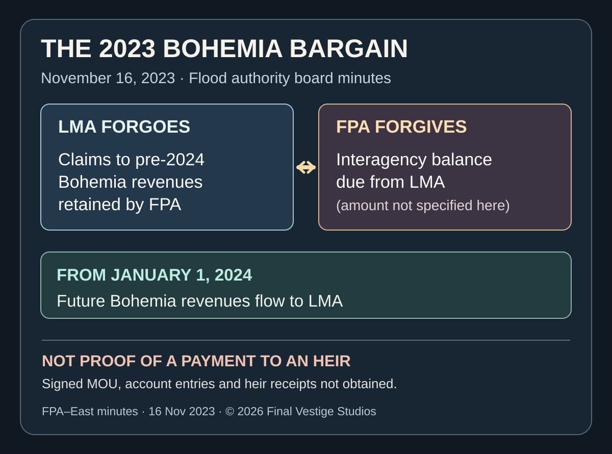

# The Spillway That Kept Its Names
*Final Vestige Investigations · focused reader candidate v50c · 17 November 2026 · INTERNAL EDITORIAL/LEGAL REVIEW — NOT APPROVED FOR PUBLICATION*

**Deck:** Louisiana returned land taken for a flood-control project. The owners then had to fight for the mineral income it had produced. Decades of deeds, judgments, settlements and official account transfers reveal why a legal entitlement is not the same thing as a cleared payment.

**Editorial scope:** This is a new, shorter treatment of the existing Bohemia investigation, **not** a new investigation or replacement for the canonical [v49 research manuscript](./bohemia-spillway-reader-cut-v49-2026-11-16.md). It draws on the verified source trail below. Avoid importing additional figures without checking their underlying document. Do not publish or overwrite WordPress draft #2488 without the release gates at the end.

## The deed and the money

On August 9, 2005, the Orleans Levee District conveyed a parcel of the Bohemia Spillway, known in the records as Tract 78, to successors of the Eusan family. The conveyance was recorded sixteen days later. It returned land that the family had transferred to the district in 1925. Eight decades separated the two instruments. [1]

That should have been the end of a long dispute. Instead, it exposed a second one. Who was entitled to the income earned from the tract while the government held it?

On September 26, 2012, Louisiana's Fourth Circuit Court of Appeal affirmed an award of **$996,596.40 in past revenues** and **$366,957.12 in statutory interest** to the Eusan claimants. It reversed a further **$365,777.34** award framed as interest on civil fruits. Those are judicially examined figures, not estimates extracted from an annual report. But even an appellate opinion cannot tell us whether a particular bank transfer subsequently cleared. The ruling records an entitlement and adjudicated amounts. The final distribution trail is a separate kind of evidence. [1]

The surrounding landscape offers a tempting visual metaphor. In February 2012, the Mississippi River opened a channel on its eastern bank in the Bohemia Spillway. NASA's account describes an initial breach about **32 feet wide and five feet deep**. A September 2007 aerial image records the canal before the breakthrough; Landsat imagery from February 2023 shows the watercourse later known as Mardi Gras Pass. The river changed course while a family pursued the value of land returned years before. But the images cannot establish the boundaries of Tract 78, the mineral title beneath it or the destination of royalty payments. [2]

*September 20, 2007. USDA Farm Service Agency National Agriculture Imagery Program aerial imagery, presented by NASA Earth Observatory; image treatment credited by NASA to Joshua Stevens. Documentary aerial image, not a reconstruction. Source and reuse terms: [NASA Earth Observatory](https://science.nasa.gov/earth/earth-observatory/mardi-gras-pass-150986/), [NASA media guidelines](https://www.nasa.gov/nasa-brand-center/images-and-media/) and [USDA NAIP catalogue](https://naip-usdaonline.hub.arcgis.com/). Public delivery of the existing WordPress asset remains a release check.*

*February 13, 2023. NASA Earth Observatory image by Joshua Stevens using USGS Landsat 8 data. Documentary satellite image, not a reconstruction. [Original NASA source](https://science.nasa.gov/earth/earth-observatory/mardi-gras-pass-150986/); [NASA reuse terms](https://www.nasa.gov/nasa-brand-center/images-and-media/). Do not describe this as a survey of a claimant's tract.*

## A flood-control project acquired in three ways

The Bohemia Spillway began as an answer to the Mississippi's high water. Louisiana's Supreme Court traced its creation to the 1920s, when the Orleans Levee District acquired land south of New Orleans and removed levees so floodwater could escape toward the Gulf. The court described a roughly **33,000-acre** project. It assigned approximately **3 percent** of that area to formal expropriation, **48 percent** to purchases in lieu of expropriation and **49 percent** to public transfers. Those rounded categories matter: a public land transfer was not a privately owned tract taken from a family. [3]

The same 1986 ruling supplied numbers that explain why the argument continued. It reported **$389,500** in total compensation for the private acquisitions. Against that, the court recorded **$1,734,480** in mineral receipts from 1929 through 1948 and **$42,921,729** from 1950 through 1981. These were gross historical receipts as the court described them, not net earnings, a present-day valuation or a sum payable to every descendant. They demonstrate the change in the property's financial significance. They do not allocate revenue to individual tracts. [3]

In 1984, Louisiana declared that the original public purpose no longer justified the government's continued ownership of eligible privately acquired lands and ordered their return to former owners or successors. The Louisiana Supreme Court upheld that mechanism in October 1986. But determining that a category of land should be returned was only the first step. Each claimant still needed to establish eligibility and title; mineral proceeds called for their own accounting. [3][4]

The distinction was litigated. In a 1999 appellate decision, judges explained that the Department of Natural Resources' power to certify land-return claimants did not give it authority to order the separate turnover and escrow of earlier royalty revenue. Act 1364 of 1997 had subsequently supplied procedures for such payments and escrow. Establishing a legal process, however, never meant every required account had been funded or every individual had been paid. [4]

## When a settlement became a payment schedule

The largest claimant case, *Haspel & Davis*, shows how far apart those steps can be. A Fifth Circuit opinion from July 23, 2007, recounts a state-court settlement under which landowners would receive an immediate **$2,318,263.72** and another **$18,767,145.26** only “as and if funds are appropriated thereof.” The agreement contemplated at least **$2.6 million per year**, and the court recorded that several payments had been made but were smaller than that annual amount. [5]

The words about appropriation were consequential. The federal appeals court concluded that the participants' earlier takings claims had been compromised into rights enforceable under the settlement agreement and consent judgment. It reversed a federal takings judgment in their favor. That ruling was not a determination that the entire settlement had been paid. It identified the legal route available for enforcement. [5]

Agency records provide a partial payment trail. A February 18, 2010 flood-authority resolution lists five transfers associated with the class settlement between December 2000 and January 2005, totaling **$5,545,818.89**, and authorizes a further **$100,000** appropriation. The latter is an authorization, not proof of a completed sixth disbursement. Nor does a board's accounting recital reveal every deduction, intermediary account, distribution to counsel or final claimant receipt. Those documents must be examined rather than presumed. [6]

Here lies a recurring trap in the Bohemia record. “Awarded,” “appropriated,” “escrowed,” “paid into court” and “received by an heir” sound like stages of one transaction. They are not interchangeable facts. An amount in a court opinion is not a cleared bank credit. An authorized appropriation may remain unspent. A payment into a court registry can still await distribution. Without the final step, a precise public figure can create an imprecise public impression.

## The escrow the board voted to close

The flood authority returned to the subject on **March 19, 2015**. Its board adopted **Resolution 03-19-15-12**, directing closure of an escrow account maintained for Bohemia litigation claims and authorizing the remaining balance's transfer into an Orleans Levee District general-fund investment or operating account. Eight commissioners voted in favor; none voted against. [7]

The resolution recited the authority's understanding that the claims associated with the account had been settled. It referred back to **Act 1364 of 1997** and an **Orleans Levee District resolution dated July 15, 1998**, under which escrow and a corresponding fund-balance reserve were to be established. The record matters because it establishes an actual board action, not merely a director's later memory of one. [7]

What it does **not** supply is the closing balance, a cancelled check, the transfer's bank posting, a claimant-level distribution schedule or a list of whose claims the board considered satisfied. Its recital is the board's assertion about the matter's disposition. It cannot stand in for independent reconciliation of every court judgment or every person entitled to proceeds.

The same meeting adopted a separate resolution authorizing nominations for mineral leases on land in which the district said it **may hold** mineral interests. The mineral-lease resolution passed **7–1**. It is possible to read these two actions together as evidence that officials were closing one administrative chapter while preparing future mineral leasing. It is not permissible to leap from that proximity to an accusation that a specific claimant's property or payment was diverted. [7]

## A different bargain, eight years later

On **November 16, 2023**, the Southeast Louisiana Flood Protection Authority–East approved a revised interagency memorandum. Its public minutes describe a negotiation with the Lakefront Management Authority: LMA would not seek Bohemia revenues the flood authority had received before 2024, and the flood authority would forgive an interagency balance owed by LMA. A January 1, 2024 date governed the planned change in revenue routing. [8]

It was an exchange between public agencies, not a private landowner's settlement. That is not a semantic distinction. The rights LMA negotiated as manager of non-flood-protection assets cannot be treated as a release of the Eusan judgment or a waiver by every former owner.

The counterpart Lakefront Management Authority board also approved the agreement that November 16. Its official resolution records **13 votes in favor and none opposed**, authorizing its chair or director to sign. Both authorities' votes are now verified. What has not been obtained is a copy of the agreement bearing the executed signatures and its final accounting schedules. [9]

Even the numbers resist an easy summary. In June 2023, LMA director Louis Capo discussed approximately **$800,000** in outstanding interagency obligations. At the November LMA meeting, he described **$700,000** to be forgiven. The **$100,000 difference** is unresolved. A repayment, an adjustment, a revised negotiation or an accounting classification could explain it. The minutes do not establish which. [9][10]

The November record contains another qualification: Capo discussed **up to $150,000** related to production from July through December 2023, while the flood authority's account spoke of revenues it had **already received** before January 2024. LMA counsel described a **six-to-eight-month delay** between production and royalty receipt. The two descriptions may address different dates in the same revenue cycle. Neither proves that $150,000 was deposited, nor defines a final contractual cutoff without the executed document. [8][9]

*The November 2023 public-agency bargain, diagrammed by Final Vestige Studios on November 17, 2026, from official flood-authority and LMA board minutes [8][9]. © Final Vestige Studios; original explanatory vector, not a contemporaneous document or AI reconstruction. The simplified revenue cutoff does not supersede the board's production-date qualification. Requires an accessible source/credit caption and actual WordPress responsive-theme inspection before release.*

## The vote that did not issue a lease

The next step was not a mineral lease. It was a vote about who would handle one.

On **July 25, 2024**, the Lakefront Management Authority adopted a resolution directing the Louisiana State Mineral and Energy Board to lease Orleans Levee District land in the Bohemia Spillway. Nine commissioners voted for it, none against. The resolution cited the previous November's agreement as the basis for LMA's management responsibility, and called on the state board to advertise, bid, negotiate and administer mineral leases on the district's behalf. That is a documented exercise of public authority. It does not show a lease was awarded or a royalty was earned. [15][16]

The distinction matters because a resolution can set the machinery in motion without recording where it went. The state board has its own leasing process. Its published explanation distinguishes the agency's request from the board's subsequent review, leasing and administration. The missing trail now includes the certified resolution received by the state, a nomination or tract file, any bid advertisement and award, an executed lease, and subsequent payment records. Each is a separate document, with its own date and evidentiary weight. [15][16]

The **approximately 107-acre** application was a different item, and a newly examined record gives it a more exact place in the sequence. Before the full board met, LMA's Commercial Real Estate Committee considered Robert A. Schroeder's proposed lease of named Bohemia tracts. Commissioner Carlos Williams moved to recommend approval, Commissioner Aadonis Exposé seconded, and the committee's minutes record that everyone voting favored the recommendation. It was an affirmative **committee recommendation**, not an issued lease. The minutes were subsequently marked approved on September 19, 2024. [17]

At that committee meeting, LMA counsel Jeff Dye identified the applicant's business as **K Exploration** and described what would follow *if* the application were accepted: referral to the state Mineral Board, advertising, competitive bids and negotiation of a lease. Dye discussed a contemplated three-year exploration period and three prospective payment types: acreage rent, a bonus, and royalties conditional on mineral production. Those were explanations of a proposed process and possible terms. The minutes neither name a winning bidder nor document a signed lease, production or receipt of those payments. [17]

The full LMA board minutes for **the same July 25** record a separate **9–0 vote** to delegate leasing authority to the state board. They also list Schroeder's application as item six, expressly noting the committee's recommendation, but pass directly to the next agenda section without recording a motion result or board vote on **that application**. Thus the older conclusion that no action was recorded needs a precise correction: **the committee did recommend approval; the full-board disposition remains undocumented in the minutes reviewed**. Neither that recommendation nor the delegation vote proves a state mineral lease was advertised, awarded, executed or paid. The listed acreage has not been tied to the Eusan family's Tract 78. [15][17]

Even the document's date labels need care. Its opening text identifies the meeting as **July 25, 2024**, consistent with the contemporaneous posted agenda; the PDF's top heading says **June 25, 2024**, while the mineral-delegation resolution itself bears a **2025-style identifier** alongside a July 25, 2024 adoption date. These inconsistencies look like clerical or template errors, but their origin has not been established. The safest identification is the meeting date corroborated by the agenda and proceedings, with the discrepant identifiers noted rather than silently corrected. [15]

*“Three Decisions, Not One.” Original Final Vestige Studios evidence diagram, November 17, 2026; © 2026 Final Vestige Studios. Based on the [LMA Commercial Real Estate Committee minutes](https://nolalakefront.com/wp-content/uploads/2024/10/25-JULY-2024-Commercial-Real-estate-Committee-Minutes_Approved-9.19.2024.pdf), [LMA full board minutes](https://nolalakefront.com/wp-content/uploads/2025/08/JULY-25-2024-Board-Minutes_approved.pdf) and [state mineral-board description](https://www.dce.louisiana.gov/state-mineral-and-energy-board). The distinction is administrative, not a property-boundary survey or a representation of an issued lease. Isolated SVG and production-theme pixel QA pending; pair the graphic with this accessible text caption and source links.*

## Revenue on the agenda, not in a verified ledger

On February 20, 2024, Capo told an LMA committee that the authority had received a **first Bohemia payment of $7,500**. The minutes do not specify a payer, a production period, a lease or an independently matched deposit. A later LMA board record dated January 30, 2025, reports **$250,000 expected** and **$25,000 received**, also without identifying the reporting period. The two figures are useful evidence of management's expectations and reports, not a reliable receivables calculation. [11][12]

By March 26, 2025, Capo was asking for an audit of Bohemia lease payments. He told the Finance Committee that the leases had not been audited since 2007. It is a statement in the minutes, not an independent search of every audit since that year. No final Bohemia-specific lease-audit report has yet been obtained. [13]

LMA's adopted fiscal 2025–2026 budget projected **$100,000** in Bohemia royalties under general-fund line 444010. The line is a forecast. It is not evidence of $100,000 received, lost, diverted or owed to a particular heir. [14]

The paper trail now has two visible layers: old judgments and settlement accounting for private claimants; recent lease receipts and public-agency budgets for the manager. They may concern overlapping land in the broader spillway. They are not, without tract identification and ledgers, the same money. Any proposed subtraction between the two would be arithmetic without an evidentiary foundation.

## The last mile of restitution

Bohemia is not a story about an absence of documents. There are deeds, court opinions, board resolutions, audited reports, lease nominations and budget entries. Some state exact dates and amounts. Others are statements by officials. Some agree; others use different periods or definitions.

The missing records are more specific: the **court-filed 1998 claimant Exhibit A**, the operative class settlement and complete amendments, the court registry and disbursing-agent schedules, cleared beneficiary receipts, the **1998 escrow creation instrument and 2015 closing entries**, the signed **2023 interagency memorandum**, and the lease-level production and remittance ledger. Without them it would be reckless either to announce that all heirs were paid or to claim that the public authorities secretly retained money owed to them.

The significance of the Eusan judgment is not that it answered the last question. It answered a question that had remained disputed for decades. The family established what its returned parcel had earned and what the law allowed it to recover. The unresolved last mile is whether the financial system carried that entitlement through to completion. A deed can return land. A judgment can put a number on what was lost. Only the final accounting can show where the money went.

---

## Sources & Further Reading — focused verification ledger

These entries identify the source type and the **limit** of what it proves. Bracketed numbers above refer to this ledger, not to the 88-entry v49 dossier.

1. **Louisiana Fourth Circuit**, [*Succession of Carter Ursin and Charles Ursin (Eusan)*, No. 2011-CA-1105, Sept. 26, 2012](https://law.justia.com/cases/louisiana/fourth-circuit-court-of-appeal/2012/2011-ca-1105.html); also [court opinion PDF](https://cases.justia.com/louisiana/fourth-circuit-court-of-appeal/2012-2011-ca-1105.pdf?ts=1429563651). Evidence: Tract 78 chronology, revenues and interest outcome; **not** proof of collection.
2. **NASA Earth Observatory**, [“Mardi Gras Pass,” Feb. 21, 2023](https://science.nasa.gov/earth/earth-observatory/mardi-gras-pass-150986/). Evidence: dated 2007/2023 imagery, geography and initial breach dimensions; **not** Tract 78 boundaries or legal title.
3. **Louisiana Supreme Court**, [*Board of Commissioners v. Department of Natural Resources*, 496 So. 2d 281, Oct. 20, 1986](https://law.justia.com/cases/louisiana/supreme-court/1986/85-ca-1448-3.html). Evidence: project area, acquisition categories, 1929–1981 receipts, 1984 return statute and its constitutionality; **not** individual claimant allocation.
4. **Louisiana Fourth Circuit**, [*Haspel & Davis*, 732 So. 2d 113, March 31, 1999](https://caselaw.findlaw.com/court/la-court-of-appeal/1028222.html). Evidence: administrative certification versus royalty-turnover judicial remedy; original clerk-filed PDF remains outstanding.
5. **U.S. Fifth Circuit**, [*Haspel & Davis*, 493 F.3d 570, July 23, 2007](https://law.justia.com/cases/federal/appellate-courts/ca5/07-30086/07-30086-cv0.wpd-2011-02-25.html). Evidence: settlement terms and enforcement ruling; **not** final satisfaction.
6. **Flood Protection Authority–East**, [board minutes, Feb. 18, 2010](https://www.floodauthority.org/wp-content/uploads/minutes/2010%2002%2018%20-%20Board%20Meeting%20Minutes.pdf), Resolution 02-18-10-08, printed pp. 14–15. Evidence: five transfers recited and $100,000 later authorized; original receipts and independent transfer evidence missing.
7. **Flood Protection Authority–East**, [board minutes, March 19, 2015](https://www.floodauthority.org/wp-content/uploads/minutes/2015%2003%2019%20-%20Board%20Meeting%20Minutes.pdf), Resolutions 03-19-15-12/13, printed pp. 24–26. Evidence: two adopted actions, escrow closure authorization and mineral-lease nomination authorization; **not** bank or payee clearance. Original page images were verified in v49's audit on Nov. 14, 2026; screenshot retry Nov. 17 returned DisabledError.
8. **Flood Protection Authority–East**, [board minutes, Nov. 16, 2023](https://www.floodauthority.org/wp-content/uploads/2023/12/2023-11-16-SLFPA-E-Board-Meeting-Minutes.pdf), printed pp. 8–9. Evidence: adopted revised MOU resolution and public-authority bargain; extracted official text confirmed, original-page screenshot attempt remains blocked.
9. **Lakefront Management Authority**, [board minutes and Resolution VII-04-11162023, Nov. 16, 2023](https://nolalakefront.com/wp-content/uploads/2024/02/NOV-16-2023-Board-Minutes-scored-approved-01.25.2024.pdf), discussion pp. 4–6 and certified resolution near the end. Evidence: counterpart vote, $700,000 statement, up-to-$150,000 production period, lag; executed signatures and bank records missing. v49 audit independently viewed original PDF pages Nov. 17.
10. **Flood Protection Authority–East**, [board minutes, June 15, 2023](https://www.floodauthority.org/wp-content/uploads/2023/07/2023-06-15-SLFPA-E-Board-Meeting-Minutes-1.pdf), printed pp. 8, 10. Evidence: earlier approximately $800,000 request, **not** an approved discharge.
11. **LMA Airport Committee**, [minutes, Feb. 20, 2024](https://nolalakefront.com/wp-content/uploads/2024/04/FEB-20-2024__Airport-Minutes_Appoved-March-28-2024.pdf), printed p. 7. Evidence: director's first-payment statement; **not** an independently verified deposit.
12. **LMA Board**, [minutes, Jan. 30, 2025](https://wwwprd.doa.louisiana.gov/boardsAndCommissions/MeetingMinutes/547_Full%20Board%20Minutes%20-%20January%2030%2C%202025final.pdf), PDF p. 9. Evidence: $250,000 versus $25,000 statement, period unspecified.
13. **LMA Finance Committee**, [minutes, March 26, 2025](https://nolalakefront.com/wp-content/uploads/2025/07/Finance-Minutes-March-26-2025final.pdf), printed p. 4. Evidence: audit request and unverified since-2007 claim.
14. **LMA**, [FY2025–2026 budget](https://nolalakefront.com/wp-content/uploads/2025/11/25-26-Budget-website.pdf), line 444010. Evidence: forecast only.

15. **Lakefront Management Authority**, [July 25, 2024 full board minutes and mineral-delegation resolution](https://nolalakefront.com/wp-content/uploads/2025/08/JULY-25-2024-Board-Minutes_approved.pdf), PDF page images zero-based 15–16, and [July 23 posted agenda](https://wwwprd.doa.louisiana.gov/boardsAndCommissions/MeetingNotices/547_July%2025%2C%202024%20-%20Regular%20Board%20Meeting%20Agenda__final%28002%297.23.2024.pdf). Evidence: nine recorded affirmative votes for **delegation**; the approximately 107-acre application was separately **listed as committee-recommended**, without an accompanying **full-board vote recorded**. **Does not prove an executed mineral lease or claimant payment.** Source date/header/identifier discrepancies retained in prose.
16. **Louisiana Department of Energy and Natural Resources**, [administration of the state mineral-leasing process](https://www.dnr.louisiana.gov/page/intro-administration-of-the-state-mineral-leasing-process) and [State Mineral and Energy Board remit](https://www.dnr.louisiana.gov/page/state-mineral-and-energy-board). Evidence: separate roles of a state agency's leasing request and the state board's review/administration. **General procedural context**, not a case-specific 2024 lease history.

17. **Lakefront Management Authority Commercial Real Estate Committee**, [July 25, 2024 minutes, approved Sept. 19, 2024](https://nolalakefront.com/wp-content/uploads/2024/10/25-JULY-2024-Commercial-Real-estate-Committee-Minutes_Approved-9.19.2024.pdf), **original PDF pp. 4–5 (zero-based 3–4), directly screenshot-inspected Nov. 17, 2026**. Evidence: unanimously favorable **committee recommendation** for the Schroeder ~107-acre application, counsel's identification of K Exploration, and a prospective state bidding/lease process with hypothetical payment terms. **Not** a full-board approval, state lease award, signed lease or deposit. Board minutes [15] omit an application-specific outcome.

## Image and production rights ledger

- **2007 documentary aerial:** USDA NAIP source, presented by NASA Earth Observatory; date Sept. 20, 2007; credit USDA FSA NAIP / NASA Earth Observatory / Joshua Stevens as supplied; rights links in caption; existing WordPress media asset; alt text above. Direct third-party hotlinking is **not** intended.
- **2023 documentary satellite:** USGS Landsat 8 data, NASA image Joshua Stevens; date Feb. 13, 2023; NASA usage guidelines linked; existing WordPress asset; alt and caption above. No endorsement implied.
- **Original July 2024 committee-to-board lease-process SVG, v50c:** Final Vestige Studios, November 17, 2026; © 2026 Final Vestige Studios; [source-controlled diagram](./assets/bohemia-2024-committee-v-board-lease-chain-v50c.svg). Original vector authored from official committee and full-board minutes plus Louisiana mineral-board description; author, date, rights, source URLs and accessibility description embedded. Corrects v50b diagram by distinguishing the affirmative **committee recommendation** from missing **full-board disposition**. Not a photograph, survey, lease or proof of payment; actual WordPress theme and isolated raster QA pending.
- **Original two-sided bargain SVG:** Final Vestige Studios, November 17, 2026; copyright © 2026 Final Vestige Studios; source file [repo asset](./assets/bohemia-2023-revenue-waiver-debt-offset-v49ac.svg); copyright and source URL metadata in original; alt and substantive limitation above; not a photograph, not a reconstruction.

## Release gate — HOLD

**No public release, WordPress replacement, newsletter, social publication or shared-template edit is authorized by this file.** Outstanding: independent line-level legal/editorial review; executed November 2023 MOU and debt adjustment; 2015 escrow closure journal and payment chain; claimant exhibit, 2000 consent judgment and disbursing-agent records; royalty lease/remittance reconcile, including July 2024 certified delegation, tract nomination and subsequent State Mineral and Energy Board docket/award outcome; current public NASA/USDA JPEG byte-delivery test; authenticated WordPress theme screenshots at **390px and 1440px**; article media-source/credit links; and first-publish safety metadata `_jetpack_dont_email_post_to_subs=true`, `jetpack_publicize_feature_enabled=false`. Preserve existing post #2488 unchanged until checks pass. The 2015 resolution's “claims settled” recital and the 2023 agencies' debt arrangement **must not** be construed as independently verified paid-in-full status.
