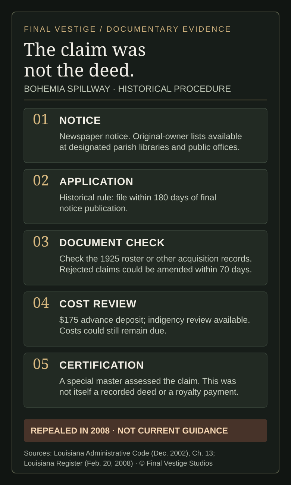

# The Spillway That Kept Its Names
*Final Vestige Investigations · reporting draft v2.3 · 13 November 2026 · NOT APPROVED FOR PUBLICATION*

**Editorial status.** This is a separately scoped companion-reporting module associated with [Caernarvon #1463](https://github.com/finalvestigestudios/final-vestige-site-layer/issues/1463), not a replacement or expansion of WordPress draft #2151 during the [production-theme QA hold #1589](https://github.com/finalvestigestudios/final-vestige-site-layer/issues/1589). It is source-checked where marked, but remains on editorial and production-theme release hold. No purported interviews, visits, contemporary measurements, or archival access beyond the linked reproduced court text and official source files.

## Draft article: The Spillway That Kept Its Names

In February 2012, the Mississippi found another opening through its eastern bank, roughly thirty-five miles southeast of New Orleans. What became **Mardi Gras Pass** began with a breach that NASA describes as thirty-two feet wide and five feet deep. In the satellite record, an old canal is visible before the opening; a later image shows a channel carrying the river's water into the wetlands. This did not happen in an unrecorded wilderness. It happened inside the Bohemia Spillway, an outlet the state had built in the 1920s and then, in 1984, declared no longer necessary for its *original land-acquisition purpose*. [9]

The river had continued to use the land. The argument over who owned it was another matter.

On page 32 of a Louisiana flood authority's 2008 financial report, the bookkeeping turns back to the 1920s. Among accounts of more recent hurricane litigation are old land-return claims and disagreements over mineral royalties. The report says that claims certified by the Department of Natural Resources through June 30, 2005 had been conveyed. It does not say that every tract was returned, every heir identified, or every payment made. [1]

The flood-control work was the **Bohemia Spillway**, not the levee deliberately blasted near Caernarvon on April 29, 1927. Their geographical proximity makes them easy to confuse. Their legal afterlives make the distinction indispensable. The new opening in 2012 would expose a deeper complication: a government's decision about land ownership and a river's continuing behavior do not answer the same question.

### An outlet downstream

Louisiana's Legislature authorized the Orleans Levee Board in 1924 to acquire land on the east bank of the river in Plaquemines Parish and construct a spillway. The state Supreme Court, reviewing the project in 1986, described the site as roughly fifty river miles below Orleans Parish. It said the outlet was intended to relieve upstream river levels by allowing excess water out toward the Gulf. The works were built during 1924–1926. [2]

A later court opinion supplies an unusually concrete description of what the engineers built. In *Richardson & Bass v. Board of Levee Commissioners*, a Louisiana Supreme Court proceeding over oil-and-gas royalties, the justices described the removal of **approximately eleven miles of existing east-bank river levee** and construction of a new back levee **2,500 to 3,000 feet inland**. Openings in that back levee carried high water into a channel and onward through bayous toward the Gulf. The figures appear in a **1956 judicial reconstruction** of the work, not a plan or survey newly recovered from 1925. The case also shows why the story of a spillway became a story of mineral title: the court had to decide competing public-district and private-lessee claims to Cox Bay oil-and-gas royalties. Its early decisions spoke of four wells; the final November 21, 1956 amendment corrected the number to **six**. [15]

The court put the area at approximately **33,000 acres**. That figure alone can suggest one vast private taking. The controlling rehearing opinion supplied three categories: **3 percent expropriated**, **48 percent purchased in lieu of expropriation**, and **49 percent transferred as public lands**. The public-land portion was not another group of private owners driven off their property. The court reported an aggregate **$389,500** paid to private owners for acquired land. These are retrospective figures, not a parcel-by-parcel examination of original deeds. [2]

Even the published judicial accounts do not group the acreage identically. A footnote in the earlier 1986 opinion describes approximately **48 percent** of the land as purchased from private owners, notes parenthetically that **less than 3 percent** of the total land had to be expropriated, and assigns the remaining **52 percent** to state transfers. The later rehearing opinion instead sets out separate rounded figures of **3 percent expropriated**, **48 percent purchased in lieu of expropriation**, and **49 percent public transfers**. The footnote's parenthetical percentage is not an extra category to add to its 48-and-52 split. Neither account is a parcel-by-parcel acquisition ledger; until the underlying land records are examined, the variation should remain visible rather than be forced into a falsely exact reconstruction. [2][3]

The spillway was supposed to serve a city upriver, but ownership of the land was now held by a public authority. The subsequent income record complicates any ending that simply calls the project finished.

According to the same court, the board received **$1,734,480 in mineral revenues in 1929–1948** and **$42,921,729 in 1950–1981**. These are historical-dollar gross receipts across specified periods, not an inflation-adjusted profit calculation, nor a ledger of money due to people flooded by the separate Caernarvon explosion. The source gives no total for 1949. [2]

The numbers are substantial, but the institutional question is more important than their size. A project justified by hydraulic protection had left behind an asset producing revenue long after the land was acquired. That income and the rights to receive it became the center of later litigation.

### The judgment that changed its own ending

By the time Louisiana began discussing whether to return Bohemia land, the courts had already spent years deciding what *public* ownership meant inside the same spillway. One dispute, buried in the successive opinions of a 1955–1956 Supreme Court case, is revealing precisely because its ending changed.

The land in *Richardson & Bass* was in Cox Bay Unit No. 2, east of the back levee. Grand Prairie Levee District had obtained the property from the state under an 1898 law. The Orleans Levee Board constructed the spillway in the 1920s, and a 1928 statute redrew Grand Prairie's jurisdiction. In 1942, Act 311 purported to confirm Orleans's title to public lands from Bohemia Plantation down to Cuselich Canal and from the river to the sea. That geographical definition reached beyond the strip where Mississippi floodwater traveled between the river and the back levee. [15]

Those statutes left a question with financial consequences: **when did Grand Prairie lose the power to lease the disputed land?** In July 1936 it had leased acreage to Delta Development Company. In March 1950 Orleans executed a different lease with Richardson & Bass. The rival leases could not both govern the same royalties in the same way. A bondholder also intervened, contending that the revenues helped secure Grand Prairie debt. [15]

The June 30, 1955 original decision and the February 20, 1956 first rehearing treated Delta's earlier lease as valid, though they awarded different royalty fractions. On **November 5, 1956**, a second rehearing changed the legal premise. The majority read the 1942 statute as confirming Orleans's ownership dating from the spillway's 1925 construction, rather than first transferring title in 1942. On that interpretation Grand Prairie had no authority to grant Delta the 1936 lease as to this land. Three dissenting justices resisted the result or its underlying title analysis. The surviving court text includes these incompatible judicial positions; citing the first opinion alone would give readers the wrong outcome. [15]

A further **November 21, 1956** correction changed two details in the *operative decree*. The four wells named in the preceding opinions became **six**: 4-H, 6-H, 7-H, 14-H, 44-H and 47-H. Orleans received an award of **3/16 (9/48) of the disputed 55-percent portion** of production proceeds, and Delta's **1/48 claim was dismissed**. The court also specified that Orleans was to receive the entire fund deposited in the trial court registry. These fractions describe the portion contested in *this case*, not 9/48 of all production in the field; another 45-percent portion due to the state was outside the dispute. The order to distribute a registry fund is not an independently examined bank receipt. [15]

The irony is not that a court was confused about who had flooded whom. It was that officials had to litigate the ownership of land they regarded as public long before the descendants of private owners began fighting for restitution. The second-rehearing majority and its dissenters disagreed on the very date ownership took effect. Decades later, the question of which former *private* owner could reclaim a particular tract required a different set of documents and a different legal test. One can follow both histories without merging them. 

### The heirs who changed the constitution

Before anyone could get a Bohemia deed back, the families faced a problem that did not appear on a land survey. Louisiana's constitution generally forbade public bodies from donating property to private people. To undo an acquisition from the 1920s, the heirs needed more than a sympathetic legislature. They needed voters across Louisiana to create an exception. [3]

The change did not begin with an engineering report. In its 1986 account of the legislative history, the Louisiana Supreme Court said the campaign for the 1983 amendment had been driven largely by heirs and successors of the original Bohemia owners. The justices cited House committee minutes that placed those descendants at a hearing on House Bill 56. The court's description is evidence of their political role; this investigation has **not obtained the original committee minutes**, interviewed the participants, or reconstructed who organized or financed the campaign. [3]

That effort had encountered resistance. Chief Justice John A. Dixon, later writing separately in the same case, noted a related 1982 bill that specifically proposed returning Bohemia property but failed in the House. The next year's measure was different. **On October 22, 1983**, Louisiana voters ratified a constitutional amendment permitting the return of expropriated land, including mineral rights, to a **former owner** after the Legislature declared the original public purpose ended. The vote did not itself transfer a single tract. The Legislature still had to act. [3]

It did, through Act 233 of 1984. The act declared that the public and necessary purpose behind the historic Bohemia acquisitions had ended **insofar as it affected ownership**, and ordered qualifying land returned to the people from whom it had been acquired **or their successors**. Four words now mattered enormously: *or their successors*. Someone who inherited a claim after a parent's or grandparent's death needed those words to carry legal force. [3]

The levee board fought the law. It warned that land and mineral-revenue losses could hurt its bonds and argued that the constitution allowed a return only to a literal former owner. A district court struck the law down. In the Louisiana Supreme Court, the majority rejected the narrow reading. It treated inheritance under Louisiana civil law, and the amendment's documented legislative purpose, as reasons the exception must extend to descendants. A contrary interpretation might have excluded most of the families whose ancestors had owned the land sixty years before. [3]

The justices were not unanimous. Dixon, joined in that objection by Justice Walter F. Blanche, argued that voters had approved language about former owners, not their heirs. Justice James L. Watson also dissented. His opinion contended that the spillway still served flood-control purposes and that surrendering its revenues threatened public works and financial obligations. Those arguments belong in the record as **dissenting positions**, not as the court's holding or independently verified hydraulic findings. [3]

The majority drew a crucial distinction. The constitution required the Legislature to **declare** that the original public purpose had ceased; it did not ask the judges to perform a new flood study or decide whether the river would ever use Bohemia again. The court held Act 233 constitutional. The original decision and the rehearing process in February and May 1986 were followed by the controlling **October 20, 1986** disposition. Legal authority to transfer qualifying title was established. Whether the channel still carried water was a different question, and whether an individual family obtained its deed would depend on records the amendment could not supply. [2][3]

This explains why the paperwork that follows matters. The political campaign could change a constitution and win in court, but it could not conjure a missing 1925 deed, identify every living successor, or turn a judgment for royalties into a cleared payment.

### The board that could not sue the state

The legal argument changed direction after Louisiana's Supreme Court upheld restitution. The Orleans Levee Board had acquired property through powers granted by the state. Now the board argued that the state's order to give some of it back amounted to an unconstitutional taking *from the board*. The dispute followed the mineral rights as well as the land. [2][42]

The money helps explain why this was contested so fiercely. In its **October 20, 1986 rehearing opinion**, the state Supreme Court described approximately **$5 million in annual spillway mineral revenues** at that time, with roughly **60 percent**, or **$3 million**, attributed to the privately acquired lands at issue. These were contemporary **mid-1980s revenue estimates**, not current earnings, audited profits or restitution amounts owed to heirs. Nor does 60 percent of revenue mean 60 percent of the acreage. The same opinion put privately purchased or expropriated land at a combined **51 percent** of approximately 33,000 acres; the remaining 49 percent was public-land transfer. [2]

The board pursued its compensation argument in federal court. On **August 15, 1988**, the United States Court of Appeals for the Fifth Circuit decided *Board of Levee Commissioners v. Huls*. The judges did not declare that the mineral interests had no value. They held that a **state-created political subdivision could not invoke the federal Takings Clause against the state that empowered it**. For this dispute, the board's attempt to distinguish its public flood-control property from supposedly private, revenue-producing mineral interests did not work. Its federal compensation claim was dismissed. [42]

A bondholder, Howard, Weil, Labouisse & Friedrichs, had raised a different objection: that returning the property impaired the district's bond contract. By the time of appeal, however, the bonds had matured and the firm conceded there was no indication it would fail to receive their full value upon redemption. The Fifth Circuit treated that claim as **moot**, vacated the pertinent lower-court ruling and dismissed the claim **without prejudice**. Calling that a substantive judicial finding that no bond contract could ever be impaired would go beyond the decision. [42]

Fourteen years later, the same federal appellate court had to explain why *Huls* did **not** give the levee district immunity when *private owners* sued it. In the **June 14, 2002 *Vogt* opinion**, the Fifth Circuit distinguished a subordinate government trying to sue its creator from a political subdivision claiming to be an “arm of the state” under the Eleventh Amendment. In the latter setting the court held that the district **was not immune** and that the landowners' allegations stated a federal takings claim. This reversed a dismissal; it did **not** collect the judgment for them. [6][42]

The apparent contradiction dissolves when the parties and legal questions are kept in view. In **1988**, the board could not demand compensation from Louisiana for the Legislature's reassignment of government-controlled property. In **2002**, private claimants were permitted to pursue an unpaid-judgment claim against the district. Neither decision establishes which heirs recovered money. The distinction is one more reason the final documentary test must be a deed or payment record, not simply a court victory.

**Evidence figure:** [Original Final Vestige legal-posture diagram](./assets/bohemia-two-federal-cases-1988-2002-2026-11-13.svg) compares those two holdings, without suggesting either decision adjudicated claimant-level payment. [6][42]

### The deed could come back with the lease still attached

The legislature had ordered the return of qualifying land in 1984. But the rules governing what an owner would receive did not stand still while families assembled titles and the board resisted. By the time some deeds were signed in 1991 and 1992, Louisiana had already rewritten important parts of the return machinery. The changes are set out in a **September 4, 1996** Court of Appeal opinion in *Vogt*, which reproduces passages of the 1984, 1985 and 1992 acts. We have checked that judicial reproduction, **not the original session-law scans** for those three enactments. [35]

Consider the leases. Section 5 of the **1984** law said returned property remained subject to existing servitudes, rights-of-way and valid surface or mineral leases or contracts executed **before the act's effective date**. In **1985**, Act 819 replaced that cutoff with contracts executed before the levee board took action to return ownership under the certification procedure. The difference matters. An owner receiving a deed after a long administrative delay could be recovering property still burdened by agreements made while the board controlled it. Whether a particular instrument was valid or what its terms permitted would require examining that instrument; the statutory text alone cannot settle a named tract's leases. [35]

The same 1985 amendment imposed a timetable. Once the Department of Natural Resources certified an applicant, the board was to **take action within sixty days** to return ownership and notify the applicant in writing. An applicant aggrieved by that action had **thirty days after notice** to seek judicial review in the Twenty-Fifth Judicial District Court. These were procedural requirements, not a guarantee that a deed would be delivered in sixty days or that a lawsuit would end in thirty. The later *Vogt* record of 1991–1992 transfers shows just how far apart a statutory timetable and an individual's completed conveyance could be. [35]

Then the Legislature widened the words describing how the property might originally have changed hands. **Act 847 of 1992** amended the return language to include an *act of convenience* and other transfers, expressly mentioning a **sale or transfer following adjudication for unpaid taxes**. That expansion is necessary context for the later *Gomez* litigation over tax-adjudicated parcels. It is not evidence that every tax sale inside the spillway met the constitutional test or ultimately produced a recorded return. The classification and prior use of each tract still mattered. [35][16]

A further amendment, **Act 1364 of 1997**, contained a revenue provision directing the board to return an amount equal to revenues produced since **June 29, 1984** until paid from property acquired by expropriation or purchase under its threat. The **2009** appellate opinion addressing Grand Prairie's claim quotes that provision, but the court also rejected a public-district claim because a legislative transfer of public property was not an expropriation from a private owner. Expanded statutory language, in other words, did not erase the constitutional distinction between public and private land. Nor did a legislative instruction establish that any particular claimant received a payment. [20]

Read together, the changes explain why the return could not be reduced to one date and one law. The **1984** decision authorized restitution; the **1985** procedure governed certification, board action and surviving contractual interests; **1992** expanded the description of possible acquisition histories; and later legislation addressed revenue. The underlying deed, the date of certification, any subsisting lease and the judicial record could still lead two owners of neighboring tracts to very different outcomes. [35][20]

### An April 1925 list

The instructions made one object unusually important: the envelope. In the Louisiana rules governing the return of Bohemia land, a rejected applicant was told to preserve the department's letter and its postmark. The outside was to say **“RETAIN THIS ENVELOPE.”** A deadline could be measured from the date stamped on it, even when the dispute behind the application concerned land acquired more than half a century before. This was a rule for handling a claim, not evidence that a particular family received such a letter. [4]

The document survives in the Louisiana Department of Natural Resources' **December 2002 compilation of Title 43**, Chapter 13. Its regulations were originally promulgated in **January 1985** and subsequently amended; the December 2002 wording cannot all be attributed to the first 1985 version. The first test asked an unexpectedly precise question. Did the named original owner appear in the *Report—Real Estate Committee to Executive Committee, Board of Levee Commissioners, Orleans Levee District, Proposed Plaquemines Outlet*, dated **April 20, 1925**, or in another board acquisition record? The regulations identified the 1925 report's then-reported location as the levee board's administrative office at **Lakefront Airport, New Orleans**. That is a lead to an original document, not proof that we have examined it or know its custodian in 2026. [4]

The rules set out a public notice process. The department was instructed to publish notices in the New Orleans *Times-Picayune* every third day for thirty days, and weekly for four consecutive weeks in the *Plaquemines Gazette*. Lists of original owners were to be made available for inspection at library locations in **Buras and Belle Chasse**, the parish courthouse and designated public offices. The text establishes what officials were required to make available; **it does not establish that every advertisement appeared or every promised list was accessible on schedule**. The department was also instructed to send a requested application form within ten days. None of those procedural commands is a receipt or a delivery log. [4]

Under the version preserved in 2002, an apparently complete application had to be received **within 180 days after the final published notice**. Preliminary review looked for answered questions, documents, a tract within the spillway and an original-owner name matching the board's records. A rejected claim could be amended within a **70-day window measured from the department's postmark**. A claimant whose file moved past preliminary review ordinarily faced a **$175 advance deposit**, subject to later assessment of actual administrative costs. For an applicant unable to pay, the regulations provided an indigency-review procedure requiring a questionnaire and **three affidavits**. That route could defer the advance deposit; even a successful applicant granted indigent status remained responsible under those historical rules for costs before the land transfer. [4]

The special master could find an apparent valid claim, reject one, or identify a claim for which some heirs were still unknown or unaccounted for. The resulting certification went on to the board. **A finding was not, by itself, a recorded conveyance, a resolution of competing heirs, or a mineral-royalty payment.** The rules therefore expose a distinction that later judgments and ledgers keep returning to: recognition, transfer and compensation were not interchangeable events. [4][19][27]

These are **historical instructions**, not a form a reader should try to file today. The Legislature later established a June 30, 2007 claim deadline through **Act 130 of 2005**, and Louisiana formally repealed Chapter 13 in **February 2008**. The 2002 procedure is useful now because it shows the evidence officials asked heirs to assemble and the procedural decisions that could separate a legal entitlement from a completed return. It cannot tell us, without individual files and deed records, how many deserving applicants were delayed or excluded. [27][23]

*Original evidence diagram: Final Vestige Studios, November 13, 2026. Source: Louisiana Administrative Code, Title 43, Chapter 13 (December 2002 compilation), and Louisiana Register (February 20, 2008). The depicted requirements were historical and were repealed; no diagrammed step proves that a particular claimant received title or compensation.* [4][23]

### The claims window closed; the cases did not

There is a later date missing from the 2002 rulebook, and it changes how that rulebook should be read. In the **February 20, 2008 Louisiana Register**, the Department of Natural Resources formally repealed the Bohemia-specific regulations in **Louisiana Administrative Code Title 43, Part I, Chapter 13**. The department gave its reason: under **2005 Act 130**, the deadline for filing land-return claims had been **June 30, 2007**. The register prints the old chapter's *Definitions*, *Notification, Application Forms* and *Application Processing and Certification* provisions with the word **“Repealed.”** The repeal is visible on printed pages **254 and 271** of the state register. [23]

That new record resolves one ambiguity while introducing another. The 180-day notice window and $175 processing deposit in the 2002 compilation were part of a historical administrative system; they cannot be presented as a live 2026 application procedure. But a filing deadline is **not a judicial finding that every prior claim was paid, dismissed or completed**. The 2012 Tract 78 appellate litigation described later in this story took place years after the 2007 deadline. A later court dispute could concern claims, ownership or money already in contention. The enrolled **2005 Act 130**, independently recovered from Louisiana's legislative archive and checked against its actual page images, now confirms the deadline directly. Its text also explains what the state did with *competing* claims, and why earlier editions of the law are easy to misread. [23][27][19]

### The law that crossed out the old deadline

On **June 22, 2005**, Louisiana's governor signed **Act 130**, the final form of Senate Bill 210. Its stated ambition was to bring a sprawling land-return process toward an end. The law did not announce a discovery about the river. It tried to settle an administrative question: after decades of deed searches, certifications and court cases, who could still submit a claim, and to whom would a new dispute be directed? The state legislature's own archive preserves the seven-page enrolled act, with its additions underlined and its discarded language visibly crossed out. [27]

The visible edits matter. An earlier provision referring to a **July 1, 2009** contact deadline is struck through. The new, underlined **Section 2(b)** requires claims for certification of Bohemia ownership to be filed with the Department of Natural Resources **by June 30, 2007**. Section 2(a) directs the board to place a final notice in the official newspapers of four parishes. We have the statutory instruction, **not evidence that the notices actually appeared**. The 2008 administrative repeal therefore was not inventing a deadline: it was following one written into the 2005 act. [27][23]

Another clause connects the deed to the money. **After** the board conveyed property to a department-certified owner, the act directed it to contact that owner **within 30 days to negotiate a final settlement** for mineral revenues received after **June 29, 1984**. Thirty days was the prescribed period for *making contact*, not proof that the parties reached an agreement, that all revenues were reconciled or that a check cleared. Confusing those events would erase precisely the distinction the surviving litigation makes. [27]

The law also acknowledged that returning a deed did not necessarily resolve ownership. It described certification of fractional interests, earlier quitclaim deeds and title disputes between owners of record and new claimants. For a later dispute over a title certified by the department and already conveyed by the board, Section 2(e) sought to protect the board and department from further title claims. In the specified circumstance where a court awarded an interest to a third party after mineral revenue had been paid to the record owner, the provision directed the payment claim toward that record owner instead of the board. These are the provisions of the **2005 enactment**, not a determination of any named heir's rights under every later law and judgment. [27]

An especially consequential passage is retrospective. Act 130 recited that a class settlement in *Haspel and Davis* had been approved by a **December 11, 2000** judgment, and that the levee board had made **partial payments**, with further payments intended. The text establishes that Louisiana formally acknowledged a settlement and partial performance by 2005. It does not identify the amount each family received. The flood authority's much later account of settlements paid and an escrow fund closed in **2015** supplies a second institutional checkpoint, not a missing list of claimants. [27][21][22]

There is one more reason not to extract a single sentence from this statute and pronounce the history settled. Its amended account of earlier certifications refers not only to expropriation and purchases made under its threat, but also to purchases between **January 1, 1924 and December 31, 1932**. Exactly how that language operated for a particular tract would require tracing its earlier certification and the applicable judgments. An amendment can change the rules without retroactively proving what happened to the people who sought relief. [27]

### The year a title could still be redeemed

In a **1993 rehearing**, Louisiana's First Circuit Court of Appeal found that the 1924 act authorizing the project had **not**, by itself, dedicated every tax-adjudicated tract to public use. For those lands, the decisive event was acquisition followed by the spillway's **construction and use in 1926**. A landowner who redeemed tax-adjudicated property before that point stood differently from one attempting redemption afterward. The distinction was not a technical footnote. It could determine whether the later 1984 return law applied at all. [16]

The opinion named **27 tracts** in discussing land eligible under the amended return law, but the operative judgment was more complicated than a single list: it vacated certifications for tracts **133, 205 and 210**, imposed litigation-related conditions on other numbers, and treated tract **214** separately. It also **ordered** the levee board to transfer tracts **15 and 115** to **Gulf Coast Oyster Company, Ltd., and St. Paul's Episcopal Church**, and tracts **102, 105 and 108** to the **heirs of Bernard Favret**. These are named recipients and parcel identifiers in a court order, not evidence that deeds were subsequently executed or that royalties were paid. The opinion's own qualifications are a warning against counting the 27 as 27 completed returns. [16]

This is the point at which the land ceased to be an abstraction. The governing question was no longer simply whether the state could return it. It was when the original owner lost the right to redeem it, which act had transferred it, whether another suit remained pending, and what the court could actually order the board to do.

### The deeds did not return all at once

Some property came back before the general dates usually given for the restitution transfers. The published opinion in *Frank v. Board of Levee Commissioners*, decided **April 6, 2005**, recounts a stipulation by both sides in the case of the succession of Josephine and Henry Taylor, Jr. The levee board, they agreed, had conveyed the relevant tract to the succession on **December 3, 1990**. A court reporting the parties' agreement is a stronger source than a generalized account of the returns, but it is not the original recorded deed. The same opinion elsewhere speaks broadly of transfers in 1991 and 1992. This family-specific date shows why a single beginning or ending year cannot describe every conveyance. [43]

The agreement did not finish the dispute. The succession, represented in the appeal by administratrix **Lemona H. Chandler**, sued over mineral revenues. On the eve of trial in 2003, the district admitted liability for **approximately $166,843 in principal**, largely derived from royalty production on the conveyed tract. The opinion itself prints the stipulated amount as **$166,842.53** and the trial court's October 14, 2003 principal award as **$166,842.50**. Rather than silently correcting the three-cent discrepancy, we report the rounded amount. It was the principal in this family's case, not a parish-wide restitution total. [43]

The court ordered interest according to the district's investment-return measure for July 1991 through July 1993, then legal interest from the **July 2, 1993 judicial demand**. But the family wanted interest dating to 1984. The trial court also awarded attorneys' fees. When the Fourth Circuit reviewed the case in 2005, it **affirmed the interest ruling and reversed the attorneys'-fee award**, finding no applicable contractual or statutory authority for those fees in this particular action. The judges distinguished an earlier federal *Vogt* collection case, where refusal to satisfy an existing judgment had raised a different constitutional question. A right recognized in one Bohemia lawsuit could not simply be transported into another. [43][6]

The ruling confirms an acknowledged conveyance and a specific legal obligation. It does **not** confirm when or whether the succession received the principal, interest or a final settlement. That last step would require a payment record and, for the property transaction, the original parish instrument. Other court records in *Vogt* identify transfers in **1991 and 1992** and litigation over revenues earned after **June 29, 1984**; their more than **$2.85 million** accounting concerns different plaintiffs and must not be added to the Taylor succession's principal as if the claims described one fund. [5][43]

### A deed with a date on it

There is a rare point in this story where the record moves beyond eligibility and a court order to an identifiable conveyance. The Louisiana Fourth Circuit's **September 26, 2012** opinion in *Succession of Carter Ursin and Charles Ursin (Eusan) and the Heirs of Joseph C. Eusan v. Board of Levee Commissioners* identifies **Bohemia Tract 78** and the families who succeeded to it. The court recounted that Carter, Charles and Joseph Eusan inherited the land in July **1925**, conveyed it to the Orleans Levee District that August, and left a recorded transaction behind. Eight decades later, after the Department of Natural Resources certified their successors on **June 3, 2005**, the levee district conveyed Tract 78 to the successors on **August 9**. The court's footnote specifies a **recording date of August 25, 2005**. This is a judicial account of a recorded conveyance, stronger than an unexecuted transfer order; the parish's original deed image has not been independently retrieved here. [19]

The successors then asked for the mineral-related revenues earned while the government held the parcel. They filed suit in **February 2006**. A trial court awarded **$996,596.40 in past revenues**, **$366,957.12 in statutory interest**, and an additional **$365,777.34** characterized as interest on revenues or *civil fruits*. On appeal in 2012, the Fourth Circuit **affirmed the revenue award and statutory interest**, as well as legal interest from judicial demand, but **reversed the $365,777.34 civil-fruits award**. The distinction matters: describing the trial court's entire award as final would count money the appellate court disallowed. And describing even the surviving judgment as *paid* would go further than the decision permits. The opinion documents a conveyance and an appellate outcome, not a verified bank transfer or the ultimate status of any later collections. [19]

The case gives the article an answer that abstract acreage totals cannot: **some land really was conveyed back**, at least according to a court that identified the owners, tract, dates and recording. It also shows why the return of a deed did not end the separate argument about revenues. The successors in this case were not the heirs named in the **1993 *Gomez*** transfer orders for other tracts. Those earlier orders still need independent conveyance follow-up; Tract 78 must not be substituted for their outcome. [16][19]

### A different applicant, a different legal result

The **September 10, 2009** decision in *Plaquemines Parish Government v. Department of Natural Resources* points in the opposite direction. The parish, acting for the Grand Prairie Levee District, sought the return of former **public lands** inside Bohemia. The court rejected its attempt to use the 1984 return-of-lands legislation, holding that the government's legislative transfers between public districts were **not expropriations from a prior private owner** or purchases under threat of one. The court affirmed dismissal for failure to state a cause of action. That conclusion concerned the former public-district parcel category, not the separate 2005 conveyance of Tract 78 to private successors. [20]

Together the two appellate records expose the central limit of a sweeping phrase like *give the spillway back*: the legal path depended on how a particular tract had entered public hands. Ownership history, not merely location within the same flood-control project, shaped the remedy. None of these decisions is a current parcel inventory, and neither supports a claim that all eligible landholders were compensated or that every continuing public mineral interest is illegitimate. [19][20]

### A judgment was not a check

The difference between a legally recognized claim and an actual payment emerged in **two separate 2002 appellate opinions** bearing the *Vogt* name. In Louisiana's Fourth Circuit on **March 27**, the court reviewed an attempt to force collection of an earlier **$2,853,358.44** mineral-revenue judgment. It affirmed the denial of mandamus and a writ of seizure. Its reasoning was a practical obstacle for the claimants: public funds and property could not simply be seized to satisfy the judgment, and appropriating money was a discretionary act that the court could not compel through that writ. The sum was attached to particular plaintiffs and particular property, not to all Bohemia heirs. [5]

Then, on **June 14, 2002**, the federal Fifth Circuit decided another *Vogt* appeal. It described **24 landowners** who had obtained an accounting and a state-court judgment but still lacked payment. The federal district court had dismissed their takings complaint, treating the levee district as an arm of the state protected by Eleventh Amendment immunity. The appeals court reversed that dismissal: the district was not entitled to that immunity, and the landowners had stated a takings claim. It did **not** thereby hand the claimants a new paid award. It restored a legal route for the case to proceed. [11]

The two decisions, read together, illuminate the difference the 1984 statute could not erase. Returning a deed, accounting for royalty receipts, establishing a money judgment, securing an appropriation, and receiving payment were five different acts. One court could permit a lawsuit while another refused an immediate means of collection. None of that proves exactly what ultimately reached a household, and a 2002 legal status must not be presented as a current unpaid balance. It does show why the long tail of the spillway story cannot be condensed into *the landowners won*.

A separate federal case presents an even sharper trap for a careless retelling. In **July 2007**, the Fifth Circuit reversed a **$17,442,332.87** federal takings judgment. A reader skimming only the district-court amount could report a dramatic recovery that the appellate court did not let stand. The decision also discussed other state-court settlement obligations, some dependent on future appropriations. The rulings must be kept in their own procedural lanes. [6]

The 2008 public audit supplies a further check. It recorded certifications involving **164 of 220 tracts** before the 1997 and 1999 statutory amendments. It said all claims certified as of June 30, 2005 had been conveyed. Neither statement establishes that every tract had a qualifying claimant, that all mineral royalties had been received by heirs, or that the litigation was over. The surrounding note still discusses settlement and payment contingencies. [1]

### The escrow account closed in 2015

The appellate opinions reveal how difficult it could be to collect a judgment. Later public meeting minutes add a necessary qualification: **some Bohemia-related settlements were paid**, according to the authority that administered the accounts. They do not tell us that every claimant collected, or identify which of the court awards already described in this story were satisfied.

At a **June 15, 2023** meeting of the Southeast Louisiana Flood Protection Authority–East, executive director **Louis Capo** traced an accounting dispute to the years after Hurricane Katrina. His presentation said that before the storm the Orleans Levee District had agreed to escrow as much as **$10 million, or a portion of it**, for litigation settlement; the arrangement was not carried out at that time. In **2007**, he reported, plaintiffs attempted to seize non-flood-protection assets. The settlement was **subsequently paid**, according to his summary. He also identified approximately **$2.4 million in Bohemia mineral-lease revenue over the preceding four years**, a management figure, not a claimant-by-claimant disbursement schedule. The minutes do not identify the settlement payees or link the payment to the specific 2002 *Vogt* or 2012 Eusan awards. [21]

Five months later, the institution provided a fuller, still retrospective account. During its **November 16, 2023** deliberations, executive counsel **Kirk Ordoyne** told the board that the authority had paid outstanding Bohemia-related lawsuits in **2007–2015**, and that its settlement escrow fund was **closed in 2015**. Capo said the flood authority had received about **$9 million in Bohemia revenues since 2007**. Another official described annual receipts ranging from **$150,000 to $700,000** during the preceding five years. These are reported board-room figures, not an independent audit of the underlying leases, receipts, settlement agreements or cleared checks. The $9 million cannot simply be added to the earlier $2.4 million: the reported periods overlap. [22]

The board was deciding what happened to the remaining revenue stream. The 2023 minutes describe a negotiated exchange: the Lakefront Management Authority would waive its claim to **pre-2024 Bohemia receipts**, while the flood authority would forgive an interfund amount otherwise due. The resolution approved an updated management memorandum and preceded the **January 1, 2024** change in revenue administration later cited in the 2024 meeting records. An interagency accounting compromise is not a conveyance of the original land to private heirs. Nor is the waiver a finding that every historical receipt had been legally owed to the Lakefront Management Authority. [22][12][14]

That distinction changes the shape of the investigation. **The record now supports actual settlement payments at the institutional level, not merely unenforced judicial judgments.** The surviving minutes still cannot tell a reader whether the **Tract 78 Eusan award**, the **1993 *Gomez* tracts** or every other eligible heir received a particular sum. To get that answer requires settlement schedules, escrow closing documents, payment records and the relevant parish instruments, not extrapolation from an authority-wide total.

### The land still had a budget line

The paper trail did not stop with the lawsuits. On **July 25, 2024**, the Lakefront Management Authority, which manages Orleans Levee District non-flood-protection assets, approved a resolution asking Louisiana's State Mineral and Energy Board to handle future oil, gas and mineral leases on **district-owned lands within the Bohemia Spillway**. The approved minutes explicitly refer to the district's remaining “assets and interests,” rather than purporting to reclaim every parcel once acquired for the 1920s project. A memorandum with the regional flood authority in **November 2023**, described in the authority's committee minutes, placed management of those remaining assets with the Lakefront Management Authority effective **January 1, 2024**. That is an administrative transfer of management, not evidence that the 1984 restitution statute was revoked. [12][14]

An accompanying agenda item concerned an application to lease roughly **107 acres** of numbered Bohemia tracts. The real-estate committee recommended it, but the full-board minutes reproduced the item **without recording a corresponding vote or signed lease**. The distinction is consequential. An application on an agenda is not an executed oil-and-gas contract. Nor do the records inspected here establish whether those tracts were subject to outstanding private-title claims. [12][14]

At a **February 20, 2025** board meeting, the authority's finance official supplied a different kind of evidence: a budget report saying Bohemia brought in **$47,000 during 2024**, with **$39,000** recorded for the “first six months of this year,” and that a forthcoming budget figure for Bohemia would be reduced to **$100,000**. The phrase “this year” appears amid discussion of fiscal-year planning, so the six-month interval should not be silently converted into a precise calendar period. These were *management figures reported in meeting minutes*, not a separate audited parcel-by-parcel revenue schedule. The record does not identify which underlying tracts produced those receipts or what any particular family received. [13]

Additional primary meeting records reveal that the shortfall was already worrying management before the February 2025 report. On **January 30, 2025**, Lakefront Management Authority executive director **Louis Capo** told commissioners Bohemia was not producing the expected return: **$250,000 anticipated, $25,000 received**. The minutes do not specify an unambiguous accounting period for those two figures. They should not be subtracted from the separate **$47,000 received during calendar 2024** reported in February and presented as a reconciled loss. These are successive management remarks, with potentially different periods or accounting bases. [24][13]

At the authority's **March 27, 2025** meeting, Capo said he would work with the Southeast Louisiana Flood Protection Authority to **verify the Bohemia payments**. The minutes do not say what transactions were being verified or record a completed reconciliation. In the context of the November 2023 interagency revenue transfer, the remark is a legitimate documentary lead, but not evidence that a particular heir was due money or that an institution misapplied funds. [25][22]

A subsequently posted **Lakefront Management Authority fiscal-year 2025–2026 budget** makes the continuing fiscal footprint concrete. Line **444010, “Bohemia Royalties,” allocates $100,000 in anticipated General Fund income**. That is a **budget estimate**, not actual fiscal-year collections, proof of an executed lease, or a schedule of reparations. Its $100,000 figure is consistent with February's discussed forecast, without converting either record into audited revenue. [26][13]

The contrast with the court's multimillion-dollar receipts from the mid-twentieth century is striking. It is not a clean measure of decline: the categories of land, time periods, ownership and accounting could all differ. What the later minutes establish is the more modest but more surprising point. **Forty years after the restitution law, Bohemia still appeared in a public authority's mineral-leasing decisions and financial forecasts.** They do not establish that an eligible heir remains unpaid today.

This is where the history of a flood-control structure becomes a history of proof.

The original engineers needed river miles, elevation and an outlet. The later claimants needed names, chains of title and a viable account of what the land had earned. Decades afterward, administrators still needed to determine what interests the district retained. Three systems of measurement occupied the same ground.

### The spillway kept moving water

The Legislature's 1984 declaration was the legal mechanism for returning qualifying land. It was not a physical finding that the river would never overflow there again. In fact, the history of the case contains an explicit disagreement on this point. A dissenting justice in the earlier 1986 proceeding argued that the spillway had handled high water repeatedly, including major flooding in 1974 and lesser flooding in 1984. That was the dissent's account, not an independent flow-gauge record and not the holding of the court on rehearing. [3]

Later measurements establish the narrower point that water still moved through the place. In a peer-reviewed 2014 study of deltaic processes, Lopez and colleagues examined the 2011 high-water event. Their field work, using acoustic Doppler measurements, estimated roughly **30,000–50,000 cubic feet per second at peak flow across the Bohemia Spillway**. It is an event-specific estimate in a scientific study. It is not a measurement of the 1927 emergency breach, not the normal year-round flow of Bohemia, and not proof that the Orleans Levee Board could legally retain the affected parcels. [8]

In 2012 the river cut a more lasting path. NASA's February 21, 2023 Earth Observatory report places the formation of **Mardi Gras Pass** within the Bohemia Spillway, following high-water erosion during 2011. Its before-and-after imagery contrasts an aircraft view dated **September 20, 2007** with a **Landsat 8 view dated February 13, 2023**. The later photograph is evidence of the *later landscape*, not of the land's condition when the levee board bought it in the 1920s. NASA describes river sediment and freshwater entering adjacent wetlands. [9]

The water was still drawing government proposals decades after the title fights began. At a **February 10, 2022** regional planning meeting under the Coastal Wetlands Planning, Protection and Restoration Act, a **USDA Natural Resources Conservation Service** nomination proposed managing the **Lower Grand Bayou outfall** of Bohemia. The project sheet called for creating approximately **192 acres of marsh**, alongside channel dredging, sediment-trapping terraces and shoreline protection. Its **$20 million–$25 million** preliminary construction estimate included a **25 percent contingency**. The proposal's account of **30,000–50,000 cubic feet per second** was attributed to an earlier Lake Pontchartrain Basin Foundation report, not a new 2022 gauging campaign. The presentation establishes that federal restoration planners were considering how to use the spillway's sediment and water. It **does not establish that the project was selected, funded, permitted or built**. A project nomination about wetlands and a constitutional rule about returning privately acquired property answer different questions. [36]

A later field survey offers a useful check on any suggestion that Mardi Gras Pass must keep growing without limit. In a **February 2024 technical report**, **Adam Songy and Michael Hopkins of Pontchartrain Conservancy** compared channel surveys from **January 2023 and January 2024**. Across **45 transects**, their reported average width was **263 feet in both years**. The mean surveyed cross-sectional area fell from **6,247 to 6,201 square feet**, a difference of **46 square feet, or approximately 0.7 percent**. The researchers described modest erosion and deposition within individual reaches but little overall change in channel dimensions during that interval. Their report cautiously suggested the pass might be approaching equilibrium. [39]

The measurement is narrower than the conclusion a photograph might invite. A **cross-sectional area** is not an annual discharge, and two January surveys cannot establish permanent stability, a zero navigation impact, or a rate of marsh creation. The authors interpolated bottom elevations where shallow water and trees prevented direct readings; their January 2024 summary table also carries an apparent **“January 2023 survey” heading inherited from the earlier edition**. The two-date comparison is supported by the clearly labeled **Table 2** and its 6,247/6,201 figures, not by treating every table caption as error-free. Nor should the 0.7 percent estimate be confused with the much larger widening reported for **Neptune Pass**, a *different opening farther downriver*. [39][31][40]

### A forecast is not a river gauge

Eight years after Mardi Gras Pass opened, the question was no longer merely how far the new channel had widened. Researchers were asking whether it might change the river's future course.

In a **2020 University of New Orleans master's thesis**, earth scientist **Joshua Hansen** used a Delft3D hydro- and morphodynamic model to reconstruct the pass's development from earlier field observations. The university's published abstract says Hansen then ran a **20-year forecast** and a separate **one-year simulation excluding tidal and subtidal forces**. The latter experiment found that tides materially affected modeled water levels, discharge and sedimentation. In the longer scenario, a wholesale **avulsion**, the river redirecting its course into a different channel, was not considered likely in the near future. Yet the model still produced reorganized flow paths and sediment deposits within the floodplain. [41]

These conclusions are not two versions of the same thing. A channel can continue carving preferred routes, filling shallow water and shifting sediment without the main Mississippi abandoning its course. Hansen's distinction makes the more dramatic question of a river changing direction harder to answer with a single image or headline.

There is also a strict difference between a forecast and a measurement. **Hansen's result describes what a model projected under its stated scenarios**, not what subsequently happened in every year after 2020. The Pontchartrain Conservancy's two January surveys in 2023 and 2024, reporting very similar mean widths and cross sections, provide independent observations of one later interval. They do **not** constitute a 20-year test of the forecast; nor do they show that tides or sediment transport became irrelevant. The scenarios, time windows and quantities are different. [39][41]

The distinction belongs in this history because the 1984 land-return statute and modern river studies are so easily pressed into false opposition. The Legislature judged that the *original public purpose justifying particular acquisitions* had ceased. A scientific model can nevertheless examine a functioning distributary there. Neither statement cancels the other. Rights to a parcel, floodwater passing over it and the probability of a future channel shift must each be established with their own evidence.

The university repository makes the thesis abstract and bibliographic record accessible. Attempts to retrieve the complete thesis PDF returned **HTTP 403**, so details unavailable in the abstract, including numerical validation metrics, forecast dates and maps, have not been claimed or depicted. [41]

### When a new river crossed an old road

The breach became a public question almost immediately. At a **March 15, 2012** meeting of the Southeast Louisiana Flood Protection Authority–East, coastal researcher **John Lopez** described the development of Mardi Gras Pass in more precise terms than a satellite image can show. According to the board's contemporaneous minutes of his presentation, river water had worked around an inoperable structure and cut a bypass near an access road. Lopez estimated **5,000–7,000 cubic feet per second through that bypass channel in July 2011**. At the same meeting he discussed a separate estimate of **30,000–50,000 cubic feet per second across the roughly twelve-mile Bohemia Spillway** during the 2011 high-water event. These are different flow paths and observation scopes. The smaller figure is not a correction to the larger one, nor should either be treated as an instrument reading for the 1927 Caernarvon blast. The minutes record his reported survey findings; they do not independently reproduce the underlying field sheets. [18]

One month later, on **April 19**, the same authority passed **Resolution 04-19-12-12**. The board asked Louisiana, the U.S. Army Corps of Engineers and other appropriate public bodies to consider keeping Mardi Gras Pass open and free-flowing, **provided no adverse effect on flood-control or navigation projects could be demonstrated**. It called for monitoring and assessment rather than declaring every competing interest settled. The recorded vote was six in favor, none opposed, with two members absent. This was a policy request by a flood-protection authority, not a federal navigation permit, a court order or proof that the channel was risk-free. [17]

The resolution also described Bohemia as continuing to reduce river-induced flooding in greater New Orleans. Read alone, that statement can seem to conflict with Louisiana's **1984** declaration that the spillway's original public purpose had ceased. But the statute was expressly framed around how that purpose affected **property ownership**. The 2012 board was making a separate, much later claim about hydraulic function and the possible value of a naturally forming distributary. Neither document resolves every modern property title; neither provides a measured, counterfactual estimate of what would have flooded without the 1920s works. Their difference is precisely the point of this investigation: **what the river can still do and what the state may still own are not the same legal or scientific question.** [2][17]

The comparison sharpens, rather than settles, the ownership dispute. A spillway can retain hydrological and ecological functions while the law treats the historical justification for compulsory acquisition as no longer sufficient to defeat a property-return statute. That is an interpretation of two different records, not a judicial finding that the 1984 Legislature anticipated the 2012 breach. The scientific record cannot determine which heirs qualified under the act. The deeds and administrative claims cannot show how much sediment crossed the floodplain in 2011.

There is a quiet irony here. What the levee board needed in 1924 was an opening; what the families and courts needed after 1984 was a boundary. The landscape could change faster than the paperwork that described who had a right to it.

### The road became a permit fight

The argument over Mardi Gras Pass did not stay abstract. When the Mississippi cut through **Potash Road**, it interrupted land access to a working oil-and-gas field. For **Sundown Energy**, the new outlet was not merely a promising route for river sediment. It was a break in a route used to reach wells and equipment. Environmental advocates saw the same opening as a chance to reconnect the river with a degraded wetland. Both consequences were real enough to organize a public dispute over what should happen next. [28][29]

Contemporaneous reporting by **Bob Marshall in *The Lens* on March 8, 2013** recorded the practical stakes. A Sundown representative estimated that reaching its facility by road, instead of by boat, saved approximately **$12,000 per month**. That is the company's reported comparison of access costs, **not an independently audited loss or a compensation award**. The company proposed repairing the road with culverts to preserve some flow. Conservation researchers argued that constricting the pass would undermine its capacity to carry freshwater and sediment. An estimate reported for one proposed culvert configuration suggested an **approximately 80 percent reduction in flow**; it was an advocacy-side modeling claim, not an observed result after construction. The proposals evolved, so the percentage should not be assigned indiscriminately to every later design. [28]

The **Louisiana Wildlife Federation** made its position explicit in a resolution adopted **February 24, 2013**. It described a Sundown coastal-use application involving **four culverts** and additional fill at the washed-out road crossing, and urged state and federal agencies to **deny** the proposed obstruction and study the river channel's navigation and habitat effects. This is a primary record of a conservation organization's advocacy, **not a permitting decision, hydrodynamic safety determination or judicial finding that environmental law had been violated**. The organization's assertions about anticipated damage remain claims requiring separate technical scrutiny. [29]

Nor was the company simply refusing every alternative. The March 2013 reporting describes discussion of a bridge and contributions toward a more expensive crossing; the parties had not settled on an acceptable design. In **July 2014**, *The Lens* reported that Louisiana had granted Sundown a state permit to build a bridge across the opening while conservation advocates continued to contest the sufficiency of culverts associated with the scheme. That report establishes a **reported state authorization**, not that the bridge was constructed, the federal approvals were issued, the channel was closed, or the completed works had any particular measured effect. The underlying permit and as-built drawings have not been obtained. [28][30]

This second conflict is different from the restitution cases. The ownership litigation asked whether the original flood-control acquisition still justified retaining particular parcels and mineral receipts. The road dispute asked how an active industrial route could coexist with an evolving waterway. Keeping those questions separate makes the place more intelligible. A river can restore some physical connections while severing a human one; a permit can regulate the crossing without adjudicating an heir's title. The documentary record here supports the existence of the competing interests, not an easy verdict about which interest ought to have prevailed.

### The channel the Corps decided to narrow

Farther downriver, near Buras, a separate opening had become much larger. **Neptune Pass** is not another name for Mardi Gras Pass or a tract proved to be part of the Bohemia restitution cases. A 2023 coastal-restoration field guide places it **just south of the Bohemia Spillway**; NASA examines it separately as a former canal that widened dramatically into a distributary. That distinction matters when photographs or discharge figures cross from one story to the other. [40][31] NASA's March 20, 2023 Earth Observatory account, using the work of coastal geologist Alexander Kolker, compared a channel approximately **150 feet wide in 2016** with one approximately **850 feet wide in 2023**. The scientists' reported discharge exceeded **118,600 cubic feet per second**, around **16 percent of the Mississippi's flow** under the conditions studied. Those measurements belong to Neptune Pass, *not* Mardi Gras Pass or the 1927 Caernarvon explosion. They do not describe a permanent percentage of river discharge across all seasons. [31]

The evidence is visible as well as numerical. Landsat 8 scenes acquired on **January 10, 2019**, and **February 6, 2023**, show the changing mouth of the pass and a sediment plume spreading into Quarantine Bay. NASA attributes its processed comparison to **Allison Nussbaum**, using **U.S. Geological Survey Landsat data**. The 2019 image is a before-widening comparison, not a photograph of the 2016 width measurement; the latter comes from the researchers' account. NASA's description of developing mouth bars supports deposition at the outlet, not an audited count of acres of durable, storm-resistant new land. [31]

### The sediment that came from elsewhere

The evidence that Neptune Pass was building a delta eventually came from beneath the water, not just from a satellite image. On **June 12 and 13, 2023**, researchers collected **12 sediment cores** from Quarantine Bay. Some contained overlapping oyster shells buried below the surface. The authors interpreted those shells alongside a 2011 state survey that had mapped an oyster reef in the same area. In other cores they found layers of sand consistent with recent deposition. None of those details, alone, timestamps the precise arrival of a particular grain. Together with sonar and bathymetric measurements, they helped reconstruct what the river had been depositing. [37]

In an **April 16, 2025** peer-reviewed study, Alexander Kolker, H. Dallon Weathers, Christy Swann and Alisha Renfro tested a deceptively simple question. Was the material accumulating in Quarantine Bay merely the sediment that Neptune Pass had excavated from its own banks and bed? Or was the opening delivering additional material from the Mississippi? One possibility makes the apparent delta largely a redistribution of nearby ground. The other means a real new supply had arrived. [37]

The researchers compared **2016 and 2022 channel surveys** and estimated approximately **6.1 million cubic meters** scoured from Neptune Pass. They estimated approximately **11 million cubic meters** deposited in the receiving bay using pre-expansion **2011** bathymetry, later surveys, sediment cores and subsidence adjustments. The difference was approximately **4.8 million cubic meters of net additional sediment** under their volume calculation. Their mass-based sensitivity tests, with different assumptions about how much water occupied the sediment's pore spaces, yielded a deposit **56–79 percent greater than channel scour alone could explain**. That percentage describes a *comparison of estimated sediment masses under alternative assumptions*. It does **not** mean researchers determined that precisely 56–79 percent of all material in the bay came directly from the river. [37]

The budget is an estimate, not a set of scales placed under the delta. Its baseline surveys were made in different years; the older channel measurements required interpolation, the bay reconstruction assumed a subsidence rate of **22 millimeters per year**, and the mass estimate varied with porosity. Even so, the direction of the result matters. A distributary that removed sediment from its channel also deposited substantially more in the receiving basin than that excavation could account for. This is empirical evidence of net deposition during the study interval, **not a guarantee of permanent, vegetated dry land, storm resilience, or a 2026 rate of growth**. The researchers' work had funding connections to Louisiana's coastal restoration program and the National Wildlife Federation, disclosed in the published article. [37]

A river that adds ground to one place can still impair a ship's route in another. The science made the competing public interests sharper, not simpler.

An outlet that builds a delta can also take energy from the navigational channel beside it. The U.S. Army Corps of Engineers explained that tension when it announced an environmental assessment and finding of no significant impact for a proposed **Neptune Pass flow-reduction structure** on **April 17, 2025**, following the April 16 release of the documents. Its stated concern was shoaling and vessel safety where water escaped from the Mississippi. The proposal was an inlet stone sill intended to decrease the channel's open **cross-sectional area from approximately 32,000 to 10,300 square feet**, using an estimated **330,200 tons of stone**. Area is not the same measure as channel width. Those numbers describe the Corps' *proposed design*, not as-built dimensions, completed stone placement, or a measured post-construction discharge. [32]

One step in the Corps' paperwork makes the engineering choice less inevitable than a single diagram suggests. In an **August 7, 2024** announcement of its *draft* environmental assessment, the agency described a stone inlet sill with a **100-foot-wide notch** that would leave a proposed **7,200-square-foot opening**, accompanied by roughly **20 V-shaped sediment-retention devices** in Quarantine Bay. The **April 2025** final-assessment announcement described a **less restrictive first-phase inlet of 10,300 square feet** and deferred additional inlet raising and outlet devices for further monitoring and potential action. The two numbers are successive **design proposals**, not observed hydraulic measurements and not evidence that the Corps reversed a completed structure. The Corps attributed the phased approach to further hydraulic and geotechnical analysis completed in **December 2024**. [38][32]

This alteration matters because it exposes the choices hidden beneath the word *closure*. The question was not simply whether engineers could stop water from passing through a breach. They were considering how far to reduce a distributary's opening, what effects to measure before further intervention, and how to balance the hazard to commercial vessels against the processes creating new sediment deposits. Nothing in either press release supplies a 2026 as-built survey, post-construction flow measurement, or independent evaluation of whether the final design met its aims. [38][32]

The project had moved beyond a paper concept by May. The maritime trade publication *The Waterways Journal* reported a **$19,473,663** federal contract awarded to **Pine Bluff Sand and Gravel Company** for stone placement, with work around Buras and an **estimated**, not certified, August 21, 2025 completion date. A contract award is evidence that an agency intended to build. It is not proof of final performance, engineering acceptance, or the amount eventually paid. [33]

The later official trail shows activity, but still requires caution. A **January 2, 2026 U.S. Coast Guard bulletin** imposed one-way ship movements at Neptune Pass during specified daylight hours **January 3–9**, citing a Corps **Mat Sinking Unit's revetment operations**. That is direct evidence of planned work and temporary navigation restrictions in the vicinity. Revetment work cannot automatically be equated with the particular stone sill described in the April 2025 proposal; the bulletin supplies no verified completion certificate or post-project hydraulic test. [34]

The contrast with Bohemia's legal history is more instructive than a claim that the state contradicted itself. In **1984**, the Legislature declared that the *original public purpose supporting specified private land acquisitions* had ceased to justify continued ownership. In **2025**, a federal navigation agency proposed works to manage water moving through an existing landscape. Those decisions addressed different legal powers, dates, locations and hazards. Neither proves the other was fraudulent or technically mistaken. Together, they show why this coast resists a tidy ending: a river can make new land and still obstruct the ships that depend on it.

### Three things that are not interchangeable

The river's history here contains **three** separate interventions. Bohemia was the east-bank spillway assembled in the 1920s and later caught in title and mineral-rights litigation. Near Caernarvon, state engineers deliberately opened a levee in **1927** in an effort to reduce flood pressure on New Orleans, setting off an entirely separate disaster-compensation history. The **1991 Caernarvon Freshwater Diversion** is a managed, gated structure studied for its ecological and sediment effects; its design flow is not the discharge of the 1927 dynamited crevasse. [2][7][8]

The difference matters whenever a dramatic photograph, water-flow figure or compensation total travels without its caption. One outlet's revenues cannot be used as proof that victims of the other were compensated. A modern operating average cannot be carried backward to a violent emergency breach.

The surviving record does not make every family's ending visible. It shows something narrower, and more revealing: in a project undertaken to move water away from a city, the hardest thing to move back could be the title to land.

---

## Original source-derived visual

**Taylor succession record sequence (v2.3):** [Original mobile-first visual, “A deed was not a payment”](./assets/bohemia-taylor-succession-three-records-2026-11-13.svg). **Creator/date/license:** Final Vestige Studios, November 13, 2026, © Final Vestige Studios; newly drawn text and vector geometry, without third-party photograph, scanned artifact, copyrighted map, or AI historical reconstruction. **Source:** original appellate text [43] (*Frank v. Board of Levee Commissioners*, Louisiana Fourth Circuit, April 6, 2005). **Caption:** “Three different documents in the Taylor succession's land-and-royalties dispute: a December 3, 1990 conveyance acknowledged by the parties; a 2003 district-court judgment for approximately $166,843 in principal; and a 2005 appeal that affirmed interest terms but reversed attorneys' fees. The appellate record does not prove that the award was paid.” **Alt:** “Three dated record cards: 1990 land conveyance acknowledged in court stipulation; 2003 roughly 166,843 dollar principal judgment; 2005 court affirms interest and reverses attorneys fees. No payment evidence verified.” **Integrity:** exact text SVG must be independently fetched, structurally validated and rasterized for mobile and desktop before WordPress embed. **Rights:** original graphic is available for FV use; no documentary photograph of the succession's heirs has been located or used. **Release hold:** original 1990 parish conveyance and independent disbursement documentation not inspected; SVG is a representation of judicial records, not archival deed imagery. No site upload.

**Federal-court standing comparison (v2.2):** [Original mobile-first SVG, “Who could sue whom?”](./assets/bohemia-two-federal-cases-1988-2002-2026-11-13.svg). **Creator, date and rights:** Final Vestige Studios, November 13, 2026; © Final Vestige Studios original evidence diagram. **Primary legal sources:** [42] *Huls*, Fifth Circuit, 852 F.2d 140 (August 15, 1988), and [6] *Vogt*, Fifth Circuit, 294 F.3d 684 (June 14, 2002). **Caption:** “In 1988 the Fifth Circuit rejected the Orleans Levee Board's attempt to sue Louisiana for taking spillway land and mineral interests. In 2002 it held that private landowners could sue the levee district because the district was not shielded by Eleventh Amendment arm-of-state immunity. The second ruling reversed a dismissal, not an unpaid judgment or a bank balance.” **Alt:** “Two stacked court-case panels. 1988: levee board versus Louisiana; federal compensation claim rejected. 2002: private landowners versus levee district; immunity dismissal reversed so claim could proceed. Neither holding shows claimant-level compensation.” **Visual integrity:** exact SVG Git blob `8b038b7d34ca0ea74f8fd1e9d722b604b42023ea`, independently read back, valid SVG title/desc/viewBox, no borrowed imagery or remote dependencies. **Pixel QA not yet performed**, because the container cannot reach GitHub raw assets in this run. **WordPress-themed 390px and 1440px rendering, local media upload, actual alt/caption integration and source-image rights signoff are pending.** No WordPress upload or embed.

**Historical Bohemia restitution-claim workflow (v2.1):** [Original locally rendered / vector source](./assets/bohemia-historical-claim-process-2026-11-13.svg). **Creator / date / rights:** Final Vestige Studios, November 13, 2026; © Final Vestige Studios, original evidence diagram, not a historical photograph, archival reconstruction, or borrowed publisher illustration. **Sources:** [4] Louisiana DNR December 2002 historical code compilation, Chapter 13, and [23] the actual February 20, 2008 Louisiana Register repeal. **Caption:** “The claim was not the deed. The 2002 compiled rules described public notices and owners' lists, a historical 180-day filing window, screening against original acquisition records, a possible 70-day amendment, a $175 advance processing deposit with indigency review, and special-master evaluation. The regulations were repealed in 2008 and are NOT current filing instructions. No step proves any particular payment or conveyance.” **Alt:** “Vertical five-step historical Bohemia claim process: notice and owner lists; 180-day application window; 1925 acquisition record check and 70-day amendment; $175 advance deposit and indigency review; special-master certification. Repealed in 2008; not current filing guidance.” **Exact-file rendering QA:** GitHub blob `1c1c0243eb1940345e686b3f6f2d8e2eecd93dad` independently re-fetched and matches the locally rendered SVG via Git blob hash. Same SVG rasterized with CairoSVG at 780px and 390px, with 390px inspected for typography, visible source/rights line and non-clipped warning. **WordPress release gate:** site-local hosting, actual production-theme responsive embed and final editorial/page-image check still required; not uploaded to WordPress. [4]'s PDF searchable text was checked but its PDF page screenshot returned 403; [23]'s repeal PDF images were inspected. The diagram documents a rulebook, not any individual's experience.

**2020 modeled-versus-observed evidence SVG (v2.0):** [Original 1200px source diagram](./assets/bohemia-mardi-gras-observation-model-2026-11-13.svg) and [art-directed 390px mobile diagram](./assets/bohemia-mardi-gras-observation-model-mobile-2026-11-13.svg). **Creator / date / rights:** Final Vestige Studios, November 13, 2026; © FV original vector figure, not a historical photograph, not an AI-generated archival reconstruction. **Sources:** NASA Earth Observatory's 2012-breach account [9], University of New Orleans repository abstract for Joshua Hansen's 2020 M.S. thesis [41], and Pontchartrain Conservancy's 2024 field measurements [39]. **Caption:** “Three different sorts of evidence describe Mardi Gras Pass: a 2012 breach documented by NASA, a conditional 2020 twenty-year river-course simulation, and two later field surveys showing a 263-foot mean width in both 2023 and 2024 and a 0.7-percent reduction in mean cross-sectional area. The observed year does not establish that the model's 20-year forecast came true.” **Alt:** “Source-labeled timeline separating 2012 event history, a 2020 research-model forecast of no near-term wholesale avulsion, and 2023–2024 field observations. The forecast is not an observation.” **Accessibility and technical readback:** both exact GitHub blobs were retrieved; accessible SVG title/description and viewBox present, and neither has external image/script dependencies. **Pixel/WordPress QA:** not yet rendered and inspected from exact committed bytes; no WordPress upload. The thesis author's figures were not copied and full thesis remains inaccessible. Use separate desktop/mobile art direction, not desktop shrink-to-fit on a phone.

**2024 Mardi Gras Pass original survey-comparison SVG (v1.9):** [Desktop vector figure](./assets/bohemia-mardi-gras-2024-survey-comparison-2026-11-13.svg) and [mobile vector figure](./assets/bohemia-mardi-gras-2024-survey-comparison-mobile-2026-11-13.svg). **Creator:** Final Vestige Studios, November 13, 2026. **Rights:** © Final Vestige Studios, newly drawn vector artwork, no third-party photograph, diagram, logo or AI reconstruction. **Source:** [39], Pontchartrain Conservancy's 2024 channel survey, Table 2 (printed p. 12 / PDF zero-based page 11), supported by method and results on printed pp. 9–11. **Caption:** “Pontchartrain Conservancy survey measurements for Mardi Gras Pass found an unchanged average channel width of 263 feet in January 2023 and January 2024, while mean cross-sectional area declined approximately 0.7 percent (6,247 to 6,201 square feet). These are separate measurements from 45 transects, not estimates of discharge or guarantees that the pass will remain stable.” **Alt:** “Two years of Mardi Gras Pass survey comparisons. Average width: 263 feet in January 2023 and again in January 2024. Average cross-sectional area: 6,247 square feet in 2023, 6,201 in 2024, a decrease of about 0.7 percent. Original diagram derived from Pontchartrain Conservancy's 2024 report.” **Editorial gate:** newly created graphics; exact-file rendered inspection and WordPress 390/1440 visitor QA remain prerequisites. Do not upload to live site solely on a source-file check.

**2025 Neptune Pass sediment-budget SVG (v1.8):** [Original desktop chart](./assets/bohemia-neptune-sediment-budget-2026-11-13.svg) and [art-directed mobile chart](./assets/bohemia-neptune-sediment-budget-mobile-2026-11-13.svg). **Creator / date / rights:** Final Vestige Studios, November 13, 2026, © FV original source-derived diagram, no external photographs or copyrighted graphical elements copied, no AI reconstruction. **Documentary source:** [37] Kolker et al., *PLOS ONE* (2025), Methods §2.8 and Results §3.7 / Table 3, DOI https://doi.org/10.1371/journal.pone.0320502 . **Caption:** “A peer-reviewed sediment budget estimated 6.1 million cubic meters scoured from Neptune Pass against 11 million cubic meters deposited in Quarantine Bay, a difference of roughly 4.8 million cubic meters after underlying unrounded calculations. Channel and bay estimates use different historical survey baselines, subsidence assumptions, and porosity sensitivity. The difference indicates net deposition in the studied interval, not permanent dry-land acreage.” **Alt / long description:** “Two horizontally scaled bars compare an estimated 6.1 million cubic meters of sediment scoured from Neptune Pass with 11 million cubic meters deposited in Quarantine Bay. Additional net deposition reported as approximately 4.8 million cubic meters. The result comes from differently dated surveys and model assumptions, and is not evidence of permanent dry land or current 2026 conditions.” **Exact-file verification:** desktop Git blob `df9ff9095e6ed6ba995dabe5fcbb903cbfe86b28` and mobile blob `126c7848ae309dee261d74d10365e6852ed5e7ed` independently fetched and matched local `git hash-object` results; both committed SVGs were rasterized from the same matching local bytes with CairoSVG and visually examined at **1200px desktop** and **390px mobile**, respectively, with readable major figures and source credit. **Release gate:** live WordPress content-image hosting, real theme responsive placement, metadata/alt audit, any color-contrast issues, and 390px/1440px authenticated preview remain unverified. **Do not use full-width desktop graphic shrunk to 390px.** Neither graphic was uploaded to WordPress.

**Neptune Pass original evidence stages graphic (v1.5):** [Sourced channel-width and proposed cross-section diagram](./assets/bohemia-neptune-pass-evidence-stages-2026-11-13.svg). **Creator / date / rights:** Final Vestige Studios, November 13, 2026; © Final Vestige Studios, original text and vector bars, no third-party visual elements, no photographic or AI reconstruction. **Caption:** “NASA researchers reported Neptune Pass widening from 150 feet (2016) to 850 feet (2023). In 2025 the Corps proposed reducing a different dimension, inlet cross-sectional area, from 32,000 to 10,300 square feet. The design is not an as-built measurement.” **Alt:** “Two independently scaled sets of bars. Channel width 150 feet in 2016 and 850 feet in 2023, attributed to NASA's reporting of Kolker's observations. Separately, proposed Corps inlet cross-sectional area 32,000 square feet before work and 10,300 square feet under its April 2025 plan. Neither area bar proves completed works.” **Sources:** [31] and [32]. **Responsive counterpart / tested artwork:** [Neptune Pass 600×1080 mobile-source SVG](./assets/bohemia-neptune-pass-evidence-stages-mobile-2026-11-13.svg), author Final Vestige Studios, Nov. 13, 2026, © FV original, same sources and factual qualifications as desktop version. The **exact committed desktop SVG blob** was reconstructed byte-for-byte and hash-matched, rendered and inspected at **1200px** (readable) and **390px** (fine print too small); the **exact committed mobile SVG blob** was independently hash-matched, rasterized at **390px**, and visually inspected (readable). Use mobile art direction for small screens; do not use the 1200px desktop canvas downscaled to 390px. **Release gate:** WordPress-local PNG/SVG handling, responsive art-direction integration and live-theme visitor QA remain outstanding. Neither is an archival photo or AI reconstruction.

**New original 1955–1956 decree-comparison SVG (v1.4):** `docs/editorial/assets/bohemia-1956-royalty-decree-revision-2026-11-13.svg`. Author: Final Vestige Studios, 13 Nov. 2026; all text and graphical bars are original, not an archival image or AI reconstruction. Documentary basis: [15], including the Nov. 21 corrected decree. Credit: “Graphic: Final Vestige Studios; court records: *Richardson & Bass*, 231 La. 299.” Caption: “The Supreme Court changed the allocation of the disputed royalty share twice, and corrected four wells to six in its final decree.” Alt: “Three-stage chart of 1955–1956 Orleans and Delta royalty allocations. Original: Orleans 6/48, Delta 1/48; first rehearing: Orleans 8/48, Delta 1/48; final: Orleans 9/48, Delta zero. Fractions apply only to the contested 55% of proceeds. The November 21 amendment identifies six wells.” It has **no external image dependencies**; a matching local design prototype was rendered at 1160px and visually reviewed on 13 Nov. 2026, but **the exact committed SVG has not undergone independent pixel inspection and 390px visitor/mobile WordPress rendering and accessibility checks are still required**, so do not upload or publish yet.

[Three distinct lower-Mississippi works: editable original SVG chronology](./assets/bohemia-caernarvon-three-works-chronology-2026-11-12.svg). **Credit:** Final Vestige Studios, original editorial diagram, created November 12, 2026, after the cited records. **Rights:** © Final Vestige Studios; not copied from a third-party map or historical photograph. **Alt text:** “Three separate histories: Bohemia Spillway built in the 1920s and disputed through 2008; April 1927 deliberately breached Caernarvon levee and a 1955 proposed reparations levy; a distinct 1991 gated Caernarvon diversion.” **Caption:** “The Bohemia land-return cases, the 1927 Caernarvon flood claims, and the 1991 controlled freshwater diversion concern different works and different evidence. Dates are schematic, not to scale.” **Image publication gate:** validate real rendered SVG in light/dark/mobile, make an accessible long description near any WordPress embed, and upload locally rather than link to GitHub as a production image.

**New records/royalties chronology:** [Four public records, 1924–2025 (editable original SVG)](./assets/bohemia-records-restitution-and-revenue-timeline-2026-11-12.svg). **Credit:** Final Vestige Studios; originally designed and authored November 12, 2026 after the Louisiana Supreme Court's 1986 opinion and the Lakefront Management Authority's July 2024 and February 2025 meeting minutes [2][12]–[14]. **Rights:** © Final Vestige Studios; no external image or third-party map copied. **Alt text / long description:** “Four separate record milestones: Bohemia land assembled in 1924–26; qualifying private land ordered returned in 1984; delegated mineral-lease administration over remaining district interests in 2024; and reported $47,000 in Bohemia receipts in 2024 according to a February 2025 board meeting. These are not proof of any specific current parcel ownership or unpaid restitution.” **Caption:** “A judgment, a deed, a leasing authorization and a budget entry answer different questions. Later public records confirm continuing administration, not unresolved ownership or unpaid compensation for every original tract.” **Release gate:** XML/text/source structure checked; graphic requires actual rendered visual inspection at mobile/desktop widths before use. If embedded in WordPress, upload locally, provide near-image credit and descriptive caption; do not hotlink GitHub as a production image.

## NASA documentary image candidates — asset manifest (NOT UPLOADED)

**2007 before:** NASA Earth Observatory *Mardi Gras Pass*, aircraft data originally acquired **September 20, 2007** through USDA's National Agriculture Imagery Program, visualized by **Joshua Stevens, NASA Earth Observatory**, NASA feature published **February 21, 2023**. Article/asset provenance: https://science.nasa.gov/earth/earth-observatory/mardi-gras-pass-150986/ ; original image link (NASA-hosted): https://assets.science.nasa.gov/dynamicimage/assets/science/esd/eo/images/imagerecords/150000/150986/mardigras_nap_2007263_lrg.jpg . **Rights:** governmental data/NASA visualization, ordinarily reusable for factual editorial purposes under NASA media guidelines; verify full-resolution asset has no separate copyright notice. **Alt:** “September 20, 2007 aerial view of the lower Mississippi's eastern bank at the site of the future Mardi Gras Pass; a preexisting canal is visible.” **Caption:** “Before the breach: 2007 USDA aerial imagery, visualized by Joshua Stevens/NASA Earth Observatory. Not a view from the 1920s.” **QA:** NASA page and thumbnail image retrieved; the full-size original has not yet been visually inspected or uploaded to FV media.

**2023 after:** **Landsat 8 OLI**, observed **February 13, 2023** with USGS-supplied data and visualization by **Joshua Stevens, NASA Earth Observatory**, feature published February 21, 2023. Original NASA asset: https://assets.science.nasa.gov/dynamicimage/assets/science/esd/eo/images/imagerecords/150000/150986/mardigras_oli_2023044_lrg.jpg . **Rights:** same editorial-use provisos. **Alt:** “February 13, 2023 Landsat 8 image showing the Mississippi River and the later Mardi Gras Pass opening into wetlands in the Bohemia Spillway.” **Caption:** “After the breach: February 2023 Landsat 8/USGS image, visualized by Joshua Stevens/NASA Earth Observatory. The opening first formed in 2012; this is its later state.” **QA:** NASA page and thumbnail image retrieved; full-size pixel and dimension review pending; do not hotlink in production. The 2007 and 2023 observations should appear as separate locally hosted responsive images or a labeled paired figure, with acquisition dates visible.

**Editorial rights policy:** NASA Brand Center https://www.nasa.gov/nasa-brand-center/ . Attribute NASA and underlying datasets, do not reproduce NASA seals/logos as FV branding, do not imply endorsement. If the NASA site labels a particular asset as third-party copyrighted, exclude it pending permission. **No copyrighted advocacy-group aerial maps or publisher journal diagrams were copied.**

## Claim ledger and sources

[1] **Louisiana Legislative Auditor / Rebowe & Company**, *Southeast Louisiana Flood Protection Authority–East, Basic Financial Statements and Independent Auditor's Reports, year ended June 30, 2008*, Note 7, **printed pp. 32–33 / PDF pages 36–37**. Official scanned report, publicly linked and **visually inspected on November 12, 2026** (indices 35–36). https://www.lla.state.la.us/PublicReports.nsf/CCB8B3E324D206DA8625755A007E35BB/$FILE/0000985C.pdf . The note is management disclosure contained within audited financial statements: distinguish the auditor's opinion on the statements from independently auditing every underlying plaintiff-specific payment.

[2] **Louisiana Supreme Court**, *Board of Commissioners of the Orleans Levee District v. Department of Natural Resources*, **496 So. 2d 281 (La. Oct. 20, 1986), on rehearing**. Authoritative opinion transcription: https://law.justia.com/cases/louisiana/supreme-court/1986/85-ca-1448-3.html . Court account of authorization, area, three methods of acquisition, aggregate purchase cost, historical gross mineral revenues, constitutional holding. Do not independently infer modern flood-control necessity from its legal discussion.

[3] **Louisiana Supreme Court**, *Board of Commissioners of the Orleans Levee District v. Department of Natural Resources*, original opinion **483 So. 2d 958**, issued **February 24, 1986**, rehearing granted **May 15, 1986**, distinguished from controlling **October 20, 1986** rehearing disposition [2]: https://law.justia.com/cases/louisiana/supreme-court/1986/85-ca-1448-4.html . **Fresh editorial check November 13, 2026 of reproduced judicial opinion text, majority pp. *960–970 and opinions/dissents pp. *970–972:** majority identifies the **October 22, 1983** ratification, 1983 Act 729 / HB 56, heir-and-successor lobbying, committee attendance **as reported by the court**, interpretation of “former owner” and limits of judicial review of the Legislature's declaration. Dixon's separate opinion describes an **unsuccessful 1982 House Bill 151** and the distinction between ballot language and successors; Blanche agreed with the heir objection; Watson also questioned ongoing hydraulic purpose and fiscal effects. **No original 1983 committee minutes, statewide ballot returns, 1982 bill roll call, 1984 enrolled Act 233 scan, engineering evidence offered at trial or original court reporter volume independently inspected.** The reproduced opinion inconsistently names the committee “Civil Law and Property” and “Civil Law and Procedure”; use neutral “House committee” pending the original 1983 minutes. A dissent is not the legal holding or a validated field study. The court transcription reproduces operative 1984 Act 233 wording, but the original act scan remains outstanding.

[4] **Louisiana Department of Natural Resources**, *Louisiana Administrative Code, Title 43, Part I*, **December 2002 compilation**, Chapter 13 “Bohemia Spillways,” §§1301–1305, **printed pp. 71–73**. Official agency-hosted PDF: https://www.dnr.louisiana.gov/assets/docs/coastal/cup/regs.pdf . **Directly checked searchable indexed text Nov. 13, 2026, lines 9390–9683** for newspaper-notice instructions, required owner-list availability at Buras/Belle Chasse libraries and parish offices, 10-day application-form dispatch, historical 180-day window, 1925 original-owner roster as screening reference, 70-day amendment window, preserved postmark/“RETAIN THIS ENVELOPE” instruction, $175 advance-cost deposit, and the indigency review using three affidavits with potential costs still due on transfer. **Graphical page screenshot requests failed HTTP 403: original page-image inspection remains NOT VERIFIED.** Regulations were promulgated beginning January 1985 and amended later; this is the **December 2002 text**, not necessarily the original 1985 text and **not current law**. February 2008 repeal verified independently in [23], and the 2005 Act 130 deadline in [27]. The original April 20, 1925 committee report itself was **not obtained**; its stated 2002 custodian is not a verified current archival location. No notices, actual delivery of forms or claimant experiences independently demonstrated.

[5] **Louisiana Court of Appeal, Fourth Circuit**, *Vogt v. Board of Commissioners*, **814 So. 2d 648 (Mar. 27, 2002)**, official-opinion transcription: https://law.justia.com/cases/louisiana/fourth-circuit-court-of-appeal/2002/2001-ca-0089.html . Transfers 1991–92, limited plaintiff/accounting scope, statutory amendments.

[6] **U.S. Court of Appeals, Fifth Circuit**, *Haspel & Davis Milling & Planting Co. v. Board of Levee Commissioners*, **493 F.3d 570 (July 23, 2007)**, text https://openjurist.org/493/f3d/570/haspel-davis-milling-planting-co-v-board-of-levee-commissioners . Reversal of federal judgment; distinguishes conditional state settlement obligations.

[7] **Louisiana Supreme Court**, *Dantoni v. Board of Levee Commissioners*, **227 La. 575, 80 So. 2d 81 (Mar. 21, 1955; rehearing denied Apr. 25)**, https://law.justia.com/cases/louisiana/supreme-court/1955/227-la-575-0.html . Proposed ½ mill of a 5½-mill levy allocated to Caernarvon reparations; **not** a receipt ledger.

[8] **John A. Lopez et al.**, “Examination of Deltaic Processes of Mississippi River Outlets—Caernarvon Delta and Bohemia Spillway in Southeastern Louisiana,” *GCAGS Journal* **3 (2014), pp. 79–93**, original publisher PDF: https://www.gcags.org/Journal/2014.GCAGS.Journal/GCAGS.Journal.2014.vol3.p79-93.Lopez.et.al.pdf . Abstract on **printed p. 79 (visually inspected)** reports field-survey peak 2011 Bohemia Spillway flow **30,000–50,000 cfs**; the *same paper* studies the distinct 1991 controlled Caernarvon diversion. Do not attribute either flow figure to the 1927 blast. **All rights reserved**; no graphics or photographs reproduced.

[9] **NASA Earth Observatory**, Emily Cassidy (story) and Joshua Stevens (imagery), “Mardi Gras Pass,” **February 21, 2023**. https://science.nasa.gov/earth/earth-observatory/mardi-gras-pass-150986/ . NASA interprets the February 2012 breach and provides an **September 20, 2007** USDA National Agriculture Imagery Program aircraft image and **February 13, 2023** USGS Landsat 8 satellite image. Cross-check acquisition dates against NASA's labelled images. This is primary federal remote-sensing imagery of those dates, **not an archival image of Bohemia in the 1920s**. NASA staff interpretation of geomorphic change must not be misrepresented as an independent 1920s field record.

[10] **NASA**, “NASA Brand Center” — published media-usage terms: https://www.nasa.gov/nasa-brand-center/ . NASA-produced imagery may generally be used for factual editorial purposes with attribution and no suggestion of endorsement; respect third-party copyrighted assets, emblems, and applicable media restrictions. NASA's image-page credit identifies Joshua Stevens / NASA Earth Observatory, with USGS Landsat and USDA NAIP data. Editorial placement only, not merch or promotion.

[11] **U.S. Court of Appeals, Fifth Circuit**, *Vogt v. Board of Commissioners of the Orleans Levee District*, **294 F.3d 684 (June 14, 2002)**, full published-opinion transcription: https://openjurist.org/294/f3d/684/vogt-v-board-of-commissioners-of-the-orleans-levee-district . Identifies 24 claimants, the **$2,853,358.44 state judgment**, legal obstacles to collection, and the federal court's reversal of jurisdictional dismissal. **Procedural win, not confirmation of payment.** Cross-read with separate state appeals case [5], decided March 27, 2002.

[12] **Lakefront Management Authority**, *Full Board Meeting Minutes, July 25, 2024*, the unanimously adopted Bohemia mineral-leasing delegation resolution and the separately **listed** 107-acre lease application, pp. 14–16 (PDF zero-based screenshot pages 13–15), https://nolalakefront.com/wp-content/uploads/2025/08/JULY-25-2024-Board-Minutes_approved.pdf . **Independently inspected the actual page images** on November 12, 2026. The resolution states a November 2023 memorandum shifted management of **district assets and interests**. It does not establish universal ownership of all old Bohemia parcels. The printed minutes contain inconsistent typed years in certain motion-number/date fields (e.g. an identifier ending '2025' and one unrelated item's '2026'); the document heading, meeting chronology and adopted-resolution date identify the meeting as **July 25, 2024**. The 107-acre item appears without a recorded separate full-board vote or executed lease in these minutes; do not promote it to an actual lease.

[13] **Lakefront Management Authority**, *Full Board Minutes, February 20, 2025*, director's finance report, PDF screenshot page index **4**, https://wwwcfprd.doa.louisiana.gov/boardsandcommissions/MeetingMinutes/547_Full%20Board%20Minutes%20-%20FEB%2020%202025completed.pdf . **Actual page screenshot visually inspected** November 12, 2026. It reports $47,000 in 2024 Bohemia receipts, $39,000 in an ambiguously labelled first six months of “this year,” and **$100,000 as a proposed Bohemia budget** amid FY2025–26 planning. Management report, **not** independently audited receipts or evidence that a particular claimant was paid / not paid.

[14] **Lakefront Management Authority**, *Commercial Real Estate Committee Minutes, July 25, 2024* (approved September 19, 2024), PDF zero-based screenshot page **3**, https://nolalakefront.com/wp-content/uploads/2024/10/25-JULY-2024-Commercial-Real-estate-Committee-Minutes_Approved-9.19.2024.pdf . Actual page image **visually inspected** November 12, 2026. Jeff Dye's recorded committee explanation identifies the November 2023 memorandum and **January 1, 2024** management date. The committee recommended delegation and the 107-acre application, but **committee recommendation is not an executed lease**.

[15] **Louisiana Supreme Court**, *Richardson & Bass (Louisiana Account) v. Board of Levee Commissioners*, **231 La. 299, 91 So. 2d 353**; original opinion June 30, 1955; first rehearing February 20, 1956; second rehearing November 5, 1956; **operative correction November 21, 1956**; subsequent appeal dismissal December 17, 1956. Complete reproduced official judicial opinion and opinions on rehearing: https://law.justia.com/cases/louisiana/supreme-court/1956/231-la-299-0.html . **Verification November 13, 2026:** reviewed the separate opinion sections and the Nov. 21 per curiam correction, which changes **four wells to six** (4-H, 6-H, 7-H, 14-H, 44-H, 47-H), awards Orleans **3/16 (9/48) of the contested 55% production-proceeds portion** and dismisses Delta's 1/48 claim. Earlier original/first-rehearing dispositions differently allocated Delta and Orleans shares; those are **not the final decree**. The majority on second rehearing interpreted Act 311 of 1942 as *confirming* Orleans's title dating to the 1925 construction, invalidating the 1936 Delta lease for the parcel; three separate dissents contested aspects of that conclusion. Original judicial text quotes 1924, 1928 and 1942 enactments, and supplies approximately **11 miles** of removed levee and **2,500–3,000 ft** setback. **Limits:** these are interpretations and recitations in a reproduced court opinion, **not independently obtained 1920s engineering plans, 1928/1942 enrolled acts, parish originals or evidence of actual receipt of award**; the lawsuit concerns **public land** and separate mineral leases, not all Bohemia private claims.

[16] **Louisiana Court of Appeal, First Circuit**, *Board of Commissioners of the Orleans Levee District v. Gomez*, **621 So. 2d 837 (La. App. 1 Cir. Apr. 28, 1993), on rehearing**. Published opinion transcription: https://openjurist.org/621/so2d/837/board-of-commissioners-v-gomez . Read particularly paras. 9–14 and **operative amended order** at para. 20: dedication for tax-adjudicated state lands tied to **1926 acquisition/construction/use**, not passage of 1924 Act alone; list of 27 tracts requiring individualized qualifications; revocation of certifications for 133,205,210; transfer **orders** for 15,115 and 102,105,108. **Caveat:** reproduction of a judicial opinion, not inspection of original reporter pages, follow-up recorded conveyances, or proof of claimant payments. The operative order is more restrictive than a casual reading of the earlier tract enumeration. Seek original reporter scan and any subsequent appeal / conveyance before making final outcome claims.

[17] **Southeast Louisiana Flood Protection Authority–East**, *Board meeting minutes, April 19, 2012*, **Resolution 04-19-12-12**, printed pp. 19–21 (debate, adopted resolution, roll-call vote). Original public-authority PDF: https://www.floodauthority.org/wp-content/uploads/minutes/2012%2004%2019%20-%20Board%20Meeting%20Minutes.pdf . **Verification:** official-hosted PDF text independently read through indexed full-text view on November 12, 2026; actual PDF page screenshot attempts returned `DisabledError`, so **visual page inspection NOT completed**. The resolution conditionally requested open-channel consideration and monitoring; it did **not** authorize a specific construction or title transaction. The agency's claimed flood-reduction function is an institutional position, not an independently quantified counterfactual.

[18] **Southeast Louisiana Flood Protection Authority–East**, *Board meeting minutes, March 15, 2012*, printed pp. 5–6 (John Lopez presentation of LPBF Bohemia survey and forming Mardi Gras Pass). Original public-authority PDF: https://www.floodauthority.org/wp-content/uploads/minutes/2012%2003%2015%20-%20Board%20Meeting%20Minutes.pdf . **Verification:** official-hosted PDF indexed text independently checked on November 12, 2026; attempts at actual screenshot rendering returned `DisabledError`, so **no visual page PASS**. July 2011 `5,000–7,000 cfs` refers to a **particular bypass channel**; `30,000–50,000 cfs` refers to **flow across the broader approximately 12-mile spillway** at a high-water peak. Both are estimates *reported by the same researcher*, not two independent studies. The later Lopez et al. 2014 paper [8] provides a separate peer-reviewed publication by overlapping authors, not independently collected hydrology.

[19] **Louisiana Court of Appeal, Fourth Circuit**, *Succession of Carter Ursin and Charles Ursin (Eusan) and the Heirs of Joseph C. Eusan v. Board of Levee Commissioners*, docket **2011-CA-1105**, **Sept. 26, 2012**, **104 So. 3d 534**, reproduced court-opinion PDF: https://cases.justia.com/louisiana/fourth-circuit-court-of-appeal/2012-2011-ca-1105.pdf?ts=1429563651 ; searchable opinion: https://law.justia.com/cases/louisiana/fourth-circuit-court-of-appeal/2012/2011-ca-1105.html . **Actual PDF pages visually inspected Nov. 12, 2026**: printed p. 2 (PDF index 2) states **Aug. 9, 2005** Tract 78 conveyance and footnote records **Aug. 25** filing; printed p. 4 (index 4) identifies **$996,596.40** revenues, **$366,957.12** statutory interest and **$365,777.34** civil fruits; printed p. 11 (index 11) explains reversal of the civil-fruits component; printed p. 17 (index 17) states **affirmed in part / reversed in part**. **Other source text** confirms DNR certification June 3, 2005, February 2006 filing. This is the court's judicial account of a recorded deed, **not an independently examined parish land-registry instrument**, receipt of payment, or proof of ultimate collection.

[20] **Louisiana Court of Appeal, First Circuit**, *Plaquemines Parish Government v. Department of Natural Resources*, docket **2008 CA 2094**, **Sept. 10, 2009**, reproduced opinion PDF: https://cases.justia.com/louisiana/first-circuit-court-of-appeal/2008ca2094-1.pdf?ts=1462355169 ; searchable text: https://law.justia.com/cases/louisiana/first-circuit-court-of-appeal/2009/2008ca2094-1.html . **Actual PDF pages visually inspected Nov. 12, 2026**: printed p. 2 (PDF index 1) documents Grand Prairie Levee District's requested return; printed p. 6 (index 5) limits the return statute to property expropriated or purchased under threat; printed p. 7 (index 6) affirms dismissal, explaining the transfers of *public* lands via legislative acts did not qualify. This is a ruling on the public-district claim, not on all privately acquired parcels. The decision recites earlier *Gomez* and 1986 background, so it is **not independent evidence** for those earlier facts.

[21] **Southeast Louisiana Flood Protection Authority–East**, *Board meeting minutes, June 15, 2023*, printed pp. **7–8**, https://www.floodauthority.org/wp-content/uploads/2023/07/2023-06-15-SLFPA-E-Board-Meeting-Minutes-1.pdf . The executive director's account says a pre-Katrina plan for an escrow of up to $10 million did not proceed then; later settlement was paid, plaintiffs sought to seize non-flood assets in 2007, and approximately $2.4 million in Bohemia mineral-lease revenue had been received over the prior four years. **Verification:** official-hosted indexed searchable PDF text read and cross-checked November 12, 2026; **page-image screenshot not obtained** because the web screenshot service returned DisabledError for the agency PDF host. Management's retrospective account, **not independently audited payment receipts**, and does not identify which *Vogt*, Eusan or other party received funds. 

[22] **Southeast Louisiana Flood Protection Authority–East**, *Board meeting minutes, November 16, 2023*, printed pp. **8–9**, Resolution **11-16-23-02**, https://www.floodauthority.org/wp-content/uploads/2023/12/2023-11-16-SLFPA-E-Board-Meeting-Minutes.pdf . Executive counsel Kirk Ordoyne reported Bohemia-related litigation payments in **2007–2015** and closure of the related settlement escrow in **2015**. Management stated the FPA had received **approximately $9 million since 2007** and a five-year annual-revenue range of **$150,000–$700,000**. The board approved an amended updated management MOU and described the LMA waiver of pre-2024 revenues in exchange for forgiveness of an interfund amount. **Verification:** official-hosted indexed searchable PDF text, including resolution and vote, checked November 12, 2026; screenshot attempts of PDF pages 8–10 returned **DisabledError**, so **actual graphical page inspection is NOT passed**. No executed MOU, escrow closing statement, lessee-by-lessee receipt or individual payout evidence in hand. The reported $9 million includes years overlapping the [21] $2.4 million period; do not sum them.

[23] **Louisiana Department of Natural Resources, Office of Mineral Resources**, “Mineral Resources, Wind Energy Leasing, and Bohemia Spillways,” *Louisiana Register*, vol. 34, no. 2 (**February 20, 2008**), printed pp. **254, 271**, https://doa.louisiana.gov/media/unqk5nws/0802.pdf . Original government register, **actual page images visually inspected** via PDF screenshot, zero-based pages **44 and 61**, November 12, 2026. It explicitly cites **2005 Act 130** and states **June 30, 2007** as the land-return claim-filing deadline; displays **Chapter 13 §§1301, 1303, 1305 repealed**. **Limits:** independently obtaining and inspecting the enrolled Act 130 is still outstanding; the repeal alone does not adjudicate open claims, extant appeal rights or payment histories.

[24] **Lakefront Management Authority**, *Full Board Minutes, January 30, 2025*, printed p. **9** (web screenshot zero-based page **8**), https://wwwcfprd.doa.louisiana.gov/boardsandcommissions/MeetingMinutes/547_Full%20Board%20Minutes%20-%20January%2030%2C%202025final.pdf . **Visually inspected the actual page pixels** November 12, 2026. Executive director Louis Capo reports **$250,000 expected, $25,000 received** from Bohemia at that time. **Limits:** no exact period or independently audited cash ledger supplied; may not be directly comparable to February's calendar-2024 receipt figure.

[25] **Lakefront Management Authority**, *Full Board Minutes, March 27, 2025*, printed p. **5** (web screenshot zero-based page **4**), https://wwwcfprd.doa.louisiana.gov/boardsandcommissions/MeetingMinutes/547_MARCH%2027%202025%20FULL%20BOARD%20Minutes__completed062025.pdf . **Visually inspected the actual page pixels** November 12, 2026. Executive director reported he would work with the regional flood authority to **verify Bohemia payments**. **Limits:** no supporting payment ledger, identified payee or reconciliation result provided; this is an interagency accounting lead, not a finding of wrongdoing.

[26] **Lakefront Management Authority**, *Fiscal Year 2025–2026 Budget*, General Fund income account **444010 Bohemia Royalties**, PDF p. **1** (zero-based screenshot **0**), https://nolalakefront.com/wp-content/uploads/2025/11/25-26-Budget-website.pdf . **Visually inspected the actual budget table** November 12, 2026; shows **$100,000 budgeted**, not proven received, in the General Fund. This is a 2025–2026 **historical forecast**, not an independently verified 2026–2027 budget or an executed mineral lease.

[27] **Louisiana Legislature**, *2005 Regular Session, Act No. 130 (enrolled Senate Bill 210)*, signed and effective **June 22, 2005**, official seven-page enrolled document, https://www.legis.la.gov/Legis/ViewDocument.aspx?d=317802 ; legislative bill history https://www.legis.la.gov/Legis/BillInfo.aspx?i=61456 . **All seven original PDF pages visually inspected November 13, 2026** to distinguish underlined additions from strikethrough deletions, which are flattened together in text extraction. **Enacted Section 2, printed p. 6 (zero-based page 5):** four-parish notice mandate, DNR deadline **June 30, 2007**, contact within 30 days **after conveyance** to negotiate mineral revenues **received after June 29, 1984**, protections for recorded titles and limits on claims against the board. **Enacted p. 3–4 (zero-based pages 2–3):** prior **July 1, 2009** contact language is visibly **struck**, new references to a **December 11, 2000** *Haspel and Davis* class settlement and the board's **partial payments**. **Enacted p. 2 (zero-based page 1):** certified purchase period **January 1, 1924–December 31, 1932**. **Limits:** this is the 2005 law, not an individual deed, bank statement, newspaper proof of notice, court interpretation of all subsections or certification under later law. The official PDF's web index misleadingly labels it “2001 First Extraordinary Session”; its actual first page unmistakably reads **Regular Session, 2005 / ACT No. 130**; legislative SB210 history independently confirms signed June 22, 2005.

[28] **Bob Marshall**, “Forces collide as nature takes a stab at saving a coastal marsh — for free,” *The Lens*, published **March 8, 2013**, updated **November 7, 2019**, https://thelensnola.org/2013/03/08/nature-takes-a-stab-at-saving-a-coastal-marsh-for-free/ . **Contemporaneous reported interviews and interpretation, not an agency permit or financial audit.** Reports Sundown's alleged **$12,000/month** road-versus-boat advantage; describes the proposed two-culvert road repair and conservation researchers' estimate of up to **80% restriction** in that configuration; covers bridge discussion and the resulting public controversy. The cost and hydraulic claims were statements attributed to interested parties, not facts independently measured by Final Vestige. **No publisher photograph reused.**

[29] **Louisiana Wildlife Federation**, Resolution **7B (2013)**, “Declaration of Mardi Gras Pass as a Navigable Waterway,” adopted **February 24, 2013**, https://lawildlifefed.org/resolution/declaration-of-mardi-gras-pass-as-a-navigable-waterway/ . **Original organization-hosted adopted resolution** checked November 13, 2026. Describes the organization's opposition to Sundown's proposed four-culvert road crossing and requests for navigation and environmental review. **Not a government permit decision, an actual Corps determination, proof of a statutory violation or an independent scientific measurement.** The reference to four culverts reflects the proposal described in this resolution, not the earlier two-culvert configuration in [28].

[30] **Bob Marshall**, “Two-year-old breach in Mississippi River could be formally named ‘Mardi Gras Pass’,” *The Lens*, published **July 11, 2014**, updated **November 7, 2019**, https://thelensnola.org/2014/07/11/two-year-old-breach-in-mississippi-river-could-be-formally-named-mardi-gras-pass/ . Reports that Louisiana DNR granted Sundown a **state permit for a bridge** and that culvert/flow arguments continued. **Independent agency permit, any federal permit, constructed bridge, as-built drawings and 2026 site conditions not obtained**. Distinguish contemporary report of an authorization from completed construction. Its third-party photographs and map are not licensed for reuse here.

[31] **NASA Earth Observatory**, Emily Cassidy, “The Widening of Neptune Pass,” **March 20, 2023**, original agency article with **Landsat 8/OLI images of January 10, 2019 and February 6, 2023**, https://science.nasa.gov/earth/earth-observatory/the-widening-of-neptune-pass-151089/ . Credits: imagery composed by **Allison Nussbaum**, using **U.S. Geological Survey Landsat data**. Text cites researcher **Alexander Kolker** for the **2016 ~150-foot versus 2023 ~850-foot** width comparison and estimates **more than 118,600 cfs / roughly 16%** Mississippi flow in the observed conditions. Direct NASA text read November 13, 2026; NASA imagery page preview seen through web image results, **original downloaded Landsat JPEG files NOT independently pixel-checked**. The widths are researcher-reported and not measurements extracted by FV from the two pictured dates; percent is not a timeless average. May be used as a documentary-image candidate only after full-size/rights QA.

[32] **U.S. Army Corps of Engineers, New Orleans District**, “Corps release final environmental assessment and FONSI for Neptune Pass flow reduction structure,” **April 17, 2025** (EA/FONSI released April 16), official release https://www.mvn.usace.army.mil/Media/News-Releases/Article/4158858/corps-release-final-environmental-assessment-and-fonsi-for-neptune-pass-flow-re/ . Official search-indexed press-release text read November 13, 2026; **direct open gave HTTP 403**, and the underlying final EA **PDF was NOT downloaded or visually inspected**. It describes **proposed** inlet cross-sectional area change **32,000 to 10,300 ft²**, approximately **330,200 tons** of stone and phased assessment; **no claim of built structure, actual new flow, or completed environmental compliance**. Later project design or construction updates still require direct confirmation. Not a parcel-title finding.

[33] **The Waterways Journal**, “Pine Bluff Awarded Neptune Pass Contract,” **May 9, 2025**, https://www.waterwaysjournal.net/2025/05/09/pine-bluff-awarded-neptune-pass-contract/ . Contemporary maritime trade reporting read directly November 13, 2026: **$19,473,663** firm-fixed-price award to Pine Bluff Sand and Gravel for Corps Neptune Pass stone placement, reporting an **estimated August 21, 2025** completion. **Not** a government procurement ledger, federal completion certificate, payment record, proof the target was met, or current post-construction survey. No publisher photos reused.

[34] **U.S. Coast Guard, Captain of the Port New Orleans**, “VTS — Safety Measure — Revetment Operations — Neptune Pass (LMR MM 22.2 LDB),” public GovDelivery bulletin **January 2, 2026**, https://content.govdelivery.com/accounts/USDHSCG/bulletins/4027c70 . **Original federal notice directly read November 13, 2026.** It schedules **January 3–9, 2026** VTS one-way vessel traffic **6 a.m.–7 p.m.** during **USACE Mat Sinking Unit revetment operations**. A temporary navigational safety restriction documents planned nearby work, **not a completed inlet-sill installation, accepted construction or altered discharge**.

[35] **Louisiana Court of Appeal, Fourth Circuit**, *Vogt v. Board of Levee Commissioners of the Orleans Levee District*, **680 So. 2d 149, No. 95-CA-1187 (September 4, 1996)**, judicial-opinion reproduction https://app.midpage.ai/document/vogt-v-board-of-levee-1634675 . **Read November 13, 2026.** The appellate opinion reproduces substantial passages of **Act 233 of 1984, Act 819 of 1985, and Act 847 of 1992**. The **1984 section 5** applies its lease/servitude protection to contracts executed before the law's effective date; the quoted **1985 section 5** changes that reference to before board action under section 4, and quoted **1985 section 4** requires board action within **60 days** of DNR certification plus a **30-day** judicial-review window following written notice. Quoted **1992 section 1** adds "act of convenience, or otherwise" including property sold/transferred after tax adjudication. The source reports some 1991–1992 deeds and addresses causes of action over post-1984 revenues, **not proof of a particular claimant's payment or evidence that all amendments survived unchanged through 2026**. The original enrolled **1984, 1985 and 1992** acts have **not** been directly inspected; judicial opinion quotations are the present source. The separate **1997 revenue clause** appears in [20]'s 2009 opinion footnote 6, not in this 1996 decision.

[36] **USDA Natural Resources Conservation Service / U.S. Army Corps of Engineers**, *Coastal Wetlands Planning, Protection and Restoration Act (CWPPRA) 32nd Priority Project List: Region 2 Regional Planning Team Meeting*, **February 10, 2022**, **Breton Sound project nominee R2-BS-01, “Bohemia Spillway Outfall Management – Lower Grand Bayou”**, official USACE-hosted presentation PDF https://www.mvn.usace.army.mil/Portals/56/docs/environmental/cwppra/PPL/PPL%2032/PPL32RPTRegion2_PUBLIC%202.16.pdf . **Government-hosted PDF text directly read November 13, 2026.** Project nominee fact sheet lists **approximately 192 proposed acres of marsh creation**, **28,300 linear feet total proposed bayou/canal dredging**, **15,540 linear feet of terraces**, **3,700 linear feet of shoreline protection**, and a **preliminary $20–25 million cost including 25% contingency**; it attributes a **30,000–50,000 cfs peak** to *LPBF Bohemia Spillway Report 2013*. **Nomination only; selection, financing, permit, execution and outcome have not been verified.** Attempted original graphical PDF-page access via the page-screenshot tool failed with an **HTTP 403**; no claim of visual page verification. Documentary asset candidate: the proposal's USDA/USACE-labeled Bohemia outfall map, based in part on satellite imagery; title/date/organization verified from extracted document, but map **pixels, third-party imagery rights, crop, local-hosting license and precise alt/caption still require inspection** before reuse. Do not hotlink or upload.

[37] **Alexander S. Kolker, H. Dallon Weathers, Christy Swann and Alisha A. Renfro**, “Distributary development in a 21st century river: The evolution of Neptune Pass and its delta, the largest new offshoot of the Mississippi River,” *PLOS ONE* **20(4): e0320502**, published **April 16, 2025**, DOI https://doi.org/10.1371/journal.pone.0320502 ; publisher full text https://journals.plos.org/plosone/article?id=10.1371/journal.pone.0320502 . **Original peer-reviewed article read in publisher HTML Nov. 13, 2026**, especially Methods §§2.7–2.8, Results §§3.6–3.7 and Table 3. **Twelve** 2023 cores; initial channel comparison 2016 vs 2022; bay comparison 2011 vs 2022 adjusted for **22 mm/year** assumed subsidence; approximately **6.1 × 10⁶ m³** scour and **1.1 × 10⁷ m³** deposit, yielding approximately **4.8 × 10⁶ m³** additional sediment; **56–79%** is the excess deposit *relative to expected scour mass* across porosity scenarios, **NOT** percentage of new river-derived sediment. The findings support the *net-deposition hypothesis during the studied interval*, not a claim of acres of enduring dry land or a 2026 as-built hydraulic result. Study authors disclose CPRA/RESTORE and National Wildlife Federation funding. **Rights:** article text and figures are open access under **CC BY 4.0**, with attribution and source required; figures that incorporate NASA/Copernicus base imagery require asset-level component attribution. No original publisher illustration has yet been reused or uploaded.

[38] **U.S. Army Corps of Engineers, New Orleans District**, “Corps seeks public comments on draft environmental assessment for Neptune Pass closure,” **August 7, 2024**, official release https://www.mvn.usace.army.mil/Media/News-Releases/Article/3864491/corps-seeks-public-comments-on-draft-environmental-assessment-for-neptune-pass/ . **2024 official press-release text verified through search-indexed agency source Nov. 13, 2026**, but direct page open **HTTP 403** and original 2024 draft EA **PDF not graphically inspected**. Agency said the **draft** recommended a **100-foot-wide notch**, **7,200-ft² inlet opening** and approximately **20 V-shaped sediment-retention enhancement devices** in Quarantine Bay. Compare with the **2025** final-announcement **10,300-ft² less restrictive, staged inlet** in [32]. Neither release demonstrates construction completion or performance. No release graphics copied.

[39] **Adam Songy and Michael Hopkins, Pontchartrain Conservancy**, *Summary of Observed Channel Dimensions of Mardi Gras Pass in the Bohemia Spillway, Southeast Louisiana: January 2024 Update*, **February 2024**, 14-page original technical report, publisher-authored PDF hosted by coastal-restoration coalition: https://mississippiriverdelta.org/wp-content/blogs.dir/75/files//MGPass_Jan_2024.pdf . **Actual PDF pages 1, 10–12, 14 visually inspected November 13, 2026**. Table 2 (printed p. 12) shows same average channel width **263 ft** in 2023 and 2024 and mean cross-sectional area **6,247 vs 6,201 ft²**, **−0.7%**; 45 transects and interpolated bathymetry are described on preceding pages. Caution: Table 1 carries a likely residual January-2023 label despite its January-2024 contents, and conclusion describes the −23.8 to −23.6 ft bottom-elevation move as a "decrease," an arithmetical ambiguity. We use Table 2 for the comparisons and do not quote the mistaken sign. This source does not establish navigational safety, future stability, or discharge.

[40] **Restore the Mississippi River Delta**, “View From Above: Neptune Pass,” **May 19, 2023**, advocacy/outreach article: https://mississippiriverdelta.org/view-from-above-neptune-pass/ . **Opened and checked November 13, 2026**. Describes Neptune Pass as **just south of Bohemia Spillway** and contrasts it with Mardi Gras Pass. For place orientation only; this is a coastal restoration coalition with a policy position, not a title survey, legal deed, a Corps completion certificate, or independent scientific measurement. Cross-check Neptune's observed channel changes with NASA [31].

[41] **Joshua Hansen**, *Forecasting the Development of a Natural Levee Breach and Subsequent Sediment Distribution at Mardi Gras Pass, Louisiana*, University of New Orleans **M.S. thesis**, awarded **August 2020**, public university repository record and author abstract: https://scholarworks.uno.edu/td/2816/ . **Official institutional repository landing page and abstract directly read November 13, 2026**. The abstract describes a hindcast based on prior field studies using Delft3D, a 20-year forecast and separate one-year no-tides scenario; it concludes that tides significantly influence modeled water levels, discharge and sedimentation, that near-term avulsion was not projected in the modeled case, and that flow/deposition pathways continued reorganizing. **Full thesis PDF retrieval returned HTTP 403** (https://scholarworks.uno.edu/cgi/viewcontent.cgi?article=4015&context=td); methods sections, figures, numerical forecast dates and validation metrics were NOT independently reviewed and therefore are neither quantified nor attributed as inspected. The thesis is a graduate research study, not peer-reviewed journal evidence or an official flood-control forecast. **Rights:** the university explicitly says the author retains copyright; no original figures/illustrations may be reused on the evidence of repository accessibility alone. This is distinct from the observed 2023–2024 Pontchartrain field surveys [39].

[42] **United States Court of Appeals for the Fifth Circuit**, *Board of Levee Commissioners of the Orleans Levee Board v. Huls*, **852 F.2d 140, No. 87-3755 (August 15, 1988)**, reproduced judicial opinion https://law.justia.com/cases/federal/appellate-courts/F2/852/140/451290/ and https://www.lexfed.com/cases/509013/board-of-levee-commissioners-of-the-orleans-levee-board-v-huls . **Full published opinion checked November 13, 2026**, including the holdings on public-subdivision standing, mineral interests and the intervening bondholder's mootness. The court held the levee district could not maintain a Fifth/Fourteenth Amendment uncompensated-taking suit against Louisiana. It **did not** adjudicate the dollar value of private heirs' claims. The bondholder claim was **moot** after bond maturity, with the district-court contract-clause disposition vacated and that claim dismissed **without prejudice**, not decided against bondholders on its merits. For 2002's important distinction, compare original appellate opinion [6] (*Vogt*, 294 F.3d 684). The estimated $5 million annual mineral revenue, $3 million privately acquired-tract portion, and **3/48/49 percent acreage classification** are attributed to the contemporaneous **October 20, 1986 rehearing opinion [2]**, not to current earnings or parcel records. No original 1920s acquisition deed or audited 1986 property-level royalty register inspected.

[43] **Louisiana Court of Appeal, Fourth Circuit**, *Michael C. Frank, Administrator of the Succession of Henry Taylor, Jr. v. Board of Levee Commissioners of the Orleans Levee District*, **No. 2004-CA-0358, decided April 6, 2005**; published judicial opinion https://law.justia.com/cases/louisiana/fourth-circuit-court-of-appeal/2005/2004-ca-0358.html ; independently corroborating transcription https://caselaw.findlaw.com/court/la-court-of-appeal/1296483.html . **Original published appellate opinion text reviewed November 13, 2026**, not the underlying 1990 parish deed, 2003 trial transcript, or proof of payment. The court records the parties' stipulation that the succession of Josephine and Henry Taylor, Jr. received a tract in a **December 3, 1990** conveyance and that the district conceded liability for **$166,842.53** royalty principal; the opinion recounts the trial court's award as **$166,842.50**. The three-cent discrepancy is **in the opinion itself**; write “approximately $166,843,” not an independently reconciled penny-exact award. The appellate court **affirmed** the trial court's interest terms (district investment-return rate from July 1991 to July 1993, legal interest from the July 2, 1993 judicial demand) and **reversed** attorneys' fees; it **rejected interest back to 1984** in this case. Distinguish the 2002 federal *Vogt* collection case [6] and other plaintiffs' accounting [5]. Neither the reported conveyance nor the judgment proves funds were actually disbursed or the ownership record independently inspected.

### Remaining editorial blockers for this companion

- **Taylor succession conveyance / 2005 *Frank* [43]:** Court reports a December 3, 1990 deed by joint stipulation, approximately $166,843 royalty principal, limited statutory interest and attorneys' fee reversal; **original Plaquemines Parish recorded instrument, stipulated exhibits, satisfaction of judgment, and beneficiary-level payment ledger are uninspected**. Court text itself differs by **three cents** between stipulation and judgment. No final payment conclusion, and no conflation with the distinct 2002 *Vogt* recovery.

- **Hansen (2020) science model [41]:** institutional abstract verified; full thesis PDF denied HTTP 403. No borrowed thesis graphics or unsupported Delft3D numerical fit or 20-year validation claims. Forecast pertains to Mardi Gras Pass, not nearby Neptune Pass. The observed 2024 field survey and the modeled 20-year scenario cannot be treated as equivalent measurements.

- **2024 Mardi Gras Pass field survey [39] / geography [40]:** the actual technical report's key PDF pages have been visually checked, including Table 2; source Table 1 has an inconsistent year label and the conclusion contains a bottom-elevation-direction ambiguity, neither of which is reproduced as a factual conclusion. Do not generalize a **0.7% cross-sectional area change** into proof of permanent equilibrium or navigation safety. A 2023 coastal-outreach page geographically distinguishes Neptune Pass just south of Bohemia, and NASA independently identifies it as a separate opening; no verified boundary parcel map or deeds for Neptune were retrieved. Original SVGs need independent rendered visual QA and local WordPress hosting. The advocacy coalition's 2024 comparison webpage now appears to contain later assertions about channel stabilization; this **undated-edit risk** is why only the original 2024 survey and explicitly dated 2023 geographic guide were used for the new facts.

- **2022 CWPPRA Bohemia restoration nominee [36]:** authoritative agency-hosted nomination text, but page-image screenshot returned HTTP 403; **no verified adopted project, construction permit, funded award, completion or as-built outcomes**. Original nominee map requires visible-page inspection and component rights clearance before use. The 2022 sheet's 30k–50k cfs is an attributed older estimate, not newly measured 2022 flow.
- **2025 peer-reviewed sediment science [37] and 2024 Corps draft [38]:** publisher HTML documents an estimated 4.8 million m³ of net sediment accumulation during the study period and the assumptions underlying the 56–79% comparison; **not** a percentage of river-derived grains nor a 2026 permanence claim. The indexed 2024 Corps design proposed 7,200 ft² with outlet devices; 2025 announced a staged 10,300-ft² inlet. Actual 2024 draft EA PDF, 2025 final EA PDF and as-built monitoring are uninspected. The sediment-budget graphic requires local hosting/rendering and visual audit before release.
- **Neptune Pass cross-check:** [31]–[34] separate NASA's observed 2019/2023 imagery, researcher-reported widths/flow, a Corps 2025 proposed inlet design, contemporaneously reported 2025 construction contract, and a January 2026 Coast Guard revetment notice. **No as-built inlet geometry, Corps acceptance letter, current discharge time series or original EA #589 PDF graphic review** has been obtained. Do not call a 2025 projection a completed 2026 hydraulic result. The new sourced SVG requires exact-file mobile/desktop image inspection before publication.

- The **1993 Gomez** court-order transfers for tracts 15/115 and 102/105/108 are not independently proved recorded or implemented; obtain subsequent docket or parish conveyances before asserting those recipients actually took title. **Distinct Tract 78** has a 2012 judicial opinion documenting a **2005 recorded conveyance**, but the original parish instrument and later royalty-payment records have not been independently inspected. Confirm the 1956 court's engineering summary against a 1920s plan before preparing a precise engineering diagram. The **operative November 21, 1956 correction** to [15] awarded Orleans 9/48 of the disputed 55% and dismissed Delta, and amended the well count to **six**; none of the earlier four-well or Delta-favorable decrees may be called final.
- The **2013–2014 Potash Road / Mardi Gras Pass crossing** is documented through a contemporary newspaper and an advocacy organization's adopted resolution [28]–[30], but **the actual Louisiana coastal-use permit, federal permit record, executed bridge plan, as-built survey and hydraulic before/after observations remain missing**. Do not call an organization's Clean Water Act accusation an adjudicated violation; do not call a reported state permit a finished bridge. No publisher photography was reused.
- The **1996 Vogt** court opinion now supplies attributed judicial transcriptions of the original **1984 Act 233**, **1985 Act 819** and **1992 Act 847** and the latter's tax-adjudication expansion; **these are not inspected enrolled session-law scans**. The **1997 Act 1364** revenue clause is quoted in the 2009 decision [20]. Obtain authentic act PDFs before releasing a claim of direct original-law verification or an unqualified statement of their effect in 2026.
- Original **April 20, 1925 board report**, original **1928 Act 246**, original **1942 Act 311**, and enrolled **1984 Act 233** still need independent inspection; the 1956 Supreme Court's reproduced account of the first three is not a substitute for the session laws. **2005 Act 130 [27] IS now retrieved and all seven actual PDF page images inspected**, directly confirming the **June 30, 2007 certification filing deadline**, the 30-day **post-conveyance contact-to-negotiate** requirement, prior partial class-settlement payments and limitations on subsequent title claims; comparison with the **February 2008 administrative repeal [23]** passes. The statute does **not** prove that the required notices were printed, titles settled or all payments made; its legal effect in specific cases remains subject to judgments and later enactments.
- Obtain a current official title/certification inventory, the actual November 2023 **executed** management memorandum, subsequent State Mineral Board lease award records, the **2007–2015 escrow closing/accounting and settlement payee schedules** described in [21]–[22], interagency payments/reconciliation raised in March 2025 [25], and later audited financial statements before saying what any **named claimant** was paid or still owed in **2026**. The 2023 records support retrospective **institution-level settlement payments**, but not the satisfaction of any identified award. The 2024–2025 records do **not** establish property-by-property outcomes.
- NASA/USGS/USDA 2007+2023 observational imagery has a documented editorial-use path and precise provenance/alt/captions, **but full-size pixels and any asset-level third-party notices have not been checked**, and no WordPress media was uploaded. The original SVG still requires responsive/visual QA; a second 1924–2025 records-chronology SVG has been authored from [2], [3], [12]–[14] but also requires responsive/visual QA. No verified 1920s Bohemia documentary photo yet.
- **New 2008 state-register pages [23] and January/March 2025 LMA minutes and FY25–26 budget [24]–[26] ARE actually visually inspected**, but new March/April 2012 primary board minutes [17]–[18] **and June/November 2023 board minutes [21]–[22]** are text-checked with **actual PDF graphical pages unverified**: both PDF screenshots returned DisabledError. Reader-facing links and all legal/hydrological assertions require final graphical/source QA before release. An intriguing 2013 LPBF report is cited by scholarly and government literature and appears to contain a reproduced contemporaneous letter from a former Bohemia resident; only third-party reposted text was located this run, so **the letter is NOT quoted or treated as authenticated** pending publisher original scan/rights and archival provenance.
- Draft needs another reporting pass, legal-outcome consistency check (now including 2005 Act 130), and a final human copyedit before even a WordPress **draft** is contemplated. The new [19] appellate judgment expressly **reverses the $365,777.34 civil-fruits component**, while affirming **$996,596.40 revenues and $366,957.12 statutory interest**, and must never be described as a paid settlement. Existing Caernarvon article #2151 stays untouched pending site QA #1589.
- Nothing in this package authorizes social distribution, newsletter send, homepage/template modification or live publication.
