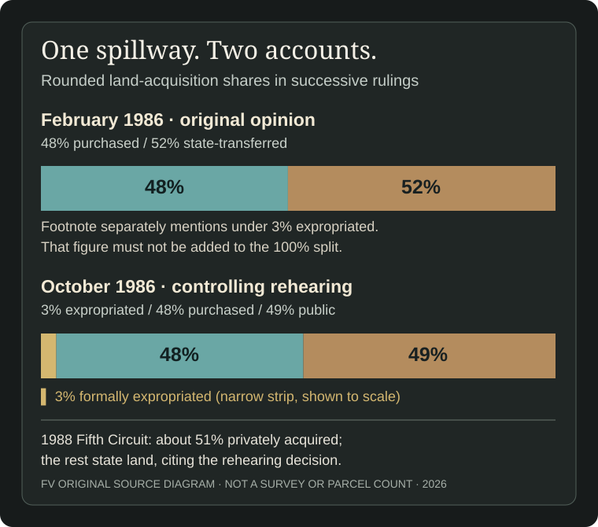
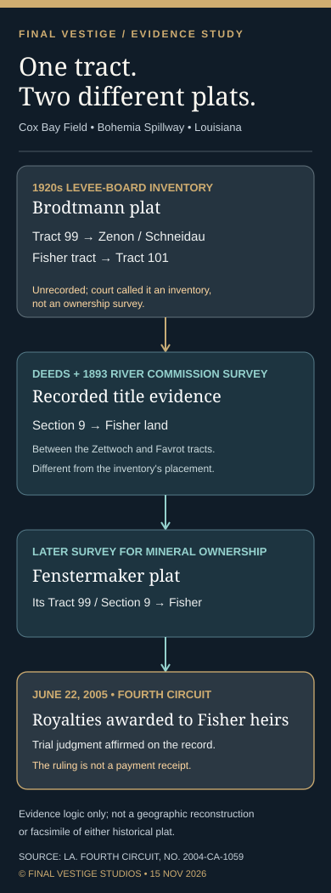
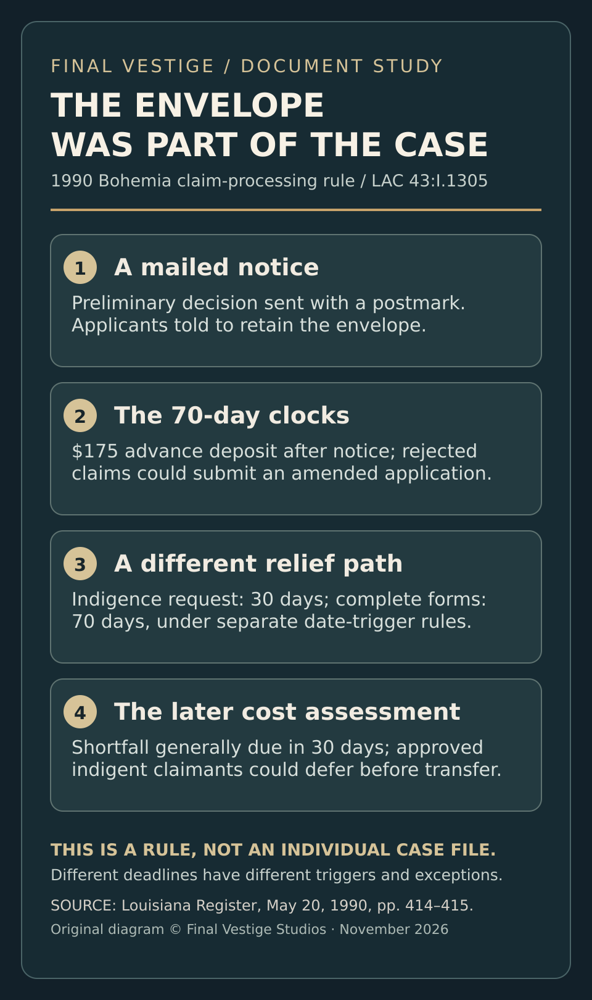

# The Spillway That Kept Its Names
*Final Vestige Investigations · reader-facing revision 40 · 15 November 2026 · REVIEW DRAFT — DO NOT PUBLISH*

**Deck:** Louisiana took land for a flood-control outlet, earned millions from its mineral rights, and later ordered parts of it returned. The courts settled questions of authority. The surviving records are less clear about who received the money.

**Editorial identity:** Concise narrative edition of [the 80-entry master dossier](./bohemia-spillway-2026-11-12-land-roster-rights-claim-investigation-draft.md). Preserve that dossier as the complete source ledger and long-form research appendix. This file does **not** supersede the separate Caernarvon 1927 WordPress draft #2151 or authorize publication. Original-source links below correspond to full dossier entries in brackets. Do not infer interviews, archive visits, or current 2026 balances from this work.

## The river came back

In February 2012, the Mississippi broke through its east bank southeast of New Orleans. The opening was modest at first. NASA's account describes a breach roughly 32 feet wide and five feet deep. Within the landscape, however, it reopened a much older argument about where the river belonged.

Aerial photographs taken in September 2007 show a canal before the breach. An image from Landsat 8 on February 13, 2023 shows the channel that became Mardi Gras Pass, carrying Mississippi water into the wetlands. The river did not need a vote or a deed to make that connection. [1]

**Two documentary views of the same landscape.** These images were made sixteen years apart, not at the moment of the 2012 breach. Their different acquisition methods and dates make them a record of visible change, not a controlled test of land gain. Both are locally stored in the Final Vestige WordPress media library, rather than hotlinked to NASA. They depict the landscape, not the ownership or payment dispute. [1]

*September 20, 2007. NAIP imagery provided by USDA Farm Service Agency; NASA Earth Observatory presentation by Joshua Stevens. Documentary aerial imagery, before Mardi Gras Pass opened. [1]*

*February 13, 2023. NASA Earth Observatory image by Joshua Stevens using USGS Landsat 8 data. Documentary satellite imagery, not an AI reconstruction. [1]*

The land underneath it was the Bohemia Spillway. In the 1920s, officials had deliberately altered this stretch of riverbank as flood protection for New Orleans. Decades later, Louisiana declared the original public purpose for acquiring **private title** had ended and ordered qualifying property returned. The river, apparently indifferent to the language, continued to cross the land.

That contradiction makes a good story. It is not the heart of this one. What makes Bohemia extraordinary is the financial and legal trail that followed: historic mineral income, an inheritance battle that helped change Louisiana's constitution, a requirement to account for the money, courts deciding whether landowners could demand payment, and financial statements that preserve figures without identifying every final recipient.

One question runs through those records. What did an eligible owner or successor actually receive?

## A public work becomes a revenue asset

The Louisiana Supreme Court's October 20, 1986 opinion places the spillway's construction in 1924–1926. The district removed levees to let unusually high Mississippi water pass toward the Gulf, relieving river stages upstream. It described a project area of approximately 33,000 acres. Not all of that land had the same origins.

### The boundary reached beyond the back levee

The river had one channel through the project. The law drew a larger perimeter. In a mineral-rights dispute decided through several opinions in **1955–1956**, Louisiana's Supreme Court described the Orleans Levee Board removing **approximately eleven miles of Mississippi River levee** and building a back levee **2,500–3,000 feet inland**. High water could pass through openings into a canal and then toward the Gulf by bayous. These distances come from the judges' reconstruction of the works, not a new survey of the 1920s engineering plans. [32]

The contested tract in that earlier case was in **Cox Bay Unit No. 2**, roughly **one mile east of the back levee**, outside the narrow strip where water passed between river and back levee. Yet the 1942 Legislature had defined the relevant public-land area from Bohemia Plantation to Cuselich Canal and **from the river to the sea**. The Supreme Court held that the tract fell within that broader statutory area. A legal boundary, in other words, could encompass land the spillway's physical flood corridor did not. [32]

The distinction mattered because **Grand Prairie Levee District** had leased the property to **Delta Development Company in 1936**, before the **Orleans Levee Board** granted a competing lease in 1950. The judicial outcome changed on rehearing. The original 1955 opinion and first 1956 rehearing recognized Delta's earlier lease in differing royalty allocations. On **second rehearing, November 5, 1956**, the majority construed the 1942 act as confirming Orleans's title from the spillway's 1925 construction, rendering the competing 1936 lease ineffective for this tract. Its amended **November 21 decree** awarded Orleans the disputed **3/16 share of 55 percent of oil-and-gas production proceeds** and corrected the operative well count from **four to six**. Those fractions concern a particular pooled production interest, not the entire spillway's mineral income. [32]

The case is a warning against reading the first reported judgment as the final one, and against confusing a court's allocation with proof that a registry distribution cleared. It concerned rival public-district and lessee rights decades **before** the 1984 private-owner restitution statute. It did not settle the later heirs' royalty demands. But it explains why a tract's position relative to the flowing river was never enough, by itself, to decide who owned its minerals. [32]

[**Original documentary diagram — one spillway, two boundaries**](./assets/bohemia-1956-physical-vs-statutory-boundary-2026-11-14.svg)  
*Final Vestige Studios, November 14, 2026. Original source-derived schematic, not a georeferenced map, archival photograph or evidence of payment. From the reconstructed project dimensions and tract location in the Louisiana Supreme Court's 1955–1956 opinion [32]. Standalone 390px/780px renders generated and the 390px view inspected; authenticated WordPress-theme QA remains outstanding.*

The court divided the area into three rounded categories: about 3 percent expropriated, 48 percent purchased in lieu of expropriation, and 49 percent transferred from public holdings. It reported $389,500 in aggregate compensation for the private acquisitions. The latter 49 percent was not privately owned land taken a second time. The distinction would become decisive when different applicants later argued they were entitled to restitution. [2]

### The three percentage points that changed on rehearing

The same thirty-three thousand acres acquired a second set of percentages while the court case was still moving. In its **February 24, 1986 original opinion**, the Louisiana Supreme Court described approximately **48 percent** as purchased from private owners and the remaining **52 percent** as transferred from the state. A footnote, citing URS Engineers' December 1984 hydraulic study, separately said **less than 3 percent** had required formal expropriation. Those figures are not three categories to add together: the opinion itself presents a 48/52 split, with expropriation mentioned inside its account of acquisition. The underlying engineering study has not been independently obtained for this investigation. [50]

After rehearing, the court's **October 20, 1986** controlling opinion described **3 percent expropriated, 48 percent purchased in lieu of expropriation, and 49 percent transferred from public holdings**. That three-part summary totals 100 percent. Both opinions concerned the same approximate **33,000-acre** project. The record available here does **not** show that three percent of the land changed hands in 1986, that acreage was missing, or why the judicial descriptions differ. Rounding, classification and source treatment are possibilities to check against the historic acquisition register, not established explanations. [2][50]

*© Final Vestige Studios, November 15, 2026. Original scale-based comparison of approximate judicial descriptions, not a historic map or deed-by-deed survey. First opinion and footnote [50], controlling rehearing [2], later federal summary [51]. Studio-owned vector, no borrowed images or remote assets; source inspected, production-theme 390px/1440px rendering not yet verified.*

The **August 15, 1988 Fifth Circuit** decision summarized the acquisition as **approximately 51 percent purchased or expropriated** and the remainder state land, expressly citing the October rehearing. More importantly, it held that the Orleans Levee Board, as a state agency, could not sue Louisiana under the federal Constitution for an uncompensated taking of the district's property. The bondholder's separate contract claim had become moot. This decided an agency-versus-state constitutional dispute. It did **not** adjudicate any heir's mineral royalty account or certify a beneficiary payment. [51]

That distinction is the reason to keep the percentages honest. How the original 33,000 acres were acquired matters to eligibility under the return law. But neither a rounded percentage nor a ruling about a public agency's power to sue can identify a particular tract's ownership, its surviving heirs, its royalty share or its paid balance. For those answers, the court's general history has to give way to deeds, tract certifications, judicial awards and transaction records. [2][50][51]

Not all who sought the land back were private heirs. In 2009, Plaquemines Parish Government, acting for the **Grand Prairie Levee District**, challenged the Department of Natural Resources' refusal to certify the district as a former owner of public acreage within Bohemia. That property had passed between government bodies under legislative acts in 1928 and 1942. Grand Prairie argued that Louisiana's land-return law should undo the transfer. The First Circuit Court of Appeal held otherwise. The constitutional exception covered land acquired from private owners through expropriation or purchase under its threat; it did not supply this public district with a right to reclaim property conveyed by legislation. The court affirmed dismissal of Grand Prairie's claim for failure to state a cause of action. [21]

That ruling makes the 49 percent figure more than a curiosity. Land acquired by a public-to-public transfer was not automatically eligible for **private-owner restitution**, even when its mineral rights generated revenues. Nor did the 2009 ruling adjudicate every private deed, certification, royalty award or payment on the other 51 percent. It decided the Grand Prairie district's claim under the return statute, not the ownership of every tract in Bohemia. [21]

The board's mineral income was considerably larger than its original land-acquisition cost. According to the court, it received $1,734,480 from 1929 through 1948 and $42,921,729 from 1950 through 1981. These are historical nominal receipts, not net profit, inflation-adjusted values, or money automatically owed to landowners. The judicial totals do not include a separate 1949 figure. [2]

To a city upriver, the spillway was flood infrastructure. To the levee district, it was also property generating income. For former owners and their descendants, the title question had survived the project itself.

The courts could not settle that question merely by deciding that a spillway had once been needed. The law had to decide whether the state could return public-controlled land at all.

## The heirs and the constitutional exception

Louisiana's constitution limited the government's ability to give away public property. Returning Bohemia titles would require an exception to that prohibition.

On October 22, 1983, voters approved a constitutional amendment permitting expropriated land, including mineral rights, to return to a former owner if the Legislature declared the original public purpose over. Act 233 of 1984 instructed the Orleans Levee Board to return eligible Bohemia property to original owners **or their successors**. In 1986, Louisiana's Supreme Court upheld that legislation. [3]

Those last three words mattered. The acquisitions dated to the 1920s. A rule permitting return only to people still alive under the precise designation *former owner* could have excluded many descendants who inherited the underlying property interest. The justices' original opinion described heirs' involvement in the campaign. The dissent argued that the constitutional amendment had not expressly included them. The controlling judgment allowed the Legislature's broader return mechanism to stand. [3]

### The sale the levee board tried to undo

The label on an old deed could decide whether a descendant got land back. Louisiana's return law covered purchases made under threat of expropriation as well as formal condemnations. The difference looked technical until the levee board tried to use it to recover property it had already returned.

On **August 21, 1997**, the board filed a counterclaim in the *Haspel & Davis* litigation. It argued that Louisiana's Department of Natural Resources had certified claimants without determining, tract by tract, whether their ancestors had surrendered property under a genuine threat of condemnation. Some sales, the board maintained, were voluntary transactions at fair market value, beyond the return law's scope. The board sought to undo transfers that did not qualify. [16]

That claim failed. In a decision dated **March 31, 1999**, Louisiana's Fourth Circuit Court of Appeal affirmed its dismissal. The judges looked back to **Act 99 of 1924**, which had empowered the board to condemn Bohemia land before purchase negotiations began. Under the specific language and circumstances of the Bohemia return statute, the court accepted that this authority amounted to the threat of expropriation for purchases made pursuant to the project. It also noted that the board had already executed deeds acknowledging the returned owners' qualifying interests. [16]

The procedural result matters as much as the reasoning. The court rejected **this board counterclaim**; it did not independently verify every heir's chain of title, turn state-held acreage into formerly private property or publish a complete roster of successful claimants. Its reasoning is nevertheless a crucial counterweight to the claim that a negotiated sale in the 1920s was necessarily a freely chosen sale. With condemnation already authorized, the buyer held a power an ordinary private buyer did not have. [16]

But authorization and fulfillment are separate things. The amendment could not locate a missing deed, establish every heir's place in a succession, or show the royalty balance attributable to a tract. Those tasks demanded documents: acquisition files, death and succession records, departmental certifications, conveyances, leases, judgments and accounts.

Some claimants obtained conveyances and litigated over royalties. Others ran into legal distinctions between private acquisitions and public-to-public land transfers. The return law did not make all 33,000 acres equally eligible. [2][3]

### The inventory put a family on another tract

On a single piece of Bohemia land, the dispute began with two drawings that could not both be right. The levee board's acquisition-era inventory called one parcel **Tract 99**, associated it with Zenon and Schneidau interests, and placed the Fisher tract farther downriver as **Tract 101**. Years later, successors were still asking courts to decide whose ancestors had actually owned the ground beneath a producing oil-and-gas lease. [49]

The contradiction was not resolved by treating every old government document as equally authoritative. The board's **Brodtmann plat had never been recorded in Plaquemines Parish**. In contrast, pre-1925 deeds and parish conveyance records located the Fisher tract in **Section 9**, between the Zettwoch and Favrot tracts. An **1893 Mississippi River Commission survey** and a later survey prepared by **C. H. Fenstermaker & Associates** supported that location. The Fenstermaker plat used the label **Tract 99** for the disputed Fisher tract; that matching number did not make it identical to the boundary drawn in the board's older inventory. [49]

On **June 22, 2005**, the Louisiana Fourth Circuit affirmed a trial-court judgment awarding the disputed mineral royalties to Fisher successors **Marc Fisher and Billie Breuille**. The opinion described the Brodtmann drawing as an inventory rather than a reliable ownership survey and rejected competing claims based on it. The appeal was expressly **not designated for publication**; its value here is the documented result of this particular title dispute, not a universal rule for every Bohemia tract. The decision identifies who prevailed on entitlement, **not how much money was ultimately disbursed**. [49]

A restitution statute could reopen an old public taking. It could not make two incompatible plats agree. Before heirs could collect from the land, someone had to establish where their ancestor's land had been. This case gives that otherwise abstract problem a tract number, a documented record conflict, and a judicial resolution; it supplies no proof about other families' claims or about cash received. [49]

*One tract, two incompatible plats. Original evidence-logic diagram, © Final Vestige Studios, November 15, 2026; based solely on the Fourth Circuit's June 22, 2005 opinion, No. 2004-CA-1059. Not a geographic map, archival scan, actual survey reproduction or claimant-payment record. [49]*

### The claim came with its own bill

For families trying to turn the 1984 return law into a deed, the application had a price. The Department of Natural Resources' Bohemia rules, as compiled in the **December 2002 Louisiana Administrative Code**, required an **advance $175 deposit per claim** before substantive processing. The money paid for administration, not the land. The published rule allowed **70 days after notice** to deposit it and warned that an untimely deposit could invalidate the claim. Other provisions required enough funds to cover the work before processing continued. Those deadlines describe the rule; they do not establish that any particular descendant lost a claim. [44]

The procedure was not simply a flat filing fee. The special master was to assess the **actual cost of each claim**: an excess advance was refundable, while a shortfall could require another payment. Under the 2002 text, the secretary allowed **30 days** for the additional payment, with the claim at risk if it was not made. Applicants unable to afford the advance could seek an indigence determination using a questionnaire and affidavits. That procedure could defer payment before the paperwork went to the levee board, but it did not extinguish the final obligation; the published regulation still required approved indigent claimants to meet actual administrative costs before land transfer. The same rules prescribed a 30-day route to seek judicial review of a denied indigence claim. These were procedural possibilities, not observed outcomes for a named family. [44]

#### The postmark was part of the evidence

A government rule can look timeless in a compilation. This one has a traceable public revision. On **May 20, 1990**, the *Louisiana Register* published amendments to the Bohemia claim-processing rule. Before a claim could reach substantive review, the department was to send the preliminary decision with a metered postmark. The rule instructed recipients to **keep the envelope**. In that process the ordinary wrapper of a letter could become evidence of when a claimant's legal time began. [46]

The clocks were not interchangeable. A rejected applicant generally had **70 days from the postmark** to submit an amended claim; a claim advanced beyond preliminary review required a **$175 advance cost deposit within 70 days after notification**. The amended rule said an untimely deposit could invalidate the claim. An indigence request operated on a separate timetable: a written request within **30 days**, and questionnaire plus three affidavits within **70 days**, reckoned from the later of the rule's effective date or the notice postmark. A special master could grant or deny indigence; a denial was subject to a 30-day payment or judicial-review route. The text describes choices open to applicants, not the outcome of any particular family's application. [46]

After substantive examination, actual costs still had to be assessed. Ordinarily the applicant had **30 days** to pay any deficiency before the papers were transmitted; successful indigent applicants could defer that payment, but the 1990 text still made it due **before land transfer**. Read alongside the 2002 compilation, this official amendment establishes that the postmark, notice, cost assessment, affidavit and special-master decision were each potential links in a claimant's administrative file. It does **not** establish continuous identical wording in every intervening year, identify an actual invalidated claim, or prove that any claimant received or lost title. Without the individual administrative docket, that last question remains open. [46][44]

*Original documentary diagram, © Final Vestige Studios, November 15, 2026. Based on the Louisiana Register of May 20, 1990, pp. 414–415. It shows distinct rule pathways, not a known applicant's history. [46]*

A different statute clarifies where that money belonged. **Louisiana Revised Statutes §30:21.2**, enacted in **1987**, directs assessment of actual administration costs after disposition of a Bohemia claim and deposit of money received under that section into the **state treasury**. The Legislature's currently displayed version uses the renamed Department of Conservation and Energy after a change effective **January 10, 2024**; the 2002 code appropriately names its predecessor, the Department of Natural Resources. This is a third accounting stream, distinct both from mineral revenues potentially owed to returned owners and from litigation money paid into a court registry. Fees recovered by the state cannot be counted as claimant restitution merely because both records say *Bohemia*. [44][45]

The records examined show the legal machinery, not its aggregate effect. We have not obtained the actual 1980s–2000s claim-fee receipts, indigence decisions, administrative cost assessments, notices mailed, voided-claim files or individual land-transfer balances. They would be necessary to establish whether and how the rules delayed or defeated eligible applications. Until then, the finding is narrower but consequential: the program required proof of title while exposing applicants to a separate bill for the proof to be processed. [44][45]

*Original source-derived graphic, **“A claim came with a bill.”** Final Vestige Studios, November 15, 2026. Based on the December 2002 Louisiana Administrative Code, Title 43, Part I, Chapter 13, and the Louisiana Legislature's text of R.S. 30:21.2. It is not a historical photograph or evidence of payment by any applicant. [View editable SVG](./assets/bohemia-claim-fees-v34.svg). Alt: “Four stages of the published 2002 Bohemia claim-cost rules: $175 advance, actual-cost accounting, indigence deferral and statutory state-treasury destination; no individual payment verified.”*

### The notices did not vanish with the lawsuits

A university collection inventory preserves another strand of the Bohemia record. Southeastern Louisiana University's *Rod Lincoln Collection* lists a **February 21, 1987** *Times-Picayune* notice of land returns, a **1988** article cataloged under a headline about claimants contesting the **$175 fee**, and a **December 15, 2000** *Plaquemines Gazette* settlement headline. It also lists 1984 legislative and legal-notice coverage. These are **finding-aid descriptions, not inspected clippings**. The index does not verify the claims in those articles, identify which heirs were paid, or prove that any settlement amount cleared. [53]

The sequence nevertheless suggests a useful correction to the reporting chronology: the **1988 fee-dispute headline precedes the 1990 rule amendment** just examined, so the amendment cannot be presented as the beginning of public objections. The cataloged 1987 notice is another promising lead for matching claimant instructions to administrative deadlines. The actual newspapers, agency mailings, special-master records and payment evidence must be obtained before drawing conclusions about a family's experience. Attempts to open the institutional finding aid directly returned HTTP 403; this research verified indexed collection descriptions only, not physical holdings. [53]

*The second paper trail. Original Final Vestige Studios vector, November 15, 2026, based on the Southeastern Louisiana University collection finding aid. Not a historical scan or proof of the clippings' contents. [53]*

## The accounting was already required

The same **March 31, 1999** ruling supplies a separate piece of the accounting chronology. The landowners had sought a declaration of royalty rights and an order placing revenue in court escrow. The judges said the Department of Natural Resources lacked authority to determine those contested royalty claims before the Legislature enacted more detailed escrow and payment procedures in **Act 1364 of 1997**. They therefore rejected the argument that the landowners' earlier lawsuit had been premature for failure to exhaust an administrative remedy that did not then exist. [16]

A duty to account in 1984, court enforcement efforts in the 1990s, and statutory escrow machinery added in 1997 are different steps. None should be mistaken for a dated receipt showing money reaching a particular successor.

The central document in this investigation is not a secret memorandum. It is Section 3 of the 1984 law.

It required the Orleans Levee Board to provide Louisiana's Department of Natural Resources with a thorough accounting of revenues received from affected property and made the information available to applicants. Those obligations were more than an aspiration by a later reformer. They appeared in an enacted statute and were examined in litigation. [3][4]

On September 4, 1996, the Louisiana Fourth Circuit Court of Appeal decided *Riley v. Riley*. Members of a family disputed title to Bohemia property already returned to other relatives. Among their requests was access to revenue accounting. The appellate court described the statutory accounting duty as ministerial and accepted the pleaded applicants' access theory for purposes of reviewing the procedural dismissal. It reversed the improper partial dismissal and remanded the case. [4]

The precise result is important. The appellate judges did **not** make a final finding that those plaintiffs owned the tract, order the board to pay them a specific royalty amount, or produce the accounting themselves. Their ruling kept the access question alive in that litigation. The record available to this investigation does not establish whether the accounting was subsequently furnished.

There is an important difference, however, between failing to locate a complete accounting in an archive and proving that none was ever made. Another branch of the litigation shows that at least one accounting **was** produced.

In *Vogt v. Board of Commissioners*, decided June 9, 1999, the Fourth Circuit described a May 5, 1997 trial-court order directing the levee board to provide an accounting. According to the published opinion, the board subsequently produced figures for revenues received from the disputed property beginning June 29, 1984, totaling **$2,853,358.44**, and the plaintiffs accepted that accounting. The record before the court included the accounting itself, a July 30, 1997 attorney's letter about it, and a DNR claimant-certification list covering Tracts 71–99. These are concrete leads to an existing document, not hypothetical records that the state might once have created. [14]

The next step was more complicated than declaring the whole sum payable to everyone in the courtroom. A January 30, 1998 judgment awarded the reported total, but on reconsideration the trial court issued a revised judgment, signed **July 24, 1998**, identifying individuals and the amounts due to each. Its reasoning distinguished participating owners' fractional interests from the shares of absent or unrepresented co-owners. The appellate court affirmed in June 1999. In other words, the accounting established a pool of receipts from particular properties; entitlement to a particular share still required an ownership analysis. The published appellate opinion does not reproduce the full account, the individual allocation schedule or proof that each award was eventually collected. [14]

The correction narrows the unresolved question. We can no longer write that no accounting is known to have been produced. We can say that the **case-specific Vogt accounting is attested in a published judicial decision**, while the scope and delivery of a complete accounting under Section 3 to DNR and other applicants, including those outside that litigation, have not been independently established. It is the original exhibits and beneficiary-level receipts, not the mere existence of an accounting, that now deserve priority.

[**Original evidence figure — the accounting that reached court, 1997–2002**](./assets/bohemia-vogt-accounting-produced-1997-2002-2026-11-14.svg)  
*Final Vestige Studios, November 14, 2026. Original source-derived SVG from Vogt (1999) and the later federal appeal (2002), not a reproduction of the missing accounting or a payment register. The $2,853,358.44 figure is aggregate disputed-property revenue, not a verified payee distribution. Mobile/2x standalone raster inspection passed; production-theme placement remains on hold.*

Thirteen years later, a proposal in the Louisiana Legislature again treated the Bohemia financial record as something worth reconstructing. Senate Bill 350's June 2009 conference report proposed a much broader examination by the Legislative Auditor and State Law Institute: land history, mineral revenue, proceedings, judgments and claimant payments. The House had passed an amended measure, and the Senate adopted the conference report. The official bill tracker stops there. **The proposal did not become an enacted law.** [5]

At a September 3, 2009 Legal Committee meeting, the flood authority's president, **Timothy Doody**, said the authority was having a historical account of the Bohemia Spillway prepared. Committee member Thomas Jackson requested a case-status briefing and described the drain of litigation on the Orleans Levee District. The committee also wanted future legal invoices to show money spent to date on each case, rather than only a current bill. These were contemporaneous discussions of record-keeping and litigation costs, not proof that the commissioned history was ever delivered or that the royalty accounting had been reconciled. The historical account and itemized case-cost reports are now specific archival targets. [31]

It would be misleading to say Louisiana first thought of an accounting in 2009. The 1984 law had required one. The unpassed 2009 proposal sought something different and more comprehensive. Neither record establishes that a complete, claimant-by-claimant reconciliation exists today.

[**Original evidence figure — the three accountability checkpoints**](./assets/bohemia-three-accountability-checkpoints-2026-11-14.svg)  
*Final Vestige Studios, November 14, 2026. Source-derived original vector artwork comparing enacted 1984 accounting duty, 1996 procedural appellate ruling and unpassed 2009 audit proposal. Not a historical photograph. Production-theme/mobile placement not cleared.*

### The accounting the district said it kept

There is stronger evidence than the *Vogt* case alone that an accounting system existed. In its **June 30, 2008** financial report, Southeast Louisiana Flood Protection Authority–East reproduced the Orleans Levee District's disclosure that it was maintaining a **complete accounting of royalty revenues** under the Bohemia return law. The same note said DNR had certified interests in **164 of 220 tracts** before the 1997 and 1999 amendments, and that the property claims certified through **June 30, 2005** had been conveyed. The note is visible on the scanned report's **printed page 32**. [17]

That is an official contemporaneous *institutional statement*, not the accounting schedules themselves. An audit opinion on financial statements should not be confused with independent verification that every royalty entry was accurate, all heirs could inspect it, or every beneficiary had been paid. The 164-tract count describes certifications within a stated period, not a claim that the other 56 tracts were stolen or that every one should have been returned. [17]

The report also refers to several payments since 2001 and repeats a **$600,000 payment into the court registry on February 26, 2004** in the separate *Haspel & Davis* proceeding. It records that class members had agreed to accept approximately **$10.08 million** to settle the case. That statement is not an additional disbursement, and the report alone does not establish whether the referenced agreement survived later court proceedings. The **2007 Fifth Circuit opinion** describes an earlier contractual arrangement totaling $21.085 million and notes that a second agreement made in June 2005 was later set aside. The two figures should not be silently added, nor presumed to refer to separate, effective obligations without the underlying contracts. [15][17]

[**Original evidence figure — the accounting trail, 1984–2026**](./assets/bohemia-accounting-evidence-checkpoints-2026-11-14.svg)  
*© Final Vestige Studios, November 14, 2026. Original source-derived mobile diagram from Act 233 (1984), Act 1364 (1997), the two 1999 Fourth Circuit decisions [14][16], and the FY2008 government financial report [17]. The diagram distinguishes requirements, court rulings and institutional accounting representations from actual claimant receipts. Standalone 390px and 780px previews visually inspected; not production-theme QA.*

The surviving evidence thus points to **two recoverable kinds of paper**: a case-specific 1997 *Vogt* accounting filed in court and a district-maintained royalty accounting described in a 2008 government report. Whether the latter encompassed the former, how it was delivered to DNR, and how the entries match transfers to individual recipients remain unanswered. That is a narrower and more testable question than whether anyone ever bothered to keep books.

## A judgment could outlive its collection

The accounting entered the record. The judgment entered the record. Payment required another step.

On **October 26, 2000**, the *Vogt* claimants asked a Louisiana court to seize **$1,831,528.49**, plus claimed income and interest, to satisfy an earlier judgment. That particular enforcement request was smaller than the **$2,853,358.44** aggregate royalty judgment. The appellate opinion records both numbers but does not reconcile them. Without the original seizure motion and the individualized allocation order, the difference should not be explained away as a discount, payment, or reduction. [18]

At the hearing, certified public accountant **David D. DeMonte**, testifying at the plaintiffs' request, described financial statements and the district's 1999 and 2000 legislative audits. He estimated the levee district's net worth at approximately **$120 million** as of June 30, 2000. He testified to **$57 million in investment securities**, within which he identified a **$9 million money-market account** and **$2.7 million earmarked for Bohemia litigation**. These are reported parts of a larger investment portfolio, not three funds that can be added together. DeMonte argued that money was available to satisfy the claim without impairing the district's work. [18]

His account of the bookkeeping was equally revealing. According to the 2002 opinion's account of his testimony, proprietary and public funds had been deposited together and distinguished through accounting entries rather than physically segregated. That is a witness's description, not an independent forensic audit of where the royalties went. Nor does a notation earmarking $2.7 million establish that this was cash legally available to these particular plaintiffs, that it belonged to them, or that it later reached them. The underlying audit workpapers and account statements have not been independently reconciled here. [18]

The court refused the requested seizure in **November 2000**. On **March 27, 2002**, Louisiana's Fourth Circuit affirmed the denial of both seizure and mandamus. Under the state constitutional and statutory rules it applied, public assets could not be seized to satisfy the district's judgment, and a court could not force the political subdivision to appropriate money for payment. The claimants had also proposed a tax if necessary; the court rejected reliance on the special levy-compensation clause for royalties that arose from the **1984 land-return law**, rather than a fresh taking of land used for a levee. Its ruling concerned enforcement of this judgment, not whether the original royalty entitlement had been established. [18]

Then came a different ruling on a different question. On **June 14, 2002**, the federal Fifth Circuit reversed dismissal of the *Vogt* plaintiffs' constitutional takings suit. It held that the district lacked the Eleventh Amendment immunity it asserted and that the pleadings could proceed as a federal takings claim. The case was **remanded**, not paid: the judges expressly left the ultimate outcome open. The state ruling said the existing money judgment could not be collected by the requested coercive methods; the federal ruling allowed a separate theory to be litigated. They should not be flattened into either a final federal victory or a proof of permanent nonpayment. [6][18]

### What the district's 2002 books say was paid

In September 2002, the Louisiana Legislative Auditor published the Orleans Levee District's financial statements for the year ended June 30. Buried in Note 20, under litigation and claims, is something more concrete than an attorney's estimate: a dated account of **payments, deposits and balances** attributed to the two major Bohemia cases. The report is a contemporary government financial disclosure. It is not a roll of beneficiaries signing receipts. [26]

For *Vogt & Edgecombe*, the district listed a **$1,831,528 judgment** and stated that claims below $10,000 had been paid in full by **August 15, 2000**, totaling **$108,683**. It reported **$1,722,845 still unpaid as of June 30, 2002**, plus interest. The principal arithmetic reconciles at the precision published: $1,831,528 less $108,683 equals $1,722,845. This supplies an institutional explanation for a smaller judgment figure near the **$1,831,528.49** sought in the 2000 seizure proceeding. It does **not** independently establish how the earlier **$2,853,358.44** tract-revenue accounting became the individual judgment amounts. That requires the July 1998 allocation order and original exhibits. [14][18][26]

The *Haspel & Davis* disclosures are different. The district listed an **$18,767,145 judgment**, reported **$1,968,264 deposited into the court registry by August 15, 2000** for smaller claims, another **$350,000 deposited there in December 2000 for agreed fixed costs**, and **$371,532 paid on the judgment by August 15, 2001**. Its stated unpaid principal at June 30, 2002 was **$16,077,350**, plus interest. The individual entries do not establish that registry money had been distributed to every entitled owner. Nor can the 2002 figure simply be added to the different, later settlement terms discussed in the 2007 federal appeal: overlapping obligations and changes in the litigation have to be traced through the actual agreements. [15][26]

Here, then, is a useful boundary in the evidence. By **June 30, 2002**, the district was formally reporting some payments and substantial unpaid judgments. By **June 2023**, an official was saying in meeting minutes that a settlement had subsequently been paid. Those statements are not necessarily inconsistent; they refer to different dates and levels of detail. Together they make a specific records request possible: the intervening court-registry disbursement orders, settlement-payment schedules, cleared transactions and satisfaction filings, rather than an unqualified accusation that no Bohemia money was ever returned. [22][26]

[**Original evidence figure — payments reported, payments not independently confirmed**](./assets/bohemia-2002-audit-payment-disclosure-2026-11-14.svg)  
*© Final Vestige Studios, November 14, 2026. Original source-derived vector using the Louisiana Legislative Auditor FY2002 report, Note 20, printed p. 54 [26]. Separates 2002 institutional payment/deposit reports from claimant-level receipts; not a current balance or historical photograph. Standalone 390px and 780px local previews visually inspected. A separate responsive HTML adaptation is staged in WordPress draft #2488; authenticated current-theme 390px and 1440px screenshots remain pending.*

### Twenty-six cases behind one judgment

The *Vogt* lawsuit was not the district's only courtroom problem. In Louisiana's comprehensive financial report for the year ended **June 30, 2000**, the Orleans Levee District appeared as a defendant or co-defendant in **73 lawsuits**, **26 involving the Bohemia Spillway**. The report described the claims as involving damages, possession of property and contract disputes. It stated that the district's financial statements carried **$2,429,293 in liabilities for these claims and litigation**. That is an institution-wide litigation figure, **not** a balance solely for the twenty-six Bohemia cases, and not evidence that any specific claimant received or remained owed that sum. [19]

Another official report fixes the fiscal setting more precisely. In its March 21, 2001 report to the legislature, the Louisiana Legislative Auditor listed **$46,982,153 in actual revenues**, **$49,910,859 in expenses/expenditures** and an **ending balance of $25,008,373** for the Orleans Levee District in the fiscal year ended June 30, 2000. Those are the report's budget-summary categories, not a claimant escrow ledger. The ending balance cannot be subtracted from the `Vogt` judgment or compared directly with DeMonte's approximately $120 million net-worth testimony. They are different accounting measures. [20]

Read together, the records suggest why a judgment could produce years of new litigation without providing a shortcut to an unpaid balance. The state counted lawsuits, the accountant described assets and the courts debated which assets could be reached. None of those sources is a substitute for the settlement register or a particular beneficiary's cleared payment. The 2000 comprehensive report has now been checked against the **original printed page 67 (PDF image index 73)** as well as extracted text. The dated, source-matched image confirms the 73-case total, its 26 Bohemia cases and the broader $2,429,293 litigation liability. That clears the source-image verification for this passage, **not** the separate question of actual claimant payments or WordPress production layout. [18]–[20]

[**Original evidence figure — twenty-six Bohemia-related lawsuits among seventy-three**](./assets/bohemia-2000-litigation-snapshot-2026-11-14.svg)  
*© Final Vestige Studios, November 14, 2026. Original source-derived diagram based on Louisiana's fiscal 2000 comprehensive annual financial report, Note 16, printed p. 67. The $2,429,293 litigation liability describes the broader district cases, **not a Bohemia-only reserve or claimant payment**. Tested as a standalone 390px and 780px vector rendering; state CAFR printed p. 67/PDF image 73 visually checked November 14, 2026; WordPress production-theme QA remains pending.* 

[**Original evidence figure — a judgment and the barrier to collection**](./assets/bohemia-vogt-judgment-collection-barrier-2026-11-14.svg)  
*© Final Vestige Studios, November 14, 2026. Original source-derived procedural diagram based on the March 2002 Louisiana appellate opinion and June 2002 Fifth Circuit opinion. Witness-reported amounts are nested and historical; neither judgment nor earmark proves disbursement or a 2026 balance. Standalone/vector verification only; WordPress theme QA remains outstanding.*

### A funding plan loses on the House floor

The obstacle to collecting a judgment also reached the Louisiana Legislature. On **May 24, 2000**, Representative Wooton offered amendments to a bill concerning riverboat gaming franchise fees. His proposal would have created a **Bohemia Spillway Debt Retirement Fund**, supported by up to **$3 million per year** from specified increases in those fees. Payment would still have depended on annual legislative appropriations. This was a proposed revenue mechanism, not cash in an established account. [28]

The draft went further than a general pledge to repay landowners. It proposed monthly court-registry distributions, assigning **14.18 percent** of available money to the *Vogt/Edgecombe* judgment creditors and **85.82 percent** to the *Haspel & Davis* class-action fund. Its language described claims over $10,000 in those two suits as the remaining unpaid Bohemia matters. That was language in a **proposed amendment**, not an audited census of claimants or a judicial finding that every other claim had been resolved. The percentages reveal how one legislator proposed dividing a future revenue stream; they are not proof that any disbursement occurred. [28]

The House recorded the outcome with unusual clarity: **36 yeas, 66 nays. The amendments were rejected.** The vote establishes the failure of this particular attachment to **House Bill 221** on that date. It does not explain each legislator's reasons, determine the fate of other proposals, or prove that no later appropriation paid any claimant. Yet it places a missing piece between the lawsuits and the audited accounts. Lawmakers discussed a specified payment channel, complete with a ceiling, allocations and court supervision. The surviving vote records why *this* channel was not created by *this* amendment. Following the money still requires enacted appropriations and actual court-registry receipts, not the rejected draft. [28]

[**Original evidence figure — a proposed repayment channel, defeated 36–66**](./assets/bohemia-2000-defeated-repayment-amendment-2026-11-14.svg)  
*© Final Vestige Studios, November 14, 2026. Source-derived original diagram of the May 24, 2000 House-floor proposal. The proposed $3 million annual ceiling and 14.18/85.82 percent split were **not enacted by this vote** and are not evidence of payments. Official journal text checked; original PDF-page screenshot retrieval failed. Production-theme QA pending.*

### When the law recognized payments and a deadline

Five years after the failed repayment-fund amendment, Louisiana adopted a different measure. **Act 130 of 2005**, signed by Governor Kathleen Blanco on **June 22, 2005**, rewrote parts of the Bohemia return procedure. It did not establish that the contested payments were complete. It set down the Legislature's account of what had happened, who might still claim a title, and what would happen when one deed was challenged by another claimant. [29]

The act identified the **December 11, 2000** *Haspel & Davis* consent judgment by docket and said the levee board had made **partial payments**, with further payments intended. It also said revenues ordered returned to existing record owners had been paid **or were being settled in the current fiscal year**, while payments involving **disputed titles had been suspended pending litigation**. Those statements are significant because they make both payment and nonpayment part of the legislative record. They are **not** a disbursement audit: the enrolled act supplies no claimant-by-claimant bank transfers, no sum paid during 2005, and no proof that litigation over a particular fractional interest ended. [29]

The new procedure imposed a **June 30, 2007 filing cutoff** for a person seeking certification for the return of Bohemia property. After land was conveyed to a certified owner, it directed the board to contact that owner **within 30 days** to negotiate a final settlement for mineral receipts collected after **June 29, 1984**. The deadline for an application, the required outreach, the conveyance, the negotiated settlement and the actual payment were separate events. The statute shows what the board was instructed to do; it does not verify that every letter was sent, every deed recorded, or every offer accepted. [29]

One provision makes the competing-heir problem especially plain. Where a later title judgment favored a third party after the board had paid the owner of record, Act 130 directed specified recovery claims **against that record owner rather than the levee board**. It sought to keep the public authority outside the resulting title lawsuit. That is the text of the 2005 rule, not a conclusion about how every later court applied it or whether it could defeat every legal challenge. For a claimant trying to follow a mineral payment, the destination of the first check could matter as much as the ownership decision eventually made in court. [29]

[**Original evidence figure — the legal path is not the payment path**](./assets/bohemia-2005-claims-payments-act130-2026-11-14.svg)  
*Final Vestige Studios, November 14, 2026. Original diagram based on Act 130 of 2005, pp. 3–7, with enactment status separately verified in the official legislative tracker. It distinguishes a reported partial settlement, a 2007 claims-filing deadline, a 30-day negotiation-contact obligation and unresolved title disputes. No historical photograph, reported individual payment or legal-advice graphic; WordPress production-theme QA pending.*

### A family's judgment had three different prices

The public accounts tell us what a levee district owed in the aggregate. A single succession's case shows what even a precise judgment cannot tell us. On **December 3, 1990**, the Orleans Levee District conveyed a tract to the successors of Josephine and Henry Taylor Jr. By the time the royalty dispute reached trial in **2003**, the parties agreed that damages were principally attributable to mineral production on that tract. They stipulated **$166,842.53 in principal**. The trial court's **October 14, 2003** judgment, as reproduced in the later opinion, states **$166,842.50**. The appellate document contains both numbers, a three-cent difference that cannot be resolved from the opinion alone. [41]

The larger dispute concerned the price of waiting. The trial court applied the district's average investment-return rate to the period **July 1, 1991 through July 1, 1993**, following Louisiana's **1997** statutory amendment, and ordered **legal interest from July 2, 1993 until paid**. The succession pressed for interest calculated back to **1984**, when Louisiana first ordered the return of Bohemia property and qualifying revenues. The **Louisiana Fourth Circuit**, in its **April 6, 2005** opinion, rejected the proposed earlier calculation and affirmed the trial court's interest treatment. Those dates identify a judicial method for calculating an obligation, not a bank's record of interest actually delivered. [41]

The district won a different issue. The trial court had also allowed attorneys' fees. On appeal the judges **reversed that award**, finding no contractual or statutory basis for fees in this particular action. A claimant could thus prevail on principal, retain an interest award, and lose a disputed right to recover litigation fees. The court did not determine what the succession ultimately deposited, withdrew, or distributed among heirs. Nor can this individual judgment be added without adjustment to later district-wide liability totals; those accounts may already include it. [41]

[**Original evidence diagram — principal, two interest periods, and reversed fees**](./assets/bohemia-taylor-estate-three-ledgers-v32.svg)  
*© Final Vestige Studios, November 15, 2026. Original vector based on the Louisiana Fourth Circuit's published opinion in No. 2004-CA-0358, especially opinion pp. 3–4 and 7–9; primary court text reproduced at Justia. Alt: “Three separate outcomes in the Taylor succession case: agreed principal of $166,842.53, interest spanning two statutory periods, and attorneys' fees reversed on appeal; no payment receipt identified.” The SVG uses no third-party pixels or historical reconstruction. Source geometry reviewed; actual WordPress-theme/mobile render not yet verified.*

### The deed returned before the royalty fight ended

For the successors of Carter Ursin, Charles Ursin and Joseph C. Eusan, the land had a number: **Bohemia Tract 78**. A Louisiana appellate court reconstructed its chain of possession from **July 8, 1925**, when the family inherited it, through an **August 15, 1925** conveyance to the Orleans Levee District. The return would take another eighty years. The Department of Natural Resources certified the successors on **June 3, 2005**; the district conveyed Tract 78 on **August 9**, and the conveyance was recorded on **August 25**. Those dates come from the court's account of the transaction, not an independently retrieved parish deed. They establish something important without proving everything: at least one identifiable parcel was returned, but the financial dispute survived its return. [47]

The successors sued for revenue from the years when the district held the tract. At trial, the parties stipulated **$996,596.40** in past revenues attributable to the property for the period beginning **June 29, 1984** and ending **August 8, 2005**. The trial court also awarded **$366,957.12** in statutory interest and **$365,777.34** more as interest treated as *civil fruits*. On **September 26, 2012**, the Louisiana Fourth Circuit affirmed the revenue and statutory-interest awards, along with legal interest from judicial demand, but **reversed the entire $365,777.34 civil-fruits component**. The three printed amounts describe distinct components of a trial judgment; adding them together and calling the result a final appellate award would count money the appeals court disallowed. [47]

A procedural distinction explains part of the outcome. The successors' claim had been certified before the 2005 repeal of the earlier statutory interest provision, and the appellate judges held that this interest right had already vested. Their claim also survived the district's prescription challenge. None of that supplies a cancelled check or a beneficiary distribution ledger. The opinion confirms a recorded conveyance as recited by the court and a judicial obligation; it does **not** verify ultimate collection, any subsequent settlement, or which heirs finally received the money. [47]

[**Original evidence diagram — one returned deed, three different appellate outcomes**](./assets/bohemia-tract78-appellate-outcomes-v36.svg)  
*© Final Vestige Studios, November 15, 2026. Original source-derived SVG, no third-party imagery and no AI reconstruction. Source: Louisiana Fourth Circuit, No. 2011-CA-1105, opinion pp. 2, 4 and 11, original PDF page images visually inspected. Alt: “Tract 78 conveyed in August 2005; on appeal $996,596.40 past revenue and $366,957.12 statutory interest were affirmed, while $365,777.34 civil-fruits interest was reversed. No actual claimant payment verified.” Production WordPress-theme checks remain outstanding.*

### The settlement that changed the remedy

A second group of Bohemia landowners was still in court years later. Their case, *Haspel & Davis*, began in 1988. After twelve years of state litigation, they chose a settlement rather than a complete trial of every claim. That choice did not make their lost mineral income imaginary. It changed what a court could do when the money did not arrive as expected.

The terms appear in a July 23, 2007 opinion of the United States Court of Appeals for the Fifth Circuit. The parties had agreed to **$2,318,263.72 designated for immediate payment** and another **$18,767,145.26 conditional on appropriated funds**. Those two contractual amounts total **$21,085,408.98**. The court was describing what the parties agreed to, not certifying that the full amount had reached the former owners. [15]

The agreement contemplated at least **$2.6 million a year**. The appellate judges reported that the levee board had made numerous payments but had fallen short of that annual benchmark. The distinction matters: an assertion that the landowners were never paid would disregard the court's express account, while an assertion that the settlement was satisfied would go beyond it. The opinion contains neither a complete payment ledger nor a final allocation by beneficiary. [15]

When the class returned to federal court in 2006, it argued that failure to meet the consent judgment amounted to another unconstitutional taking. A federal district judge awarded roughly **$17.44 million**, plus additional sums. But the Fifth Circuit **reversed that judgment on July 23, 2007, and vacated the seizure orders**. In the appellate court's reasoning, the participants had compromised the underlying takings claim through their settlement. Their remaining remedy was enforcement of that agreement and consent judgment in the state court that had retained jurisdiction. The ruling did not decide that the contractual obligations had all been paid. Just as importantly, it expressly **did not decide** whether Louisiana's independent restrictions on seizing public property would have barred collection had the underlying judgment survived: vacatur of that judgment was enough to dispose of the seizure orders. [15]

That is not what happened in *Vogt*. The *Vogt* litigants pursued a royalty judgment without first surrendering the same claim in a comprehensive settlement, and the Fifth Circuit in 2002 permitted their constitutional theory to proceed. The 2007 court expressly distinguished the two cases. They concerned different plaintiffs, different procedural histories and different legal remedies. Their dollar figures cannot be added to calculate a single Bohemia debt. [6][14][15]

[**Original evidence figure — a settlement is not a payment record**](./assets/bohemia-2007-settlement-terms-mobile-2026-11-13.svg)  
*Final Vestige Studios, November 13, 2026. Original vector diagram showing the two contractual sums described by the Fifth Circuit, the annual benchmark and the reversal. It depicts settlement obligations, **not** bank transfers, beneficiary receipts or a verified present-day balance. Production-theme responsive QA still required.*

The court's 2007 opinion also reports that a second settlement negotiated in June 2005 had been set aside by a state court. That discarded agreement is not another pool of compensation to add to the first. The appellate opinion gives slightly different dollar-and-cent amounts for successive lower-court judgments. With the federal award reversed, a neat surviving **$17.44 million** payable verdict would be a false conclusion. The accurate result is a blocked federal takings route, with state-court settlement enforcement rights remaining. [15]

### The $19 million that was not a payout

One number in the next annual report could be mistaken for a long-delayed reckoning. In its financial statements for the year ended **June 30, 2007**, the Orleans Levee District reported that, following a joint motion during the federal judgment fight, **$19 million of district funds had been set aside pending appeal**. The audit note recounts the July 23, 2007 reversal as well. That $19 million was described as money held against an unresolved legal dispute, not checks issued to former owners. The underlying segregation account, order and subsequent release instructions have not yet been reconciled with beneficiary records. [15][27]

The same note reveals an administrative squeeze alongside the litigation. **June 30, 2007** had been designated as a deadline for filing claims to Bohemia property. The district reported a rush of filings before the cutoff and said **16 suits** had been filed in the matter as of that date, while acknowledging that it could not predict which claims would prove valid. This figure cannot be plotted against the **26 Bohemia-related lawsuits** disclosed in the district's FY2000 report as though both were a stable census: they describe separate reporting dates and potentially different case populations. [19][27]

The note concluded that Bohemia judgments would be paid when money was available and appropriated. That was the district's stated condition, not a judicial finding that no payments had occurred. The later record also includes government officials reporting that a settlement was paid. To know precisely what happened to the **$19 million set-aside**, the trail must pass through the joint motion, the relevant account transactions and release orders, and then the actual distribution schedules. A reserve, a claim, an appropriation and a receipt are four different things. [22][27]

Different litigation took a different course. In the Taylor succession dispute, an April 6, 2005 Louisiana appellate opinion recounted a property conveyance dated December 3, 1990 and a stipulation identifying $166,842.53 in royalty principal. It rejected the trial court's fee award on the basis presented. The opinion does not itself authenticate a specific bank transfer to each beneficiary. [7]

Those distinctions would matter when the district's financial disclosures entered the picture.

A 2004 audited financial report contains a management note saying the district had paid $314,491.59 in the Taylor succession matter. It also reports a February 26, 2004 payment of $600,000 into a court registry in the separate *Haspel & Davis* class action. These statements are evidence that the institution reported transactions, not proof that either sum can be assigned twice, nor proof of how the registry funds were ultimately distributed. [8]

The same 2004 note describes the separate $166,842.53 figure as fees and interest on appeal, whereas the 2005 *Frank* appellate opinion identifies the figure as stipulated royalty principal. A reader can see the conflict. The surviving documents do not yet explain why the descriptions differ. It is grounds to reconcile the source files, not to declare fraud or produce a new unpaid-balance estimate. [7][8]

There is a financial temptation here: assemble the court figures, add the audited totals, subtract a reserve balance, and announce what heirs are still owed. That arithmetic would be theatrical rather than investigative. A judgment amount, an accounting of receipts, an award allocated among fractional owners, a restricted fund balance and a cleared beneficiary payment are different records.

## The balance changed, then its label did

The district's financial statements provide a sequence that is easy to chart and harder to interpret.

### The money on the books was not the money owed

In **June 2002**, the Orleans Levee District identified **$639,356 in investments held for Bohemia litigation** on its statement of net assets. Note 17 carried the same sum in the General Fund as **Bohemia Spillway Escrow**, while the net-assets presentation listed it as restricted for Bohemia claims. Those are three presentations of one year-end restricted balance, not three deposits. The original financial-statement pages place that asset plainly in view. [26]

Across the same report, another number was much larger: **$17,800,195 in judgments payable**. Note 20 resolves the apparent mystery of its composition. The district reported **$1,722,845** remaining on the *Vogt & Edgecombe* judgment and **$16,077,350** on *Haspel & Davis*. Together, they equal the judgment liability carried on the face of the statements, to the dollar. The report also described earlier payments into the court registry and payments toward judgments, but these historical disclosures cannot replace a payee-by-payee disbursement ledger. [26]

The distinction is not cosmetic. A restricted investment is an asset; a judgment payable is a liability. **Subtracting $639,356 from $17,800,195 would not establish an unpaid claimant shortfall**, nor would a reduction in either balance tell us who received money. The financial statements do document that, at a particular year-end, the district reported both a restricted account and substantially larger Bohemia judgment obligations. What they do not supply is the transaction trail connecting a later authorization, a bank debit, and a specific beneficiary. [26]

[**Original evidence figure — the reserve was not the judgment**](./assets/bohemia-fy2002-asset-liability-reconciliation-v25.svg)  
*© Final Vestige Studios, November 15, 2026. Original source-derived vector, not an account statement, historical photograph or reconstruction. Based on Louisiana Legislative Auditor FY2002 Statement A, printed p. 18, Note 17, p. 51, and Note 20, p. 54; original page images visually checked. Separate accounting classes deliberately shown without a supposed payment shortfall. 390px and 780px standalone renders, 390px visually inspected; authenticated WordPress-theme QA remains outstanding.*

### The judgment corrected before Katrina

A later audit rewrote part of the earlier balance sheet. In its financial statements for the year ended **June 30, 2004**, the Orleans Levee District disclosed in **Note 21** that a judgment payable connected with Bohemia litigation had been **understated in fiscal 2001** and that interest had continued to accrue. It recorded a **$4,964,233 prior-period adjustment**, reducing governmental activities' reported opening net assets at **July 1, 2003** from **$101,995,523 to $97,031,290**. That correction recognized a liability on the books. It did not, by itself, move money to a landowner. The original audited pages **66–67** were visually checked. [8]

A separate **Note 13** allows the wider judgment balance to be followed through FY2004. The district showed **$19,135,560** outstanding at the restated July 1, 2003 opening, **$1,185,648** in additions and **$600,000** in deductions, for **$19,721,208** at June 30, 2004. The arithmetic reconciles exactly. But this is the district's **combined judgments** category, expressly covering Bohemia and unrelated contractual litigation. Its $600,000 deduction is consistent in amount with the separately reported February 26 court-registry deposit; the schedule does not identify the payees or independently prove that registry funds cleared to class members. The original audited **page 55** and litigation note on **pages 62–63** were checked. [8]

The report's management discussion refers to another figure, **$3,955,506 of additional liability recognized in connection with Bohemia judgments**. It describes a change affecting unrestricted net assets, not an instruction to add that sum to the $4,964,233 prior-year restatement or to the $1,185,648 annual judgment additions. Those passages operate at different accounting times and scopes. Reconstructing their full relationship requires the earlier posting journals, revised court calculations and supporting audit schedules. The substantial finding is more restrained: the district publicly acknowledged that an earlier liability had been understated, years before Katrina and the subsequent financing debate. [8]

[**Original evidence figure — the liability corrected on paper**](./assets/bohemia-fy2004-prior-period-restatement-v26.svg)  
*© Final Vestige Studios, November 15, 2026. Original source-derived SVG, not an archival photograph, bank-transfer record or historical reconstruction. Based on Orleans Levee District FY2004 audit Notes 13 and 21 (printed pp. 55 and 66–67), with case-scope caution from Note 17 (pp. 62–63). Official PDF original-page visuals inspected; standalone 390px and 780px renders produced and 390px checked for readability. WordPress-theme preview remains a separate release gate. Alt: “FY2004 report says a $4,964,233 prior-period Bohemia judgment correction was recorded; broader combined judgments roll forward from $19,135,560 plus $1,185,648 and minus $600,000 to $19,721,208, not proof of claimant receipt.”*

In June 2004, it reported **$246,877** reserved for the Bohemia Spillway Escrow. The corresponding June 2005 amount was **$456,190**. June 2006 showed **$339,407**. The first interval increased by $209,313; the second decreased by $116,783. None of those changes, standing alone, identifies a claimant deposit or payment. [8][9]

### The financing vote twelve days before Katrina

On **August 17, 2005**, the Orleans Levee Board authorized using available funds and issuing debt to finance settlement of outstanding Bohemia judgments. **Twelve days later**, Hurricane Katrina struck the Gulf Coast. In the district's financial report for the year ended **June 30, 2006**, management said the storm's financial impact made that financing initiative impractical during the fiscal year. It reported a fall of **more than $17 million** in cash and investments, including funds outside the operating account. That is the district's account of its finances, not an independent showing that every later delay was caused by the hurricane. Nor is an authorization evidence that debt was issued or a claimant paid. [9]

The same report supplies distinctions a single headline sum would erase. Its litigation note says that the *Haspel & Davis* class had agreed to accept **$10,076,559.47** in settlement if financing and appropriations could be secured. It also records a **$600,000 deposit into the court registry on February 26, 2004** and other payments since 2001. A conditional settlement figure, a payment into court, and money cleared to a named class member are different events. The 2006 statement must be reconciled with the settlement terms later described by the Fifth Circuit before treating those sums as separate or cumulative. [9][15]

The report also says the Department of Natural Resources had previously certified interests in **164 of 220 tracts**, and that the district had conveyed claims certified through **June 30, 2005**. Those are institutional statements about title administration, not the underlying recorded deeds or mineral-royalty distribution schedules. They do not establish that 164 tracts generated checks or that every eligible successor was identified. [9]

### The number that belonged in another column

A line in the district's 2006 financial report initially appeared to disclose a $52,159 disagreement about Bohemia. On printed page **10**, management said **$391,566** of the General Fund had been designated for future expenditures. In the next sentence, the same **$391,566** appeared as the amount reserved for Bohemia litigation settlements. That repetition matters: the description of the first sum and the label attached to the second could not safely be treated as two independent findings. [9]

The detailed financial notes separate the categories. **Note 14, printed page 49**, records **$339,407** as the Bohemia Spillway Escrow reserve at June 30, 2006. **Note 15, printed page 50**, shows exactly where the other **$391,566** was designated: **$16,971** for major construction equipment, **$18,239** for air-conditioning replacement, **$100,000** for hurricane cleanup and recovery, **$100,000** for workers' compensation and **$156,356** for capital assets. Those five allocations sum precisely to **$391,566**. The figure is not presented as a second Bohemia escrow reserve in the detailed note. The original scanned pages 10, 49 and 50 were inspected side by side. [9]

The district's 2005 audit supports the distinction. Its management discussion on printed page **15** already described a **$391,566** General Fund designation for future expenditures *separately* from a **$456,190** Bohemia settlement reserve. That earlier document was also inspected in original page-image form. The 2006 management discussion consequently contains an **internal label inconsistency**, with the detailed notes identifying the Bohemia category more specifically. The precise reason for the inconsistent narrative label, including whether it was a drafting carryover, is not confirmed by an amendment or auditor explanation. [9]

It would be wrong to publish the arithmetic difference as an unexplained **$52,159 payment gap**. We now know the $391,566 has its own five-part designation schedule and is not an independently established Bohemia reserve. This correction **does not** prove that every mineral royalty, escrow movement or claimant disbursement was properly reconciled; those still require the underlying books and payee records. It narrows one apparent discrepancy without pretending to solve the larger investigation. [9]

[**Original evidence figure — the same number in two accounts**](./assets/bohemia-fy2006-note14-note15-accounting-label-v27.svg)  
*© Final Vestige Studios, November 15, 2026. Original source-derived diagram using FY2006 Orleans Levee District management discussion (printed p. 10), Notes 14–15 (pp. 49–50), and FY2005 management discussion (p. 15). Original scanned pages visually inspected. Does not portray transfers, bank statements or proof of beneficiary receipt. Alt: “2006 management summary repeats $391,566 as a Bohemia reserve, but Note 14 gives $339,407 for Bohemia; Note 15 allocates the $391,566 to equipment, hurricane recovery, workers’ compensation and capital expenses.”*

[**Original evidence figure — the financing authorization and the audited ledger**](./assets/bohemia-2005-2006-financing-audit-v23.svg)  
*© Final Vestige Studios, November 14, 2026. Studio-authored source-derived timeline, not archival photography or a reconstruction. FY2006 Orleans Levee District report, printed pp. 4, 10, 45, 49, 53–54. Original page images verified. It does not portray an executed bond, bank transfer or recipient payment.*

The June 2007 audited report then used a broader **Legal Settlements** classification for **$292,522**, reported as funds set aside for legal settlement payments within the General Fund. The source does not explicitly identify the whole balance as Bohemia escrow. The year ended **June 30, 2008** brought another audited note: **$333,218** in that same broad category. Both figures appear on **printed page 46** of their respective official Orleans Levee District reports, visually verified against the original PDF pages. They follow the **$339,407** Bohemia-specific reserve reported for June 2006, but do not form a clean Bohemia-only three-year accounting series. [9][17]

The $40,696 increase from the 2007 reported legal-settlement balance to the 2008 one is arithmetic, not an identified mineral-royalty receipt, loan payment, escrow transfer or reimbursement to an heir. Even a year-end reserve properly classified on an audited balance sheet cannot disclose which claimant was paid or why the restricted balance changed. The underlying fund ledger, escrow-bank statements and settlement voucher file would have to supply that connection. [9][17]

[**Original evidence figure — the label changes, 2006–2008**](./assets/bohemia-2006-2008-restricted-funds-labels-v24.svg)  
*© Final Vestige Studios, November 15, 2026. Original source-derived SVG, based on the Orleans Levee District's FY2006 printed p.49, FY2007 printed p.46 and FY2008 printed p.46; scanned original FY2007 p.46 and FY2008 p.46 individually inspected on November 15, 2026. For 2007–2008, the category is broader **legal settlement payments**, not identified as a Bohemia-only reserve. No payment inference. Local 390px and 780px standalone render inspected; WordPress-theme visual inspection and upload not completed.*

[**Original evidence figure — reserve labels, 2004–2007**](./assets/bohemia-2004-2006-reserve-predecessor-2026-11-13.svg)  
*Final Vestige Studios, 2026. Based on original annual financial reports. The figure compares 2004–2006 Bohemia-labelled reserves only; the 2007 broader legal-settlements category requires a separate label and explanation. Original artwork; not archival photography.*

### Two ratifications, missing terms

The public record can name a settlement without showing what anyone received. At its **April 15, 2010** meeting, after an executive session, the Southeast Louisiana Flood Protection Authority–East ratified an agreement involving **Webb Worthington Trust and other named parties**. Resolution **04-15-10-08** identifies **Tract 22-B in the Bohemia Spillway**, states that the agreement was effective **March 18, 2010** and executed **March 19**, and authorizes further documents and negotiation of a road right-of-way arrangement with Sundown Energy LP. The board's recorded vote was **five to zero**. The resolution does **not** prove that the road arrangement was executed or that any settlement payment cleared. [35]

In the immediately preceding **Resolution 04-15-10-07**, the same five members ratified a different agreement involving **Louis and Jeanne Cornay and Southern Delta Land Company**. That resolution describes a **February 5, 2002** lease to Core Energy Group involving approximately **693.6419 acres** and legal disputes over assets **near** the Bohemia Spillway. It gives an effective date of **November 19, 2009**, records execution by the authority's president on **March 12, 2010**, and says the Louisiana attorney general approved it on **March 29**. The phrasing is important: a lease in the vicinity is not necessarily a returned private tract inside the spillway, and this second agreement cannot simply be merged with the Tract 22-B settlement or with the separate *Haspel* class settlement. [35]

Both public resolutions expressly approved keeping their settlement terms **confidential** as provided in the agreements. They named a legal act, parties and sometimes a tract, but did not publish consideration, distribution schedules or cleared-payment evidence. That narrows the question left by the board's **2015 statement that all relevant claims had been settled**: what did the signed contracts require, what release or conveyance was recorded for each parcel, and which amounts, if any, reached which recipients? Confidentiality in an approved settlement is not by itself evidence of misconduct. Nor is public ratification a substitute for examining the contract and the underlying ledger. [10][35]

There is a small warning against overprecision even in the meeting record. Its executive-session agenda lists the Webb Worthington action as case **52-592**, whereas the formal settlement resolution prints **55-592**. Until the Plaquemines Parish court register confirms the number, neither should be promoted as an independently authenticated docket citation. The next search is specific: the signed March 2010 agreements, the corresponding court dismissal and release orders, any recorded Tract 22-B instrument, and the fund-level and beneficiary-level disbursement registers. The agency-hosted PDF text establishes what the board recorded; direct inspection of the original PDF page images was unavailable in this cycle. [35]

[**Original evidence figure — public resolutions, undisclosed payment details**](./assets/bohemia-2010-confidential-settlement-record-v21.svg)  
*© Final Vestige Studios, November 14, 2026. Original source-derived vector comparing resolutions 04-15-10-07 and 04-15-10-08. The first concerns property near the spillway; the second expressly names Tract 22-B. Both votes were 5–0, with confidential contractual terms. This graphic is not a historical photograph and does not establish payments, wrongdoing or a reconciled claim balance. Standalone 390px raster visually inspected; authenticated WordPress-theme QA pending.*

### Five payments named in a resolution, and another compromise three years later

The minutes of a February 18, 2010 flood-authority meeting carry more precise payment dates than the later summaries. Resolution 02-18-10-08, adopted seven votes to none, says the Orleans Levee District had paid **$5,545,818.89** toward the *Haspel & Davis* settlement. It itemizes five transfers as occurring on or about **December 11, 2000 ($2,318,263.72)**, **August 15, 2001 ($371,532)**, **February 7, 2003 ($1,906,023.17)**, **February 27, 2004 ($600,000)** and **January 4, 2005 ($350,000)**. These amounts add to the reported total exactly. The dates belong to the payments the authority described, not to five new transfers made in 2010. [42]

This is stronger evidence than a vague statement that money had changed hands, but it has a boundary. The resolution is the authority's formal account of what the district paid toward the class judgment. We have not examined the five underlying bank debits, court registry entries, distribution warrants, deductions, or individual beneficiaries' receipts. It would be wrong to say no money was paid; it would also be wrong to say each entitled heir received a particular amount. The minutes recount the **December 11, 2000 consent judgment** and a **June 2005 second settlement** that became ineffective after Katrina, and authorized another **$100,000 appropriation in 2010**. Appropriation is not itself evidence that the additional sum cleared. [42]

Even the dates need their own accounting. The FY2004 audited financial notes identify a **$600,000 court-registry deposit on February 26, 2004**, while the 2010 resolution records a payment **on or about February 27**. Both describe the same amount in the same litigation context. There is no basis for counting them as two separate payments or announcing an error in the transfer; the court registry and the original posting instruments would be needed to distinguish booking date from payment date. [8][42]

More than three years later, on **October 17, 2013**, the same authority met in Harahan. Its minutes describe a *Haspel & Davis* **proposed compromise dated October 10, 2013**. The public board changed the proposed resolution's wording from *ratified and approved* to **approved**. It then passed **five to zero, with three abstentions**. The three newly appointed commissioners said they lacked enough information to evaluate the compromise's merits. The minutes contain the vote and case identification, **not the compromise's consideration, signed final contract, performance, releases, or claimant-payment schedule**. An approval is an identifiable institutional decision, not a receipt. [43]

The sequence supplies a testable lead for the dramatic change in authority-wide judgment liabilities between fiscal 2013 and fiscal 2014. But juxtaposition is not reconciliation. The 2013 vote cannot yet be identified as the cause of the FY2014 accounting reduction, much less translated into cash received by Bohemia owners. The next decisive documents are the signed October 2013 compromise, any court order approving or enforcing it, the FY2014 signed audit's case-level judgment notes, ledger entries explaining the liability change, and the payment register. Until those records connect, the story must keep the reported transfers, board approval, accounting change and claimant satisfaction in four separate columns. [39][42][43]

[**Original evidence diagram — what the board recorded, what it approved**](./assets/bohemia-2010-payments-2013-compromise-v33.svg)  
*© Final Vestige Studios, November 15, 2026. Studio-drawn source-derived SVG, not historical photography or bank records. It plots five amounts from the 2010 public resolution, followed by a separate 2013 compromise vote. It does not establish individual receipt or executed compromise. Accessibility: “Five payments the authority said were made in 2000–2005, totaling $5,545,818.89, followed by a 2013 vote of five yes, none no and three abstentions; receipt and performance unverified.” [42][43]*

### A judgment retired is not a claimant paid

The financial record returns to Bohemia in the fiscal year ended **June 30, 2013**, but by then the reporting entity was the **Southeast Louisiana Flood Protection Authority–East**, not the old district considered alone. In its combined audited statements, the governmental-activities line for *judgments* begins at **$22,595,389** on June 30, 2012, records **$1,412,769** in retirements during the year, and ends at **$21,182,620**. The arithmetic reconciles exactly. The classification does not: this is an Authority-wide judgments line, not a Bohemia-only account, a list of cleared checks or a schedule of paid beneficiaries. [38]

The next printed page turns directly to **Bohemia Spillway Litigation**. It describes the *Haspel & Davis* judgment in terms of **$18,767,145 plus interest**, and says a number of payments had been made since **2001**. That retrospective statement matters. It is official acknowledgment that the litigation was not simply an unbroken history of zero payment. But the note does not identify those payments, assign them to a particular fiscal year, give their recipients or reconcile them with the **$1,412,769** reduction in the preceding table. Those two disclosures appear side by side; the document supplies no accounting key connecting them. [38]

A reader could easily turn that proximity into a false conclusion: *the authority retired $1.4 million in Bohemia obligations in 2013*. The audit does not establish that. Nor does it establish the opposite. The underlying case-by-case judgments subledger, approved payment warrants, court-registry records and beneficiary allocations are needed before the retirement figure can be attributed to any claimant. The Fifth Circuit's **2007** account of the appropriation-dependent class settlement [15] is another reason not to treat every reported judgment balance as a straightforward record of cash received.

[**Original FY2013 evidence diagram — a combined judgments line is not a payee register**](./assets/bohemia-fy2013-judgment-retirement-v29.svg)  
*Final Vestige Studios, November 15, 2026. Original vector/typesetting from the official FY2013 audit's printed pp. 42–43 [38], not archival photography or a bank ledger. A stand-alone 390px view was rendered and visually inspected; the original official PDF was checked via its indexed text but the PDF screenshot service rejected the 15.2 MB file. Thus source page-image QA and authenticated WordPress-theme QA remain unresolved.*

### A fiscal year the summary does not explain

In the audited statements for **June 30, 2013**, the flood authority reported **$21,182,620** in combined governmental judgments outstanding. Its audit for the year ended **June 30, 2015** opens the corresponding judgments roll-forward with only **$200,000 at June 30, 2014**. That is a striking change across the intervening year. It is also a dangerous place to guess. The original **FY2014 judgment roll-forward and case-level entries are not yet in this evidence file**, so subtracting the two published balances cannot establish how much was paid, released, remeasured or reclassified, much less which portion concerned Bohemia. [38][39]

The **2015** management discussion supplies a lead, not a complete explanation. Discussing the Orleans Levee District's general revenues, management said the **2014** figures included a nonrecurring gain from a reduction in a settlement, contributing to an approximately **$11 million** year-over-year change in general revenue. It did **not** name the settlement in that passage. A reduced accounting liability can generate a recognized gain without an equal cash disbursement. We cannot attach the passage to *Haspel & Davis*, *Vogt*, or any other named case without the FY2014 notes, trial-court filings, settlement instruments and payment register. [39]

The **FY2015** roll-forward itself is less ambiguous. The authority began with **$200,000** in governmental judgments, added **$325,000**, reported **no retirements in that FY2015 line**, and closed with **$525,000**. The audit's restricted-assets disclosure totals **$6,747,694**, allocated to specified debt, benefit and Corps-related purposes; it does not separately identify a Bohemia escrow there. Neither the low judgments balance nor the absence of a separately named reserve proves that the March 2015 Bohemia escrow-closure authorization was executed or that every former owner received payment. Those events require bank transfers, court distributions and beneficiary receipts. [39][10]

The missing evidence is therefore now narrower: the **FY2014 audited roll-forward**, the journal entry that reduced any relevant settlement liability, the named court case and source for the gain, and the disbursement/registry records that distinguish accounting relief from money delivered. Until those documents agree, the substantial change in a combined judgment line is a question for the ledger, not a headline about vanished money.

[**Original audit-comparison figure — three balances, one missing bridge**](./assets/bohemia-2013-2015-rollforward-uncertain-v30.svg)  
*© Final Vestige Studios, November 15, 2026. Original 390px source-derived vector based on FY2013 Note K [38] and FY2015 Note K [39]. Alt: “Three year-end Authority-wide judgments balances, $21,182,620 in 2013, $200,000 in 2014 and $525,000 in 2015, separated by an unresolved FY2014 reconciliation. They do not demonstrate a Bohemia payout.” No third-party photographic content or AI historical reconstruction. Exact studio SVG rendered and visually inspected at 390px. Original 2015 PDF-page screenshots and actual WordPress theme preview are still pending.*

### An offer after the year closed

Before that vote, the cases were already on the board's public docket. On **June 19, 2014**, eleven days before the fiscal year ended, the authority's minutes listed **DNR docket 563586** and **Plaquemines dockets 55-774 and 61-051** among the matters for a closed executive session. The minutes record the commissioners entering executive session at **11:30 a.m.** and returning to public session at **1:07 p.m.** They do not disclose what advice counsel gave, whether a settlement was agreed in private, or whether any accounting entry or payment followed. The existence of that agenda item qualifies any suggestion that the July 24 vote was the first known board consideration of these specific proceedings. [52]

The same June 19 minutes contain a tempting but unrelated use of the word **escrow**. **Resolution 06-19-14-18** approved creation of a bank account to accumulate funds for periodic inspection and maintenance of major storm-protection structures, including the IHNC Surge Barrier and Seabrook navigation gates. It contemplated an initial **$2 million deposit** in that fiscal year *or as soon as practical*. This was a dedicated infrastructure-maintenance action, **not identified as a Bohemia settlement escrow or a claimant-distribution account**. The resolution authorizes the account and deposit; it does not independently verify that the deposit cleared. [52]

At the flood authority's **July 24, 2014** meeting, the commissioners moved into a closed executive session at **10:17 a.m.** They returned to the public meeting at **10:47 a.m.** The minutes then record **Resolution 07-24-14-10**. The authority authorized its legal counsel to proceed with a settlement offer recommended in litigation involving the Orleans Levee District, Louisiana's Department of Natural Resources, and successors to Plaquemines Land Company. **Five commissioners voted in favor, none opposed, and three were absent.** The operative words were permission to proceed with an offer. They did not announce that an agreement had been signed or money delivered. [48]

The resolution supplies three unusually specific search keys: **No. 563586**, in Louisiana's **19th Judicial District Court**, and **Nos. 55-774 and 61-051**, in the **25th Judicial District Court** in Plaquemines Parish. The two Plaquemines proceedings named multiple successors in interest and the trustees of the Arlene and Joseph Meraux Charitable Foundation. In the public minutes, those names identify parties to proceedings, not recipients of particular checks. The July 2014 action must also be kept separate from the authority's **October 17, 2013 approval of a proposed Haspel & Davis compromise**. They were recorded as different litigation actions, and the available resolutions do not prove that either created any particular later disbursement. [43, 48]

The dates produce a sharper accounting question. The authority's **2014 fiscal year ended June 30**. This board authorization came **24 days after that cutoff**. An action taken on July 24 cannot, *by itself*, prove why the governmental judgments liability was lower on June 30. Negotiations, prior obligations, subsequent-event treatment and recorded accounting entries could matter, but the board resolution does not disclose them. It contains **no dollar amount**, no executed settlement text, no court satisfaction, no case-specific journal entry and no list of paid claimants. The sharp decline in the combined judgments balance therefore remains unreconciled at the case level. [39, 40, 48]

The distinction has a practical consequence for reporting. A board can authorize counsel to negotiate without proving the offer was accepted. A signed agreement may settle rights without showing when an escrow was funded. An audit may recognize an extinguished liability without naming the individual who collected cash. Treating those four records as interchangeable would turn a useful paper trail into a false payment history. The next records to obtain are the signed agreement or rejection associated with **Resolution 07-24-14-10**, docket activity for each of the three proceedings, the fiscal 2014 subsequent-events and litigation schedules, and any case-linked escrow or payment ledger. [48]

[**Original evidence diagram — before the books closed**](./assets/bohemia-preclose-executive-session-v40.svg)  
*© Final Vestige Studios, November 15, 2026. Original source-derived timeline from June 19 board minutes [52] and July 24 board minutes [48]. Alt: “June 19 agenda listed the three litigation dockets for closed-session consideration, June 30 ended fiscal 2014, and July 24 brought authorization of a settlement offer; a separate $2 million maintenance-account resolution is not a claimant fund.” This is not a historic survey, bank record, signed settlement or proof of a payment. Original studio-authored editable vector; actual WordPress-theme screenshot remains outstanding.*

### The audit was in the room

On **October 16, 2014**, in the second-floor council chambers of the Joseph Yenni Building in Harahan, the flood authority's board received a report on its just-completed **June 30, 2014** financial audit. The agency's own minutes record auditor **Jim Durbin**, of **Gurtner, Zuniga and Abney**, telling commissioners that he had already presented the findings to the Finance Committee on **October 2**. Board members were handed copies of the management discussion and audit. Whatever became of the judgment liabilities that fiscal year, the financial report was not a document merely promised for the future. It existed and was circulated to the body responsible for oversight. [40]

The minutes summarize Durbin's assessment as a fair presentation of the authority's finances, without audited adjustments or uncorrected misstatements. They also identify legal-litigation reserves, depreciation and post-employment benefits as the significant accounting estimates. Those are **the auditor's statements as recorded in board minutes**, not an independent verification of each litigation balance and not a disclosure of the underlying Bohemia case ledger. No claimant list, judgment-by-judgment roll-forward or signed settlement instrument appears in the passage. [40]

A year later, the **FY2015** financial statements described a **nonrecurring gain in 2014** resulting from a reduced lawsuit-settlement liability, without identifying the lawsuit in the cited management discussion. It would be tempting to set that account beside the collapse in the combined judgments balance between FY2013 and FY2014 and call the mystery solved. But the October meeting and the later management narrative answer different questions. An auditor saying there were no *audit adjustments* is not saying there were no ordinary recorded settlement transactions, and a gain from reducing a liability is not proof that the same amount left the bank. The case, entry and recipient still have to be identified. [39][40]

The record request can now be specific: **the FY2014 report and its litigation notes**, the **October 2 Finance Committee audit packet**, any schedules distributed at the **October 16 board meeting**, and the Orleans Levee District's corresponding **settlement-liability general-ledger entries and supporting court or payment records**. Only those can show whether the reduced balance arose from cash, settlement terms, remeasurement or classification, and whether any of it belonged to Bohemia. An official record of an audit presentation does not stand in for the audit itself. [38][39][40]

[**Original evidence diagram — the 2014 audit paper trail is not a claimant-payment trail**](./assets/bohemia-2014-audit-paper-trail-v31.svg)  
*© Final Vestige Studios, November 15, 2026. Source-derived vector diagram; no historical-photo or AI reconstruction. Based on FY2013 audit [38], October 16, 2014 authority minutes [40] and FY2015 audit [39]. Alt: “Four dated documentary checkpoints from FY2013 through FY2015; October 2014 minutes establish the audit was presented, but do not identify which claimant, if any, received payment.” A 390px mobile rendering of the original design was inspected. Agency-hosted 2014 original PDF page pixels and actual WordPress theme rendering remain unverified.*

### A conditional repayment source in 2014

By the summer of 2014, Bohemia mineral income appeared in a different ledger discussion: not a new order returning land, but a possible way to repay a state loan. At a **July 10, 2014** finance-committee meeting, **Orleans Levee District comptroller Jim Bollinger** explained that a **2006 Louisiana Office of Community Development loan** carried repayment terms without, in his account, identifying which district division would provide the money. He described a separate levee-board resolution tying the notes to surplus non-flood-protection enterprise revenue and proceeds from Bohemia mineral assets. The distinction is consequential. Those revenues were discussed as potential *sources* for the notes; the committee did not record a transfer. [34]

Bollinger said the non-flood assets division had generated **no excess operating revenue since Hurricane Katrina**. General counsel **Robert Lacour** then reported that some Bohemia mineral revenue had been received, but described a **roughly $20 million judgment plus interest** connected with the *Haspel & Davis* litigation. He suggested revisiting the state-note question after that litigation and considering any net mineral income remaining afterward. The $20 million is a figure **attributed to counsel in these 2014 minutes**, not an independently reconciled judgment principal or a 2014 claimant-payment balance. It cannot be added to the older audit disclosures or treated as a second, distinct award without the underlying docket and accounts. [34]

The committee asked for the issue to go before the full board. Its minutes do not establish that the state notes were repaid, that mineral receipts were redirected, or that any claimant's payment was subordinated. What they establish is narrower and more revealing: at least two institutional obligations were being discussed against a limited, legally entangled source of potential revenue. To trace what actually happened, the next documents are the **2006 cooperative agreement**, the **levee-board funding resolution**, the **state loan payment ledger**, the **Bohemia mineral receipts account** and the **Haspel settlement/distribution records**. [34]

[**Original evidence figure — a possible repayment source is not a payment**](./assets/bohemia-2014-finance-notes-repayment-2026-11-14.svg)  
*© Final Vestige Studios, November 14, 2026. Original source-derived financial-flow diagram, based on attributed statements in the July 10, 2014 Finance Committee minutes [34]. Conditional proposal, **not** a proven payment sequence, lien priority or 2014 judgment balance. Official publisher text examined; original PDF-page screenshot request failed. SVG source is original, pending independent graphical and WordPress-theme QA.*

On March 19, 2015, the Southeast Louisiana Flood Protection Authority–East adopted a resolution authorizing closure of the Bohemia settlement escrow and transfer of the remaining balance to the Orleans Levee District General Fund. Its recorded vote was 8–0. A following mineral-lease nomination resolution passed 7–1. They were separate decisions. The minutes do not provide a transfer receipt, final escrow balance, or a parcel-to-mineral-nomination overlap analysis. [10]

The board's own recital makes a sharper institutional claim: **“all claims relating to this matter have been settled.”** That is the rationale the authority formally recorded for releasing the escrow restrictions. It does not name the settlements, identify individual recipients, state the balance remaining in the account, or reproduce a bank instruction that actually moved the money. The same resolution directed an accounting change: eliminate the fund-balance reserve and stop classifying the former escrow revenues as “disputed.” A declaration that settlement obligations were resolved, an accounting reclassification and a verified payment to each heir are not interchangeable events. [10]

The minutes also preserve a precise document to recover. They say that **Resolution 1-071598, dated July 15, 1998**, instructed the Orleans Levee District to create an escrow bank account and an equivalent reserve against fund balance; that board action followed the 1997 escrow legislation. The 2015 minutes attest that lineage, but the underlying 1998 resolution, bank statements and closing entries are still needed to independently trace execution. The next records request can therefore identify the very account-creation order, rather than asking vaguely for “the Bohemia money.” [10]

[**Original evidence figure — the recorded escrow trail, and the missing transfer receipt**](./assets/bohemia-2015-escrow-resolution-proof-gap-2026-11-14.svg)  
*© Final Vestige Studios, November 14, 2026. Original vector evidence graphic based on the official March 19, 2015 board minutes, printed pp. 24–25. The 1997 law and 1998 board resolution are **recited in** the 2015 minutes; the 2015 vote is directly recorded there. This is not archival photography and does not prove settlement payment.*

This is where a report can slide into an accusation by changing the tense. The board **authorized** closing the escrow. That does not, without a transaction ledger, show when the money moved, how much moved, or who had already been paid. Nor does the adjacency of the mineral-lease vote demonstrate the two decisions diverted any particular former owner's property.

### The second vote: mineral nominations

The escrow resolution was followed, in the **same March 19, 2015 meeting**, by a different decision about the mineral interests the Orleans Levee District **might** hold. Under **Resolution 03-19-15-13**, the authority authorized Louisiana's State Mineral and Energy Board and Office of Mineral Resources to take mineral-lease nominations, advertise, accept bids and execute leases for three exhibit-defined areas. The descriptions gave approximate sizes of **463 acres**, **233 acres** and **585 acres**, respectively, in Plaquemines Parish. These were proposed nomination areas, not a reconciled inventory of title. Without the three attached tract exhibits and the lease docket, adding the figures into a single block of unencumbered, non-overlapping acreage would be unjustified. [36]

The vote was **7–1**, unlike the preceding **8–0** escrow-closure approval. The dissenting vote belonged to **Lambert Hassinger**, but the minutes do not give his reason. Before the mineral resolution, board member **Richard Luettich** said the board might in future consider **potential subsidence associated with mineral withdrawal**; counsel's discussion also addressed the restoration requirement in pipeline rights-of-way. These are concerns recorded during deliberation, not findings that extraction caused subsidence at Bohemia or evidence that a proposed lease was later awarded. [36]

Read in sequence, the minutes show an authority **removing one restriction on an old litigation reserve** and **authorizing a separate route for future mineral leasing** on the same day. The closeness is worth recording, but there is no source-backed bridge from one vote to an accusation about the other. The next paper trail is clear: tract exhibits A–C, the Mineral and Energy Board nomination and bid files, signed leases if any, later revenue statements, and the actual escrow closing entry. None of those is supplied by the meeting record itself. [10][36]

[**Original evidence figure — two votes, separate evidentiary limits**](./assets/bohemia-2015-escrow-vs-lease-nominations-v22.svg)  
*© Final Vestige Studios, November 14, 2026. Original source-derived vector diagram, not a historical photograph or cadastral map. Source: March 19, 2015 board minutes, resolutions 03-19-15-12 and -13, printed pp. 24–26. Standalone 390px and 780px renders produced; 390px raster visually inspected. The official indexed PDF text was checked, but fresh original-PDF screenshot retrieval failed. This graphic has not been added to WordPress and requires authenticated theme QA.*

A different government account adds one more trap for the unwary. Louisiana DNR monthly reports identify a **Bohemia claimant administrative-cost** account, number 1107, with **$48,087.59** reported in November 2020 and again in September and November 2021. This was an account for advance money paid by claimants toward survey and claims-administration costs, not the levee district's 2015 settlement escrow. The reports do not establish whether that 2021 balance remained unchanged in 2026. [11]

The word *Bohemia* appears on both sets of books. That does not turn them into the same account.

## Two board meetings, two kinds of settlement record

By June 2023, the Bohemia papers were surfacing in a dispute over which public authority could use the mineral receipts. At a June 15 meeting of the Southeast Louisiana Flood Protection Authority–East, Lakefront Management Authority executive director Louis Capo recounted a pre-Katrina proposal to escrow as much as $10 million, or a portion of it, in connection with Bohemia litigation. He said the arrangement had not gone forward at the time. After claimants tried to seize non-flood-protection assets in 2007, he explained, the mineral receipts had been classified as flood-protection revenues. Then came a sentence that changes how the record must be described: **“The settlement was subsequently paid.”** [22]

It was an official's account, recorded in board minutes, not a certified schedule of cleared checks. The summary does not name the settlement, identify individual beneficiaries, supply payment dates, or reconcile the separate *Vogt* judgment with the *Haspel & Davis* consent judgment. Capo also reported approximately **$2.4 million in Bohemia mineral-lease revenue over the preceding four years**. This was money described as received by the district, not an amount demonstrated to have reached the former landowners. Both points matter. It is now inaccurate to write as though there were no institutional reports of settlement payments; it would be equally inaccurate to treat the report as proof that every claimant was satisfied. [22]

The authority's **November 16, 2023** minutes make the institutional dispute more explicit. Executive counsel Kirk Ordoyne said the flood authority had to pay outstanding Bohemia lawsuits during **2007–2015** and that the settlement escrow closed in 2015. Capo described approximately **$9 million in Bohemia receipts since 2007**. Under the revised non-flood-asset arrangement approved by the board, the Lakefront Management Authority would forgo its claim to revenues received before 2024, and the flood authority would forgive an interfund amount otherwise due. The resolution authorized an updated memorandum; the minutes alone do not show a fully executed agreement, payment register or bank reconciliation. The $9 million and earlier $2.4 million figures cover overlapping periods, so adding them would double-count unknown receipts. [23]

## The next handoff: mineral management in 2024

By July 2024, the proposed division of administrative responsibility had become a matter of operating practice. At a **July 25, 2024** commercial real-estate committee meeting, Lakefront Management Authority counsel Jeff Dye said that a memorandum with the flood authority, established in November 2023, had shifted control of the Bohemia assets to the Lakefront Management Authority effective **January 1, 2024**. The committee recommended delegating mineral-lease administration to Louisiana's State Mineral and Energy Board. It also considered a prospective lease application concerning approximately **107 acres** of numbered Bohemia tracts. These were statements and actions recorded in the committee minutes, not the underlying executed memorandum or an issued mineral lease. [24]

The Lakefront Management Authority's full board subsequently approved the mineral-leasing delegation on **July 25, 2024**. Its resolution described the district's Bohemia holdings as **non-flood-protection assets**, stated that the authority had assumed their management and control under the November memorandum, and directed the State Mineral and Energy Board to administer future leases pursuant to Louisiana Revised Statutes **30:153**. Those recorded decisions provide a much firmer endpoint to the **institutional-control** story than the 2023 negotiations alone. They do not by themselves prove transfer of legal title to every parcel, execution of a particular lease, production of minerals, or full satisfaction of the older claimant judgments. [25]

The distinction was visible even in the committee's discussion of a new lease: an application still had to go through advertisement, bids and execution before it could become a mineral contract. A proposed 107-acre package cannot be treated as royalties already collected. More fundamentally, a government body's authority to manage mineral interests in 2024 is not a retrospective payment register for the separate *Vogt* and *Haspel & Davis* cases. What remains to locate is the executed November 2023 memorandum, the land-and-mineral title schedules identifying the interests actually controlled, the post-transfer lease register and accounting, and the original beneficiary disbursements. [24][25]

[**Original evidence figure — control of mineral administration is not a claimant-payment record**](./assets/bohemia-2015-2024-management-handoff-2026-11-14.svg)  
*© Final Vestige Studios, November 14, 2026. Original source-derived chronology. Dates and administrative acts are based on March 2015 and November 2023 flood authority minutes and July 25, 2024 Lakefront Management Authority committee/full-board minutes. Alt: “Four dates distinguish 2015 escrow-closure authorization, 2023 memorandum negotiations, the reported January 2024 management handoff, and July 2024 mineral-leasing delegation; none proves the satisfaction of every landowner claim.” Standalone 390px and 760px raster renders inspected; WordPress production-theme QA pending.*

This is the distinction the documents demand. One question is which public authority was entitled to administer the royalties in 2023. Another is what a court awarded a particular successor to a particular owner, and what that person actually received. The board minutes describe the first and offer attributed statements about the second. They do not close the evidentiary gap between them.

## The marsh makes the neat ending impossible

There is a second archive running alongside the paperwork: the landscape.

Pontchartrain Conservancy studied the spillway from 2007 onward, including overbank flow during the 2011 Mississippi flood. Its field account describes water entering small channels and gullies rather than spreading evenly across the adjacent marsh. Researchers also documented sections of older man-made canals being reclaimed as sediment accumulated. They propose a contribution from episodic river sediment but explicitly allow for underlying geology as another reason the area has been relatively stable. [12]

Mardi Gras Pass developed during the 2011–2012 flood period within that altered landscape. NASA's 2007 and 2023 images show change, not a controlled experiment in what would have happened without the channel. [1]

A set of meeting minutes made the physical chronology more precise. On **August 5, 2011**, the flood authority's Coastal Advisory Committee heard **John Lopez** describe measurements from that year's high water. Roughly **80 percent of the Bohemia Spillway** had been overtopped, he reported, with an **average water depth around 15 inches**. The force of the water had also cut through a **roadway**: the last measurement described a road breach about **150 feet wide and 24 feet deep**. These were attributed preliminary field observations reported to a committee, not a survey of every part of the spillway. [30]

That was not yet the riverbank opening NASA dates to **February 2012**. In its retrospective NASA explains that the pass began developing during the **2011 flood**, when water washed away a road section and connected two existing canals. The later connection through the Mississippi's bank was initially described as **32 feet wide and five feet deep**. There is no reason to make the 2011 roadway gap and 2012 riverbank breach share dimensions: they refer to different openings and stages in a developing channel system. Nor do the two sources locate every surveyed cross-section precisely enough to map it without the original field sheets. [1][30]

The same 2011 committee record describes a proposed **2,000-foot low causeway** to preserve passage over the road opening, alongside an estimated **$20 million–$30 million** alternative freshwater-diversion project nearby. It records a unanimous recommendation to ask the state to *consider* the causeway, not a construction contract or an achieved saving. The water had already made an opening; the public authorities were discussing what that would mean for access, infrastructure and wetland restoration. [30]

[**Original evidence figure — two openings, two measurements**](./assets/bohemia-2011-2012-two-breaches-2026-11-14.svg)  
*Final Vestige Studios, November 14, 2026. Original documentary chronology comparing preliminary 2011 flood-authority roadway measurements with NASA's description of the initial 2012 riverbank connection. It is conceptual, not a map or scaled cross-section; figures describe distinct openings and should not be compared as contradictory readings. Source SVG committed; standalone and WordPress-theme graphical QA pending.*

### The board heard two Bohemias

On **March 15, 2012**, the Southeast Louisiana Flood Protection Authority–East heard a presentation about a river mouth that had begun to open through the spillway. John Lopez of the Lake Pontchartrain Basin Foundation reported that field observers had measured the breach at the Mississippi on **March 10** at **32 feet wide and five feet deep**. He estimated about **100–300 cubic feet per second** through Mardi Gras Pass during low water, potentially **5,000–10,000 cfs** when the river was high. Those are contemporaneous **estimates reported in meeting minutes**, not continuous gauge measurements or guarantees about later performance. The March observation supplies an independent dated checkpoint for the small breach NASA describes. [37][1]

The board also heard about a practical conflict at the new opening. Lopez said that **Sundown/Eland** had maintained the interrupted road for industrial access and that a permit request to reconstruct it was under state review. He warned that rebuilding the crossing as before could obstruct the new water connection, and he discussed a possible **2,000-foot elevated causeway**, then estimated at **$2 million**. That figure was a proposal presented in 2012, not a final engineering estimate, approved expenditure or record that the road or causeway was built. The minutes establish competing concerns about access and the developing channel, not an agency finding that any party acted unlawfully. [37]

Another Bohemia matter appears later in **the same meeting**. By a vote of **eight to zero**, the authority adopted **Resolution 03-15-12-11**, ratifying a settlement dated effective **September 9, 2011** among the Orleans Levee District, Poydras Home, representatives of two companies in liquidation, and the Mermelstein succession interests. The resolution identifies **nine related civil actions**, including title and mineral disputes, and approves keeping the agreement's terms confidential. The listed dockets are not nine confirmed payments or even necessarily nine independent beneficiaries. Without the signed agreement, court orders and transaction records, the vote establishes ratification, not the consideration paid or the final disposition of each claimant's interest. [37]

The juxtaposition is revealing without proving a direct connection. In one public session, officials considered how a newly moving river might reshape the spillway and ratified an agreement tied to the older ownership struggle. The water's passage, the authority to settle, the signing of legal instruments and a household's receipt of money followed different evidentiary trails. None can stand in for another. [37]

[**Original evidence diagram — one meeting, two records**](./assets/bohemia-march-2012-two-records-v28.svg)  
*© Final Vestige Studios, November 15, 2026. Original vector illustration based on March 15, 2012 Flood Authority–East board minutes, printed pp. 5–7 and 23–24. The pairing is editorial, not evidence of a causal link between the waterway and the settlement. SVG rendered and visually checked at 390px; source document's searchable text verified, but actual PDF-page screenshot retrieval failed. Not a historical photograph, scaled survey or payment ledger.*

A 2023 State of the Coast conference abstract reported rooted vegetated coverage in the pass's outfall study area falling from **33.1 square kilometers in 2008** to **30.0 in 2021**. Most of the decline preceded 2017; the reported 2017–2021 change was roughly **0.3 square kilometers**. The authors considered the slowdown consistent with newly emerging wetlands counterbalancing other losses. This was a preliminary image-classification analysis, without the full uncertainty assessment in the material reviewed here. It does not prove net land gain over the complete period or assign all change to the channel, which formed in 2012. [13]

### The channel's one-year measurement

More than a decade after the first breach, the pass offered a different kind of evidence. In **February 2024**, **Adam Songy and Michael Hopkins of Pontchartrain Conservancy** published a comparison of the channel's **January 2023 and January 2024** surveys. Across **45 bank-to-bank transects**, mean width measured **263 feet in both years**. Mean modeled cross-sectional area declined from **6,247 square feet to 6,201**, a difference of **46 square feet, about 0.7 percent**. The numbers suggest comparatively little net change over that particular year, not a channel expanding without interruption. [33]

The detail matters as much as the average. Some reaches widened or scoured while others accumulated sediment; the measurements used an interpolated bottom surface where trees or shallow water prevented direct fathometer readings. The source itself cautions that interpolation may underestimate cross-sectional area. Its **Table 2 on printed page 12**, checked in the original page image, identifies the two comparison years unambiguously even though a heading above **Table 1** incorrectly refers to a January 2023 survey. The authors suggested the pass might be approaching equilibrium, a provisional interpretation rather than evidence of permanent stability, annual discharge or marsh acreage gained. [33]

The study's introduction calls the channel's formation **March 2012**, while NASA dates the bank breakthrough to around **February 21, 2012**. Both place the opening amid the 2011–2012 erosion sequence; they do not give an identical day or use an explicitly reconciled definition of formation. The article therefore treats NASA's date as an attributed account, not a date on which a field engineer recorded every channel feature. Neither survey says who owned a mineral tract or whether a settlement check cleared. [1][33]

[**Original evidence diagram — two January surveys, little net dimensional change**](./assets/bohemia-mardi-gras-2024-survey-comparison-mobile-2026-11-13.svg)  
*Final Vestige Studios, November 13, 2026. Studio-created vector comparison based on Songy and Hopkins's February 2024 Table 2 and reported mean widths. Independent graph design; no third-party survey figures, imagery or map tiles reproduced. Visualized values are estimates for 45 surveyed transects, not year-round discharge or a projection for 2026. WordPress production-theme review remains pending.*

The physical and legal stories illuminate one another without proving one another. That water continued to move through the former spillway does not invalidate the Louisiana Supreme Court's interpretation of the 1984 land-return law. That the Legislature declared the original acquisition purpose ended does not mean the river stopped flooding the place. The two records answer different questions.

## What an accounting would finally settle

The surviving documents are strong enough to establish several things, including that a specific revenue accounting entered litigation.

The project acquired both private and public land. Mineral income followed. Louisiana created a legal return mechanism for qualifying private holdings. The state also required revenue accounting and later courts entertained claims for access, title and payment. Individual transfers and institutional payments were reported in some cases. [2]–[8]

The documents are not yet sufficient for a complete claimant ledger. They do not establish every original owner, every valid successor, every conveyance recording, every settlement term or the final destination of each dollar. They certainly do not establish a current 2026 sum owed.

The next decisive records are specific: the *Haspel & Davis* state-court consent judgment and settlement-payment receipts, as well as the **1997 accounting and its supporting schedules filed in Vogt**, the July 30, 1997 correspondence, the **July 24, 1998 judgment's individual allocations** and later satisfaction records; evidence of whether the broader Section 3 reporting duty was fulfilled through a DNR transmittal and applicant-access process; original parish conveyance instruments; court-registry disbursement orders; bank entries completing the 2015 escrow transfer; and post-2021 statements for the separate DNR administrative account.

That is a more exact question than whether the state ever paid anyone. Some official records say it did. The unresolved question is which claimant was paid what, for which tract and period, with what documentary proof. A newly identifiable 1997 accounting and the later allocation judgment make that question more answerable, not less.

The Mississippi created a new channel in 2012. Long before that, the government had created a channel of its own, through legislation, certifications, deeds and money. Following that second channel to its end requires more than knowing a judgment was entered or a reserve was recorded. It requires the record that shows where the money landed.

---

## Sources & Further Reading

These are 53 selected reader-facing sources. The [master source ledger](./bohemia-spillway-2026-11-12-land-roster-rights-claim-investigation-draft.md) contains **82 sequential entries** at this research checkpoint and distinguishes originals inspected from judicial reproductions, excerpts, institutional reports, interpretation and unexamined underlying records.

1. **NASA Earth Observatory**, Emily Cassidy and Joshua Stevens, “[Mardi Gras Pass](https://science.nasa.gov/earth/earth-observatory/mardi-gras-pass-150986/)” (February 21, 2023), USDA 2007 NAIP and USGS 2023 Landsat imagery; source images dated September 20, 2007 and February 13, 2023. Images created by Joshua Stevens using USDA NAIP and USGS Landsat data; corresponding documentary JPGs stored locally in WordPress media IDs **2485** (2007) and **2484** (2023). [NASA media-use guidelines](https://www.nasa.gov/nasa-brand-center/images-and-media/) permit factual editorial reuse subject to attribution and no endorsement; [USDA's imagery hub](https://apfo-usdaonline.opendata.arcgis.com/) identifies NAIP aerial imagery as public domain; [USGS](https://www.usgs.gov/media/images/landsat-product-citation-screenshot) identifies Landsat images as public domain. Source credit and alt/caption checked by independent media-library readback; article-page rendering is still unverified.
2. **Louisiana Supreme Court**, *Board of Commissioners v. Department of Natural Resources*, [496 So. 2d 281](https://law.justia.com/cases/louisiana/supreme-court/1986/85-ca-1448-3.html) (October 20, 1986, controlling rehearing), acquisition categories, historical mineral receipts and holding.
3. **Louisiana Supreme Court**, [original 1986 opinion](https://law.justia.com/cases/louisiana/supreme-court/1986/85-ca-1448-4.html) (February 24, 1986; rehearing granted May 15; superseded approximate **48% purchased/52% public** grouping differs from October controlling rehearing's **3% expropriated/48% purchased/49% public** breakdown used in the article); 1983 constitutional change, heirs, Section 3 statutory context. Court text reproduced online, not original legislative enrollment inspected.
4. **Louisiana Fourth Circuit**, [*Riley v. Riley*, 680 So. 2d 169](https://openjurist.org/680/so2d/169/riley-v-riley) (September 4, 1996), accounting access and procedural reversal; no completed accounting verified.
5. **Louisiana Legislature**, [SB350 2009 bill history](https://www.legis.la.gov/Legis/BillInfo.aspx?i=213709) and [conference report #4069](https://www.legis.la.gov/Legis/ViewDocument.aspx?d=666737), **proposed, not enacted**. Do not describe a mandated 2010 government audit.
6. **Fifth Circuit**, [*Vogt v. Board of Commissioners*, 294 F.3d 684](https://openjurist.org/294/f3d/684/vogt-v-board-of-commissioners-of-the-orleans-levee-district) (June 14, 2002), $2,853,358.44 state judgment discussed; federal appeal does not document final collection.
7. **Louisiana Fourth Circuit**, [*Frank*, No. 2004-CA-0358](https://law.justia.com/cases/louisiana/fourth-circuit-court-of-appeal/2005/2004-ca-0358.html) (April 6, 2005), Taylor succession conveyance stipulation, royalty principal and attorneys' fee issue.
8. **Orleans Levee District / Postlethwaite & Netterville**, [FY2004 audited financial statements](https://app.lla.la.gov/publicreports.nsf/0/86256ea9004c005986256f1200769546/%24file/0000003f.pdf), printed pp. 9, 55, 60, 62–63, 66–67. Original page images of pp. 9, 55, 66–67 inspected November 15, 2026; Note 21 documents a $4,964,233 prior-year correction and Note 13 a combined judgment roll-forward, neither a beneficiary bank receipt.
9. **Louisiana Legislative Auditor**, [FY2005](https://app.lla.la.gov/publicreports.nsf/0/88e334f6ae3ae3e5862570a60069ba83/$file/0000104f.pdf), [FY2006](https://app.lla.la.gov/publicreports.nsf/0/f190284f7da564b88625725e0078912f/$file/000008c0.pdf), and [FY2007](https://app.lla.state.la.us/PublicReports.nsf/3ABF8A4700B075598625737600782977/%24FILE/00001769.pdf) financial statements; audit source ledger [45]–[47] records exact page references and the FY2007 category-change limitation. FY2006 printed pp. 4, 10, 45, 49–50 and 53–54 were visually checked, including a **November 15, 2026 original-page reconciliation**: management discussion p. 10 repeats $391,566 as a Bohemia reserve but Note 14 p. 49 specifies the **$339,407 Bohemia reserve** and Note 15 p. 50 accounts for **all $391,566 as five separate future-spending designations**. FY2005 printed p. 15 independently distinguishes the same $391,566 general designation from the $456,190 Bohemia reserve; original page images inspected November 15. The narrative's inconsistent label is **not evidence of a $52,159 payment loss**; the cause of the wording mismatch is unconfirmed. The FY2005 subsequent-events note, printed p. 69, additionally documents an **up-to-$11,200,000 debt authorization** on August 17, 2005 and its postponement after Katrina; authorization is not issuance or payment. These financial disclosures do not prove beneficiary receipt.
10. **Southeast Louisiana Flood Protection Authority–East**, [March 19, 2015 board minutes](https://www.floodauthority.org/wp-content/uploads/minutes/2015%2003%2019%20-%20Board%20Meeting%20Minutes.pdf), pp. 24–26, resolutions 03-19-15-12/13. Official hosted PDF **text and page images visually verified November 14, 2026**, printed pp. 24–25 (PDF zero-based pages 23–24). Resolution 03-19-15-12 passed 8–0 and recited the 1997/1998 escrow premises; separate mineral nomination resolution 03-19-15-13 passed 7–1. The record is an authorization, not a transfer receipt.
11. **Louisiana Joint Legislative Committee on the Budget**, [November 2021 escrow report](https://jlcb.legis.la.gov/Docs/2021/dec/December%202021%20RTC%20Act%20361%20of%202017%20-%20November.pdf); DNR agency 431 account 1107, administrative costs, not the 2015 levee escrow. Verify continuing account and current agency ledger separately.
12. **Pontchartrain Conservancy**, “[Bohemia Spillway](https://scienceforourcoast.org/bohemia-spillway),” original institutional research program and interpretation, 2011 surveys and canal infilling; not a complete causality study.
13. **State of the Coast 2023**, [session abstract compilation](https://www.stateofthecoast.org/wp-content/uploads/2023/07/Sessions-and-Abstracts-Individual-1.pdf), Michael Hopkins / Pontchartrain Conservancy, p. 20 of PDF (zero-based image 19), preliminary 2008–2021 vegetation classification; original page image verified.
14. **Louisiana Fourth Circuit**, [*Vogt v. Board of Commissioners*, 738 So. 2d 1142, No. 98-CA-2379](https://caselaw.findlaw.com/court/la-court-of-appeal/1323990.html) (**June 9, 1999**), published judicial-opinion transcription directly inspected November 14, 2026: board-produced **$2,853,358.44** accounting, accepted by plaintiffs for properties in that suit; **May 5, 1997** order, July 30, 1997 letter, DNR certification list for Tracts 71–99, **July 24, 1998** revised judgment identifying payees and fractional ownership, appellate affirmance. **The underlying accounting and signed allocation order have not been retrieved.** Do not equate aggregate revenue with total awards to all owners or treat adjudication as proof of payment.

15. **United States Court of Appeals for the Fifth Circuit**, [*Haspel & Davis Milling & Planting Co. v. Board of Levee Commissioners*, No. 07-30086, 493 F.3d 570](https://www.ca5.uscourts.gov/Opinions/pub/07/07-30086-CV0.wpd.pdf) (**July 23, 2007**), **court-hosted 17-page filed opinion**; original printed pp. 2–4, 9–11 visually rechecked on November 14, 2026. Distinguishes a $2,318,263.72 immediate settlement term from $18,767,145.26 conditioned on appropriations; acknowledges some payments, a missed $2.6M/year benchmark and reversal of a separate approximately $17.44M federal takings judgment. **No claimant-level payee register, complete state consent judgment or eventual satisfaction verified.**

16. **Louisiana Fourth Circuit**, [*Haspel & Davis Milling & Planting Co., Ltd. v. Board of Levee Commissioners*, 732 So. 2d 113, No. 98-CA-1664](https://caselaw.findlaw.com/court/la-court-of-appeal/1028222.html) (**March 31, 1999**). Published appellate opinion directly checked November 14, 2026. On the board's August 21, 1997 counterclaim, the court upheld dismissal of its attempt to undo certain returned deeds; it interpreted 1924 condemnation authority in the context of Bohemia's purchase-under-threat language, and explained the 1997 Act 1364 escrow/payment procedural change. **This was not an adjudication of every claimant's title or a payment certificate.**

17. **Louisiana Legislative Auditor / Rebowe & Company**, [*Southeast Louisiana Flood Protection Authority–East, Basic Financial Statements and Independent Auditor's Reports, June 30, 2008*](https://www.lla.state.la.us/PublicReports.nsf/CCB8B3E324D206DA8625755A007E35BB/%24FILE/0000985C.pdf), **Note 7, printed pp. 32–33, PDF images 35–36 (zero-based)**. Official scanned original visually checked November 14, 2026. Reports district management's claim that it maintained a complete royalty accounting, prior certifications in 164 of 220 tracts, property conveyances and conditional settlement discussions. **An audited financial report is not the source ledger, independent claimant-level verification or a certified record of all actual distributions.**

18. **Louisiana Fourth Circuit**, [*Vogt v. Board of Commissioners*, 814 So. 2d 648, Nos. 2001-CA-0089 and -0090](https://law.justia.com/cases/louisiana/fourth-circuit-court-of-appeal/2002/2001-ca-0089.html) (**March 27, 2002**), [original court-opinion PDF](https://cases.justia.com/louisiana/fourth-circuit-court-of-appeal/2002-2001-ca-0089.pdf?ts=1440795651) (18 pages, image pages 7, 8 and 16 visually inspected November 14, 2026). Reported October 26, 2000 seizure request of **$1,831,528.49 plus claimed income and interest**; DeMonte's witness testimony about approximately **$120m net worth, $57m investments containing $9m money-market funds and $2.7m Bohemia-litigation earmark** as of June 2000; denial of mandamus and seizure affirmed. **Court's description of testimony, not independently audited bank availability or payment, and no later satisfaction is established.** Compare with [Fifth Circuit *Vogt* (June 14, 2002)](https://openjurist.org/294/f3d/684/vogt-v-board-of-commissioners-of-the-orleans-levee-district), which reversed preliminary dismissal and remanded without deciding final recovery.

19. **Louisiana Division of Administration / Office of Statewide Reporting and Accounting Policy**, [*State of Louisiana Comprehensive Annual Financial Report, FY ended June 30, 2000*](https://www.doa.la.gov/media/xcem4e3d/cafr2000.pdf) (cover letter dated December 19, 2000), **Note 16 (Contingencies), printed p. 67**. Official published PDF text directly inspected November 14, 2026: Orleans Levee District was defendant or co-defendant in **73 lawsuits, 26 involving Bohemia**, and reported **$2,429,293 liabilities for these claims and litigation collectively**. **Limits:** the figure covers the broader litigation disclosure, is not allocated to Bohemia or individual claimants, and is not a payment receipt or current balance. The original printed p. 67 was directly visually inspected on November 14, 2026 (PDF screenshot index 73) as well as matched to searchable text; the 73/26 case counts and $2,429,293 figure were confirmed on the page.
20. **Louisiana Legislative Auditor**, [*Boards, Commissions, and Like Entities: Report to the Legislature*](https://app.lla.state.la.us/PublicReports.nsf/E09C20D4A5B0010586257022002F1573/%24FILE/00000AA9.pdf) (**March 21, 2001**), Orleans Levee District, **p. C-13, PDF screenshot page 121 (zero-based)**. Original government page image directly inspected November 14, 2026: for actual FY ended June 30, 2000, **$46,982,153 revenues; $49,910,859 expenses/expenditures; $25,008,373 ending balance**. **Limits:** budget summary, not a Bohemia escrow, independent asset valuation or beneficiary-level disbursement accounting. Do not compare ending balance directly with the $120m expert-estimated net worth in [18].

21. **Louisiana Court of Appeal, First Circuit**, [*Plaquemines Parish Government v. Department of Natural Resources*, 2008 CA 2094](https://law.justia.com/cases/louisiana/first-circuit-court-of-appeal/2009/2008ca2094-1.html) (September 10, 2009); [seven-page original-format opinion PDF](https://cases.justia.com/louisiana/first-circuit-court-of-appeal/2008ca2094-1.pdf?ts=1462355169), **printed pp. 6–7 visually checked November 14, 2026**. The court affirmed dismissal of a claim by Plaquemines Parish Government on behalf of Grand Prairie Levee District for the return of public land conveyed between political subdivisions under 1928 and 1942 acts. It held the private-owner expropriation exception did not provide this public district a cause of action. **Limits:** no final title roster or mineral-disbursement audit, and not a ruling against eligible private successors.
22. **Southeast Louisiana Flood Protection Authority–East**, [board minutes, June 15, 2023](https://www.floodauthority.org/wp-content/uploads/2023/07/2023-06-15-SLFPA-E-Board-Meeting-Minutes-1.pdf), **printed p. 8**, original page-image independently examined November 14, 2026. Louis Capo described a pre-Katrina escrow proposal, 2007 asset classification, a subsequently paid settlement and approximately $2.4 million in four-year mineral receipts. **Limit:** retrospective official statement, not identifiable settlement, payment voucher, satisfaction docket, audit of the receipts or confirmation of beneficiary-level allocation. Master research ledger [21].
23. **Southeast Louisiana Flood Protection Authority–East**, [board minutes, November 16, 2023](https://www.floodauthority.org/wp-content/uploads/2023/12/2023-11-16-SLFPA-E-Board-Meeting-Minutes.pdf), **printed pp. 8–9**, Resolution 11-16-23-02. Original government-hosted *searchable text* reread November 14, 2026; original page-image screenshot attempt failed (DisabledError), **so graphical-page verification is outstanding**. Board counsel said the flood authority had to pay outstanding Bohemia lawsuits in 2007–2015 and reported a 2015 escrow closure; management described approximately $9 million in receipts since 2007 and a negotiated pre-2024 revenue waiver. **Limit:** not an executed MOU, independent receipts ledger, bank transfer or individual satisfaction record. Master research ledger [22].

24. **Lakefront Management Authority, Commercial Real Estate Committee**, [approved minutes of July 25, 2024](https://nolalakefront.com/wp-content/uploads/2024/10/25-JULY-2024-Commercial-Real-estate-Committee-Minutes_Approved-9.19.2024.pdf), **printed pp. 4–5 (PDF images 3–4 zero-based)**. Original page images visually inspected November 14, 2026. Counsel Jeff Dye described the November 2023 memorandum's administrative effect from January 1, 2024; committee discussed delegation and an approximately 107-acre Bohemia lease application. **Limit:** counsel's meeting account is not itself the signed instrument, proof of legal title, an executed lease or beneficiary payment. 
25. **Lakefront Management Authority, Full Board**, [official July 25, 2024 minutes and adopted mineral delegation resolution](https://wwwcfprd.doa.louisiana.gov/BoardsAndCommissions/MeetingMinutes/547_JULY%2025%202024%20Board%20Minutes_approved.pdf), resolution concerning Louisiana R.S. 30:153 and Bohemia Spillway mineral leasing. Official government PDF text and original-page images **13–14 (zero-based)** inspected November 14, 2026, confirming the adopted mineral-leasing delegation and recital of the November 2023 memorandum. The document's first heading says June 25 while its meeting narrative, resolution and adoption date say July 25; use the repeated adoption date with an explicit document typo caveat. **Limit:** delegated administration/board action, not a fully executed underlying 2023 MOU, tract-by-tract property title or settlement receipt.

26. **Louisiana Legislative Auditor**, [*Orleans Levee District: Financial Statements and Independent Auditor's Reports*, dated September 18, 2002](https://www.lla.state.la.us/PublicReports.nsf/86256EA9004C005986256F7F007D7E24/%24FILE/41d2eee0.PDF), Note 20, **printed p. 54 (PDF zero-based image 56)**, original scanned page visually inspected November 14, 2026. As of June 30, 2002, the district reported *Vogt & Edgecombe* judgment $1,831,528; $108,683 smaller claims paid by August 15, 2000; $1,722,845 unpaid plus interest. It separately disclosed a *Haspel & Davis* judgment $18,767,145; $1,968,264 deposited into court registry by August 15, 2000; $350,000 court-registry fixed-cost deposit in December 2000; $371,532 additional payment by August 15, 2001; and $16,077,350 unpaid plus interest at June 30, 2002. **Original-page extension verified November 15, 2026:** Statement A **printed p. 18/PDF page index 20** lists **$639,356 investments held for Bohemia litigation**, and Note 17 **printed p. 51/PDF page index 53** calls that same year-end reserve **Bohemia Spillway Escrow**; both pages visually inspected. The unpaid judgment components in Note 20 reconcile exactly to the statement's **$17,800,195 judgments payable**. These accounting classes do not yield a beneficiary payment-gap calculation. **Limitation:** a district financial-statement disclosure is not an independently verified individual claimant payout register, a 2026 balance, or evidence that registry deposits were disbursed. The 2002 report's narrative and appended schedule use inconsistent 69/70 total-lawsuit counts; avoid treating those as a reconciled census.

27. **Orleans Levee District / Postlethwaite & Netterville**, [*Basic Financial Statements, year ended June 30, 2007*](https://app.lla.state.la.us/PublicReports.nsf/3ABF8A4700B075598625737600782977/%24FILE/00001769.pdf), Note 19, **printed pp. 57–59; original PDF images 60–62 (zero-based)** visually inspected November 14, 2026. The district reported **$19 million of its funds set aside pending an appeal after a joint motion**, the July 23, 2007 Fifth Circuit reversal of the federal award and execution orders, a **June 30, 2007 property-claim filing deadline**, and **16 suits reported in that matter** as of the cutoff date. The note reports conditions for payment, not final beneficiary receipt. **Limits:** post-year-end litigation events appear in financial statements for the fiscal year ended June 30; no actual segregated-account statement, joint motion, release order, case-by-case claim roster or distribution voucher has been independently obtained. The 16 suits are not mechanically comparable with 26 Bohemia-related matters reported in the FY2000 note. The document's searchable text contains an OCR artifact showing “$113,767,145” where the visually inspected original page reads **$18,767,145**; use the scanned image, not OCR, for this number.

28. **Louisiana House of Representatives**, [*Official Journal, Fourteenth Day's Proceedings*, May 24, 2000](https://house.legis.la.gov/H_Journals/H_Journals_All/2000_RSJournals/hj052414.PDF), **printed pp. 9–10**, debate over Wooton amendments to **engrossed House Bill 221**. The official PDF's searchable text records a proposed **up-to-$3-million/year** Bohemia Spillway Debt Retirement Fund from specified riverboat franchise fees, conditional on appropriation, with **14.18% *Vogt/Edgecombe*** and **85.82% *Haspel & Davis*** registry distribution proposals and rejection by **36 yeas to 66 nays**. Checked against the same journal under the official house.louisiana.gov mirror November 14, 2026; **multiple original-page screenshot requests failed (502/DisabledError), so visual-page verification remains open**. The journal proves the fate of *this amendment*, not subsequent funding, actual disbursement or status of a different bill. 

29. **Louisiana Legislature**, [Act No. 130 of 2005 (SB 210), signed June 22, 2005](https://www.legis.la.gov/Legis/ViewDocument.aspx?d=317802), **pp. 3–7**, and the [official SB210 bill history](https://www.legis.la.gov/Legis/BillInfo.aspx?i=61456) confirming enactment and effective date. Section 1 records the **December 11, 2000 Haspel & Davis consent judgment**, partial payments and intended further payments; identifies suspended payments amid contested title; Section 2 establishes the **June 30, 2007 claim-filing deadline**, directs outreach to certified owners within **30 days after conveyance** to negotiate post-June-29-1984 mineral receipts, and specifies a limited later-title-dispute recovery mechanism directed against a record owner. **Original enrolled act PDF pages 3–6 visually inspected November 14, 2026**, including formatting that distinguishes struck-through former law from bold-underlined enacted additions. The text confirms legislative recitals and duties, **not** bank-level fulfillment, class-wide satisfaction, final judicial interpretations, or current balances.

30. **Southeast Louisiana Flood Protection Authority–East**, [*Coastal Advisory Committee minutes, August 5, 2011*](https://www.floodauthority.org/wp-content/uploads/committee_minutes/2011%2008%2005%20Coastal%20Advisory%20Committee%20minutes.pdf), **printed pp. 6–8, PDF pages 6–8 (zero-based indices 5–7)**. Original scanned/print-layout PDF images of pp. 7–8 visually inspected November 14, 2026. Records Lopez's attributed 2011 high-water observations (approximately 80% overtopped, ~15 inches average depth), an approximately 150-foot-by-24-foot **roadway** breach, proposal for a 2,000-foot causeway and nearby $20m–$30m alternative project, and a recommendation to ask the state to consider a causeway. **Limit:** minutes attribute measurements and projections to a speaker; neither original raw survey nor construction/completion records independently inspected. NASA [1] places the later **riverbank** opening in February 2012; the two measurements are not of one surveyed opening.
31. **Southeast Louisiana Flood Protection Authority–East**, [*Legal Committee minutes, September 3, 2009*](https://www.floodauthority.org/wp-content/uploads/committee_minutes/2009%2009%2003%20Legal%20Committee%20Minutes.pdf); printed pp. 1–2. Verified against public agency-hosted searchable document text November 14, 2026; original page screenshot service returned an access error. Records Timothy Doody's statement that a history was being prepared, Jackson's Bohemia status request, and committee's decision to require ongoing invoices to include amounts paid to date by case. **Limit:** committee minutes do not show the commissioned historical account's delivery or establish that the case-cost reports survived.

32. **Louisiana Supreme Court**, [*Richardson & Bass (Louisiana Account) v. Board of Levee Commissioners*, 231 La. 299, 91 So. 2d 353](https://law.justia.com/cases/louisiana/supreme-court/1956/231-la-299-0.html). Original opinion **June 30, 1955**; first rehearing **February 20, 1956**; second rehearing **November 5, 1956**; per curiam correction **November 21, 1956**; further appeal dismissed **December 17, 1956**. Complete public judicial-opinion transcription and successive decrees rechecked November 14, 2026, especially physical description (approximately eleven miles of river levee removed, 2,500–3,000-foot back levee) and the **final** ruling that Orleans held the disputed land under Act 311 of 1942 interpreted to recognize title dating from 1925. Contested tract about one mile east of back levee. **Corrected final decree specifies six wells and awards Orleans 3/16 of the contested 55% production portion; earlier Delta allocations were superseded.** The case concerns intergovernmental public title and lessee rights, not the later private heirs' settlement. Judicial text, not original 1920s plans, cadastral survey, Act 311 enrollment, or a registry receipt. Already documented as master ledger [15]; not a new master source.

33. **Pontchartrain Conservancy**, Adam Songy and Michael Hopkins, [*Summary of Observed Channel Dimensions of Mardi Gras Pass in the Bohemia Spillway, Southeast Louisiana: January 2024 Update*](https://mississippiriverdelta.org/wp-content/blogs.dir/75/files/MGPass_Jan_2024.pdf), **February 2024**, especially methods pp. 8–10 and **Table 2, printed p. 12**. The researcher-authored report compares January 2023 with January 2024 surveys at **45 transects**, reports **263-ft average width in each year**, and mean modeled cross-sectional area **6,247 versus 6,201 ft² (−0.7%)**. The actual original-format PDF page pixels for printed pp. **10 and 12** were visually checked **November 14, 2026**, via the independently hosted organization PDF; its original Conservancy-hosted URL was unavailable in this run. It interpolates bathymetry in inaccessible portions, includes an inconsistent January-2023 caption on Table 1, and offers only a provisional equilibrium interpretation. Its description of formation in *March 2012* differs from NASA [1]'s approximately *February 21, 2012* date; preserve attribution. This report is already recorded in the master ledger at **[39]**, not a new master source. No report graphics reproduced, and the figures cannot verify property claims or 2026 channel conditions.

34. **Southeast Louisiana Flood Protection Authority–East**, [*Finance Committee minutes, July 10, 2014*](https://www.floodauthority.org/wp-content/uploads/committee_minutes/2014%2007%2010%20Finance%20Committee%20Minutes.pdf), **printed pp. 3–4**, agenda item F. Original agency-hosted, searchable PDF text checked November 14, 2026. Records comptroller Jim Bollinger's explanation of 2006 Office of Community Development notes and a board resolution that contemplated excess enterprise revenue and Bohemia mineral proceeds; he reported no excess non-flood-division operating revenue since Katrina. General counsel Robert Lacour reported *some* mineral receipts, a **roughly $20 million plus interest** *Haspel & Davis* obligation, and possible future use of **net mineral revenue after litigation** for repayment. Committee requested a board-agenda briefing. **Cautions:** record of official statements, not source loan contract, adjudicated priority, bank receipt, audited loan balance, or verified 2014 claimant-level arrears. The web PDF-page screenshot service returned DisabledError for original printed pp. 3–4, so visual-source verification remains open.

35. **Southeast Louisiana Flood Protection Authority–East**, [*Board meeting minutes, April 15, 2010*](https://www.floodauthority.org/wp-content/uploads/minutes/2010%2004%2015%20-%20Board%20Meeting%20Minutes.pdf), **printed pp. 9–10**, resolutions **04-15-10-07** and **04-15-10-08**, with executive-session agenda on printed p. 6. Agency-hosted PDF text verified November 14, 2026. Resolution 07 ratified a confidential November 19, 2009-effective Cornay/Southern Delta agreement related to a February 5, 2002 Core Energy lease of approximately **693.6419 acres** and disputes **near** Bohemia; executed March 12, 2010, and attorney-general approval recited March 29. Resolution 08 ratified a separate **Tract 22-B** Bohemia settlement among the Webb Worthington parties, effective March 18, executed March 19; both resolutions passed **5–0** and retained confidential terms. The executive-session agenda's case **52-592** conflicts with resolution 08's **55-592**: docket not independently reconciled. **Limit:** official minutes record ratification and legal context, not the signed contract text, financial consideration, payment receipts, court dismissal, title transfer, or contents of confidential provisions. The PDF filename contains “DRAFT.doc”; page-image screenshot attempts failed with DisabledError, so original-page visual verification remains open. No wrongdoing is inferred from confidentiality.

36. **Southeast Louisiana Flood Protection Authority–East**, [*Board minutes, March 19, 2015*](https://www.floodauthority.org/wp-content/uploads/minutes/2015%2003%2019%20-%20Board%20Meeting%20Minutes.pdf), especially **Resolution 03-19-15-13**, printed **pp. 25–26**, directly following escrow resolution **03-19-15-12**, printed pp. 24–25. The recorded vote was **7–1** on authorizing mineral lease nominations and state-board leasing procedures for property in three exhibit-defined areas of approximately **463, 233 and 585 acres**. The minutes use cautious title language (mineral interests the district **may hold**), and the descriptions do not establish exclusive ownership, nonoverlapping parcels, a completed lease, receipts or claimant distributions. **Lambert Hassinger voted against**; the minutes do not give a reason. **Richard Luettich mentioned prospective subsidence concerns** associated with mineral withdrawal; not an environmental finding. **This is another resolution within an already cited 2015 government record [10], not a newly discovered physical document.** Publisher-indexed text checked November 14, 2026; fresh screenshot attempts for the agency PDF returned DisabledError, so direct graphical page verification of #13 remains pending.

37. **Southeast Louisiana Flood Protection Authority–East**, [*Board meeting minutes, March 15, 2012*](https://www.floodauthority.org/wp-content/uploads/minutes/2012%2003%2015%20-%20Board%20Meeting%20Minutes.pdf), **printed pp. 5–7** (John Lopez presentation) and **23–24** (Resolution 03-15-12-11). The minutes report March 10 Mardi Gras Pass breach **32 ft wide, 5 ft deep**, indicative low/high flow estimates and road-access/permit/causeway concerns, and a separate **8–0** ratification of a settlement effective September 9, 2011 covering **nine listed civil actions** with confidential terms. These are **reported field observations, estimates and formal board actions**, not proof of permanent channel capacity, permit outcome, signed consideration, escrow release, restitution to named persons or final judgment satisfaction. Agency-hosted PDF searchable text checked November 15, 2026; original-page web screenshot attempts returned DisabledError, so graphical verification remains pending. Obtain original signed settlement, judicial releases and payments before any satisfaction claim. This is a **new primary-document source**, not an inference from the 2011 coastal committee minutes [30] or the separate 2010 settlement minutes [35].

38. **Southeast Louisiana Flood Protection Authority–East / Silva Gurtner & Abney**, [*Combined Financial Statements as of June 30, 2013*](https://www.lla.state.la.us/PublicReports.nsf/0587D41B7EEF34E086257C06004E70CD/%24FILE/00035B16.pdf), **printed pp. 42–43**, notes K (long-term obligations) and L (contingent liabilities). Official Louisiana Legislative Auditor-hosted report. The governmental-activities *judgments* roll-forward reports **$22,595,389 − $1,412,769 = $21,182,620** from June 2012 to June 2013; the following note separately acknowledges some *Haspel & Davis* payments since 2001 and describes an **$18,767,145 plus-interest** judgment. **Limit:** combined line not apportioned by litigation, payee, payment method or receipt; do not equate FY2013 retirements to Bohemia payouts. Original publisher-indexed PDF text inspected **November 15, 2026**; original-page screenshot requests for the 15.2 MB document failed with HTTP 400 size-limit, and the original PDF bytes were not independently retrieved. **Text-verified, graphical-page QA still open**.

39. **Southeast Louisiana Flood Protection Authority–East / Silva Gurtner & Abney**, [*Combined Financial Statements as of June 30, 2015*](https://app.lla.state.la.us/PublicReports.nsf/FD28474B7D2636D686257EEA006F1A21/%24FILE/0000AE49.pdf), Louisiana Legislative Auditor-hosted original FY2015 audit. **Note K printed p. 50:** governmental-activities judgments **$200,000 (June 2014) + $325,000 additions − $0 retirements = $525,000 (June 2015)**. Management discussion **printed p. 9** names an unspecified 2014 settlement-related accounting gain to explain approximately **$11 million** in general-revenue comparison; it does not identify Bohemia. **Note F printed pp. 34–35** itemizes **$6,747,694** of restricted assets for other stated purposes, with no separate Bohemia line. **Limit:** the FY2014 audit/journal roll-forward, settlement identification, and recipient payment records are not verified; neither comparative balances nor no separately stated escrow prove settlement satisfaction. Source text inspected November 15, 2026 on the official PDF, but original screenshot blocked by **16.6 MB file size**; graphical primary-document QA pending.

40. **Southeast Louisiana Flood Protection Authority–East**, [*Board Meeting Minutes, October 16, 2014*](https://www.floodauthority.org/wp-content/uploads/minutes/2014%2010%2016%20-%20Board%20Meeting%20Minutes.pdf), printed p. 5, item “Report on the financial audit for the fiscal year ending June 30, 2014.” The minutes record auditor Jim Durbin's report that the FY2014 findings were presented at the October 2 Finance Committee and that the October 16 board received copies of the audit and management discussion. Significant estimates included legal-litigation reserves. **Limits:** the minutes do not provide the litigation subledger, prove the truth of individual balances, identify a settlement gain or establish claimant receipt. Official agency-hosted PDF indexed text inspected November 15, 2026; original-page screenshot retrieval failed (service DisabledError). This is a contemporaneous **meeting account**, not an examination of the FY2014 report itself.

41. **Louisiana Court of Appeal, Fourth Circuit**, *Michael C. Frank, Administrator of the Succession of Henry Taylor Jr. v. Board of Levee Commissioners of the Orleans Levee District*, No. **2004-CA-0358** ([court-authored opinion PDF, April 6, 2005](https://cases.justia.com/louisiana/fourth-circuit-court-of-appeal/2005-2004-ca-0358.pdf?ts=1437512407); [HTML reproduction](https://law.justia.com/cases/louisiana/fourth-circuit-court-of-appeal/2005/2004-ca-0358.html)), particularly original opinion **pp. 3–4, 7–9**. The parties stipulated **$166,842.53** in royalty-derived principal; the opinion separately reports a trial judgment of **$166,842.50** (an unreconciled 3-cent textual discrepancy). Trial interest at the district's average investment return was applied July 1, 1991–July 1, 1993; legal interest followed from July 2, 1993 until paid. On appeal the interest method was affirmed and the attorneys'-fees award reversed, with no bank disbursement or claimant-level satisfaction proved. **Verification:** page-image render of court opinion pages 1, 4–5 and 8–10 visually inspected November 15, 2026; Justia hosts this court-authored text, not an original judiciary domain. No inference of payment made.

42. **Southeast Louisiana Flood Protection Authority–East**, [board meeting minutes, February 18, 2010](<https://www.floodauthority.org/wp-content/uploads/minutes/2010%2002%2018%20-%20Board%20Meeting%20Minutes.pdf>), **Resolution 02-18-10-08, printed pp. 14–15**, 7–0. Primary institutional recital lists five payments *dated* 2000–2005 totaling **$5,545,818.89** in *Haspel & Davis*, the original 2000 consent judgment and the rescinded 2005 second settlement; separately approves a 2010 $100,000 appropriation, **not independently verified as disbursed**. Source text verified Nov 15, 2026; PDF-page screenshot retrieval failed. Payment instruments and payee ledger not in hand.
43. **Southeast Louisiana Flood Protection Authority–East**, [board meeting minutes, October 17, 2013](<https://www.floodauthority.org/wp-content/uploads/minutes/2013%2010%2017%20-%20Board%20Meeting%20Minutes.pdf>), **Resolution 10-17-13-12, printed pp. 21–22**. After executive session, the board approved an **October 10 proposed *Haspel & Davis* compromise**, **5 yes, 0 no, 3 abstentions**, after changing “ratified and approved” to “approved.” Record does not include signed contract, negotiated terms, beneficiary schedule, actual distribution or link to FY2014 liability roll-forward. Text verified Nov 15, 2026; screenshot retrieval unavailable.

44. **Louisiana Department of Natural Resources**, [*Louisiana Administrative Code*, Title 43, Part I, Chapter 13, “Bohemia Spillways,” §§1303 and 1305, December 2002 compilation](https://www.dnr.louisiana.gov/assets/docs/coastal/cup/regs.pdf), printed pp. **71–73**. Rule text requires $175 advance deposit per claim within 70 days after notice, later actual-cost reconciliation, additional payment, specific indigence request/review and payment timing. Indexed agency PDF text examined November 15, 2026; original screenshot retrieval returned 403; two-column extraction demands final original-page verification before release. **No documented actual application charge, denial, payment or land-transfer outcome.**
45. **Louisiana State Legislature**, [La. R.S. §30:21.2, “Bohemia Spillway Cost Recovery”](https://legis.la.gov/legis/Law.aspx?d=87164), official current statutory text, enacted Act 644 of 1987 (effective July 9, 1987), amended 1992 and 2023 (agency reference effective January 10, 2024). Costs of administering a Bohemia claim may be assessed against parties and funds received under the section go to the state treasury. This is not a record of funds actually received or of mineral royalty restitution; compare the historical [2006 wording](https://law.justia.com/codes/louisiana/2006/15/87164.html) referring to Department of Natural Resources. Official enacted-law web text independently read November 15, 2026.

46. **Louisiana Office of the State Register**, [*Louisiana Register*, Volume 16, No. 5, “Bohemia Spillway Lands,” amendments to LAC 43:I.1305, May 20, 1990, printed pp. 414–415](https://www.doa.la.gov/media/2t1diled/may.pdf). Government-hosted primary promulgation, with notice/envelope retention, separate 70-day amended-claim and $175 deposit deadlines, 30/70-day indigence timing, 30-day shortfall payment and deferred-cost treatment. **Verified against the government PDF's searchable text** November 15, 2026; original-page image screenshot service refused the 17.8 MB file, so typography/column-layout image check remains a QA hold. This is a historical amendment, not proof any named person's claim was invalidated or any fee was received.

47. **Louisiana Court of Appeal, Fourth Circuit**, [*Succession of Carter Ursin and Charles Ursin (Eusan) and the Heirs of Joseph C. Eusan v. Board of Levee Commissioners*, No. 2011-CA-1105 (September 26, 2012)](https://cases.justia.com/louisiana/fourth-circuit-court-of-appeal/2012-2011-ca-1105.pdf?ts=1429563651); [searchable court-opinion reproduction](https://law.justia.com/cases/louisiana/fourth-circuit-court-of-appeal/2012/2011-ca-1105.html). **Original court opinion PDF page images directly inspected** November 15, 2026, including printed pp. 2, 4 and 11, confirming Tract 78 conveyance/recording, separate damages/interest awards and reversal of $365,777.34 civil-fruits interest. No original parish deed, cleared receipt, final execution or claimant distribution independently examined.

48. **Southeast Louisiana Flood Protection Authority–East**, [*Minutes of Board Meeting*, July 24, 2014](https://www.floodauthority.org/wp-content/uploads/minutes/2014%2007%2024%20-%20Board%20Meeting%20Minutes.pdf), **printed pp. 12–13**, especially **Resolution 07-24-14-10**. Official agency-hosted original PDF; **web PDF page images 12 and 13 directly visually inspected on November 15, 2026** against the document text. The board reconvened at 10:47 a.m. after executive session; 5–0 vote, three absent, authorizing counsel to *proceed with a settlement offer* in DNR docket 563586 and Plaquemines proceedings 55-774 and 61-051. **Neither executed terms nor payment/financial-entry evidence is provided**. Distinct from October 2013 Haspel proceedings and from the FY2014 audit readout.

49. **Louisiana Court of Appeal, Fourth Circuit**, [*William Wall Morris v. Bass Enterprises Production Co., Bass Partnership, Marc Fisher and Billie Breuille*, No. 2004-CA-1059](https://cases.justia.com/louisiana/fourth-circuit-court-of-appeal/2005-2004-ca-1059.pdf?ts=1437339617), **June 22, 2005**, 14-page court-issued text, expressly **NOT DESIGNATED FOR PUBLICATION** ([searchable opinion](https://law.justia.com/cases/louisiana/fourth-circuit-court-of-appeal/2005/2004-ca-1059.html)). Original PDF page images 5, 11 and 14 (zero-indexed 4, 10, 13) visually inspected against the text on November 15, 2026. Court affirmed trial judgment finding Fisher successors' entitlement to disputed Cox Bay/Section 9 Tract 99 mineral royalties over rival claims based on the unrecorded Brodtmann inventory; pre-1925 deeds, 1893 Mississippi River Commission survey and later Fenstermaker plat were central to the record. Opinion does **not** establish a disbursement date, amount paid, an independent review of the original surveys, or a rule for unrelated tracts.

50. **Louisiana Supreme Court**, [*Board of Commissioners of the Orleans Levee District v. Department of Natural Resources*, 483 So. 2d 958](https://law.justia.com/cases/louisiana/supreme-court/1986/85-ca-1448-4.html), original opinion dated **February 24, 1986** (rehearing granted **May 15, 1986**), especially **note [3]**: approximately 48% purchased, 52% state transfer, fewer than 3% formally expropriated, citing URS Engineers, *Bohemia Spillway Hydraulic Study* (December 1984), p. 11. Published judicial-opinion text verified November 15, 2026. **Not** the final October rehearing disposition; underlying URS report and acquisition registers not independently inspected. Existing master dossier evidence [3].

51. **U.S. Court of Appeals, Fifth Circuit**, [*Board of Levee Commissioners of the Orleans Levee Board v. Huls*, 852 F.2d 140](https://law.resource.org/pub/us/case/reporter/F2/852/852.F2d.140.87-3755.html), **August 15, 1988**, especially opening ¶2 and parts II–III: about 51% privately purchased or expropriated (citing the October 1986 Louisiana rehearing); a state agency's constitutional-taking claim against its own state failed and the bondholder contract claim had become moot. Reproduced full judicial text checked November 15, 2026. No claimant-level payment or adjudicated parcel ledger. Existing master dossier evidence [42].
52. **Southeast Louisiana Flood Protection Authority–East**, [*Minutes of Board Meeting*, June 19, 2014](https://www.floodauthority.org/wp-content/uploads/minutes/2014%2006%2019%20-%20Board%20Meeting%20Minutes.pdf), **printed pp. 22–23 and 26–27**. Agency-published original PDF text read November 15, 2026. Page 22–23, **Resolution 06-19-14-18**, authorizes a dedicated storm-gate periodic-maintenance account and initial $2 million deposit in the fiscal year or when practicable; **not Bohemia claimant escrow**. Page 26–27 lists DNR **563586** and Plaquemines **55-774/61-051** on the executive-session agenda, with session 11:30 a.m.–1:07 p.m. **This source does not reveal private deliberations, a signed agreement, accounting entries, bank transfer or claimant receipt.** Original PDF page-image screenshot request failed in the browsing service (DisabledError); no original-page visual inspection is claimed.

53. **Southeastern Louisiana University, Center for Southeast Louisiana Studies**, [*Rod Lincoln Collection* institutional finding aid](https://www.southeastern.edu/acad_research/programs/csls/historical_collections/archival_collections/l_m/lincoln_rod/), Box 15, Bohemia-related material (including Folder 3B). Catalog entries list 1984 legislative newspaper records, a February 21, 1987 return-of-land notice, an October 8, 1988 newspaper headline about a $175 claimant fee, and a December 15, 2000 settlement headline. University indexed catalog text checked November 15, 2026, but direct page fetch returned HTTP 403. **Only metadata is established, not article content, original notices, editorial accuracy, physical archive access, rights to scans, court orders or claimant payments.**

**v31 audit-to-board trail:** [original vector](./assets/bohemia-2014-audit-paper-trail-v31.svg), Final Vestige Studios (2026-11-15), studio-owned diagram with no incorporated third-party imagery. Sources [38], [39] and [40]. Mobile 390px standalone rendering visually checked. Alt: “Timeline of FY2013 judgments, 2014 board audit presentation, and the FY2015 retrospective settlement-gain disclosure; no case-level payment established.” This does **not** substitute for editor-authenticated WordPress theme QA.

**November 15, 2026 v34 regulatory-fee trace.** Newly examined the [official 2002 Bohemia land-return rules](https://www.dnr.louisiana.gov/assets/docs/coastal/cup/regs.pdf) and [Louisiana's current enacted cost-recovery statute](https://legis.la.gov/legis/Law.aspx?d=87164). Distinguish refundable $175 advance/actual cost, possible indigence deferral, treasury deposits from owner royalties and court registry. This is **not** proof of actual collected fees, rejected claims, or restitution payments. Original administrative PDF page-image screenshot 403 and authenticated WordPress-theme QA pending. [Original studio v34 SVG](./assets/bohemia-claim-fees-v34.svg), © Final Vestige Studios; isolated 390px rendering visually inspected, no third-party image assets.

## Original visual asset register and release controls

| [Tract 99: incompatible inventory and title evidence](./assets/bohemia-tract99-recorded-title-v38.svg) | Final Vestige Studios, November 15, 2026 | Original studio-owned SVG, copyright reserved; diagrams evidence hierarchy from [49], no third-party image assets or geographic reconstruction | “The levee board's unrecorded inventory differed from recorded deeds and two surveys; the 2005 court affirmed royalties to Fisher heirs.” Alt: “Schematic comparing Brodtmann inventory placing Tract 99 with Zenon/Schneidau and Fisher in Tract 101, versus parish deeds and 1893 survey placing Fisher in Section 9 and Fenstermaker labeling that Tract 99; June 2005 judgment affirmed Fisher heirs' royalty entitlement, not payment.” | Source-controlled vector with accessible title and description; no theme screenshot or publicly confirmed SVG rendering. |

| [FY2013–FY2015 judgment comparison, unresolved FY2014 bridge](./assets/bohemia-2013-2015-rollforward-uncertain-v30.svg) | Final Vestige Studios, November 15, 2026 | Fully original SVG chart, no third-party pixels; primary figures from official FY2013 [38] and FY2015 [39] audits | “Three year-end governmental judgments balances, with an explicit gap over FY2014.” Alt: “Governmental judgments line: $21,182,620 at June 2013, $200,000 at June 2014 and $525,000 at June 2015; no inferred Bohemia payment or escrow movement.” | Original exact SVG also rendered to 390px PNG and visually inspected. PDF page screenshots unsuccessful because source exceeds web limit; WP theme mobile/desktop QA not performed. |

| [FY2013 combined judgments versus Bohemia note](./assets/bohemia-fy2013-judgment-retirement-v29.svg) | Final Vestige Studios, November 15, 2026 | Original vector/typesetting, no borrowed pixels or photographic reconstruction; official FY2013 audit [38] | “A judgment balance is not a payment ledger.” Alt: “The combined governmental judgments balance moved from $22,595,389 at June 2012 through $1,412,769 in FY2013 retirement to $21,182,620 at June 2013, but no Bohemia-only or beneficiary allocation is provided.” | Standalone 390px/780px PNGs generated, 390px visually inspected; primary publisher PDF text checked, official PDF screenshots failed by file-size limit; WP theme QA pending. |

| [March 2012 two-record board session](./assets/bohemia-march-2012-two-records-v28.svg) | Final Vestige Studios, November 15, 2026 | Fully original editable SVG, no historical photo/third-party pixels; source: March 15, 2012 flood authority minutes [37] | “One meeting, two records.” Alt: “The flood board's March 15, 2012 meeting recorded a March 10 channel observation of 32 feet wide and 5 feet deep, and a separate eight-to-zero ratification of a September 2011 agreement mentioning nine civil actions; neither proves payment.” | Standalone 390px artwork rendered and visually inspected; publisher PDF textual verification passed, original PDF screenshot failed; WordPress preview still unverified. |

| Asset | Creator / date | Ownership & rights | Reader caption and alt | Status |
| [FY2002 restricted asset versus Bohemia judgments](./assets/bohemia-fy2002-asset-liability-reconciliation-v25.svg) | Final Vestige Studios, 2026-11-15 | Original self-contained SVG; official Louisiana Legislative Auditor FY2002 pp. 18, 51, 54 [26]; no third-party pixels, photographs, maps or external fonts | “The reserve was not the judgment.” Alt: “At June 30, 2002, $639,356 invested for Bohemia litigation and separate judgments payable of $1,722,845 Vogt plus $16,077,350 Haspel totaling $17,800,195; different accounting categories, not a payment gap.” | Exact committed SVG source-matched and local 390px raster visually checked, not placed in WordPress media; no production-theme PASS. |
| [2005–2006 authorization and financial disclosure](./assets/bohemia-2005-2006-financing-audit-v23.svg) | Final Vestige Studios, 2026-11-14 | Original self-contained vector, no third-party imagery | “A funding plan meets a disaster.” Alt: “Timeline of 2005 authorization and Katrina and 2006 escrow $339,407 versus unreconciled $391,566 management-discussion figure; none establishes receipt.” | 390px standalone raster visually inspected; not uploaded to WordPress |\n| [2015 escrow and mineral nomination votes](./assets/bohemia-2015-escrow-vs-lease-nominations-v22.svg) | Final Vestige Studios, 2026-11-14 | Studio-created self-contained vector; no photographs or external assets | “One meeting. Two separate votes.” Alt: “Resolution 12 authorized Bohemia escrow closure 8–0; following Resolution 13 authorized three mineral nomination areas of approximately 463, 233 and 585 acres by a 7–1 vote; neither proves transfers, executed leases, or payee receipts.” | Standalone 390px inspected, SVG committed; not uploaded to WordPress |
|---|---|---|---|
| [2010 board ratifications versus payment records](./assets/bohemia-2010-confidential-settlement-record-v21.svg) | Final Vestige Studios, November 14, 2026 | Original standalone SVG; no borrowed imagery, external fonts, maps, or historical reconstructions. Official 2010 meeting minutes [35] | “A public vote. Private terms.” Alt: “Two 2010 resolutions ratified confidential agreements, one near Bohemia involving Southern Delta/Cornay and one expressly involving Bohemia Tract 22-B and Webb Worthington parties. Both passed five to zero; amounts paid are not recorded.” | Source SVG and 390px/780px renders made; 390px raster visually inspected. **Original minutes PDF-page pixels and live WordPress-theme QA remain blocked**; not uploaded into WP. |
| [2014 conditional mineral-revenue repayment discussion](./assets/bohemia-2014-finance-notes-repayment-2026-11-14.svg) | Final Vestige Studios, November 14, 2026 | Original studio vector, no borrowed images or embedded external assets; source official Finance Committee minutes [34] | “Potential repayment sources and unresolved Haspel obligation discussed in 2014.” Alt: “A 2006 state loan was linked by officials in 2014 to possible excess business revenue and Bohemia mineral receipts; the non-flood asset division had no reported surplus and Haspel litigation was unresolved. No transfer or creditor priority is shown.” | Source-controlled diagram. PDF searchable text checked; original page screenshot unavailable. Standalone visual and current-theme responsive QA pending. Not uploaded to WordPress. |\n| [January 2023/2024 survey comparison, mobile original](./assets/bohemia-mardi-gras-2024-survey-comparison-mobile-2026-11-13.svg) | Final Vestige Studios, November 13, 2026 | Original self-contained source-derived vector; data from Pontchartrain Conservancy [33]; no report figures, satellite tiles or third-party artwork copied | “Mean width 263 ft both January surveys; mean modeled cross-sectional area 6,247 to 6,201 ft² (−0.7%), measured at 45 transects.” Alt: “Two January field surveys compare Mardi Gras Pass width and modeled channel cross-sectional area; discharge, ownership and future stability are not measured.” | Existing master-dossier illustration; original SVG fetched independently in this cycle. Production-theme QA remains outstanding. Not uploaded to WordPress. |
| [Physical versus legal boundary of the Bohemia Spillway, 1955–56](./assets/bohemia-1956-physical-vs-statutory-boundary-2026-11-14.svg) | Final Vestige Studios, November 14, 2026 | Original self-contained SVG; no third-party image, font download or map. Source: Louisiana Supreme Court opinion [32], previous master ledger [15] | “One spillway. Two boundaries.” Alt: “The court described roughly 11 miles of old river levee removed, a back levee 2,500–3,000 feet inland, and a disputed tract a mile east of that levee still within the broader 1942 area.” | Original 390px and 780px CairoSVG rasters generated; 390px stand-alone visual inspected and found legible. Not to scale. **Not uploaded to WordPress; live-theme 390/1440 QA held.** |
| [2011 flood and 2012 breakthrough — two measured openings](./assets/bohemia-2011-2012-two-breaches-2026-11-14.svg) | Final Vestige Studios, November 14, 2026 | Fully original SVG chronology based on official 2011 meeting minutes [30] and NASA [1], no third-party images/fonts | “One floodplain, two recorded stages.” Alt: “2011 field account: about 80 percent of Bohemia overtopped at about 15 inches, with a road breach about 150 by 24 feet. NASA: February 2012 riverbank opening initially about 32 by 5 feet. Measurements are of separate openings and phases.” | SVG committed to GitHub, original document pp. 7–8 screenshot-verified. Standalone raster and actual WordPress-theme QA pending; not uploaded to live WordPress. |
| [2005 Bohemia claim and payment pathways](./assets/bohemia-2005-claims-payments-act130-2026-11-14.svg) | Final Vestige Studios, November 14, 2026 | Entirely original source-derived vector; no embedded third-party photographs, assets or external fonts; original Act 130 of 2005, enrolled PDF [29] | “The legal path is not the payment path.” Alt: “2005 Act 130 acknowledges partial Haspel settlement payments, records suspended payouts for disputed titles, requires new claimant filings by June 30, 2007 and directs post-conveyance contact within 30 days to negotiate royalties.” | New SVG source; original enrolled PDF original pages 3–6 visually verified, tracker confirms enactment. Studio SVG stand-alone rendering and WP-theme QA pending. |
| [Rejected 2000 Bohemia repayment proposal](./assets/bohemia-2000-defeated-repayment-amendment-2026-11-14.svg) | Final Vestige Studios, November 14, 2026 | Fully original vector diagram: no external images/fonts; factual basis Louisiana House May 24, 2000 journal [28] | “A proposed $3m/year revenue mechanism failed 36–66, not a paid settlement.” Alt: “In 2000 legislators considered earmarking up to $3 million per year of qualifying riverboat gaming fees, 14.18% for Vogt and 85.82% for Haspel; House vote rejected the amendment 36 yeas to 66 nays.” | GitHub SVG source committed; standalone 390px and 780px render checked locally; official PDF text verified but original-page screenshot blocked. WordPress current-theme QA outstanding. |
| [FY2002 payment-and-deposit disclosure diagram](./assets/bohemia-2002-audit-payment-disclosure-2026-11-14.svg) | Final Vestige Studios, 2026-11-14 | Original vector, no third-party imagery/external dependencies; based on Louisiana Legislative Auditor FY2002 Note 20, printed p. 54 [26] | “Historical Bohemia judgment disclosures in 2002 are not personal payment receipts or present balances.” Alt: “Vogt judgment $1,831,528, $108,683 smaller claims paid, $1,722,845 unpaid; Haspel judgment $18,767,145, $1,968,264 and $350,000 court-registry deposits, $371,532 further payment, $16,077,350 unpaid, all as reported in FY2002 financial statements.” | GitHub SVG committed and source retrieved; standalone 390px/780px preview inspected. Responsive HTML adaptation staged in WordPress draft #2488; no live-theme screenshot approval. |
| [2015 escrow authorization versus execution](./assets/bohemia-2015-escrow-resolution-proof-gap-2026-11-14.svg) | Final Vestige Studios, November 14, 2026 | Original self-contained SVG; based on [10], official March 19, 2015 board minutes, pp. 24–25. No third-party image assets | “Three recorded institutional steps, one unverified transfer.” Alt: “1997 escrow requirement and 1998 account direction as recited in 2015, followed by the 2015 8–0 closure authorization; final transfer receipt and beneficiary schedule not supplied.” | 390px/780px renders prepared; 390px preview inspected for legibility and clipping; WordPress theme QA pending |
| [2015–2024 mineral-management control chronology](./assets/bohemia-2015-2024-management-handoff-2026-11-14.svg) | Final Vestige Studios, 2026-11-14 | Studio-produced vector, no historic/third-party imagery; sourced to [10], [23]–[25] | “Institutional control changed; claimant satisfaction not established.” Alt: “Four dates distinguish escrow closure authority, 2023 management talks, 2024 effective handoff and 2024 leasing delegation; none proves claimant payment.” | 760×830 SVG created and rendered to 390px and 760px PNG; 390px image visually inspected. GitHub source committed. Production WordPress layout unverified. |
| [FY2000 litigation case-count diagram](./assets/bohemia-2000-litigation-snapshot-2026-11-14.svg) | Final Vestige Studios, 2026-11-14 | Original studio vector with no third-party pixels, fonts or remote embeds; data source [19] | “Twenty-six Bohemia cases among seventy-three district lawsuits.” Alt: “Of 73 litigation matters involving the Orleans Levee District in fiscal 2000, 26 were Bohemia-related; $2,429,293 in reported litigation liabilities described the broader claims, not Bohemia alone or payments to heirs.” | 390px and 780px standalone render inspected; graphic source independently read back from GitHub. **Original state CAFR printed p. 67/PDF image 73 directly inspected November 14, 2026; WordPress 390px/1440px QA pending** |
| [1984–2026 accounting evidence checkpoints](./assets/bohemia-accounting-evidence-checkpoints-2026-11-14.svg) | Final Vestige Studios, 2026-11-14 | Original self-contained, studio-drawn vector typography and shapes; references [3][14][16][17], no third-party assets | “The accounting trail: a legal duty is not a payment receipt.” Alt: “Five checkpoints from the enacted 1984 Bohemia accounting obligation through 1997 escrow procedures, 1999 court decisions and a 2008 district accounting assertion to an unresolved claimant-level reconciliation.” | Exact Git blob SHA `924f43b761c24b0c3879d0c46a4c6c099fe8468a` matched locally rendered SVG; 390px and 780px previews generated, mobile visually checked, no external assets. WP production-theme QA pending |
| [2007 NAIP aerial documentary image](https://finalvestige.com/wp-content/uploads/2026/11/bohemia-prepass-naip-2007-usda-nasa.jpg) | USDA Farm Service Agency NAIP, acquired 2007-09-20; NASA Earth Observatory / Joshua Stevens presentation, 2023-02-21 | Public-domain USDA aerial imagery; [USDA rights](https://apfo-usdaonline.opendata.arcgis.com/), [NASA media guidelines](https://www.nasa.gov/nasa-brand-center/images-and-media/); no endorsement implied | “2007 east bank and existing canal before Mardi Gras Pass”; alt stored in media #2485: “Aerial photograph from September 20, 2007 of the Bohemia Spillway east bank of the Mississippi River, before Mardi Gras Pass opened in February 2012; a pre-existing canal is visible.” | **Uploaded** to WordPress media #2485, independent library readback of type/dimensions/credits/alt passed; page/theme visual QA not done |
| [2023 Landsat 8 documentary image](https://finalvestige.com/wp-content/uploads/2026/11/bohemia-mardi-gras-pass-landsat-2023-nasa-usgs.jpg) | NASA Earth Observatory / Joshua Stevens with USGS Landsat 8 data acquired 2023-02-13; article 2023-02-21 | [USGS public-domain Landsat imagery](https://www.usgs.gov/media/images/landsat-product-citation-screenshot); [NASA editorial reuse terms](https://www.nasa.gov/nasa-brand-center/images-and-media/), credit/no endorsement | “Mardi Gras Pass, February 2023”; alt stored in media #2484: “Landsat 8 satellite image acquired February 13, 2023, showing Mardi Gras Pass connecting the Mississippi River to wetlands of the Bohemia Spillway near Port Sulphur, Louisiana.” | **Uploaded** to WordPress media #2484, readback of image type/dimensions/credits/alt passed; page/theme visual QA not done |
| [Accounting checkpoints](./assets/bohemia-three-accountability-checkpoints-2026-11-14.svg) | Final Vestige Studios, 2026-11-14 | Studio-created original diagram; cite court and legislative records | “1984 law imposed revenue accounting, 1996 court recognized access theory, 2009 broader audit proposal did not pass.” Alt: “Three separate statutory and judicial accountability checkpoints for the Bohemia Spillway, 1984, 1996, and 2009.” | Local rendering previously checked; WordPress theme QA not done |
| [Vogt collection barrier, 1998–2002](./assets/bohemia-vogt-judgment-collection-barrier-2026-11-14.svg) | Final Vestige Studios, 2026-11-14 | Original source-derived diagram; [2002 Louisiana appellate opinion and original PDF](https://law.justia.com/cases/louisiana/fourth-circuit-court-of-appeal/2002/2001-ca-0089.html) and [2002 federal appeal](https://openjurist.org/294/f3d/684/vogt-v-board-of-commissioners-of-the-orleans-levee-district); no external image assets | “A court judgment, an accountant's historical testimony, state enforcement barriers and a later federal remand. No beneficiary payments inferred.” Alt: “Four procedural checkpoints, 1998 to 2002; a 2.853-million-dollar judgment and 2.7-million-dollar reported litigation earmark are not evidence of payment.” | Original FV SVG independently read back with matching Git blob hash; 390px and 780px rasters generated, 390px visually inspected for clipping and legibility; only authenticated WordPress production-theme QA remains |
| [1997–2002 Vogt accounting chronology](./assets/bohemia-vogt-accounting-produced-1997-2002-2026-11-14.svg) | Final Vestige Studios, 2026-11-14 | Studio-owned vector illustration; legal evidence from [1999 state appellate opinion](https://caselaw.findlaw.com/court/la-court-of-appeal/1323990.html) and [2002 federal appeal](https://openjurist.org/294/f3d/684/vogt-v-board-of-commissioners-of-the-orleans-levee-district); no external assets | “Court-ordered accounting of $2,853,358.44 in disputed-property revenues, followed by an ownership-specific judgment and federal enforcement dispute.” Alt: “Four dated legal milestones distinguish production of a case-specific Bohemia revenue accounting from fractional ownership awards and final collection.” | Exact Git blob matched locally rendered original; 390px and 780px rasters generated and 390px inspected; WordPress theme QA still required |
| [2004–2006 reserve figure](./assets/bohemia-2004-2006-reserve-predecessor-2026-11-13.svg) | Final Vestige Studios, 2026-11-13 | Studio-created source-derived chart | “Bohemia-labelled reserve: $246,877 in FY2004, $456,190 in FY2005, $339,407 in FY2006. Balance changes are not payments.” Alt: “Three year-end Bohemia escrow reserve balances from Orleans Levee District financial statements.” | Prior mobile raster inspection, not production theme |
| [2007 conditional class-settlement terms, mobile](./assets/bohemia-2007-settlement-terms-mobile-2026-11-13.svg) | Final Vestige Studios, 2026-11-13 | Studio-owned original diagram; figures and disposition from [official Fifth Circuit filed opinion](https://www.ca5.uscourts.gov/Opinions/pub/07/07-30086-CV0.wpd.pdf); no embedded third-party images | “Two separately conditioned contractual sums from *Haspel & Davis* and the 2007 reversal.” Alt: “Bohemia settlement terms: 2.318 million dollars designated for immediate payment, 18.767 million subject to appropriations; not a distribution record.” | SVG independently retrieved; intrinsic 390px dimensions, accessible title/description and no external dependencies verified. Prior graphical QA recorded in dossier; actual WordPress theme QA not done |
| [Mardi Gras Pass imagery](https://science.nasa.gov/earth/earth-observatory/mardi-gras-pass-150986/) | USDA NAIP 2007 / USGS Landsat 8 2023, composite by Joshua Stevens, NASA Earth Observatory story Emily Cassidy | Federal imagery and NASA graphic include provenance; inspect component terms, NASA image policy and original files **before local reuse**. Do not hotlink | “The canal visible in 2007 and the later pass in 2023.” Alt: “Separate 2007 aircraft and 2023 satellite views of the Mardi Gras Pass area, compared by NASA.” | NASA source reference; the two dated derivative documentary JPGs are separately locally uploaded as WordPress media #2485 and #2484 with source credits and alt text. Actual WordPress article-theme presentation not yet inspected |

**November 14, 2026 late-morning verification advance.** The original *June 15, 2023* flood authority board-minute page 8 was visually inspected and the *November 16, 2023* government-hosted searchable PDF text was reread, though the latter's screenshots were blocked. Reader sources [22]–[23] now distinguish 2023 institutional payment statements from actual claimant-level satisfaction and distinguish mineral revenues from distributions. Neither $2.4m over four years nor $9m since 2007 is a 2026 balance or an amount to add to the other.

**Editorial release gates:** Recover and compare the royalty accounting described in the 2008 government note, underlying DNR tract-certification schedules and the *Vogt* 1997 exhibit; do not portray management's statement as independent validation of completeness or claimant receipt.  verify the original *Haspel & Davis* consent judgment and beneficiary-level payment ledger before any final settlement-balance claims; preserve its distinction from the separate *Vogt* litigation.  finish claim-to-source spot check and chronological legal edit; review possible defamation/individual-claim and currentness claims; decide image licensing and upload locally; complete genuine editor-authenticated WordPress production-theme inspection at 390px and 1440px; if first publishing a new post, set `_jetpack_dont_email_post_to_subs=true` and `jetpack_publicize_feature_enabled=false` in that first request, then independently read back published HTML, links, media credits and status. Do not change post #2151 or any shared template on this ticket.

**November 14, 2026 evidence and staging QA (reader v9).** Reinspected original-format 2009 appellate opinion, printed pp. 6–7, verifying the Grand Prairie public-land distinction already captured in the 60-source dossier entry [20]. Promoted this separately to reader source [21]; it does **not** create a fictitious new master source [61]. WordPress draft #2488 remains publication-held; source URL and in-post source-anchor QA documented in a separate cycle audit. Original documentary images and 2000 case-count figure remain staged. The 2009 appellate decision is not a deed-by-deed accounting or final payment record.

**November 14, 2026 early-afternoon advance (reader v11).** Two additional official July 25, 2024 Lakefront Management Authority primary documents now anchor the post-2023 administrative handoff. Committee PDF pp. 4–5 visually inspected, and full-board government text read; full-board original screenshot blocked and a June/July heading inconsistency noted. Reader sources [24]–[25] qualify management authority versus tract title and beneficiary payment. New original self-contained timeline visually checked at 390px. Publish held for authenticated WordPress rendering and original settlement/accounting transactions.
