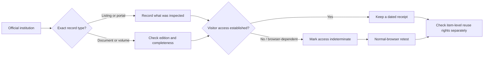

# The Access Receipt — Twenty Doors, Four Different Failures

**Final Vestige Studios · Library Resource Studio · Source audit, 13 November 2026 · UNPUBLISHED RELEASE CANDIDATE**

An institutional link can be correct while the thing a reader hopes to find is absent, delayed, incomplete or only discoverable using a modern browser. The route matters, but it is not the record. This source-specific access receipt extends the 90-entry Library provenance register rather than duplicating the published [Archive Trail](https://finalvestige.com/the-archive-trail/) or replacing the live directory.

The [canonical 90-source snapshot](research-sources-90-provenance-2026-11-13.csv) now has **30 individually reviewed destinations** (10 from the earlier pass, 20 newly inspected) and **60 not independently reviewed**. **90/90 source names, category assignments, original primary destination URLs and item-specific “NOT CLEARED” media-rights flags are unchanged.** These were official-page textual inspections, **not** visitor browser tests.

## How to read the statuses

- **Confirmed (7):** the appropriate official institutional page and substantive listing/report were readable. This does **not** certify all subsidiary PDFs, updates, attachments or image reuse.
- **Qualified (6):** the source identity was established but the text discloses limits to scope, age, availability or interaction that readers need to know.
- **Indeterminate (7):** HTTP 403 in an automated reader, script-only shell, or an oversized PDF prevented an adequate visitor-facing judgment. **Nothing was established as a public-facing broken link.**

## Four findings that change what a reader should say

**The missing half-year.** [OSHA fatality inspections](https://www.osha.gov/fatalities) are not a live death counter. OSHA says records appear only after six months have elapsed from opening conferences, and Federal/State Plan datasets have different starting coverage.

**The report that was only Volume One.** [NASA NTRS item 20030093634](https://ntrs.nasa.gov/citations/20030093634) explicitly identifies *Columbia Accident Investigation Board Report: Volume One*. Related links lead to separate volumes. A single citation is not the full six-volume set.

**The instruction no longer endorsed.** The [NPS Preservation Briefs index](https://www.nps.gov/orgs/1739/preservation-briefs.htm) says Brief #8 was rescinded in October 2023. A surviving official page may contain material the agency no longer recommends.

**The archive with a missing wing.** [NIST's Disaster and Failure Studies Data Archive](https://www.nist.gov/disaster-failure-studies/data-archive) identifies WTC materials but marks the Chile 2010 collection unavailable due to maintenance. It also cautions that contributor photographs and videos may be copyrighted by others.

## Twenty official routes reviewed

| # | Resource | Review result | Important qualification |
|---:|---|---|---|
| 1 | [JFK 2025 releases](https://www.archives.gov/research/jfk/release-2025) | Confirmed | NARA release index |
| 3 | [COINTELPRO](https://vault.fbi.gov/cointel-pro/cointel-pro) | Confirmed | FBI Vault folders |
| 5 | [FRUS Iran 1951–54](https://history.state.gov/historicaldocuments/frus1951-54IranEd2) | Confirmed | Documents 1–375, 2018 edition |
| 15 | [GAO High-Risk 2025](https://www.gao.gov/products/gao-25-107743) | Confirmed | 2025 report, not a live index |
| 16 | [GAO federal IT](https://www.gao.gov/products/gao-25-107852) | Confirmed | January 2025 report |
| 17 | [FEC campaign finance](https://www.fec.gov/data/) | Qualified | Portal confirmed; interactive search not exercised |
| 21 | [OSHA fatality inspections](https://www.osha.gov/fatalities) | Qualified | Six-month publication lag and scope limits |
| 28 | [Regulations.gov](https://www.regulations.gov/) | Indeterminate | Automated reader 403, not a proven site failure |
| 37 | [Columbia Board](https://ntrs.nasa.gov/citations/20030093634) | Qualified | NTRS record describes **Volume One** |
| 41 | [El Faro](https://www.ntsb.gov/investigations/Pages/DCA16MM001.aspx) | Confirmed | NTSB case page with docket/report links |
| 53 | [NIST data archive](https://www.nist.gov/disaster-failure-studies/data-archive) | Qualified | Chile earthquake subcollection unavailable; submitted copyrights |
| 56 | [NHC data](https://www.nhc.noaa.gov/data/) | Indeterminate | Reader 403; browser access unresolved |
| 59 | [HABS / HAER / HALS](https://www.loc.gov/pictures/collection/hh/) | Indeterminate | LOC reader 403; item rights not known |
| 60 | [USGS topoView](https://www.usgs.gov/tools/topoview) | Qualified | Institutional tool page; map JS not exercised |
| 67 | [LOC Sanborn maps](https://www.loc.gov/collections/sanborn-maps/about-this-collection/) | Indeterminate | Reader 403; not public-browser evidence |
| 68 | [NARA Catalog](https://catalog.archives.gov/) | Indeterminate | Reader returned JS shell only |
| 83 | [NPS Preservation Briefs](https://www.nps.gov/orgs/1739/preservation-briefs.htm) | Qualified | Brief #8 rescinded October 2023 |
| 88 | [BLM 2009 Surveying Manual](https://www.blm.gov/sites/default/files/Manual_Of_Surveying_Instructions_2009.pdf) | Indeterminate | ~39.5 MB PDF exceeded reader limit |
| 89 | [USCG Light List](https://www.navcen.uscg.gov/light-list-annual-publication) | Indeterminate | Reader 403; edition download untested |
| 90 | [FAA Aeronautical Information Manual](https://www.faa.gov/air_traffic/publications/atpubs/aim_html) | Confirmed | Effective July 9, 2026 / Change 3 |

## Reader's six-field source receipt

Record (1) **exact title and identifier**, (2) **institution and URL**, (3) **date and access method**, (4) **whether you saw a landing page, search result, full record or download**, (5) **scope/edition/availability exceptions** and (6) **item-level creator, rights and reproduction terms**. An error message belongs in field 4, not in a categorical “archive is broken” conclusion.

### Provenance & permissions

All statements above are observations made on **2026-11-13** using official agency pages. Only the specifically quoted documentary scope/availability claims were established. Live JS search, downloaded files, archive completeness and public-browser UX require separate verification. The editorial comparison and original four-gate diagram are **original Final Vestige work**, 2026; no third-party photo, chart, scan or video was reproduced. **No individual third-party item was cleared for reuse.** Access terms are not image permissions.

For method and related work: [The Archive Trail](https://finalvestige.com/the-archive-trail/), [The Lost Landscape](https://finalvestige.com/the-lost-landscape/), [The Failure Chain](https://finalvestige.com/the-failure-chain/), [Apollo 1 Evidence Atlas](https://finalvestige.com/apollo-1-evidence-atlas/). Follow Final Vestige's [Editorial Standards](https://finalvestige.com/editorial-standards/) on disputes, technical numbers, rights and corrections.

### Publishing hold and release QA

This is a source-controlled editorial working document, not a WordPress publication. The existing live Research Sources #1338 still displays stale 60-labels despite 90 cards. Draft PR #2318 is a separate 11-text-change count-only repair; staging draft #2354 includes additional architecture and URL changes and must not be wholesale promoted. With no networked production-theme browser, actual 320/390/768/1440px visitor screenshots, keyboard/JS search, and first-publication email/social suppression remain **unverified**. No live WordPress, subscriber, social or third-party media changes were made.
