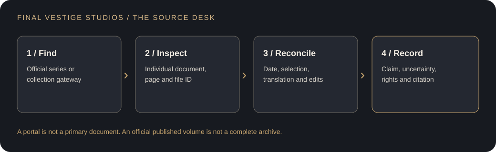

# The Declassified Source Desk
## Twelve official doors, and the records behind them

**Final Vestige Studios — Library Research Sources editorial/rights companion.** Checked November 18, 2026. Source-page target: [Research Sources](https://finalvestige.com/free-resources/research-sources/) (WordPress page #1338). **Status: researched and staged for editorial review; not published or incorporated into WordPress.**

*Illustration: Final Vestige Studios, November 18, 2026. Original artwork prepared for Final Vestige Studios; reuse permission remains with the studio; no historical reconstruction, external photograph or copyrighted archival item is reproduced. The figure is a method, not an evidence object.*

### The problem

Declassification can make a document accessible without making the document easy to understand. A search result and the file it identifies may have different dates. A source described as an “archive” may actually be an agency news story, a finding aid, a curated official documentary volume, or a database indexing hundreds of original records. Those are useful doors. None should be mistaken for the individual witness standing behind it.

The public Library currently has **90 Research Sources cards**, including these **12** in its “Declassified & decisions” family. Several default counters still describe an earlier 60-card edition; tracked separately in [issue #1788](https://github.com/finalvestigestudios/final-vestige-site-layer/issues/1788). This guide does not make the counters silently correct and does not change the live page.

### Pick the door that matches the question

| You need to… | Start here | Preserve in your notes |
|---|---|---|
| Find a released U.S. intelligence file | CIA FOIA Reading Room, FBI Vault, or NARA release index | Release/record identifier, creation date, declassification or scan date, and page |
| Understand which documents U.S. officials selected for a diplomatic documentary edition | FRUS volume, including its preface and sources section | Volume/edition, document number, underlying source and editorial footnotes |
| Trace an archival custody path when the original is not online | Reagan Library topic guide | Collection, series, box, folder, access restriction and archivist contact |
| Investigate deciphered historical intercepted messages | NSA VENONA | Original message date, release year, transcription/translation status, partial wording caveat |
| Test whether a popular summary reflects a particular file | CIA Nixon Collection story / PDB publication | Open the specific linked original document before quoting it |

**The first rule:** separate **record creation**, **record release**, **website publication**, and **the researcher's access date**. These dates are not synonyms.

### Twelve current source entries

#### 1. JFK Assassination Records — 2025 Documents Release
**Institution / entry form:** NARA · Release index. [Open official entry](https://www.archives.gov/research/jfk/release-2025).

**What the accessible institutional page supplies:** 2025 release batches and access instructions; NARA notes continuing digitization.

**How a reader should use it:** Identify an individual release document, then capture its own file identity.

**Do not infer:** Records may contain personal information about living people; availability does not license republication of personal details.

**Reuse posture:** NARA federal-work guidance; item-level third-party/privacy assessment. **Entry page inspected:** November 18, 2026. Original subdocuments or images were *not* individually inspected in this pass.

#### 2. Pentagon Papers
**Institution / entry form:** NARA · Report collection. [Open official entry](https://www.archives.gov/research/pentagon-papers).

**What the accessible institutional page supplies:** Complete declassified Defense Vietnam Task Force report as released by NARA with Presidential Libraries.

**How a reader should use it:** Select part/volume and preserve original report pagination, not a newspaper excerpt.

**Do not infer:** The 1971 published excerpts were incomplete; use the NARA report for source comparison.

**Reuse posture:** NARA federal-work guidance; examine item contents before reuse. **Entry page inspected:** November 18, 2026. Original subdocuments or images were *not* individually inspected in this pass.

#### 3. COINTELPRO
**Institution / entry form:** FBI Vault · Topic gateway. [Open official entry](https://vault.fbi.gov/cointel-pro/cointel-pro).

**What the accessible institutional page supplies:** FBI Vault gateway organized into subject-related subcollections.

**How a reader should use it:** Follow the particular subcollection and document PDF, capture file/page identity.

**Do not infer:** Historic FBI classifications are period labels, not neutral descriptions or FV endorsement; a release is not a complete program history.

**Reuse posture:** FBI public information policy; any specific reproduced item needs separate review. **Entry page inspected:** November 18, 2026. Original subdocuments or images were *not* individually inspected in this pass.

#### 4. VENONA Documents
**Institution / entry form:** NSA · Translated message index. [Open official entry](https://www.nsa.gov/serve-from-netstorage/news-features/declassified-documents/venona/index.html).

**What the accessible institutional page supplies:** NSA VENONA archive with translated message releases, date and topical indexes.

**How a reader should use it:** Record translated document's date and archival title plus translation status.

**Do not infer:** A translation is not raw intercepted communication; limitations of decryption and editorial context must remain visible.

**Reuse posture:** Link only pending item-level rights and scan provenance confirmation. **Entry page inspected:** November 18, 2026. Original subdocuments or images were *not* individually inspected in this pass.

#### 5. FRUS: Iran, 1951–1954, Second Edition
**Institution / entry form:** State Department · Edited documentary volume. [Open official entry](https://history.state.gov/historicaldocuments/frus1951-54IranEd2).

**What the accessible institutional page supplies:** 2018 edition; documents 1–375 with preface, sources, index and downloadable edition.

**How a reader should use it:** Cite volume, document number, document date and editorial footnotes.

**Do not infer:** FRUS is a selected edited official documentary history, not every original agency file.

**Reuse posture:** FRUS published text public domain per Office of the Historian. **Entry page inspected:** November 18, 2026. Original subdocuments or images were *not* individually inspected in this pass.

#### 6. FRUS: Guatemala, 1952–1954
**Institution / entry form:** State Department · Edited documentary volume. [Open official entry](https://history.state.gov/historicaldocuments/frus1952-54Guat).

**What the accessible institutional page supplies:** 2003 volume; documents 1–287, editor notes and indexes.

**How a reader should use it:** Start from a document number and inspect its source note and any omitted passages.

**Do not infer:** Editorial selection and release limitations; avoid treating an absent record as evidence of absence.

**Reuse posture:** FRUS published text public domain per Office of the Historian. **Entry page inspected:** November 18, 2026. Original subdocuments or images were *not* individually inspected in this pass.

#### 7. The Nixon Collection
**Institution / entry form:** CIA · Agency overview / gateway. [Open official entry](https://www.cia.gov/stories/story/the-nixon-collection/).

**What the accessible institutional page supplies:** 2022 Agency story pointing toward eight trip-preparation intelligence products.

**How a reader should use it:** Follow the linked document collection before treating an image or claim as primary evidence.

**Do not infer:** The linked page is a narrative introduction, not itself an original 1972 intelligence document.

**Reuse posture:** CIA public-site material generally usable unless individually copyrighted; original documents require item check. **Entry page inspected:** November 18, 2026. Original subdocuments or images were *not* individually inspected in this pass.

#### 8. President’s Daily Brief — Kennedy and Johnson
**Institution / entry form:** CIA · Publication / release context. [Open official entry](https://www.cia.gov/resources/publications/presidents-daily-brief-delivering-intelligence-to-kennedy-and-johnson/).

**What the accessible institutional page supplies:** 2015 overview booklet about release of approximately 2,500 briefing documents.

**How a reader should use it:** Follow primary briefings; cite each dated PDB rather than this explanatory booklet.

**Do not infer:** This URL identifies a 40-page overview and historic release, not every individual daily brief.

**Reuse posture:** CIA public-site policy with copyright and credit caveats. **Entry page inspected:** November 18, 2026. Original subdocuments or images were *not* individually inspected in this pass.

#### 9. FRUS: Cuban Missile Crisis and Aftermath
**Institution / entry form:** State Department · Edited documentary volume. [Open official entry](https://history.state.gov/historicaldocuments/frus1961-63v11).

**What the accessible institutional page supplies:** 1996 volume XI; documents 1–390, sources and editorial annotations.

**How a reader should use it:** Compare dated document text against meeting recordings or other source series when available.

**Do not infer:** Published selections and annotations are distinct from underlying raw archives.

**Reuse posture:** FRUS published text public domain per Office of the Historian. **Entry page inspected:** November 18, 2026. Original subdocuments or images were *not* individually inspected in this pass.

#### 61. CIA Freedom of Information Act Electronic Reading Room
**Institution / entry form:** CIA · Search and access portal. [Open official entry](https://www.cia.gov/readingroom/).

**What the accessible institutional page supplies:** CIA FOIA digital records and thematic collections; some pages require JavaScript.

**How a reader should use it:** Record stable item title, CIA declassification identifier and PDF page, not only search URL.

**Do not infer:** Search visibility is not complete CIA holdings; some content requires JS, some items withhold portions.

**Reuse posture:** CIA public-site policy with item-specific copyright exceptions. **Entry page inspected:** November 18, 2026. Original subdocuments or images were *not* individually inspected in this pass.

#### 63. FRUS: Congo, 1960–1968
**Institution / entry form:** State Department · Edited documentary volume. [Open official entry](https://history.state.gov/historicaldocuments/frus1964-68v23).

**What the accessible institutional page supplies:** 2013 volume XXIII; documents 1–582 and published errata.

**How a reader should use it:** Check the errata, document source note and original document date.

**Do not infer:** The modern FRUS publication date is not the historical document date.

**Reuse posture:** FRUS published text public domain per Office of the Historian. **Entry page inspected:** November 18, 2026. Original subdocuments or images were *not* individually inspected in this pass.

#### 64. Iran-Contra Scandal — Reagan Library Topic Guide
**Institution / entry form:** Reagan Presidential Library / NARA · Archival finding aid / topic guide. [Open official entry](https://www.reaganlibrary.gov/archives/topic-guide/iran-contra-scandal).

**What the accessible institutional page supplies:** Collection guide and inventory with archive contact route; page updated May 8, 2025.

**How a reader should use it:** Record collection, folder and box; request item-level material when not digitized.

**Do not infer:** Topic guide explicitly warns that some material remains withdrawn under FOIA restrictions.

**Reuse posture:** NARA holdings not uniformly unrestricted; request item-specific rights and access conditions. **Entry page inspected:** November 18, 2026. Original subdocuments or images were *not* individually inspected in this pass.

### A six-field source receipt you can use immediately

Copy this beneath every interesting document, on paper or in research notes:

1. **Historical assertion I want to test:** one precise statement, not a topic.
2. **Door / institution / access URL:** where the search began; include access date.
3. **Actual record:** document title, original date, identifier, page and record creator. Mark **not accessed** if you did not reach it.
4. **Witness type:** original document, later scan, transcription, translated message, edited source edition, institution's overview or secondary account.
5. **Selection and uncertainty:** redaction, omission, translation, editorial notes, missing scans, disputed time convention, or unresolved custody.
6. **Reuse and credit:** item-level rights or restriction, attribution, privacy concerns, source URL and the exact portion used.

A completed receipt should be precise enough that another person can reproduce the route without relying on memory or trusting the editor's interpretation.

**Illustrative exercise — not a historical document.** A hypothetical agency timeline lists “February 7,” but its file creation timestamp is “February 9.” A late posting, later typed summary, timezone difference or corrected date are competing explanations. Until the individual record identifies which, write “dates differ; reason unverified.” Do not silently replace either date.

### Editorial quality decisions surfaced by this pass

**High-value correction to future descriptions:** The CIA's *Nixon Collection* link is a **2022 agency overview leading toward eight 1972 trip-preparation products**, not a direct record or facsimile. The Kennedy/Johnson *President's Daily Brief* page is an explanatory **2015 booklet and release context**, not a single repository of all roughly 2,500 original briefs. Labeling these as “direct document” destinations would overstate what a reader gets.

**Interpretation guardrails:** The FBI Vault page preserves historical categories that may be stigmatizing or inaccurate; they should be identified as FBI-era classification rather than adopted as contemporary editorial categories. NSA VENONA releases contain **translations/decryptions**, not merely unmediated originals. FRUS volumes are the official **selected and edited** documentary history of U.S. foreign policy, with document notes and sources explaining the selection.

**Privacy guardrail:** NARA's JFK 2025 release page explicitly notes that some released records include personal identifiers of living people. Public accessibility does not justify republishing those details in an FV page, worksheet, screenshot or video.

### Rights and provenance

Only outgoing text **links** were reviewed and preserved. No governmental seal, third-party photo, facsimile, PDF page or excerpt was imported.

- [NARA Copyright and Permissions](https://www.archives.gov/research/still-pictures/permissions): most federal government works are U.S. public-domain works, but NARA holds third-party/restricted material; NARA does not guarantee an item's copyright status.
- [NARA Privacy and Use Policies](https://www.archives.gov/global-pages/privacy.html): NARA-created U.S. government works are public domain; donated and third-party collection material may not be.
- [State Department FRUS FAQ](https://history.state.gov/about/faq/what-is-frus): the published FRUS series is in the public domain and may be copied with appropriate source citation. This does not confer license to a different institution's reproduction of a collection item.
- [CIA Site Policies](https://www.cia.gov/site-policies/): CIA public website content generally may be copied unless an item carries a copyright notice; requests source/byline attribution and requires permission for explicitly copyrighted material.
- [FBI Privacy Policy](https://www.fbi.gov/privacy-policy): FBI-provided unattributed site information is public, but official insignia and the FBI name carry statutory anti-endorsement restrictions.
- NSA's [VENONA index](https://www.nsa.gov/serve-from-netstorage/news-features/declassified-documents/venona/index.html) is publicly accessible. Its site policy page presents ambiguous boilerplate, so **no affirmative blanket scan license** is asserted here.
- [Reagan Library topic guide](https://www.reaganlibrary.gov/archives/topic-guide/iran-contra-scandal) specifically warns that selected records remain withdrawn under FOIA and points researchers to the archivist; access and reuse have to be checked at item level.

All 12 official entry-page URLs produced readable institutional pages in this pass. That observation is **not** a promise of permanent link health, item-level public accessibility, current collection completeness, image-reuse permission or an actual WordPress browser QA pass. Item pages and PDF links behind those entries remain outside this limited audit.

**Crosslinks:** [Archive Trail](https://finalvestige.com/the-archive-trail/) for the claim-to-source method; [Research Sources](https://finalvestige.com/free-resources/research-sources/) for all institutional destinations; [Editorial Standards](https://finalvestige.com/editorial-standards/) for disputed accounts, sourcing, corrections and reconstructions; [The Public Record](https://finalvestige.com/accountability/) for a live example of official-record accountability.

### Release and change ledger

| Check | Result | Date |
|---|---|---|
| Live Library and Editorial Standards inspected | Pass; no public write | 2026-11-18 |
| 90-card published WordPress #1338 underlying source inspected | 90 entries, five categories; 12 declassified family cards | 2026-11-18 |
| All 12 primary *entry page* destinations inspected | Readable official pages; zero confirmed broken landing URLs | 2026-11-18 |
| Source-type, limitations and rights evaluated | This guide and the companion machine-readable CSV | 2026-11-18 |
| Original visualization provenance | Created for this audit; text alternative included | 2026-11-18 |
| Actual responsive in-theme browser tests at 320/390/768/1440 | **Not passed**; no production browser pixels accessible here | 2026-11-18 |
| WordPress and publication activity | **None**; no draft, subscriber, social or navigation mutations | 2026-11-18 |

**Next guarded release action:** After issue #1788's real-browser acceptance, correct the published #1338 counters minimally (90 total; declassified 12, accountability 24, engineering 21, archives 25, navigation 8), confirm behavior with JS on/off, and only then consider incorporating this annotated research path as a scoped Library enhancement. Do not apply new live changes based only on this static audit. No first-publish emails, public promotion, external video action or spending are authorized.

*Editorial origin: Final Vestige Studios Library Resource Studio, November 18, 2026. Original explanatory writing, index-level research and illustration. This is not legal advice on copyright, record access or privacy.*
