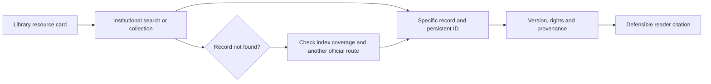

# Final Vestige Library — 90-source provenance and route register
**Snapshot:** November 13, 2026 · **Owner:** Library editorial lane · **Release state:** working editorial register, not a published source page.

## Why this exists
A directory can contain 90 beautiful links and still fail when its buttons lead to policy explanations instead of actual evidence. This register provides an auditable identity for **all 90 primary call-to-action destinations** in the current WordPress **STAGING DRAFT #2354**, so a link repair can be reviewed independently of the published **#1338** counts repair. It is not a wholesale replacement for #1338. The five actual category distributions are 12 declassified, 24 accountability, 21 engineering, 25 archives, and 8 navigation.

## Method and limits
1. Fetched authenticated WordPress page #2354, status **draft**, parent 77, modified 2026-11-13T02:37:00. Parsed exactly 90 `article.fv-rs-card` records. Classified **the last anchor in each card as its primary CTA**; earlier anchors are supporting institutional help/rights links. Verified 90 distinct titles and 90 distinct primary URLs, HTTPS on every destination, counts 12/24/21/25/8.
2. Recorded each title, raw institutional metadata display text, primary URL and supporting-link count in [CSV](./research-sources-90-provenance-2026-11-13.csv). The catalog snapshot date is **not** a claim that all 90 external destinations were fetched, that they work in an ordinary browser, or that any image is licensed for reproduction.
3. Ten prioritized links were checked against primary agency pages or attempted directly. Review states distinguish source-confirmed institutional routes, search-result-only evidence, access-indeterminate results, and not-reviewed entries. Automated 403 and contradictory search/open outcomes are **not** treated as broken links.
4. The source catalog descriptions and rights tags are retained as **claims displayed by FV**, not reverified copyright determinations. **No media is approved for reuse by this CSV.** Smithsonian CC0 applies only to individually identified CC0-designated assets, not all Smithsonian content. Agency-operated systems can hold third-party files subject to separate rights.

## Reader problem and route test
**A button works, yet the evidence is missing.** Test each lead through five steps: 
- **Identity:** Does the destination match the exact record, docket, collection or search system named in the card? Log the site's title and redirects.
- **Access:** Can an ordinary reader reach the record without signing in, specialized software or paid access? Record limitations and an alternative official path.
- **Completeness:** Does the record index cover the dates and media type in the claim? A missing search hit is not necessarily a missing document.
- **Provenance:** Record the creating institution, object identifier, edition/revision, record-level URL, capture date and catalog path.
- **Reuse:** Check rights on the actual image or dataset, identify any third-party/privacy/trademark constraints and keep a credit line, even when attribution isn't required.

## High-priority verified examples (dated November 13, 2026)
- **NRC ADAMS (#24):** direct search path https://adams-search.nrc.gov/ and agency guide https://www.nrc.gov/documents-reports/adams-public-documents . A JavaScript search application can return a thin non-readable extraction; this is not proof the search was operated.
- **GovInfo hearings (#34):** https://www.govinfo.gov/app/collection/chrg and https://www.govinfo.gov/help/chrg . GovInfo warns not every committee hearing is included and some hearing volumes appear later.
- **Three Mile Island (#52):** NRC's June 2016 Knowledge Management Digest Rev 1 overview, https://www.nrc.gov/regulations-legislation/nureg-series-publications/publications-prepared-by-nrc-staff-for-knowledge-management/three-mile-island-accident-of-1979-knowledge-management-digest-nuregkm-0001/r1 . Do not equate it with the full original investigation file.
- **NTSB CAROL (#54):** https://my.ntsb.gov/ and https://www.ntsb.gov/Pages/carol.aspx . Search ranges differ by transport mode; the documentary docket may sit elsewhere.
- **NARA donated collections (#82):** https://www.archives.gov/findingaid/donated-collection-explorer . October 2026 public snapshot reports 1,175,630 scans, 4.62% of an *estimated* 25,447,250 textual pages. This is not a complete record inventory.
- **David Rumsey (#76):** https://www.davidrumsey.com/ exposes collection search. Rights remain item-specific.
- **Smithsonian Open Access (#66):** official indexed https://www.si.edu/openaccess/faq distinguishes CC0 and restricted items. Direct automated open of the home page was inconsistent with official indexed search results; do not label broken.
- **LOC (#61, #78), DPLA (#75):** automated access blocked on tested routes; remain indeterminate. Do not redirect away from the collection merely to cure a robot-only 403.

## Exact release boundary
Do not publish this ledger as if it proves 90 working links, and do not replace live WordPress #1338 with unpublished #2354. Release of the count-only fix remains governed by [issue #1788](https://github.com/finalvestigestudios/final-vestige-site-layer/issues/1788), [draft PR #2318](https://github.com/finalvestigestudios/final-vestige-site-layer/pull/2318) and [shared browser QA #1589](https://github.com/finalvestigestudios/final-vestige-site-layer/issues/1589). Inspect actual theme at 320/390/768/1440 including search, filters, keyboard, focus, no-JS fallback and overflow before any public write. Do not send subscriber email or auto-social. No copy of third-party media was made.

**Related FV resources:** [The Archive Trail](https://finalvestige.com/the-archive-trail/) · [The Library](https://finalvestige.com/free-resources/) · [Editorial Standards](https://finalvestige.com/editorial-standards/) · [Research Sources](https://finalvestige.com/free-resources/research-sources/).

### Original visual — source route vs evidence

*Original instructional schematic by Final Vestige Studios, 2026-11-13. It represents a method, not an archival image or record.*

**Open conditions:** actual browser verification of priority destinations, individual media rights, common production-theme QA gate. Use next review to upgrade rows from `not_independently_checked` with dated evidence; never silently overwrite failed or blocked statuses.
