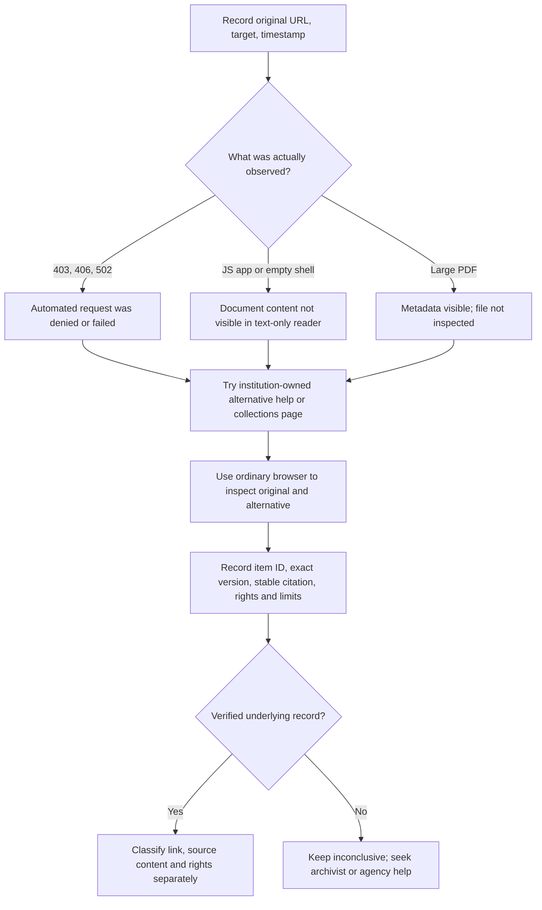

# The Door That Wouldn't Open — Access Recovery Register

**Final Vestige Library · 2026-11-10 UTC · Release candidate, NOT a live WordPress resource**

A government link returning **403, 406, 502, an empty JavaScript shell or a very large PDF** in an automated reader does not prove that the material is unavailable to an ordinary visitor. It proves that the *particular test* did not retrieve it. This register preserves the difference and provides institution-owned routes back to the record.

**Inventory:** [Research Sources public page](https://finalvestige.com/free-resources/research-sources/) · [90-source provenance ledger](./research-sources-90-provenance-ledger-2026-11-10.csv) · [Library](https://finalvestige.com/free-resources/) · [Editorial Standards](https://finalvestige.com/editorial-standards/). Reader-facing directory release remains held at GitHub #1788 pending production-theme verification #1589. As of this record the public directory still uses stale 60-source static labels; the 90-source static-first correction is only in draft #2354.

## A decision tree that does not mistake a failed fetch for missing evidence

*Original Final Vestige editorial diagram (2026-11-10), not an archival image.*

## 26 high-friction entry points

These are **not 26 known broken links**. A secondary agency page may explain coverage without resolving the original destination or verifying individual files. A dash means *no independently checked substitute*, not that no substitute exists. All baseline statuses come from the 2026-11-10 automated-access review. The 15 additional official routes were inspected through institutional indexed or readable documentation the same date. **An ordinary logged-out browser PASS is not recorded for any of these 26.**

| # | Source and original entry | Automated observation (2026-11-10) | Institution-owned route / what it establishes | Next action |
|---:|---|---|---|---|
| 18 | [USAspending Advanced Search](https://www.usaspending.gov/search) | javascript shell only | — No alternate route checked in this review. | Open in a normal browser; if blocked, locate the agency's help/reference service. Keep result inconclusive until verified. |
| 24 | [ADAMS Public Documents](https://www.nrc.gov/documents-reports/adams-public-documents) | automated access 403 | [Institutional evidence](https://www.nrc.gov/reading-rm/pdr/services): NRC Public Document Room explains pre-1999 legacy indexes, microfiche, librarian assistance. | Institutional documentation retrievable; ADAMS landing still automated 403. |
| 26 | [Oversight.gov](https://www.oversight.gov/) | automated access 406 | — No alternate route checked in this review. | Open in a normal browser; if blocked, locate the agency's help/reference service. Keep result inconclusive until verified. |
| 28 | [Regulations.gov](https://www.regulations.gov/) | automated access 403 | — No alternate route checked in this review. | Open in a normal browser; if blocked, locate the agency's help/reference service. Keep result inconclusive until verified. |
| 34 | [Congressional Hearings Collection](https://www.govinfo.gov/app/collection/chrg) | javascript shell no readable content | [Institutional evidence](https://www.govinfo.gov/help/chrg): GovInfo defines collection gaps: select hearings from 104th Congress onward, uneven committee availability, publication lag. | Institutional help read; application still needs browser. |
| 36 | [RECAP Archive / CourtListener](https://www.courtlistener.com/recap/) | automated access 403 | — No alternate route checked in this review. | Open in a normal browser; if blocked, locate the agency's help/reference service. Keep result inconclusive until verified. |
| 42 | [The 1980 Eruptions of Mount St. Helens — Professional Paper 1250](https://pubs.usgs.gov/publication/pp1250) | automated access 403 | [Institutional evidence](https://doi.org/10.3133/pp1250): USGS DOI identifies the authoritative 1981 Professional Paper 1250, 844 pages and one plate. | Official publication metadata indexed; redirect/PDF need browser. |
| 51 | [IPET and Hurricane Protection Decision Chronology](https://www.iwr.usace.army.mil/About/History/IPET-and-HPDC-Investigations/) | automated access 403 | — No alternate route checked in this review. | Open in a normal browser; if blocked, locate the agency's help/reference service. Keep result inconclusive until verified. |
| 52 | [Three Mile Island Knowledge Management Digest](https://www.nrc.gov/regulations-legislation/nureg-series-publications/publications-prepared-by-nrc-staff-for-knowledge-management/three-mile-island-accident-of-1979-knowledge-management-digest-nuregkm-0001/r1) | institutional page indexed direct 403 | — No alternate route checked in this review. | Open in a normal browser; if blocked, locate the agency's help/reference service. Keep result inconclusive until verified. |
| 54 | [NTSB CAROL — Case Analysis and Reporting Online](https://my.ntsb.gov/) | redirect to js app | [Institutional evidence](https://www.ntsb.gov/Pages/carol.aspx): NTSB states aviation data 1962 onward, other modes generally 2010 onward; use dockets for exhibits. | Old domain redirect verified; app JavaScript not inspected. |
| 56 | [National Hurricane Center Data Archive](https://www.nhc.noaa.gov/data/) | automated 403 not dead link | [Institutional evidence](https://www.nhc.noaa.gov/data/hurdat/): NHC direct HURDAT2 files and format notes. Dated updates can change retrospective best tracks. | Official data index text read; item-level version still required. |
| 59 | [HABS / HAER / HALS](https://www.loc.gov/pictures/collection/hh/) | automated access 403 | [Institutional evidence](https://www.loc.gov/collections/historic-american-buildings-landscapes-and-engineering-records/about-this-collection/): LOC explains HABS/HAER/HALS photos, measured drawings and histories; item rights advisory is decisive. | Institutional collection description read, legacy pictures site automated 403. |
| 61 | [Chronicling America](https://www.loc.gov/collections/chronicling-america/about-this-collection/) | automated access 403 | [Institutional evidence](https://guides.loc.gov/chronicling-america/about-the-collection): LOC researcher guide explains selected NDNP digitization, not the universe of historical newspapers. | Institutional research guide read; main collection automated 403. |
| 64 | [OSTI.GOV](https://www.osti.gov/) | reader 502 | [Institutional evidence](https://www.osti.gov/search-tools): DOE OSTI's official secondary directory for OSTI.GOV, DOE PAGES and specialist services. | Search-tools guidance read; original homepage reader 502. |
| 66 | [Smithsonian Open Access](https://www.si.edu/openaccess) | reader 404 but institutional search index live | [Institutional evidence](https://www.si.edu/openaccess/faq): Smithsonian FAQ explains CC0 marking and exclusions; not every museum item is CC0. | Program FAQ read; original portal may reject automated fetch. |
| 67 | [Sanborn Maps Collection](https://www.loc.gov/collections/sanborn-maps/about-this-collection/) | automated 403 not dead link | [Institutional evidence](https://guides.loc.gov/fire-insurance-maps/sanborn-searching): LOC Sanborn guide distinguishes online public-domain sheets, unscanned holdings and restricted sheets. | Institutional guide read; collection landing automated 403. |
| 68 | [National Archives Catalog](https://catalog.archives.gov/) | javascript shell only | [Institutional evidence](https://www.archives.gov/research/catalog/help/using): NARA's catalog guide explains series-level description, digital access limitations and restricted holdings. | Institutional guide read; catalog is JS application. |
| 73 | [NOAA Historical Hurricane Tracks](https://coast.noaa.gov/hurricanes/) | javascript shell only | [Institutional evidence](https://coast.noaa.gov/hurricanes/index.html): NOAA tool landing describes track-distance search and warns spatial radius is not storm impact boundary. | Institutional tool description read; interactive search not tested. |
| 74 | [Railroad Maps, 1828–1900](https://www.loc.gov/collections/railroad-maps-1828-to-1900/about-this-collection/) | automated access 403 | — No alternate route checked in this review. | Open in a normal browser; if blocked, locate the agency's help/reference service. Keep result inconclusive until verified. |
| 75 | [Digital Public Library of America](https://dp.la/) | automated access 403 | — No alternate route checked in this review. | Open in a normal browser; if blocked, locate the agency's help/reference service. Keep result inconclusive until verified. |
| 78 | [Veterans History Project Collection](https://www.loc.gov/collections/veterans-history-project-collection/) | reader disabled | [Institutional evidence](https://ask.loc.gov/veterans-history/faq/369355): LOC access FAQ distinguishes descriptive records, digitized interviews and onsite appointments. | LOC FAQ read; individual records and use permissions vary. |
| 80 | [Biodiversity Heritage Library](https://www.biodiversitylibrary.org/) | institutional page automated 403 | — No alternate route checked in this review. | Open in a normal browser; if blocked, locate the agency's help/reference service. Keep result inconclusive until verified. |
| 84 | [International Ice Patrol Annual Reports](https://www.navcen.uscg.gov/international-ice-patrol-annual-reports) | institutional page indexed direct 403 | — No alternate route checked in this review. | Open in a normal browser; if blocked, locate the agency's help/reference service. Keep result inconclusive until verified. |
| 86 | [Navigation Rules and Regulations Handbook](https://www.navcen.uscg.gov/sites/default/files/pdf/navRules/Handbook/Nav%20Rules%20Handbook_Corrected_08-12-2024.pdf) | automated access 403 | — No alternate route checked in this review. | Open in a normal browser; if blocked, locate the agency's help/reference service. Keep result inconclusive until verified. |
| 88 | [Manual of Surveying Instructions — 2009](https://www.blm.gov/sites/default/files/Manual_Of_Surveying_Instructions_2009.pdf) | large pdf not downloaded | [Institutional evidence](https://www.blm.gov/programs/lands-and-realty/cadastral-survey/cadastral-tools): BLM cadastral tools page links 2009 Manual and its errata; 2009 PDF too large to inspect in this run. | BLM page read; PDF content not freshly verified. |
| 89 | [U.S. Coast Guard Light List](https://www.navcen.uscg.gov/light-list-annual-publication) | institutional page automated 403 | [Institutional evidence](https://navcen.uscg.gov/weekly-light-lists): NAVCEN explains corrected weekly editions and MSI updates; annual Light List is not live operating status. | Agency guidance read; linked PDFs/portal not manually inspected. |

## A reusable access-witness card

Copy one card per research attempt. This is a **record of an access test**, not a legal permission form.

- **Question and desired record:** ______________________
- **Source title / owning institution:** ______________________
- **Original link and exact date/time (timezone):** ______________________
- **Request method:** ordinary browser / automated reader / API / archival staff / other
- **Observed response:** HTTP status, JS shell, login wall, PDF size, missing scan, etc.
- **Institutional alternative, source of authority, checked date:** ______________________
- **Exact item or series identifier; year/version/revision:** ______________________
- **What was actually opened or read (not assumed):** ______________________
- **What remains unverified:** ______________________
- **Item-specific rights, restrictions, privacy, donor credit:** ______________________
- **Stable citation + next retrieval action:** ______________________

## Rights and provenance

All agency text and destinations above are **linked**, not copied as documents or screenshots. The diagram and worksheet are original Final Vestige editorial work, dated November 10, 2026. The available source pages are owned by their named institutions; **a public URL, government host, CC0 program description or digitized file never grants universal reuse permission**. Smithsonian CC0 applies only to marked assets; LOC veterans and contributed archival material may carry separately held copyright; even federal surveys can incorporate externally contributed images. Check the specific asset's rights advisory and privacy implications before reproducing any media.

This inventory does **not** establish any of the 26 destinations as broken or visitor-accessible. It establishes an audit trail and 15 authoritative contextual routes. Direct ordinary-browser page, search, PDF and media verification remains outstanding. No first-publish emails or social posts authorized. Cross-links for readers after release: [The Archive Trail](https://finalvestige.com/the-archive-trail/) and [The Page That Changed](https://finalvestige.com/free-resources/the-page-that-changed/).
