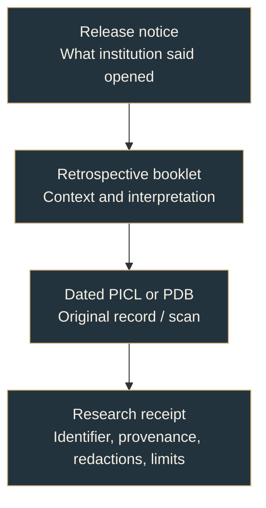

# The Brief Was Not the Brief
**Final Vestige Library · original field guide · November 13, 2026 · Editorial working draft; NOT a public release**

> A link can point to a real government publication and still miss the historical document a researcher went there to find.

## The reader problem

The published [Final Vestige Research Sources directory](https://finalvestige.com/free-resources/research-sources/) lists **“President’s Daily Brief — Kennedy and Johnson”** and describes roughly 2,500 released briefings covering 1961–1969. Its primary CTA currently goes to the [CIA’s official publication-details page](https://www.cia.gov/resources/publications/presidents-daily-brief-delivering-intelligence-to-kennedy-and-johnson/). That page explicitly identifies a **40-page explanatory booklet**, not a dated declassified briefing scan. The booklet is valuable historical context, but a source index promising a document collection should distinguish it from the released records.

The [CIA announcement of September 16, 2015](https://www.cia.gov/stories/story/cia-releases-roughly-2500-declassifed-presidents-daily-briefs/) reports the release of approximately 2,500 former classified briefings and directs readers to its [FOIA Electronic Reading Room](https://www.cia.gov/readingroom/). The CIA identifies **President's Intelligence Checklists (PICLs), June 1961–November 1964**, and **President's Daily Briefs (PDBs), December 1964–January 1969**. The release also claims approximately 80% had been declassified **at that time**; it does not establish the current total or completeness of online records.

A previously published deep route `https://www.cia.gov/readingroom/collection/presidents-daily-brief-1961-1969` currently redirects to the generic Reading Room for a noninteractive retriever. The generic page warns that JavaScript is necessary for correct display. **Do not replace the existing CTA with that deep route until a human-style browser can verify a dated item and its working destination.** Do not label an access-indeterminate route broken.

## Three different objects

1. **2015 announcement** — contemporaneous evidence that the CIA says the collection was released at the event. Not evidence for a claim in a specific day's briefing.
2. **2015 retrospective booklet** — an explanatory account of the process and selected materials. Not an original dated intelligence product.
3. **Dated original PICL/PDB** — primary evidence of what the writer reported at the time. It does **not** independently prove that the intelligence assertions were true. Capture source identifier, document date, original title, page range, visible omissions/redactions, and original file URL.

### Evidence-route diagram

**Diagram:** original Final Vestige Studios editorial schematic, November 13, 2026. It illustrates a *research route*, not the documentary genealogy of any one CIA file. Do not present it as a historical document or CIA graphic.

## The five-step field method

1. Retain the 2015 release notice and its date/collection description. The institution's count is approximate and historically dated.
2. Enter the actual [CIA Reading Room](https://www.cia.gov/readingroom/), select Historical Collections or search. Note that this interface is JavaScript-dependent; do not infer record-level access from a static text view.
3. Query the document's **exact date**, using **PICL** for 1961–November 1964 or **PDB** for December 1964–January 1969. Confirm whether the result is a scan or merely a description.
4. Inspect the document and record its original visible title, date, stable/accession identifier, file link, page count and every relevant redaction, page omission, changed catalog label or version.
5. State the narrow inference: “the briefing reported X.” Compare claims with other contemporaneous records and later investigations rather than saying “X happened” solely because it appears in a classified-era intelligence product.

**Evidence receipt fields:** title; original date; series; institutional ID; actual item URL; access state (not verified / catalog only / original scan viewed / reprocessed copy); reuse rights status; page/redaction/identity qualifiers; exact narrowly supported claim. Never invent an ID, page count, status, event, or tested record.

## Primary-source provenance and rights ledger

| Source | Institution and date | Checked Nov 13 2026 | What it supports / boundary | Media rights |
| --- | --- | --- | --- | --- |
| [CIA release notice](https://www.cia.gov/stories/story/cia-releases-roughly-2500-declassifed-presidents-daily-briefs/) | CIA · Sep 16 2015 | Official text accessible | Release count, PICL-to-PDB chronology, archive route; 80% estimate historically dated | Link only; no media reproduced |
| [CIA publication details](https://www.cia.gov/resources/publications/presidents-daily-brief-delivering-intelligence-to-kennedy-and-johnson/) | CIA · 2015 | Official text accessible | Specifically describes separate 40-page explanatory booklet | Link only; booklet cover not copied |
| [CIA FOIA Reading Room](https://www.cia.gov/readingroom/) | CIA · live gateway | Official landing accessible, JavaScript required | Historical collection entry point; specific original scans **not** independently validated in this run | No file reuse clearance |
| [LBJ Presidential Library release](https://www.lbjlibrary.org/news-and-press/press-releases/cia-releases-previously-classified-presidential-briefings-lbj) | LBJ Library · Sep 2015 | Institutional text accessible | Corroborates release and PICL/PDB chronology | No photograph copied |
| [Federal government copyright guidance](https://www.usa.gov/government-copyright) | USAGov · updated Apr 30 2026 | Official text accessible | Government sites can contain third-party copyrighted works, agency logos, publicity and privacy restrictions | Does not license item-level media |
| [FV Research Sources directory](https://finalvestige.com/free-resources/research-sources/) | Final Vestige · observed Nov 13 2026 | Public text accessible | CTA currently links booklet page while card promises collection; site also has legacy 60-count despite 90 actual entries | Owned text; no public write in this run |

**Last-checked ledger timestamp:** 2026-11-13. Ordinary-browser access to the CIA's exact dated original scans and their present item-level usage conditions is **NOT VERIFIED**. No third-party scans, photographs, logos or booklet cover were embedded or copied. Federal-site availability is not blanket permission: see USAGov above.

**Crosslinks:** [Research Sources](https://finalvestige.com/free-resources/research-sources/) · [Library](https://finalvestige.com/free-resources/) · [Apollo 1 Evidence Atlas](https://finalvestige.com/apollo-1-evidence-atlas/) (illustrates the same distinction between documented and interpretive evidence on another case) · [Editorial Standards](https://finalvestige.com/editorial-standards/).

## Standalone reader deliverable

A **fully original**, illustrated offline HTML field guide and functioning **local-only JSON evidence-receipt form** accompanies this editorial draft in the November 13 Library Studio release package. It does not fetch documents or upload user entries. It includes a seven-section argument, practical record-search protocol, original SVG schematic with accessible title/description/caption, official source trail, print-to-PDF option, keyboard focus, reduced-motion preference and mobile layouts. Print companion is six pages. No third-party assets or API calls.

**Local QA (not production WordPress QA):** Chromium at 320, 390, 768 and 1440 px with JS on/off: 8/8 passes, no document-level horizontal scroll, no script errors. Tested malicious non-HTTPS URL refusal, local JSON export, reset; verified PDF print. This does **not** clear the production-theme/anonymous visitor gate.

## Safe publication decision

**HOLD — source evidence, record-level route, production rendering and email/social suppression are not fully cleared.** Do not publish this as a live page, change #1338's CTA, edit parent Library #77, replace staging #2354, or deploy from this PR. Preserve PR #2318's distinct count-only correction. If publishing a new WordPress page later, explicitly ensure `_jetpack_dont_email_post_to_subs=true` via a proven site-supported mechanism before first publish; do not infer suppression from a draft flag. Test visitor files, rendering at all four widths, keyboard controls, source links, anonymous access and content/metadata readback first.

**Suggested Grok editorial angle (not distributed):** “The CIA released thousands of presidential briefings. Why did the link take you to a brochure?” Do not post or change Grok accounts without its separate lane.

**Coordination:** [Issue #1788](https://github.com/finalvestigestudios/final-vestige-site-layer/issues/1788), [draft PR #2318](https://github.com/finalvestigestudios/final-vestige-site-layer/pull/2318), [draft PR #2336](https://github.com/finalvestigestudios/final-vestige-site-layer/pull/2336). Research register updated on this branch: **50/90 individually reviewed; 40 remain; all 90 source card URLs preserved; zero media reuse clearances granted**.
