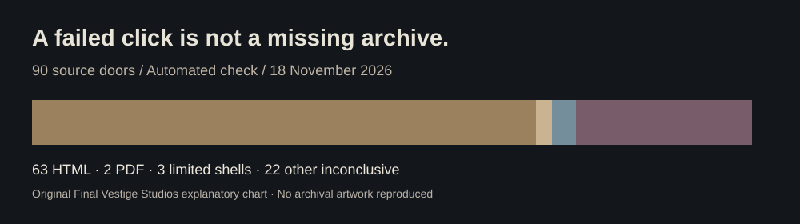

# The Door That Would Not Open
**Final Vestige Studios · Access-recovery field guide · November 18, 2026 · DRAFT / HOLD**

An archive does not vanish because one automated request receives a 403. Nor does a document become trustworthy just because its homepage loads. This research desk covers **25 of the 90 institutional entrances** that were limited or inconclusive during the latest automated sweep: 3 interactive/minimal-text shells and 22 other inconclusive requests. All original destinations remain recorded without replacement.

## What we independently established

**21 of these 25** now have an independently located institution/publisher/collection-operator reference that explains how the archive works, preserves an index, or supplies an alternate discovery path. **4 still lack a sufficiently inspected independent reference.** A search-indexed official page is not a signed-out ordinary-browser acceptance test, evidence that a particular document downloaded, a proof of completeness, or reuse permission.

## Four instructive failures

**A 404 that did not end the collection.** An automated request to [Smithsonian Open Access](https://www.si.edu/openaccess) returned 404 in one retrieval client. The institution's own [Open Access FAQ](https://www.si.edu/openaccess/faq) was nevertheless independently found, explaining how qualifying CC0 objects can be accessed. The right conclusion is that the client result is inconclusive, not that the collection was abolished or that every Smithsonian item is CC0.

**A 403 with a durable bibliographic key.** The USGS Professional Paper 1250 destination returned 403. The agency's [publication catalog](https://www.usgs.gov/publications/1980-eruptions-mount-st-helens-washington) confirms the 1981 work, its authors and DOI 10.3133/pp1250, and refers to a separate plate. Record the DOI while trying a normal browser or requesting the document.

**A JavaScript shell is not a blank archive.** NARA's [Catalog usage guide](https://www.archives.gov/research/catalog/help/using) explains the hierarchy of descriptions and digital objects. A hit to a series-level catalog entry is not evidence that the associated file or scanned item was opened.

**Too large for the tool.** The Bureau of Land Management's [cadastral tools page](https://www.blm.gov/programs/lands-and-realty/cadastral-survey/cadastral-tools) identifies the 2009 Manual of Surveying Instructions and related errata. A fetch-size ceiling says nothing about whether the book survives.

## Reader's recovery procedure

1. Copy the exact URL, the retrieval timestamp and timezone, the client used and the precise error. Do not collapse 403, 404, timeout, partial JavaScript and size cap into a generic broken-link label.
2. Open the originating institution's catalog or help page, not an unlicensed mirror. Recover a stable object identifier: record group, accession, DOI, docket number, volume, sheet, report number, document number or collection ID.
3. Search for that identifier and confirm both the containing collection and the specific item. Distinguish a catalog description, official edited collection, transcript, later analytical reconstruction and original scan.
4. If an item requires a browser, login, archivist, alternate viewer or large download, log that requirement instead of filling the evidentiary gap with a guess.
5. Save the copy's publication date, revision, page/sheet and permanent source URL. Keep observed facts separate from interpretations.
6. Check reuse conditions for the *specific item*. For example, LOC's [online Sanborn Maps collection](https://www.loc.gov/collections/sanborn-maps/about-this-collection/rights-and-access/) has an express public-domain statement, while the [Smithsonian's FAQ](https://www.si.edu/openaccess/faq) limits CC0 to qualifying designated digital assets.

## Twenty-five annotated recovery entries

### FV-RS-015 — USAspending Advanced Search

- Original entrance: https://www.usaspending.gov/search
- Automated observation: **js_or_minimal_text** (2026-11-18).
- Recovery evidence: [institution/provider reference](https://www.usaspending.gov/featured-content/spending-stories/discover-how-government-spending-supports-causes-you-care-about) (official_method).
- **What to do:** Use official Advanced Search instructions; the JavaScript search screen is not a static document.
- **Reuse:** Item-level copyright, privacy and permissions must be checked before copying scans, illustrations, photos or data.

### FV-RS-021 — ADAMS Public Documents

- Original entrance: https://www.nrc.gov/reading-rm/adams
- Automated observation: **fetch_403** (2026-11-18).
- Recovery evidence: [institution/provider reference](https://www.nrc.gov/documents-reports/adams-public-documents) (official_method).
- **What to do:** NRC now describes a cloud-based ADAMS Public Search; record accession numbers and distinguish a public item from a legacy citation.
- **Reuse:** Item-level copyright, privacy and permissions must be checked before copying scans, illustrations, photos or data.

### FV-RS-023 — Oversight.gov

- Original entrance: https://www.oversight.gov/
- Automated observation: **fetch_timeout** (2026-11-18).
- Recovery evidence: [institution/provider reference](https://www.oversight.gov/) (original_found_in_index).
- **What to do:** Official CIGIE portal independently indexed; search reports or open recommendations by agency and report number.
- **Reuse:** Item-level copyright, privacy and permissions must be checked before copying scans, illustrations, photos or data.

### FV-RS-025 — Regulations.gov

- Original entrance: https://www.regulations.gov/
- Automated observation: **fetch_403** (2026-11-18).
- Recovery evidence: not independently established in this run.
- **What to do:** No adequate institutional alternate reviewed; check the docket number in a normal browser and preserve agency, comment period and document ID.
- **Reuse:** Item-level copyright, privacy and permissions must be checked before copying scans, illustrations, photos or data.

### FV-RS-034 — The 1980 Eruptions of Mount St. Helens — Professional Paper 1250

- Original entrance: https://pubs.usgs.gov/publication/pp1250
- Automated observation: **fetch_403** (2026-11-18).
- Recovery evidence: [institution/provider reference](https://www.usgs.gov/publications/1980-eruptions-mount-st-helens-washington) (official_bibliography).
- **What to do:** USGS bibliographic entry confirms Professional Paper 1250, 1981, DOI 10.3133/pp1250, and a separate plate.
- **Reuse:** Item-level copyright, privacy and permissions must be checked before copying scans, illustrations, photos or data.

### FV-RS-043 — IPET and Hurricane Protection Decision Chronology

- Original entrance: https://www.iwr.usace.army.mil/About/History/IPET-and-HPDC-Investigations/
- Automated observation: **fetch_403** (2026-11-18).
- Recovery evidence: not independently established in this run.
- **What to do:** USACE IPET/HPDC index needs direct human-browser verification; do not claim lost records from a 403.
- **Reuse:** Item-level copyright, privacy and permissions must be checked before copying scans, illustrations, photos or data.

### FV-RS-044 — Three Mile Island Knowledge Management Digest

- Original entrance: https://www.nrc.gov/reading-rm/doc-collections/nuregs/knowledge/km0001/r1/index
- Automated observation: **fetch_403** (2026-11-18).
- Recovery evidence: [institution/provider reference](https://www.nrc.gov/documents-reports/get-copies-of-documents) (method_not_item).
- **What to do:** NRC document-access guide is confirmed, but the particular Three Mile Island digest was not inspected. Locate its NUREG number.
- **Reuse:** Item-level copyright, privacy and permissions must be checked before copying scans, illustrations, photos or data.

### FV-RS-046 — HABS / HAER / HALS

- Original entrance: https://www.loc.gov/pictures/collection/hh/
- Automated observation: **fetch_403** (2026-11-18).
- Recovery evidence: [institution/provider reference](https://www.loc.gov/collections/historic-american-buildings-landscapes-and-engineering-records/about-this-collection/) (official_collection).
- **What to do:** LOC explains HABS/HAER/HALS measured drawings, photographs and histories. Capture survey, sheet and photograph identifiers.
- **Reuse:** Item-level copyright, privacy and permissions must be checked before copying scans, illustrations, photos or data.

### FV-RS-048 — Chronicling America

- Original entrance: https://www.loc.gov/collections/chronicling-america/about-this-collection/
- Automated observation: **fetch_403** (2026-11-18).
- Recovery evidence: [institution/provider reference](https://www.loc.gov/ndnp/migration/) (official_migration).
- **What to do:** LOC documents the August 2025 Chronicling America upgrade and April 2026 OCR-page migration; search by paper, issue date and page.
- **Reuse:** Item-level copyright, privacy and permissions must be checked before copying scans, illustrations, photos or data.

### FV-RS-051 — OSTI.GOV

- Original entrance: https://www.osti.gov/
- Automated observation: **fetch_502** (2026-11-18).
- Recovery evidence: [institution/provider reference](https://www.osti.gov/search-tools) (official_method).
- **What to do:** DOE identifies OSTI.GOV as its primary R&D portal; prefer OSTI ID, report number or DOI for precise recovery.
- **Reuse:** Item-level copyright, privacy and permissions must be checked before copying scans, illustrations, photos or data.

### FV-RS-053 — Smithsonian Open Access

- Original entrance: https://www.si.edu/openaccess
- Automated observation: **fetch_404** (2026-11-18).
- Recovery evidence: [institution/provider reference](https://www.si.edu/openaccess/faq) (official_rights).
- **What to do:** Smithsonian landing page and FAQ are independently available despite one 404 fetch; only individually marked CC0 assets are freely reusable.
- **Reuse:** Item-level copyright, privacy and permissions must be checked before copying scans, illustrations, photos or data.

### FV-RS-054 — Sanborn Maps Collection

- Original entrance: https://www.loc.gov/collections/sanborn-maps/about-this-collection/
- Automated observation: **fetch_403** (2026-11-18).
- Recovery evidence: [institution/provider reference](https://www.loc.gov/collections/sanborn-maps/about-this-collection/) (official_collection).
- **What to do:** LOC explains Sanborn fire-insurance editions, sheet maps, city coverage and symbols; record city, edition, volume, and sheet.
- **Reuse:** Item-level copyright, privacy and permissions must be checked before copying scans, illustrations, photos or data.

### FV-RS-055 — National Archives Catalog

- Original entrance: https://catalog.archives.gov/
- Automated observation: **js_or_minimal_text** (2026-11-18).
- Recovery evidence: [institution/provider reference](https://www.archives.gov/research/catalog/help/using) (official_method).
- **What to do:** NARA explains archival descriptions and digital objects; a catalog entry is not necessarily the underlying scanned record.
- **Reuse:** Item-level copyright, privacy and permissions must be checked before copying scans, illustrations, photos or data.

### FV-RS-057 — International Ice Patrol Annual Reports

- Original entrance: https://www.navcen.uscg.gov/international-ice-patrol-annual-reports
- Automated observation: **fetch_403** (2026-11-18).
- Recovery evidence: [institution/provider reference](https://www.navcen.uscg.gov/international-ice-patrol-annual-reports) (original_found_in_index).
- **What to do:** USCG annual reports index is independently discoverable, including historic decade ZIPs; select the year before claiming any PDF read.
- **Reuse:** Item-level copyright, privacy and permissions must be checked before copying scans, illustrations, photos or data.

### FV-RS-065 — Congressional Research Service Products

- Original entrance: https://www.congress.gov/crs-products
- Automated observation: **fetch_restricted** (2026-11-18).
- Recovery evidence: not independently established in this run.
- **What to do:** Congress.gov CRS product portal restricted in this research client. Preserve report number/date; no specific report retrieved.
- **Reuse:** Item-level copyright, privacy and permissions must be checked before copying scans, illustrations, photos or data.

### FV-RS-067 — Federal Audit Clearinghouse

- Original entrance: https://www.fac.gov/
- Automated observation: **fetch_timeout** (2026-11-18).
- Recovery evidence: [institution/provider reference](https://www.fac.gov/welcome/) (official_transition).
- **What to do:** GSA FAC instructions distinguish October 2023 new-platform submissions from historic Census data; check filing era.
- **Reuse:** Item-level copyright, privacy and permissions must be checked before copying scans, illustrations, photos or data.

### FV-RS-068 — RECAP Archive / CourtListener

- Original entrance: https://www.courtlistener.com/recap/
- Automated observation: **fetch_403** (2026-11-18).
- Recovery evidence: [institution/provider reference](https://courtlistener.com/recap) (provider_index).
- **What to do:** RECAP's provider-run search is independently indexed. An absent RECAP hit cannot establish that a case filing never existed in PACER.
- **Reuse:** Item-level copyright, privacy and permissions must be checked before copying scans, illustrations, photos or data.

### FV-RS-073 — National Hurricane Center Data Archive

- Original entrance: https://www.nhc.noaa.gov/data/
- Automated observation: **fetch_403** (2026-11-18).
- Recovery evidence: [institution/provider reference](https://www.nhc.noaa.gov/data/) (original_found_in_index).
- **What to do:** NHC identifies tropical cyclone reports, archived advisories and later best-track data as distinct record types.
- **Reuse:** Item-level copyright, privacy and permissions must be checked before copying scans, illustrations, photos or data.

### FV-RS-077 — Manual of Surveying Instructions — 2009

- Original entrance: https://www.blm.gov/sites/default/files/Manual_Of_Surveying_Instructions_2009.pdf
- Automated observation: **fetch_too_large** (2026-11-18).
- Recovery evidence: [institution/provider reference](https://www.blm.gov/programs/lands-and-realty/cadastral-survey/cadastral-tools) (official_index).
- **What to do:** BLM identifies the large 2009 surveying manual and its errata; a client size ceiling is not document disappearance.
- **Reuse:** Item-level copyright, privacy and permissions must be checked before copying scans, illustrations, photos or data.

### FV-RS-078 — U.S. Coast Guard Light List

- Original entrance: https://www.navcen.uscg.gov/light-list-annual-publication
- Automated observation: **fetch_403** (2026-11-18).
- Recovery evidence: [institution/provider reference](https://www.navcen.uscg.gov/light-list-annual-publication) (original_found_in_index).
- **What to do:** USCG publishes annual Light List volumes and weekly corrections; record edition and correction week.
- **Reuse:** Item-level copyright, privacy and permissions must be checked before copying scans, illustrations, photos or data.

### FV-RS-081 — NOAA Historical Hurricane Tracks

- Original entrance: https://coast.noaa.gov/hurricanes/
- Automated observation: **js_or_minimal_text** (2026-11-18).
- Recovery evidence: [institution/provider reference](https://coast.noaa.gov/hurricanes/) (original_found_in_index).
- **What to do:** NOAA map and underlying dataset description were independently indexed; use a named storm, basin and version.
- **Reuse:** Item-level copyright, privacy and permissions must be checked before copying scans, illustrations, photos or data.

### FV-RS-082 — Railroad Maps, 1828–1900

- Original entrance: https://www.loc.gov/collections/railroad-maps-1828-to-1900/about-this-collection/
- Automated observation: **fetch_403** (2026-11-18).
- Recovery evidence: [institution/provider reference](https://www.loc.gov/collections/railroad-maps-1828-to-1900/about-this-collection/) (official_collection).
- **What to do:** LOC warns collection maps include promotional routes never constructed; verify target date and operating status.
- **Reuse:** Item-level copyright, privacy and permissions must be checked before copying scans, illustrations, photos or data.

### FV-RS-083 — Digital Public Library of America

- Original entrance: https://dp.la/
- Automated observation: **fetch_403** (2026-11-18).
- Recovery evidence: not independently established in this run.
- **What to do:** DPLA page not independently confirmed through an authoritative production URL here; follow to the contributing holding institution.
- **Reuse:** Item-level copyright, privacy and permissions must be checked before copying scans, illustrations, photos or data.

### FV-RS-086 — Veterans History Project Collection

- Original entrance: https://www.loc.gov/collections/veterans-history-project-collection/
- Automated observation: **fetch_disabled** (2026-11-18).
- Recovery evidence: [institution/provider reference](https://www.loc.gov/collections/veterans-history-project-collection/about-this-collection/) (official_collection).
- **What to do:** LOC notes that not every donated veterans-history collection includes a digitized recording or letter. Check item availability.
- **Reuse:** Item-level copyright, privacy and permissions must be checked before copying scans, illustrations, photos or data.

### FV-RS-088 — Biodiversity Heritage Library

- Original entrance: https://www.biodiversitylibrary.org/
- Automated observation: **fetch_403** (2026-11-18).
- Recovery evidence: [institution/provider reference](https://www.biodiversitylibrary.org/) (original_found_in_index).
- **What to do:** The BHL provider search portal was independently indexed; verify volume, page, edition and item rights.
- **Reuse:** Item-level copyright, privacy and permissions must be checked before copying scans, illustrations, photos or data.

## Reusable failed-access receipt

| Field | Researcher's entry |
|---|---|
| Institution and record title | ______________________________ |
| Exact original URL | ______________________________ |
| Date / time / timezone / retrieval client | ______________________________ |
| Observed error and request method | ______________________________ |
| Stable accession / DOI / catalog number | ______________________________ |
| Independent institutional index consulted | ______________________________ |
| Actual file, scan or edition opened (if any) | ______________________________ |
| What this version proves and does not prove | ______________________________ |
| Rights statement, licensor and restrictions | ______________________________ |
| Next action or archive staff contact | ______________________________ |

## Provenance and last-checked ledger

- Compiled against the 90-row [`research-sources-90-access-probe-2026-11-18.csv`](./research-sources-90-access-probe-2026-11-18.csv) in the existing Library draft PR. All 25 original identifiers, original URLs, titles and automated outcomes retained.
- Institutional method/reference links examined through research retrieval **2026-11-18**. The companion CSV distinguishes verified contextual page from an unverified original item.
- Explanatory SVG authored by **Final Vestige Studios**, 2026-11-18; original artwork, not an archival facsimile. No third-party images/scans/videos copied; therefore no third-party asset licenses asserted.
- Reader crosslinks: [Research Sources](https://finalvestige.com/free-resources/research-sources/) · [The Library](https://finalvestige.com/free-resources/) · [The Archive Trail](https://finalvestige.com/free-resources/the-archive-trail/) · [Editorial Standards](https://finalvestige.com/editorial-standards/).
- Outstanding **RELEASE HOLD**: genuine production WordPress theme at widths 320/390/768/1440, keyboard/screen-reader and print acceptance, per-item rights before media inclusion, live public readback, link/media health and enforceable first-publish notification suppression. Networked screenshot service provided URLs, but container DNS prevents inspectable pixel retrieval; do not claim that gate passed.
- Coordination: [issue #1788](https://github.com/finalvestigestudios/final-vestige-site-layer/issues/1788) separately tracks the live page's 90-vs-60 labels and 24/25 versus 23/26 category counters. This new asset does not change WordPress, the original 90 URLs, subscriber settings, Grok, homepage, Investigations or Preparedness.
